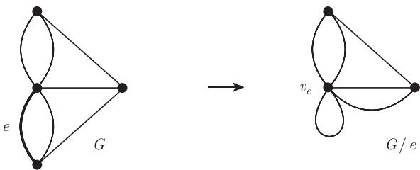
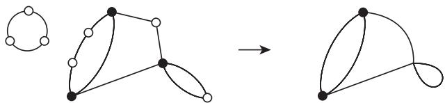

import Guide from '@/components/Guide.astro';
import Knowledge from '@/components/Knowledge.astro';
import Example from '@/components/Example.astro';
import Analysis from '@/components/Analysis.astro';
import Solution from '@/components/Solution.astro';
import Variant from '@/components/Variant.astro';
import Note from '@/components/Note.astro';
import Block from '@/components/Block.astro';
import Method from '@/components/Method.astro';
import Exercise from '@/components/Exercise.astro';

下面再介绍几个图论的概念, 也许它们在本书中用得不多, 有些甚至从未出现, 但为了本书的完整性, 也包括在本节中.

超图 (hypergraph) 是一对不相交的集合 $(V, E)$ , 其中 $E$ 的元素是 $V$ 的 (具有任意基数的) 非空子集. 因此, 图是一种特殊的超图.

有向图 (directed graph or digraph) 是由一对不相交的集合 $(V, E)$ (分别称作顶点和边) 以及两个映射 init: $E \to V$ 和 ter: $E \to V$ 组成的, 其中 init 把每条边 $e$ 映到了一个初始点 (initial vertex) init(e) 上, 而 ter 把每条边 $e$ 映到一个终点 (terminal vertex) ter(e) 上. 我们称边 $e$ 是从 init(e) 指向 (directed to) ter(e) 的. 注意到, 在有向图中, 两个顶点 $x$ 和 $y$ 之间可以有若干条边, 这样的边称为重边 (multiple edge); 如果边的方向相同 (例如从 $x$ 到 $y$ ), 则称为平行边 (parallel edge). 如果 init(e) = ter(e), 则 $e$ 叫做环边 (loop).

对于有向图 $D$ 和 (无向) 图 $G$ , 如果 $V(D) = V(G)$ , $E(D) = E(G)$ 且对每条边 $e = xy$ 有 $\{\mathrm{init}(e), \mathrm{ter}(e)\} = \{x, y\}$ , 则称 $D$ 是 $G$ 的一个定向 (orientation). 直观地看, 一个定向图 (oriented graph) 就是把一个无向图的每条边从一个端点到另一个端点给出方向而得到的图, 也可以把定向图看作没有重边和环边的有向图.

多重图 (multigraph) 是由一对不相交的集合 $(V, E)$ (称为顶点和边) 以及从 $E$ 到 $V \cup [V]^2$ 的一个映射组成的, 这里映射给每条边指定一个或两个顶点 (叫做端点 (end)). 所以, 多重图可以有重边和环边. 我们可以把多重图看作“忘记”给边定向的有向图. 如果 $x$ 和 $y$ 是边 $e$ 的端点, 我们还把它记为 $e = xy$ , 然而 $x$ 和 $y$ 也许不再唯一地确定 $e$ 了.

因此, 图是一个没有重边和环边的多重图. 令人吃惊的是, 有时证明一个关于图的定理, 对多重图来证反而会更简单. 此外, 在图论的某些领域中 (例如, 平面对偶性, 见 4.6 节和 6.5 节), 多重图会比图来得更自然, 如果坚持限制在图上反而显得不自然, 并且技巧上更复杂. 因此, 在这些情形, 我们会直接考虑多重图, 并沿用前面已引进的术语.

然而, 我们必须指出几点不同之处. 多重图中允许有长度为 1 和 2 的圈, 即环边和一对重边 (或叫做双边 (double edge)). 一个顶点上的环边的邻点就是它自身, 并且对该顶点的度贡献了 2. 在图 1.10.1 中, 有 $d(v_e) = 6$ . 在多重图 $G$ 中, 环边和平行边的端点把这些边和 $G$ 的其他部分分隔开来, 所以环边 $e$ 的端点 $v$ 是一个割点, 除非 $(\{v\}, \{e\})$ 是 $G$ 的一个分支, 这时 $(\{v\}, \{e\})$ 是 3.1 节中的“块”. 所以具有环边的多重图一定不是 2-连通的, 而 3-连通的多重图确实是一个图.

<figure class="vp-figure">
  
  <figcaption>图 1.10.1 在对应于图1.8.1的多重图中收缩边 $e$</figcaption>
</figure>

在多重图中, 边收缩要比在图中来得简单. 在多重图 $G = (V, E)$ 中, 如果把边 $e = xy$ 收缩成一个顶点 $v_e$ , 除了 $e$ 本身外, 我们不再需要删除别的边: 平行于 $e$ 的边变成了在 $v_e$ 的环边, 而边 $xv$ 和 $yv$ 变成了 $v_e$ 和 $v$ 之间的平行边 (图1.10.1). 更准确地说, $E(G / e) = E \setminus \{e\}$ , 而且只需把 $G$ 中的关联映射 $e' \mapsto \{\mathrm{init}(e'), \mathrm{ter}(e')\}$ 调整成 $G / e$ 中的新顶点集. 因此, 收缩环边和删除环边有同样的效果.

如果 v 是多重图 G 中的一个度为 2 的顶点, 则对 v 的压缩 (suppressing) 是指删除顶点 v 并把 v 的两个邻点用边连接起来. $^{13}$ (如果两个相关联的边是同一条边, 即在顶点 $v$ 的环边, 则不需添加边而只要删去顶点 $v$ 即可. 如果关联顶点 $v$ 的两条边都与同一个顶点 $w \neq v$ 关联, 则添加的新边将会是在 $w$ 的一个环边, 参照图 1.10.2.) 当 $v$ 被压缩时, 除 $v$ 外的所有顶点的度均不变化, 所以压缩若干个顶点后所得到的多重图与顶点压缩的顺序无关, 且得到的多重图是明确定义的.

<figure class="vp-figure">
  
  <figcaption>图 1.10.2 对所有的白顶点进行压缩</figcaption>
</figure>

最后, 应当指出, 习惯于研究多重图的学者通常把它称为 “图”, 在他们的术语中, 本书中的图被称作 “简单图”.
