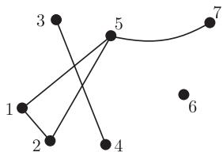
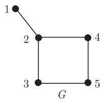
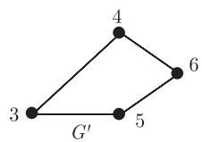
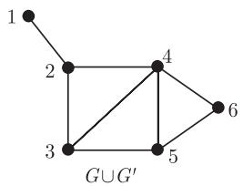
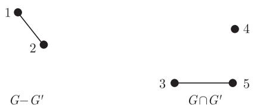
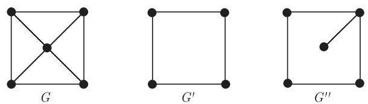
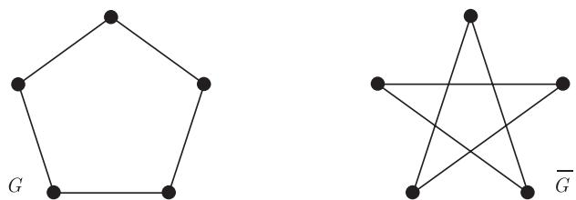

import Guide from '@/components/Guide.astro';
import Knowledge from '@/components/Knowledge.astro';
import Example from '@/components/Example.astro';
import Analysis from '@/components/Analysis.astro';
import Solution from '@/components/Solution.astro';
import Variant from '@/components/Variant.astro';
import Note from '@/components/Note.astro';
import Block from '@/components/Block.astro';
import Method from '@/components/Method.astro';
import Exercise from '@/components/Exercise.astro';

这一章将对后面用到的术语给出简要的介绍. 幸运的是, 大部分图论术语都很直观且容易记忆, 对于那些需要更多背景知识的术语, 我们会在后面适当的时候再进行介绍.

1.1 节对图论中最基本的概念给出了简洁而完整的介绍, 这些概念是围绕着图这一中心展开的, 大部分读者可能已经接触过这些概念或在阅读本书前已经有所了解. 基于此, 1.1 节将对基本的概念给出必要的解释但不赘述, 其主要的目的是把最基本的概念集于一处, 以便于将来参考和查阅. 关于多重图的各种变化, 参见 1.10 节.

从 1.2 节起, 所有的新定义都会由数个简单而基本的命题引出. 通常这些新定义和新引进的术语密切相关: 一个图的不变量问题如何影响到另一个图论问题, 尽早地熟悉这样的思考方式将有利于后面的学习.

我们用 $\mathbb{N}$ 表示包括零在内的自然数的集合. 模 $n$ 整数集 $\mathbb{Z}/n\mathbb{Z}$ 记为 $\mathbb{Z}_n$, 其元素记作 $\bar{i} := i + n\mathbb{Z}$; 当我们把 $\mathbb{Z}_2 = \{\bar{0}, \bar{1}\}$ 看作一个域时, 也把它记作 $\mathbb{F}_2 = \{0, 1\}$. 对实数 $x$, 我们用 $\lfloor x \rfloor$ 表示小于或等于 $x$ 的最大整数, 用 $\lceil x \rceil$ 表示大于或等于 $x$ 的最小整数. 以 2 为底的对数函数记为 “$\log$”, 而自然对数函数记为 “$\ln$”. 给定集合 $A$, 以及它的互不相交的子集 $A_1, \dots, A_k$, 如果对每个 $i$ 均有 $A_i \neq \varnothing$ 并且 $\bigcup_{i=1}^k A_i = A$, 则称集合 $\mathcal{A} = \{A_1, \dots, A_k\}$ 为 $A$ 的一个划分 (partition). 给定 $A$ 的另一个划分 $\{A'_1, A'_2, \dots, A'_\ell\}$, 如果每个 $A'_i$ 都包含于某个 $A_j$ 中, 则称 $\mathcal{A}'$ 为 $\mathcal{A}$ 的细化 (refine). 我们用 $[A]^k$ 表示集合 $A$ 的所有 $k$-元子集. 另外, 有 $k$ 个元素的集合称为 $k$-集 ($k$-set), 而 $k$ 个元素的子集称为 $k$-子集 ($k$-subset).

## 1.1 图

图 (graph) $G = (V, E)$ 是一个二元组 $(V, E)$ 使得 $E \subseteq [V]^2$, 所以 $E$ 的元素是 $V$ 的 2-元子集. 为了避免符号上的混淆, 我们总是默认 $V \cap E = \varnothing$. 集合 $V$ 中的元素称为图 $G$ 的顶点 (vertex)(或节点 (node)、点 (point)), 而集合 $E$ 的元素称为边 (edge)(或线 (line)). 通常, 描绘一个图的方法是把顶点画成一个小圆圈, 如果相应的顶点之间有一条边, 就用一条线连接这两个小圆圈. 如何绘制这些小圆圈和连线是无关紧要的, 重要的是要正确体现哪些顶点对之间有边, 哪些顶点对之间没有边.

<figure class="vp-figure">
  
  <figcaption>图 1.1.1 顶点集为 $V = \{1, 2, \dots, 7\}$，边集为 $E = \{\{1, 2\}, \{1, 5\}, \{2, 5\}, \{3, 4\}, \{5, 7\}\}$ 的图</figcaption>
</figure>

具有顶点集 $V$ 的图亦称为 $\pmb{V}$ 上的图 (a graph on $V$). 图 $G$ 的顶点集记为 $V(G)$, 边集记为 $E(G)$. 这些约定俗成与这两个集合的记法是独立的: 图 $H = (W, F)$ 的顶点集 $W$ 仍记为 $V(H)$ 而不是 $W(H)$. 我们通常并不把一个图和它的顶点集或边集严格地区分开来, 比如, 我们称一个顶点 $v \in G$ (而不是 $v \in V(G)$), 一条边 $e \in G$, 等等.

一个图的顶点个数称为它的阶 (order), 记为 $|G|$, 它的边数记为 $\|G\|$. 根据图的阶, 我们把图分为有限的 (finite)、无限的 (infinite) 或可数的 (countable), 等等. 除第 8 章以外, 在所有章节中除非特别说明, 我们总是假定图是有限的.

对于空图 (empty graph) $(\varnothing, \varnothing)$, 我们简记为 $\varnothing$. 阶为 0 或 1 的图称为平凡的 (trivial). 有时, 比如当使用归纳法时, 平凡图会很有用; 而在其他一些情形中, 它会成为无聊的反例或麻烦事. 为了避免全书通篇充斥着非平凡性条件的假定, 对于平凡图尤其是空图 $\varnothing$, 我们将省略讨论.

给定顶点 $v$ 和边 $e$, 如果 $v \in e$, 则称 $v$ 与 $e$ 关联 (incident), 从而 $e$ 是在 (at) $v$ 的边. 关联同一条边的两个顶点称为这条边的端点 (endvertex) 或顶端 (end), 而这条边连接 (join) 它的两个端点. 边 $\{x, y\}$ 通常记为 $xy$ (或 $yx$). 如果 $x \in X$ 且 $y \in Y$, 则称边 $xy$ 为一条 $X - Y$ 边 ($X - Y$ edge); 集合 $E$ 中所有 $X - Y$ 边的集合, 记为 $E(X, Y)$; 而 $E(\{x\}, Y)$ 和 $E(X, \{y\})$ 会简记为 $E(x, Y)$ 和 $E(X, y)$. $E$ 中所有和顶点 $v$ 关联的边记为 $E(v)$.

如果 $\{x, y\}$ 是 $G$ 的一条边, 则称两个顶点 $x$ 和 $y$ 是相邻的 (adjacent) 或邻点 (neighbour); 如果两条边 $e \neq f$ 有一个公共端点, 则称 $e$ 和 $f$ 是相邻的. 若 $G$ 的所有顶点都是两两相邻的, 则称 $G$ 是完全的 (complete). $n$ 个顶点的完全图记为 $K^n$; $K^3$ 称为三角形 (triangle).

互不相邻的顶点或边称为独立顶点或独立边 (independent vertex/edge). 更正式地, 若一个顶点集或边集中没有两个元素是相邻的, 则该集合称为独立集 (independent set); 独立的顶点集也称作稳定集 (stable set).

设 $G = (V, E)$ 和 $G' = (V', E')$ 是两个图, 如果从 $G$ 到 $G'$ 的映射 $\varphi: V \to V'$ 保留顶点的关联性, 即只要 $\{x, y\} \in E$ 就有 $\{\varphi(x), \varphi(y)\} \in E'$, 那么我们称 $\varphi$ 是一个同态 (homomorphism). 特别地, 对于 $\varphi$ 的象中的每个顶点 $x'$, 它的逆映象 $\varphi^{-1}(x')$ 是 $G$ 中的一个独立集. 如果 $\varphi$ 是一个双射, 同时它的逆 $\varphi^{-1}$ 也是一个同态 (即对于任意 $x, y \in V$, 有 $xy \in E \Leftrightarrow \varphi(x)\varphi(y) \in E'$), 我们称 $\varphi$ 是一个同构 (isomorphism), 或者称 $G$ 和 $G'$ 是同构的, 并记作 $G \simeq G'$. 从 $G$ 到自身的同构是一个自同构 (automorphism). 通常情况下我们并不区别同构的图, 所以同构的图常记为 $G = G'$ 而不是 $G \simeq G'$. 比如, 我们会称 17 个顶点的完全图, 等等. 如果我们想强调只对给定图的同构类感兴趣, 就会非正式地称它为抽象图 (abstract graph).

在同构意义下封闭的图族叫做图性质 (graph property). 比如, “包含三角形”就是一个图性质: 如果 $G$ 包含三个两两相邻的顶点, 则每个同构于 $G$ 的图亦有此性质. 对于图上的一个映射, 如果对每个同构图它均取相同的值, 则这样的映射称为一个图不变量 (graph invariant). 一个图的顶点数和边数就是两个简单的图不变量; 图中两两相邻的最大顶点数也是图不变量.

我们记 $G \cup G' := (V \cup V', E \cup E')$ 及 $G \cap G' := (V \cap V', E \cap E')$. 若 $G \cap G' = \varnothing$, 则称 $G$ 和 $G'$ 是不交的 (disjoint); 如果 $V' \subseteq V$ 且 $E' \subseteq E$, 则称 $G'$ 是 $G$ 的子图 (subgraph)(并称 $G$ 是 $G'$ 的母图 (supergraph)), 记作 $G' \subseteq G$. 非正式地, 我们称 $G$ 包含 (contain) $G'$. 若 $G' \subseteq G$ 且 $G' \neq G$, 则称 $G'$ 是 $G$ 的真子图 (proper subgraph).

若 $G' \subseteq G$ 且 $G'$ 包含了 $E$ 中所有满足 $x, y \in V'$ 的边 $xy$, 则称 $G'$ 是 $G$ 的导出子图 (induced subgraph), 或称 $V'$ 在图 $G$ 中导出 (induce) 或支撑 (span) $G'$, 并记为 $G' =: G[V']$. 因此, 对任意顶点集 $U \subseteq V$, $G[U]$ 表示定义在 $U$ 上的图, 它的边恰好是 $G$ 中那些两个端点均在 $U$ 中的边. 如果 $H$ 是 $G$ 的子图 (不必是导出子图), 我们简记 $G[V(H)]$ 为 $G[H]$. 最后, 如果 $V'$ 支撑 $G$ 的所有顶点, 即 $V' = V$, 则称 $G'$ 是 $G$ 的一个支撑子图 (spanning subgraph).

<figure class="vp-figure">
  
  
  
  
  <figcaption>图 1.1.2 图的并、差和交; 顶点 2,3,4 在 $G \cup G'$ 中导出 (或支撑) 一个三角形, 但在 $G$ 中则不导出三角形</figcaption>
</figure>

<figure class="vp-figure">
  
  <figcaption>图 1.1.3 图 $G$ 的子图 $G'$ 和 $G''$: $G'$ 是 $G$ 的导出子图, 但 $G''$ 不是</figcaption>
</figure>

设 $U$ 是 $G$ 的任意一个顶点集合, 我们把 $G[V \setminus U]$ 简记为 $G - U$. 换句话说, $G - U$ 是从 $G$ 中删除 $U \cap V$ 中所有顶点以及相关联的边而得到的图. 如果 $U = \{v\}$ 是个单点集, 我们把 $G - \{v\}$ 简记为 $G - v$; 而把 $G - V(G')$ 简单地记作 $G - G'$. 对于 $[V]^2$ 的一个子集 $F$, 我们记 $G - F := (V, E \setminus F)$ 和 $G + F := (V, E \cup F)$; 同上, $G - \{e\}$ 和 $G + \{e\}$ 分别简记为 $G - e$ 和 $G + e$. 对于一个给定的图性质, 若 $G$ 本身具有此性质, 而它的任意母图 $(V, F)$ (即 $F \supsetneq E$) 却不具有此性质, 则我们称 $G$ 关于此性质是边极大的 (edge-maximal).

更一般地, 当我们称一个图对于某性质是极大的 (maximal) 或极小的 (minimal), 但没有强调具体的序关系时, 我们均指子图关系. 当提到顶点集或边集的极大性或极小性时, 均指集合的包含关系.

如果 $G$ 和 $G'$ 是不交的, 那么 $G * G'$ 表示在 $G \cup G'$ 中连接 $G$ 的所有顶点到 $G'$ 的所有顶点而得到的图. 比如, $K^2 * K^3 = K^5$. 图 $G$ 的补图 (complement) $\overline{G}$ 是 $V$ 上边集为 $[V]^2 \setminus E$ 的图. 图 $G$ 的线图 (line graph) $L(G)$ 是 $E$ 上的图, 它的顶点集是 $E$ 且使得 $x, y \in E$ 是相邻的当且仅当它们作为边在 $G$ 中是相邻的.

<figure class="vp-figure">
  
  <figcaption>图 1.1.4 一个与其补图同构的图</figcaption>
</figure>
