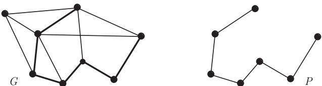
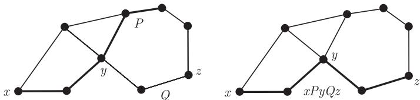
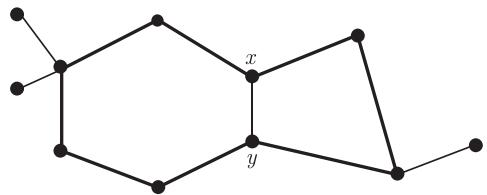
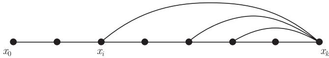

import Guide from '@/components/Guide.astro';
import Knowledge from '@/components/Knowledge.astro';
import Example from '@/components/Example.astro';
import Analysis from '@/components/Analysis.astro';
import Solution from '@/components/Solution.astro';
import Variant from '@/components/Variant.astro';
import Note from '@/components/Note.astro';
import Block from '@/components/Block.astro';
import Method from '@/components/Method.astro';
import Exercise from '@/components/Exercise.astro';

路 (path) $P = (V, E)$ 是一个非空图, 其顶点集和边集分别为

$$
V = \{x_0, x_1, \dots, x_k\}, \quad E = \{x_0 x_1, x_1 x_2, \dots, x_{k-1} x_k\},
$$

这里所有的 $x_i$ 均互不相同. 顶点 $x_0$ 和 $x_k$ 由路 $P$ 连接 (link), 并称它们为路的端点 (endvertex) 或顶端 (end); 而 $x_1, \dots, x_{k-1}$ 称为 $P$ 的内部 (inner) 顶点. 一条路上的边数称为路的长度 (length), 长度为 $k$ 的路记为 $P^k$. 注意到, 我们允许 $k$ 为零, 所以 $P^0 = K^1$.

<figure class="vp-figure">
  
  <figcaption>图 1.3.1 $G$ 中的路 $P = P^6$</figcaption>
</figure>

我们经常用顶点的自然顺序排列表示路, 记为 $P = x_0 x_1 \cdots x_k$, 并称 $P$ 是一条从 (from) $x_0$ 到 (to) $x_k$ 的路 (或 $x_0$ 和 $x_k$ 之间 (between) 的路).

对 $0 \leqslant i \leqslant j \leqslant k$, 记 $P$ 的各种子路如下:

$$
\begin{aligned}
P x_i &:= x_0 \cdots x_i, \\
x_i P &:= x_i \cdots x_k, \\
x_i P x_j &:= x_i \cdots x_j,
\end{aligned}
$$

以及

$$
\begin{aligned}
\mathring{P} &:= x_1 \cdots x_{k-1}, \\
P \mathring{x}_i &:= x_0 \cdots x_{i-1}, \\
\mathring{x}_i P &:= x_{i+1} \cdots x_k, \\
\mathring{x}_i P \mathring{x}_j &:= x_{i+1} \cdots x_{j-1}.
\end{aligned}
$$

我们用类似的直观方法来表示路的串联, 比如, 如果三条路的并 $Px \cup xQy \cup yR$ 还是一条路, 则可简记为 $PxQyR$.

<figure class="vp-figure">
  
  <figcaption>图 1.3.2 路 $P$, $Q$ 和 $xPyQz$</figcaption>
</figure>

给定顶点集 $A$ 和 $B$ 以及路 $P = x_0 x_1 \cdots x_k$, 如果 $V(P) \cap A = \{x_0\}$ 且 $V(P) \cap B = \{x_k\}$, 则称 $P$ 为一条 $A-B$ 路 ($A-B$ path); 同前面一样, 把 $\{a\}-B$ 路记作 $a-B$ 路, 等等. 对于两条或以上的路, 如果其中任意一条路不包含另一条路的内部顶点, 则称它们是独立路 (independent path). 例如, 两条 $a-b$ 路是独立的当且仅当 $a$ 和 $b$ 是其唯一的公共顶点.

给定图 $H$, 如果路 $P$ 是非平凡的且只与 $H$ 在端点接触, 则称 $P$ 是一条 $H$-路 ($H$-path). 特别地, 任何长度为 1 的 $H$-路的边不可能是 $H$ 的边.

若 $P = x_0 \cdots x_{k-1}$ 是一条路且 $k \geqslant 3$, 则称图 $C := P + x_{k-1} x_0$ 为圈 (cycle). 与路一样, 我们经常用顶点的 (循环) 序列来表示一个圈; 上面提到的圈 $C$ 可以表示为 $x_0 x_1 \cdots x_{k-1} x_0$. 圈中的边数 (或顶点数) 称为长度 (length), 长度为 $k$ 的圈亦称为 $k$-圈 ($k$-cycle) 并记为 $C^k$.

图 $G$ 中最短圈的长度叫做围长 (girth), 记为 $g(G)$, 而 $G$ 中最长圈的长度称为周长 (circumference). (若 $G$ 中不含圈, 则围长设为 $\infty$ 而周长为零.) 图中不在圈上但连接圈中两个顶点的边称为这个圈的弦 (chord), 所以 $G$ 的导出圈 (induced cycle) 是不含弦的圈 (即 $G$ 的导出子图是个圈, 见图 1.3.3).

<figure class="vp-figure">
  
  <figcaption>图 1.3.3 具有弦 $xy$ 的圈 $C^8$ 及导出圈 $C^6$ 和 $C^4$</figcaption>
</figure>

若一个图的最小度较大, 则它一定包含较长的路和圈 (也可参考练习 9).

<Knowledge title="命题 1.3.1">
如果 $\delta(G) \geqslant 2$, 则图 $G$ 包含一条长度为 $\delta(G)$ 的路和长度至少为 $\delta(G) + 1$ 的圈.

<Solution title="证明">
设 $x_0 \cdots x_k$ 为 $G$ 的一条最长路, 那么 $x_k$ 的所有邻点均在这条路上 (图 1.3.4), 所以 $k \geqslant d(x_k) \geqslant \delta(G)$. 如果 $i < k$ 是满足 $x_i x_k \in E(G)$ 的极小的下标, 则 $x_i \cdots x_k x_i$ 是长度至少为 $\delta(G) + 1$ 的圈.

<figure class="vp-figure">
  
  <figcaption>图 1.3.4 最长路 $x_0 \cdots x_k$ 和 $x_k$ 的邻点</figcaption>
</figure>

∎
</Solution>
</Knowledge>

另一方面, 除非顶点个数是固定的, 最小度和围长并不相关: 在第 11 章中将看到, 存在具有任意大最小度和任意大围长的图.

图 $G$ 中两个顶点 $x, y$ 之间的距离 (distance) $d_G(x, y)$ 定义为 $G$ 中最短 $x-y$ 路的长度; 如果这样的路不存在, 则令 $d(x, y) := \infty$. 图 $G$ 中所有顶点对之间的距离最大值称为 $G$ 的直径 (diameter), 记为 $\operatorname{diam} G$. 当然, 直径和围长是密切相关的.

<Knowledge title="命题 1.3.2">
任意包含至少一个圈的图 $G$ 满足 $g(G) \leqslant 2\operatorname{diam} G + 1$.

<Solution title="证明">
设 $C$ 为 $G$ 的一个最短圈. 如果 $g(G) \geqslant 2\operatorname{diam} G + 2$, 则 $C$ 包含两个顶点使得它们在 $C$ 中的距离至少是 $\operatorname{diam} G + 1$. 在 $G$ 中, 这两个顶点之间的距离更短, 而连接它们之间的最短路 $P$ 不是 $C$ 的子图, 所以 $P$ 包含一条 $C$-路 $xPy$. 将 $C$ 中两条 $x-y$ 路中短的一条与路 $xPy$ 连接在一起, 将形成一个比 $C$ 更短的圈, 矛盾. ∎
</Solution>
</Knowledge>

图 $G$ 的中心点 (central vertex) 是指能使得它到任何其他顶点的距离尽可能小的顶点, 这个最短距离称作半径 (radius) 并记为 $\operatorname{rad} G$. 所以, 严格地说,

$$
\operatorname{rad} G = \min_{x \in V(G)} \max_{y \in V(G)} d_G(x, y).
$$

作为练习, 不难验证

$$
\operatorname{rad} G \leqslant \operatorname{diam} G \leqslant 2 \operatorname{rad} G.
$$

若对图的阶不作任何限制, 那么直径和半径同最小度、平均度及最大度之间并不存在内在联系. 但是, 同时具有较大直径和最小度的图一定有较大的阶 (比两个参数中的单个对阶的影响更大, 参考练习 10), 而同时具有较小直径和最大度的图一定有较小的阶.

<Knowledge title="命题 1.3.3">
设 $G$ 是一个半径至多为 $k$ 且最大度至多为 $d \geqslant 3$ 的图, 则 $G$ 的顶点个数小于 $\frac{d}{d - 2} (d - 1)^k$.

<Solution title="证明">
设 $z$ 是 $G$ 的一个中心点而 $D_i$ 是 $G$ 中到 $z$ 的距离为 $i$ 的顶点集, 则 $V(G) = \bigcup_{i=0}^k D_i$. 显然, $|D_0| = 1$ 且 $|D_1| \leqslant d$. 对每个 $i \geqslant 1$, 因为 $D_{i+1}$ 中的每个顶点均为 $D_i$ 中某个顶点的邻点 (为什么?), 且 $D_i$ 的每个顶点在 $D_{i+1}$ 中至多有 $d-1$ 个邻点 (由于它还有一个邻点在 $D_{i-1}$ 中), 所以 $|D_{i+1}| \leqslant (d-1)|D_i|$. 对所有 $i < k$ 用归纳假设, 我们有 $|D_{i+1}| \leqslant d(d-1)^i$, 这蕴含着

$$
|G| \leqslant 1 + d \sum_{i = 0}^{k - 1} (d - 1)^i = 1 + \frac{d}{d - 2} ((d - 1)^k - 1) < \frac{d}{d - 2} (d - 1)^k.
$$

∎
</Solution>
</Knowledge>

类似地, 假设 $G$ 的最小度和围长均较大, 我们可找到 $G$ 的阶的下界. 对 $d \in \mathbb{R}$ 和 $g \in \mathbb{N}$, 设

$$
n_0(d, g) := \begin{cases}
1 + d \sum_{i = 0}^{r - 1} (d - 1)^i, & g =: 2r + 1 \text{ 为奇数}, \\
2 \sum_{i = 0}^{r - 1} (d - 1)^i, & g =: 2r \text{ 为偶数}.
\end{cases}
$$

不难证明, 具有最小度 $\delta$ 和围长 $g$ 的图有至少 $n_0(\delta, g)$ 个顶点 (练习 7). 更有趣的是平均度亦有相同的界.

<Knowledge title="定理 1.3.4 (Alon, Hoory and Linial, 2002)">
设 $G$ 是一个图, 如果 $d(G) \geqslant d \geqslant 2$ 且 $g(G) \geqslant g \in \mathbb{N}$, 则 $|G| \geqslant n_0(d, g)$.
</Knowledge>

定理 1.3.4 保证了一个相对于 $|G|$ 的较短圈的存在性. 运用练习 7 中最小度的情形, 我们得到以下更一般的界:

<Knowledge title="推论 1.3.5">
若 $\delta(G) \geqslant 3$, 则 $g(G) < 2 \log |G|$.

<Solution title="证明">
如果 $g := g(G)$ 是偶数, 则

$$
n_0(3, g) = 2 \frac{2^{g / 2} - 1}{2 - 1} = 2^{g / 2} + (2^{g / 2} - 2) > 2^{g / 2};
$$

当 $g$ 是奇数时,

$$
n_0(3, g) = 1 + 3 \frac{2^{(g - 1) / 2} - 1}{2 - 1} = \frac{3}{\sqrt{2}} 2^{g / 2} - 2 > 2^{g / 2}.
$$

因为 $|G| \geqslant n_0(3, g)$, 故结论成立. ∎
</Solution>
</Knowledge>

图 $G$ 中长度为 $k$ 的途径 (walk) 是一个非空的顶点和边的交错序列 $v_0 e_0 v_1 e_1 \cdots e_{k-1} v_k$, 使得对于所有 $i < k$ 均有 $e_i = \{v_i, v_{i+1}\}$. 若 $v_0 = v_k$, 则称此途径是闭的 (closed). 如果途径中的顶点互不相同, 显然我们得到 $G$ 中的一条路. 一般地, 两个顶点之间的任意途径包含这两个顶点间一条路 (如何证明?).
