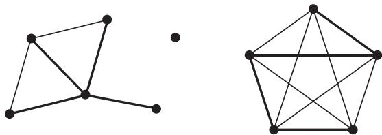
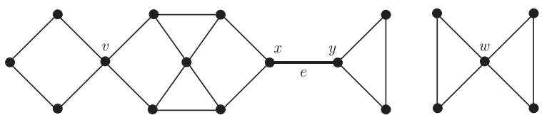
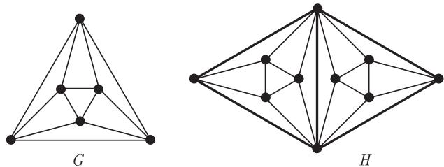

import Guide from '@/components/Guide.astro';
import Knowledge from '@/components/Knowledge.astro';
import Example from '@/components/Example.astro';
import Analysis from '@/components/Analysis.astro';
import Solution from '@/components/Solution.astro';
import Variant from '@/components/Variant.astro';
import Note from '@/components/Note.astro';
import Block from '@/components/Block.astro';
import Method from '@/components/Method.astro';
import Exercise from '@/components/Exercise.astro';

如果非空图 $G$ 中的任意两个顶点之间均有一条路相连, 我们称 $G$ 是连通的 (connected). 若 $U \subseteq V(G)$ 且 $G[U]$ 是连通的, 则称 (在 $G$ 中) $U$ 本身是连通的.

<Knowledge title="命题 1.4.1">
连通图 $G$ 的顶点总可以排序成 $v_1, v_2, \dots, v_n$ 使得对每个 $i$ 均有 $G_i := G[v_1, \dots, v_i]$ 是连通的.

<Solution title="证明">
取任意顶点作为 $v_1$. 对于某个 $i < |G|$, 归纳地假设顶点 $v_1, \dots, v_i$ 已取定, 现在来选取一个顶点 $v \in G - G_i$. 因为 $G$ 是连通的, 所以它包含一条 $v - v_1$ 路 $P$. 选取路 $P$ 在 $G - G_i$ 中的最后一个顶点为 $v_{i+1}$, 则 $v_{i+1}$ 在 $G_i$ 中有一个邻点. 根据归纳法, 可得出每个 $G_i$ 的连通性. ∎
</Solution>
</Knowledge>

设 $G = (V, E)$ 是一个图, 则它的极大连通子图称为分支 (component). 显然, 分支都是导出子图且它们的顶点集划分 $V$. 因为连通图是非空的, 所以空图没有分支.

<figure class="vp-figure">
  
  <figcaption>图 1.4.1 具有三个分支的图以及每个分支中的极小支撑连通子图</figcaption>
</figure>

给定 $A, B \subseteq V$ 和 $X \subseteq V \cup E$, 如果 $G$ 的每条 $A - B$ 路均包含 $X$ 中的一个顶点或一条边, 则我们称在 $G$ 中 $X$ 分离 (separate) 集合 $A$ 和 $B$. 注意到, 这蕴含着 $A \cap B \subseteq X$. 若两个顶点 $a, b \notin X$ 且 $X$ 分离 $\{a\}, \{b\}$, 则称 $X$ 分离顶点 $a, b$; 如果 $X$ 分离 $G$ 中的两个顶点, 就称 $X$ 分离 $G$. 顶点所形成的分离集合亦称为分隔 (separator). 边的分离集合没有通用的名称, 但某些这样的集合会有专用名称, 例如, 1.9 节中的割 (cut) 和键 (bond). 如果一个顶点分离同一个分支中的两个顶点, 则称它为割点 (cutvertex), 而桥 (bridge) 则为分离其两个端点的边, 所以图中的桥恰为那些不在任何圈中的边.

<figure class="vp-figure">
  
  <figcaption>图 1.4.2 具有割点 $v, x, y, w$ 和割边 $e = xy$ 的图</figcaption>
</figure>

如果 $A \cup B = V$ 且 $G$ 没有 $A \setminus B$ 和 $B \setminus A$ 之间的边, 则无序对 $\{A, B\}$ 称为 $G$ 的分离 (separation). 显然, 第二个条件等于说, $A \cap B$ 分离 $A$ 和 $B$. 若 $A \setminus B$ 和 $B \setminus A$ 均非空, 则称这个分离是真的 (proper), 而 $|A \cap B|$ 叫做分离 $\{A, B\}$ 的阶 (order), 集合 $A, B$ 叫做分离的侧面 (side).

若 $|G| > k \in \mathbb{N}$, 且对任意满足 $|X| < k$ 的子集 $X \subseteq V$ 均有 $G - X$ 是连通的, 则称 $G$ 是 $k$-连通的 ($k$-connected). 换言之, $G$ 中任意两个顶点都不能被少于 $k$ 个其他顶点所分离. 所有 (非空) 图都是 0-连通的; 而 1-连通图恰为那些非平凡连通图. 使得 $G$ 是 $k$-连通的最大整数 $k$ 称为 $G$ 的连通度 (connectivity) 并记为 $\kappa(G)$. 所以, $\kappa(G) = 0$ 当且仅当 $G$ 是不连通的或是 $K^1$. 对于任意 $n \geqslant 1$ 均有 $\kappa(K^n) = n - 1$.

若 $|G| > 1$ 且对任意少于 $\ell$ 条边的集合 $F \subseteq E$, $G - F$ 均是连通的, 则称 $G$ 是 $\ell$-边连通的 ($\ell$-edge-connected). 使得 $G$ 为 $\ell$-边连通的最大整数 $\ell$ 叫做 $G$ 的边连通度 (edge-connectivity) 并记为 $\lambda(G)$. 特别地, 若 $G$ 是不连通的, 则 $\lambda(G) = 0$.

<figure class="vp-figure">
  
  <figcaption>图 1.4.3 具有 $\kappa (G) = \lambda (G) = 4$ 的八面体 $G$ 和具有 $\kappa (H) = 2$ 而 $\lambda (H) = 4$ 的图 $H$</figcaption>
</figure>

<Knowledge title="命题 1.4.2">
若 $G$ 是非平凡的, 则 $\kappa(G) \leqslant \lambda(G) \leqslant \delta(G)$.

<Solution title="证明">
因为关联一个固定顶点的所有边分离 $G$, 所以第二个不等式显然成立. 为证明第一个, 设 $F$ 是包含 $\lambda(G)$ 条边的集合使得 $G - F$ 不连通. 由 $\lambda$ 的定义知, 这样的集合总是存在的. 注意到, $F$ 是 $G$ 中的一个极小边分离集, 我们证明 $\kappa(G) \leqslant |F|$.

假设 $G$ 包含一个顶点 $v$, 它不和 $F$ 中的任何边关联. 设 $C$ 是 $G - F$ 中包含 $v$ 的分支, 则 $C$ 中关联 $F$ 的某条边的顶点会分离 $v$ 和 $G - C$. 因为 $F$ 中不存在两个端点均在 $C$ 上的边 (由 $F$ 的极小性得), 所以至多有 $|F|$ 个这样的顶点, 从而证明了 $\kappa(G) \leqslant |F|$.

其次, 假设 $G$ 中每个顶点均关联 $F$ 的某条边. 设 $v$ 是任意顶点而 $C$ 是 $G - F$ 中包含 $v$ 的分支, 则 $v$ 的满足 $vw \notin F$ 的邻点 $w$ 一定属于 $C$ 并关联 $F$ 中不同的边 (同样由 $F$ 的极小性得), 所以 $d_G(v) \leqslant |F|$. 由于 $N_G(v)$ 把 $v$ 和 $G$ 的其他顶点分离开, 这蕴含着 $\kappa(G) \leqslant |F|$, 除非不存在其他顶点, 即 $\{v\} \cup N(v) = V$. 但在这种情况下, 由 $v$ 的任意性得, $G$ 是完全图, 即 $\kappa(G) = \lambda(G) = |G| - 1$. ∎
</Solution>
</Knowledge>

从命题 1.4.2 可看到, 高连通度的图必有大的最小度; 但反过来, 大的最小度不一定能保证高连通度, 甚至不能确保高边连通度 (读者能否找到这样的例子呢?), 但它可保证高连通子图的存在性.

<Knowledge title="定理 1.4.3 (Mader, 1972)">
设 $0 \neq k \in \mathbb{N}$. 任意满足 $d(G) \geqslant 4k$ 的图 $G$ 均包含一个 $(k+1)$-连通的子图 $H$ 使得 $\varepsilon(H) > \varepsilon(G) - k$.

<Solution title="证明">
令 $\gamma := \varepsilon(G) (\geqslant 2k)$, 考虑满足以下条件的子图 $G' \subseteq G$

$$
|G'| \geqslant 2k \quad \text{和} \quad \|G'\| > \gamma (|G'| - k). \tag{$*$}
$$

因为 $G$ 本身满足 $(*)$, 所以这样的 $G'$ 一定存在. 设 $H$ 是其中一个具有最小阶的子图.

不存在满足 $(*)$ 且正好阶为 $2k$ 的图 $G'$, 否则这蕴含着 $\|G'\| > \gamma k \geqslant 2k^2 > \binom{|G'|}{2}$. 所以由 $H$ 的极小性推出 $\delta(H) > \gamma$; 否则, 我们总可以去掉一个度数不超过 $\gamma$ 的顶点而得到满足 $(*)$ 的子图 $G' \subsetneq H$. 特别地, 我们有 $|H| \geqslant \gamma$. 对 $(*)$ 中不等式 $\|H\| > \gamma |H| - \gamma k$ 两边除以 $|H|$, 我们得到所期待的 $\varepsilon(H) > \gamma - k$.

余下需证 $H$ 是 $(k + 1)$-连通的. 若不成立, 则 $H$ 有一个阶不超过 $k$ 的真分离 $\{U_1, U_2\}$, 令 $H[U_i] =: H_i$. 因为任意顶点 $v \in U_1 \setminus U_2$, 它的所有 $d(v) \geqslant \delta(H) > \gamma$ 个邻点均在 $H_1$ 中, 所以 $|H_1| \geqslant \gamma \geqslant 2k$. 类似地, 可以得到 $|H_2| \geqslant 2k$. 根据 $H$ 的极小性, $H_1$ 和 $H_2$ 均不满足 $(*)$, 所以对 $i = 1, 2$, 可以得到

$$
\|H_i\| \leqslant \gamma (|H_i| - k).
$$

但是

$$
\begin{aligned}
\|H\| &\leqslant \|H_1\| + \|H_2\| \\
&\leqslant \gamma(|H_1| + |H_2| - 2k) \\
&\leqslant \gamma(|H| - k) \quad (\text{因为 } |H_1 \cap H_2| \leqslant k),
\end{aligned}
$$

上式对于 $H$ 和 $(*)$ 产生矛盾. ∎
</Solution>
</Knowledge>
