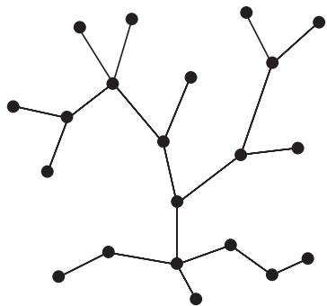
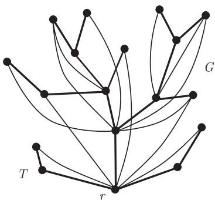

import Guide from '@/components/Guide.astro';
import Knowledge from '@/components/Knowledge.astro';
import Example from '@/components/Example.astro';
import Analysis from '@/components/Analysis.astro';
import Solution from '@/components/Solution.astro';
import Variant from '@/components/Variant.astro';
import Note from '@/components/Note.astro';
import Block from '@/components/Block.astro';
import Method from '@/components/Method.astro';
import Exercise from '@/components/Exercise.astro';

一个无圈 (acyclic) 图, 即不含任何圈的图, 亦称为森林 (forest), 而连通的森林则称为树 (tree). (所以, 森林是分支为树的图.) 树中度为 1 的顶点称为叶子 (leaf), 而其他顶点称为内部顶点. 每个非平凡的树都有叶子, 比如, 最长路的端点. 这一简单的结论有时会很有用, 尤其是对树使用归纳法时: 去掉树的一个叶子, 剩下的图还是一棵树.

<figure class="vp-figure">
  
  <figcaption>图 1.5.1 一棵树</figcaption>
</figure>

<Knowledge title="定理 1.5.1">
对于图 $T$, 下列命题是等价的:

(i) $T$ 是一棵树;

(ii) $T$ 中任意两个顶点被 $T$ 的唯一一条路连接;

(iii) $T$ 是极小连通的, 即 $T$ 是连通的但对任意边 $e \in T$, $T - e$ 是不连通的;

(iv) $T$ 是极大无圈的, 即 $T$ 不包含圈但对任意两个不相邻的顶点 $x, y \in T$, $T + xy$ 包含圈.
</Knowledge>

定理 1.5.1 可以容易地证明, 但对不熟悉树以及相关概念的人却是一道很好的练习题. 沿用 1.3 节中关于路的记号, 我们把树 $T$ 中的两个顶点 $x, y$ 之间的唯一路记为 $xTy$ (见 (ii)).

定理 1.5.1 的一个常用推论是: 每个连通图均包含一棵支撑树. 要证明这个结论, 只需取定一个极小连通支撑子图, 然后运用 (iii); 或者取定一个极大无圈子图, 然后运用 (iv). 图 1.4.1 给出了具有三个分支的图及每个分支的支撑树. 当 $T$ 是 $G$ 的一棵支撑树时, $E(G) \setminus E(T)$ 中的边是 $T$ 在 $G$ 中的弦 (chord).

<Knowledge title="推论 1.5.2">
一棵树的顶点总可以被列举为 $v_1, \dots, v_n$ 使得每个 $v_i (i \geqslant 2)$ 在 $\{v_1, \dots, v_{i-1}\}$ 中有唯一的邻点.

<Solution title="证明">
运用命题 1.4.1 来列举顶点, 即可得到. ∎
</Solution>
</Knowledge>

<Knowledge title="推论 1.5.3">
$n$ 个顶点的连通图是一棵树当且仅当它有 $n - 1$ 条边.

<Solution title="证明">
在推论 1.5.2 中, 对 $i$ 用归纳法得, 由前面的 $i$ 个顶点支撑的子图具有 $i - 1$ 条边. 令 $i = n$, 我们证明了必要性. 反过来, 设 $G$ 是任意具有 $n$ 个顶点和 $n - 1$ 条边的连通图, 而 $G'$ 是 $G$ 的一棵支撑树. 由必要性, 树 $G'$ 有 $n - 1$ 条边, 所以有 $G = G'$. ∎
</Solution>
</Knowledge>

<Knowledge title="推论 1.5.4">
若 $T$ 是一棵树, 而 $G$ 是满足 $\delta(G) \geqslant |T| - 1$ 的任意图, 则 $T \subseteq G$, 即 $G$ 包含一个同构于 $T$ 的子图.

<Solution title="证明">
根据推论 1.5.2 给出的列举顺序, 我们可以归纳地找到 $G$ 中 $T$ 的拷贝. ∎
</Solution>
</Knowledge>

有时, 把树中的一个顶点作特别处理会方便问题的解决, 这个顶点称为树的根 (root), 而具有固定根 $r$ 的树叫做有根树 (rooted tree). 我们把 $x \in rTy$ 记为 $x \leqslant y$, 从而定义了 $V(T)$ 上的一个偏序关系, 我们称它是与 $T$ 和 $r$ 关联的树序 (tree-order). 这种序可看作是用“高度”来刻画的: 若 $x < y$, 则称 $x$ 在 $T$ 中位于 $y$ 之下 (below), 而

$$
\lceil y \rceil := \{x \mid x \leqslant y\} \quad \text{和} \quad \lfloor x \rfloor := \{y \mid y \geqslant x\}
$$

分别称为 $y$ 的下闭包 (down-closure) 和 $x$ 的上闭包 (up-closure). 如果集合 $X \subseteq V(T)$ 等于它自身的上闭包, 即满足 $X = \lfloor X \rfloor := \bigcup_{x \in X} \lfloor x \rfloor$, 则称它在 $T$ 中是上闭的 (up-closed) 或是一个上集合 (up-set); 类似地, 可以定义下闭的 (down-closed) 或下集合 (down-set), 等等.

注意到, $T$ 的根是这个偏序关系中最小的元素, 叶子是极大元素, 而 $T$ 的任意边的两个端点是可比的, 任意顶点的下闭包是一条链 (chain), 即两两可比较的元素的集合. (如何证明呢?) 到根的距离为 $k$ 的顶点具有高度 (height) $k$, 并组成 $T$ 的第 $k$ 层 (level).

对包含于 $G$ 中的有根树 $T$, 如果 $G$ 中的任意 $T$-路的两个端点在 $T$ 的树序中是可比的, 我们称有根树 $T$ 在 $G$ 中是正规的 (normal). 若 $T$ 支撑 $G$, 这等于是要求: 只要两个顶点在 $G$ 中是相邻的, 它们在 $T$ 中一定是可比的 (图 1.5.2).

<figure class="vp-figure">
  
  <figcaption>图 1.5.2 具有根 $r$ 的正规支撑树</figcaption>
</figure>

图 $G$ 的正规树 $T$ 可以成为研究 $G$ 的结构的强有力工具, 这是因为 $G$ 表现了 $T$ 的分离性质:

<Knowledge title="引理 1.5.5">
设 $T$ 是 $G$ 中的一棵正规树.

(i) 任意两个在树中不可比较的顶点 $x, y \in T$ 在 $G$ 中被集合 $\lceil x \rceil \cap \lceil y \rceil$ 分离.

(ii) 若 $S \subseteq V(T) = V(G)$ 且 $S$ 是下闭的, 设 $x$ 是 $T - S$ 中的极小元, 则这些集合 $\lfloor x \rfloor$ 支撑 $G - S$ 的所有分支.

<Solution title="证明">
(i) 设 $P$ 是 $G$ 中的任意 $x - y$ 路, 我们欲证明 $P$ 和 $\lceil x \rceil \cap \lceil y \rceil$ 相交. 设 $t_1, \dots, t_n$ 是 $P \cap T$ 的极小顶点序列, 它满足 $t_1 = x, t_n = y$ 且对所有 $i$, $t_i$ 和 $t_{i+1}$ 在 $T$ 的树序中是可比的. (这样的序列总是存在的: 因为 $T$ 是正规的, 而且每个路段 $t_i P t_{i+1}$ 要么是 $T$ 的边, 要么是一个 $T$-路, 所以 $P \cap T$ 中所有顶点的集合 (根据它们在 $P$ 中出现的自然顺序) 具有这个性质.) 在这个极小序列中, 对任何 $i$ 不可能存在关系 $t_{i-1} < t_i > t_{i+1}$; 否则, $t_{i-1}$ 和 $t_{i+1}$ 是可比的, 去掉 $t_i$ 可形成一个更短的这种序列. 所以, 对某个 $k \in \{1, \dots, n\}$, 有

$$
x = t_1 > \dots > t_k < \dots < t_n = y.
$$

因为 $t_k \in \lceil x \rceil \cap \lceil y \rceil \cap V(P)$.

(ii) 考虑 $G - S$ 的一个分支 $C$, 设 $x$ 是 $C$ 的顶点集的极小元, 那么 $V(C)$ 没有其他的极小元 $x'$; 否则, $x$ 和 $x'$ 是不可比较的. 由 (i) 知 $C$ 中的任意 $x - x'$ 路包含一个处于 $x$ 和 $x'$ 之下的顶点, 这与它们在 $V(C)$ 中的极小性矛盾. 由于 $C$ 的每个顶点处于 $V(C)$ 的某个极小元之上, 所以它位于 $x$ 之上. 反过来, 每个顶点 $y \in \lfloor x \rfloor$ 属于 $C$ 中, 这是因为 $S$ 是下闭的, 向上的路 $xTy$ 处于 $T - S$ 中, 从而 $V(C) = \lfloor x \rfloor$.

下一步证明 $x$ 不仅在 $V(C)$ 中是极小的, 在 $T - S$ 中亦然. 处于 $x$ 下面的顶点组成 $T$ 的一个链 $\lceil t \rceil$. 因为 $t$ 是 $x$ 的邻点, $C$ 作为 $G - S$ 的分支, 它的极大性蕴含着 $t \in S$, 所以 $\lceil t \rceil \subseteq S$ (因为 $S$ 是下闭的), 从而证明了 $G - S$ 的每个分支由集合 $\lfloor x \rfloor$ 支撑着, 这里 $x$ 是 $T - S$ 中的极小元.

反过来, 如果 $x$ 是 $T - S$ 中的任意极小元, 显然它在所处的 $G - S$ 的分支 $C$ 中也是极小元, 因此 $V(C) = \lfloor x \rfloor$, 即 $\lfloor x \rfloor$ 支撑这个分支. ∎
</Solution>
</Knowledge>

正规支撑树也叫做深度优先搜索树 (depth-first search tree), 这是因为它和图的计算机搜索相关 (练习 26). 这个事实常用来证明存在性, 它也可以通过更为简洁和漂亮的归纳法来证明 (练习 25). 然而, 下面给出的构造证明很好地反映了正规树是如何揭示了主图的结构的.

<Knowledge title="命题 1.5.6">
设定任意顶点为根, 每个连通图均包含一棵正规支撑树.

<Solution title="证明">
设 $G$ 是一个连通图, 而 $T$ 是 $G$ 中取任意顶点 $r$ 为根的极大正规树, 我们需要证明 $V(T) = V(G)$.

用反证法. 设 $C$ 是 $G - T$ 的一个分支. 因为 $T$ 是正规的, 所以 $N(C)$ 是 $T$ 中一个链. 设 $x$ 是链中最大元, 而 $y \in C$ 是邻接 $x$ 的顶点. 令 $T'$ 是在 $T$ 中连接 $x$ 和 $y$ 而得到的树, 则 $T$ 的树序可推广到 $T'$ 上. 下面我们证明 $T'$ 亦为 $G$ 中的一棵正规树, 从而得到矛盾.

设 $P$ 为 $G$ 中一条 $T'$-路. 若 $P$ 的端点均在 $T$ 中, 则它们在 $T$ 的树序中 (从而也在 $T'$ 的树序中) 是可比的, 这是因为 $P$ 也是 $T$-路以及由假设知 $T$ 在 $G$ 中是正规的. 否则, $y$ 是 $P$ 的一个端点, 因此除了 $P$ 的另一端点 $z$ 以外, $P$ 本身位于 $C$ 中, 而 $z$ 则在 $N(C)$ 中. 由 $x$ 的选择知 $z \leqslant x$. 为了证明 $y$ 和 $z$ 是可比的, 我们只需要说明 $x < y$, 即 $x \in rT'y$, 而这是显然的, 因为 $y$ 是邻接 $x$ 的 $T'$ 中的叶子. ∎
</Solution>
</Knowledge>
