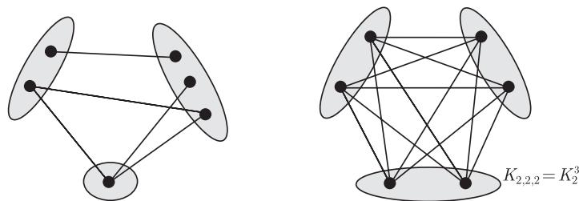
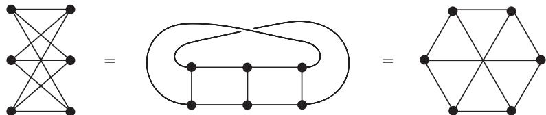
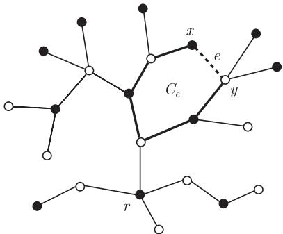

import Guide from '@/components/Guide.astro';
import Knowledge from '@/components/Knowledge.astro';
import Example from '@/components/Example.astro';
import Analysis from '@/components/Analysis.astro';
import Solution from '@/components/Solution.astro';
import Variant from '@/components/Variant.astro';
import Note from '@/components/Note.astro';
import Block from '@/components/Block.astro';
import Method from '@/components/Method.astro';
import Exercise from '@/components/Exercise.astro';

设 $r \geqslant 2$ 是一个整数, 对于图 $G = (V, E)$, 如果 $V$ 可以划分为 $r$ 个类使得任意一条边的端点都属于不同的类中 (即同一类中的顶点不相邻), 则称 $G$ 为 $r$-部图 ($r$-partite graph). 通常我们把 2-部图称为二部图 (bipartite graph).

若 $r$-部图中, 不同类中任意两个顶点均相邻接, 则称它为完全 $r$-部图 (complete $r$-partite graph). 所有的 $r$-部图被统称为完全多部图 (complete multipartite graph). 我们把完全 $r$-部图 $\overline{K^{n_1}} * \cdots * \overline{K^{n_r}}$ 记为 $K_{n_1, \dots, n_r}$; 当 $n_1 = \cdots = n_r =: s$ 时, 可简记为 $K_s^r$. 所以 $K_s^r$ 是一个每个类都恰好有 $s$ 个顶点的完全 $r$-部图 (图 1.6.1 中第二个是八面体 $K_2^3$, 注意这里的画法和图 1.4.3 的画法有所不同). 图类 $K_{1, n}$ 也叫做星 (star), 其中 $K_{1, n}$ 中度数为 $n$ 的顶点称为星的中心 (centre).

<figure class="vp-figure">
  
  <figcaption>图 1.6.1 两个 3-部图</figcaption>
</figure>

<figure class="vp-figure">
  
  <figcaption>图 1.6.2 二部图 $K_{3,3} = K_3^2$ 的三种不同画法</figcaption>
</figure>

显然, 任意二部图不能包含长度为奇数的圈, 即奇圈 (odd cycle). 事实上, 二部图可用这个性质来刻画:

<Knowledge title="命题 1.6.1">
一个图是二部图当且仅当它不包含奇圈.

<Solution title="证明">
设 $G = (V, E)$ 是一个不含奇圈的图, 我们证明 $G$ 是二部的. 显然, 如果图的各个分支是二部的或平凡的, 则它是二部的, 所以我们可以假设 $G$ 是连通的. 设 $T$ 是 $G$ 的一棵支撑树, 并取定根 $r \in T$, 我们用 $\leqslant_T$ 来表示 $V$ 上的树序. 对于任意顶点 $v \in V$, 唯一路 $rTv$ 具有奇数或偶数长度; 根据奇偶性, 从而可以定义 $V$ 上的一个划分. 下面证明 $G$ 是具有这一划分的二部图.

设 $e = xy$ 是 $G$ 中的任意边. 如果 $e \in T$, 比如 $x <_T y$, 则 $rTy = rTxy$, 所以 $x$ 和 $y$ 分属不同的划分类. 如果 $e \notin T$, 那么 $C_e := xTy + e$ 是一个圈 (图 1.6.3). 由前面的讨论知, $xTy$ 上的顶点交错地属于两个不同的划分类. 由假定知, $C_e$ 是个偶圈, 所以 $x$ 和 $y$ 也属于不同的划分类.

<figure class="vp-figure">
  
  <figcaption>图 1.6.3 $T + e$ 中的圈 $C_e$</figcaption>
</figure>

∎
</Solution>
</Knowledge>
