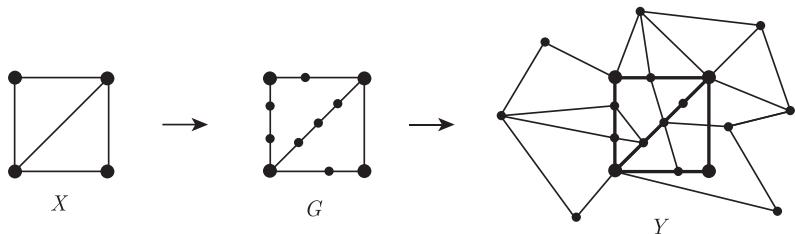
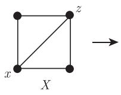
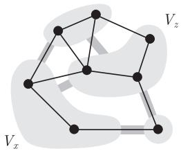
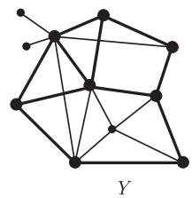
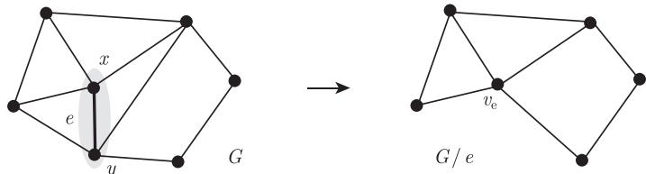
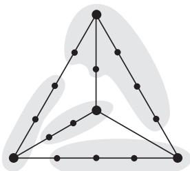

import Guide from '@/components/Guide.astro';
import Knowledge from '@/components/Knowledge.astro';
import Example from '@/components/Example.astro';
import Analysis from '@/components/Analysis.astro';
import Solution from '@/components/Solution.astro';
import Variant from '@/components/Variant.astro';
import Note from '@/components/Note.astro';
import Block from '@/components/Block.astro';
import Method from '@/components/Method.astro';
import Exercise from '@/components/Exercise.astro';

在 1.1 节中, 我们已看到图之间的两种基本包含关系, 即 “子图” 关系和 “导出子图” 关系. 本节将会介绍另外两种关系: “子式” 关系和 “拓扑子式” 关系. 设 $X$ 是一个固定的图.

非正式地, 对 $X$ 中的某些或全部边进行 “细分”, 即在这些边上插入若干新的顶点, 这样所得到的图叫做 $X$ 的细分 (subdivision). 换句话说, 把 $X$ 中的某些边替换成具有相同端点的路, 使得这些路的内点既不在 $V(X)$ 中, 也不在其他任何新的路上. 当 $G$ 是 $X$ 的细分时, 我们亦称 $G$ 是一个 $TX$. $X$ 中原始顶点是 $TX$ 的分支顶点 (branch vertices), 新的顶点叫做细分顶点 (subdividing vertices). 注意到, 细分顶点的度总是 2, 而分支顶点保持了它在 $X$ 中的顶点度.

如果 $Y$ 包含 $TX$ 作为子图, 那么 $X$ 是 $Y$ 的拓扑子式 (topological minor) (图 1.7.1).

<figure class="vp-figure">
  
  <figcaption>图 1.7.1 图 $G$ 是一个 $TX$, 即 $X$ 的细分. 因为 $G \subseteq Y$, 故 $X$ 是 $Y$ 的拓扑子式</figcaption>
</figure>

类似地, 把 $X$ 的每个顶点 $x$ 由不相交的连通图 $G_x$ 代替, $X$ 的边 $xy$ 由 $G_x - G_y$ 边的非空集合代替, 所得到的图叫做 $IX$. 更严格地讲, 如果图 $G$ 的顶点集可以划分成连通子集 $V_x$ 的集合 $\{V_x \mid x \in V(X)\}$ 使得不同的顶点 $x, y \in X$ 在 $X$ 中是邻接的, 当且仅当 $G$ 包含一条 $V_x - V_y$ 边, 则称 $G$ 是一个 $IX$; 集合 $V_x$ 是 $IX$ 的分支集 (branch set). 反过来, 我们说 $X$ 是由 $G$ 收缩子图 $G_x$ 而得到的, 称其为 $G$ 的收缩子式 (contraction minor).

若图 $Y$ 包含 $IX$ 子图, 则称 $X$ 是 $Y$ 的子式 (minor), 而 $IX$ 是 $Y$ 中 $X$ 的模型 (model), 记作 $X \preccurlyeq Y$ (图 1.7.2). 因此 $X$ 是 $Y$ 的子式当且仅当存在从 $V(Y)$ 的子集到 $V(X)$ 上的映射 $\varphi$ 使得对每个顶点 $x \in X$, 它的原象 $\varphi^{-1}(x)$ 在 $Y$ 中是连通的, 同时对每条边 $xx' \in X$, 存在 $Y$ 中的一条边连接分支集合 $\varphi^{-1}(x)$ 和 $\varphi^{-1}(x')$. 如果 $\varphi$ 的定义域是整个 $V(Y)$, 且只要 $x \neq x'$ 就有 $xx' \in X$ 且 $Y$ 包含 $\varphi^{-1}(x)$ 和 $\varphi^{-1}(x')$ 之间的边 (因此 $Y$ 是一个 $IX$), 则称 $\varphi$ 是 $Y$ 到 $X$ 的收缩 (contraction).

<figure class="vp-figure">
  
  
  
  <figcaption>图 1.7.2 图 $G$ 是 $Y$ 中 $X$ 的一个模型, 因此 $X$ 是 $Y$ 的一个子式</figcaption>
</figure>

因为分支集可能是单点集, 所以图的每个子图也是它的一个子式. 在无限图中, 分支集也允许是无限的. 例如, 图 8.1.1 中的图是具有无限星形 $X$ 的 $IX$.

<Knowledge title="命题 1.7.1">
子式关系 $\preccurlyeq$ 和拓扑子式关系均为有限图类上的偏序关系, 即它满足自反性、反对称性及传递性.
</Knowledge>

如果 $G$ 是一个 $IX$, 那么 $\mathcal{P} = \{V_x \mid x \in X\}$ 是 $V(G)$ 的一个划分, 对 $G$ 的这个收缩子式, 记为 $X =: G / \mathcal{P}$. 如果 $U = V_x$ 是唯一的非单点分支集, 则把 $X$ 记为 $X =: G / U$, 把 $U$ 收缩成的顶点 $x \in X$ 记为 $v_U$, 然后把 $X$ 的余下部分看成 $G$ 的导出子图. “最小”的非平凡情形是当 $U$ 恰好包含一条边 $e$ 的两个端点, 使得 $U = e$, 那么我们称 $X = G / e$ 是由 $G$ 收缩边 $e$ (contracting the edge $e$) 而得到的, 见图 1.7.3.

<figure class="vp-figure">
  
  <figcaption>图 1.7.3 收缩边 $e$ 的过程</figcaption>
</figure>

因为子式关系具有传递性, 任何一系列单独顶点或单独边的删除或者收缩都产生一个子式. 反之, 一个有限图的每个子式都可以通过这种方式得到:

<Knowledge title="推论 1.7.2">
设 $X$ 和 $Y$ 是有限图, 那么 $X$ 是 $Y$ 的子式当且仅当存在图 $G_0, \dots, G_n$ 使得 $G_0 = Y, G_n = X$ 且每个 $G_{i+1}$ 是由 $G_i$ 通过删除一条边、收缩一条边或者删除一个顶点而得到的.

<Solution title="证明">
对 $|Y| + \|Y\|$ 用归纳法. ∎
</Solution>
</Knowledge>

最后, 我们给出下面这个子式和拓扑子式之间的关系.

<Knowledge title="命题 1.7.3">
(i) 每个 $TX$ 也是一个 $IX$ (图 1.7.4), 所以, 图的每个拓扑子式也是它的一个 (普通) 子式.

(ii) 若 $\Delta(X) \leqslant 3$, 则每个 $IX$ 包含一个 $TX$, 因此, 最大度至多为 3 的子式也是一个拓扑子式.
</Knowledge>

<figure class="vp-figure">
  
  <figcaption>图 1.7.4 $K^4$ 的细分可看作一个 $IK^4$</figcaption>
</figure>

到这里, 我们已经介绍了图中所有的常用关系, 也可以定义什么叫做一个图嵌入另一个图中. 基本上, 图 $G$ 在 $H$ 中的嵌入 (embedding) 是一个单射 $\varphi: V(G) \to V(H)$, 它保持某种我们感兴趣的图结构. 所以, $\varphi$ 把 $G$ “作为子图”嵌入到 $H$ 中意味着 $\varphi$ 保持了顶点的邻接性; “导出子图”嵌入则意味着 $\varphi$ 既保持了顶点的邻接性, 也保持了非邻接性. 如果 $\varphi$ 是定义在 $E(G)$ 和 $V(G)$ 上的, 并且把 $G$ 的边 $xy$ 映射到 $H$ 中连接 $\varphi(x)$ 和 $\varphi(y)$ 的独立路上, 则称 $G$ 是嵌入 $H$ 中的“拓扑子式”. 类似地, $\varphi$ 把 $G$ 作为“子式”嵌入到 $H$ 中是指, $\varphi$ 是从 $V(G)$ 到 $H$ 中不相交连通顶点子集 (而不是到单个顶点) 的一个映射, 使得对于 $G$ 的任意边 $xy$, $H$ 都有一条连接集合 $\varphi(x)$ 和 $\varphi(y)$ 的边. 根据研究的对象, 可以引进不同的嵌入, 比如, 可以类似地定义“作为支撑子图”“作为导出子式”等嵌入.
