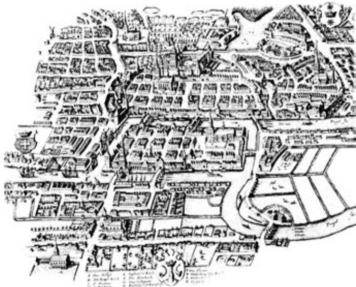
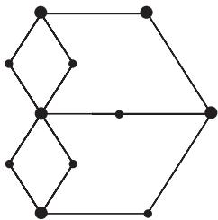

import Guide from '@/components/Guide.astro';
import Knowledge from '@/components/Knowledge.astro';
import Example from '@/components/Example.astro';
import Analysis from '@/components/Analysis.astro';
import Solution from '@/components/Solution.astro';
import Variant from '@/components/Variant.astro';
import Note from '@/components/Note.astro';
import Block from '@/components/Block.astro';
import Method from '@/components/Method.astro';
import Exercise from '@/components/Exercise.astro';

任何数学家, 如果他有幸在 18 世纪身处东普鲁士城市柯尼斯堡 (Königsberg), 都会毫不犹豫地追随伟大数学家欧拉 (Euler), 去寻找一种往返旅行方法使得古城的每一座桥恰好被穿行一次 (图 1.8.1).

<figure class="vp-figure">
  
  <figcaption>图 1.8.1 柯尼斯堡七桥地图 (约 1736 年)</figcaption>
</figure>

由此启发, 我们称一个通过图的每条边恰好一次的闭途径为欧拉环游 (Euler tour). 如果一个图包含一个欧拉环游, 就称它是欧拉的 (Eulerian).

<figure class="vp-figure">
  
  <figcaption>图 1.8.2 七桥问题所对应的图</figcaption>
</figure>

<Knowledge title="定理 1.8.1 (Euler, 1736)">
一个连通图是欧拉的当且仅当它的每个顶点度是偶数.

<Solution title="证明">
度条件显然是充分的: 如果一个顶点在欧拉环游中出现 $k$ 次 (对于起始点和终结点, 我们考虑了两次, 所以可看作 $k + 1$ 次), 则它的度一定是 $2k$.

反过来, 我们对 $\|G\|$ 用归纳法, 证明顶点度均为偶数的连通图 $G$ 一定有欧拉环游. 对于 $\|G\| = 0$, 显然成立. 设 $\|G\| \geqslant 1$, 因为所有的顶点度是偶数, 所以我们可以找到一个非平凡的闭途径, 它包含每条边最多一次. (如何做到的呢?) 设 $W$ 是最长的一条这样的闭途径, 把 $W$ 的边集记为 $F$. 如果 $F = E(G)$, 那么 $W$ 是一条欧拉环游. 否则, $G' := G - F$ 包含至少一条边.

对于每个顶点 $v \in G$, 在 $F$ 中有偶数条边关联 $v$, 因此 $G'$ 的所有顶点的度还是偶数. 因为 $G$ 是连通的, $G'$ 中存在一条边 $e$ 关联 $W$ 中的某个顶点. 由归纳假设, $G'$ 中包含 $e$ 的分支 $C$ 有欧拉环游. 把这个欧拉环游嫁接到 $W$ 上 (通过适当地重新排序), 我们得到 $G$ 中一条更长的闭途径, 与 $W$ 的最大性矛盾. ∎
</Solution>
</Knowledge>
