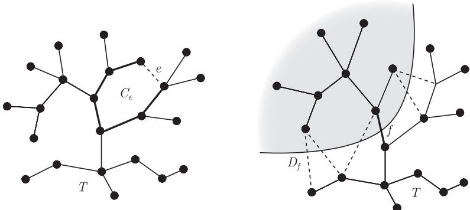

import Guide from '@/components/Guide.astro';
import Knowledge from '@/components/Knowledge.astro';
import Example from '@/components/Example.astro';
import Analysis from '@/components/Analysis.astro';
import Solution from '@/components/Solution.astro';
import Variant from '@/components/Variant.astro';
import Note from '@/components/Note.astro';
import Block from '@/components/Block.astro';
import Method from '@/components/Method.astro';
import Exercise from '@/components/Exercise.astro';

设 $G = (V, E)$ 是一个具有 $n$ 个顶点和 $m$ 条边的图, 这里 $V = \{v_1, \dots, v_n\}$ 和 $E = \{e_1, \dots, e_m\}$. 图 $G$ 的顶点空间 (vertex space) $\mathcal{V}(G)$ 是由所有从 $V$ 到 $\mathbb{F}_2$ 上的函数组成的向量空间 (这里 $\mathbb{F}_2 = \{0, 1\}$ 是一个二元域). $\mathcal{V}(G)$ 的每个元素自然地对应于 $V$ 的一个子集, 即具有函数值 1 的那些顶点所组成的集合, 而 $V$ 的每个子集都由它在 $\mathcal{V}(G)$ 中的指示函数唯一地表示. 所以, 我们可以把 $\mathcal{V}(G)$ 看作由 $V$ 的幂集构成的向量空间: 两个顶点集 $U, U' \subseteq V$ 的和 $U + U'$ 定义为它们的对称差 (为什么呢?), 且对于任意 $U \subseteq V$, 有 $U = -U$. 空 (顶点) 集 $\varnothing$ 可以看作 $\mathcal{V}(G)$ 中的零元. 因为 $\{\{v_1\}, \dots, \{v_n\}\}$ 构成 $\mathcal{V}(G)$ 的一组基 (称作标准基 (standard basis)), 故 $\dim \mathcal{V}(G) = n$.

同样地, 从 $E$ 到 $\mathbb{F}_2$ 的所有函数构成了 $G$ 的边空间 (edge space) $\mathcal{E}(G)$: $E$ 的子集对应于它的元素, 向量加法采用对称差运算, $\varnothing \subseteq E$ 是零元, 且对任意 $F \subseteq E$ 有 $F = -F$. 同理, $\{\{e_1\}, \dots, \{e_m\}\}$ 是 $\mathcal{E}(G)$ 的标准基 (standard basis), 故 $\dim \mathcal{E}(G) = m$. 给定边空间中的两个元素 $F$ 和 $F'$, 把它们看作从 $E$ 到 $\mathbb{F}_2$ 的函数, 我们记

$$
\langle F, F' \rangle := \sum_{e \in E} F(e) F'(e) \in \mathbb{F}_2.
$$

上式等于零当且仅当 $F$ 和 $F'$ 有偶数条公共边; 特别地, 若 $F \neq \varnothing$, 则 $\langle F, F \rangle = 0$. 给定 $\mathcal{E}(G)$ 的子空间 $\mathcal{F}$, 记

$$
\mathcal{F}^\perp := \{D \in \mathcal{E}(G) \mid \text{对所有 } F \in \mathcal{F} \text{ 满足 } \langle F, D \rangle = 0\}.
$$

上面的集合构成 $\mathcal{E}(G)$ 的一个子空间 (所有满足某线性方程组的向量所构成的空间. 你能找出这些线性方程吗?), 我们可以证明

$$
\dim \mathcal{F} + \dim \mathcal{F}^\perp = m.
$$

圈空间 (cycle space) $\mathcal{C} = \mathcal{C}(G)$ 是由 $G$ 中所有圈 (更准确地说, 是所有圈的边) 支撑的 $\mathcal{E}(G)$ 的子空间. $\mathcal{C}(G)$ 的维数有时称为 $G$ 的圈数 (cyclomatic number).

$\mathcal{C}$ 的元素可以容易地由其所涉及的子图的顶点度来识别. 此外, 为了生成圈空间, 我们不需要考虑所有圈的对称差, 而只需要考虑圈的不交并即可.

<Knowledge title="命题 1.9.1">
对于边集 $D \subseteq E$, 下面的命题是等价的:

(i) $D \in \mathcal{C}(G)$;

(ii) $D$ 是 $G$ 中若干圈 (边集) 的不交并 (可以是空的);

(iii) 图 $(V, D)$ 的所有顶点度均为偶数.

<Solution title="证明">
因为圈上的顶点度均为偶数, 而且对称差运算保持这一性质, 所以对生成 $D$ 的圈的个数用归纳法可以证明蕴含关系 $(\mathrm{i}) \to (\mathrm{iii})$. 蕴含关系 $(\mathrm{iii}) \to (\mathrm{ii})$ 可对 $|D|$ 用归纳法来证明: 如果 $D \neq \varnothing$, 则 $(V, D)$ 包含一个圈 $C$, 删除 $C$ 的边再应用归纳假设即可. 蕴含关系 $(\mathrm{ii}) \to (\mathrm{i})$ 可以由 $\mathcal{C}(G)$ 的定义直接得到. ∎
</Solution>
</Knowledge>

如果存在 $V$ 的一个划分 $\{V_1, V_2\}$, 使得 $F = E(V_1, V_2)$, 那么我们称边集 $F$ 是 $G$ 的一个割 (cut); $F$ 中的边横穿 (cross) 这个划分; 集合 $V_1$ 和 $V_2$ 是这个割的侧面 (side). 前面提到, 当 $V_1 = \{v\}$ 时, 这个割记为 $E(v)$. $G$ 中的极小非空割是一个键.

<Knowledge title="命题 1.9.2">
图 $G$ 中的所有割和 $\varnothing$ 一起构成 $\mathcal{E}(G)$ 的一个子空间 $\mathcal{B} = \mathcal{B}(G)$, 这个空间是由形式为 $E(v)$ 的割所生成的.

<Solution title="证明">
用 $\mathcal{B}$ 表示形式为 $E(v)$ 的割所生成的 $\mathcal{E}(G)$ 的子空间. 例如, 关于顶点划分 $\{V_1, V_2\}$, $G$ 的所有割等于 $\sum_{v \in V_1} E(v)$, 所以属于 $\mathcal{B}$. 反过来, 每一个集合 $\sum_{u \in U} E(u) \in \mathcal{B}$ 要么是空集 (例如, 当 $U \in \{\varnothing, V\}$ 时), 要么是割 $E(U, V \setminus U)$. ∎
</Solution>
</Knowledge>

命题 1.9.2 中的空间 $\mathcal{B}$ 是 $G$ 的一个割空间 (cut space) 或者键空间. 不难从所有的割 $E(v)$ 中找到 $\mathcal{B}$ 的显式基, 从而确定它的维数 (见练习 40). 注意到, $\mathcal{B}$ 中的键就像 $\mathcal{C}$ 中的圈一样, 是空间的极小非空元素.

这里, “非空”的条件只有当 $G$ 是非连通时才重要. 如果 $G$ 是连通的, 则它的键恰好就是那些极小割, 它们可以很容易被识别: 连通图的割是极小的当且仅当对应的顶点划分的两侧面均导出连通子图 (练习 36). 如果 $G$ 是非连通的, 则它的键是其分支的极小割.

类似于命题 1.9.1, 键和它的不交并可以生成割空间.

<Knowledge title="引理 1.9.3">
每个割是键的不交并.

<Solution title="证明">
设 $F$ 是一个割, 对 $F$ 的边数用归纳法. 对于 $F = \varnothing$, 结论是平凡的 (即零个并). 如果 $F \neq \varnothing$ 本身不是一个键, 则它严格地包含某个非空割 $F'$, 由命题 1.9.2, $F \setminus F' = F + F'$ 是一个更小的非空割. 由归纳假设, $F'$ 和 $F \setminus F'$ 都是键的不交并, 所以 $F$ 也是键的不交并. ∎
</Solution>
</Knowledge>

练习 39 给出了如何构造引理 1.9.3 中键的明确方法. 在 3.1 节, 我们会给出在图的整体结构中, 圈和键所处的可能位置的更多细节 (引理 3.1.2 和引理 3.1.3).

<Knowledge title="定理 1.9.4">
图的圈空间 $\mathcal{C}$ 和割空间 $\mathcal{B}$ 满足

$$
\mathcal{C} = \mathcal{B}^\perp \quad \text{和} \quad \mathcal{B} = \mathcal{C}^\perp.
$$

<Solution title="证明">
给定图 $G = (V, E)$, 显然 $G$ 的每个圈在每个割中都包含割的偶数条边, 这意味着 $\mathcal{C} \subseteq \mathcal{B}^\perp$ 和 $\mathcal{B} \subseteq \mathcal{C}^\perp$.

接下来证明 $\mathcal{B}^\perp \subseteq \mathcal{C}$. 由命题 1.9.1 知, 对于任意一个边集 $F \notin \mathcal{C}$, 存在一个顶点 $v$ 关联 $F$ 中的奇数条边. 因此, $\langle E(v), F \rangle = 1$, 故 $E(v) \in \mathcal{B}$ 蕴含着 $F \notin \mathcal{B}^\perp$, 这说明 $\mathcal{C} = \mathcal{B}^\perp$.

要证明 $\mathcal{C}^\perp \subseteq \mathcal{B}$, 给定 $F \in \mathcal{C}^\perp$, 考虑在 $G$ 中收缩 $E \setminus F$ 中的边而得到的多重图 $H$, 则 $H$ 中任意圈的所有边都在 $F$ 中. 因为 $H$ 中的圈可以通过 $E \setminus F$ 中的边拓展成 $G$ 的一个圈, 所以这些边的个数是偶数. 由命题 1.6.1 知, $H$ 是个二部图, 它的二部划分导出了 $V$ 的划分 $(V_1, V_2)$ 使得 $E(V_1, V_2) = F$, 从而证明了 $F \in \mathcal{B}$. ∎
</Solution>
</Knowledge>

考虑一个连通图 $G = (V, E)$ 以及它的支撑树 $T \subseteq G$. 对于任意弦 $e \in E \setminus E(T)$, $T + e$ 中存在唯一圈 $C_e$. 这些圈 $C_e$ 是 $G$ 的关于 $T$ 的基本圈 (fundamental cycle). 另一方面, 给定一条边 $f \in T$, 森林 $T - f$ 恰好有两个分支 (定理 1.5.1 (iii)), 这两个分支之间的边集合 $D_f \subseteq E$ 形成了 $G$ 的一个键, 这个键是关于 $T$ 的 $f$ 的基本割 (fundamental cut).

<figure class="vp-figure">
  
  <figcaption>图 1.9.1 基本圈 $C_e$ 和基本割 $D_f$</figcaption>
</figure>

注意到, 对所有的边 $e \notin T$ 和 $f \in T$, $f \in C_e$ 当且仅当 $e \in D_f$. 这意味着存在某种深刻的对偶关系, 下面的定理做了进一步的揭示.

<Knowledge title="定理 1.9.5">
设 $G$ 是一个具有 $n$ 个顶点和 $m$ 条边的连通图, 而 $T \subseteq G$ 是它的一棵支撑树.

(i) $G$ 的关于 $T$ 的基本割和基本圈分别构成 $\mathcal{B}(G)$ 和 $\mathcal{C}(G)$ 的基.

(ii) 所以有, $\dim \mathcal{B}(G) = n - 1$ 和 $\dim \mathcal{C}(G) = m - n + 1$.

<Solution title="证明">
(i) 注意到, 边 $f \in T$ 属于 $D_f$, 但不属于任何其他基本割; 而边 $e \notin T$ 属于 $C_e$ 但不属于任何其他基本圈, 所以所有的基本圈和所有的基本割分别组成 $\mathcal{B} = \mathcal{B}(G)$ 和 $\mathcal{C} = \mathcal{C}(G)$ 中的线性独立集.

我们证明基本圈生成每一个圈 $C$. 由一开始的观察知, $D := C + \sum_{e \in C \setminus T} C_e$ 是 $\mathcal{C}$ 的一个元素, 它不包含 $T$ 之外的边. 但是, 由命题 1.9.1 知, $\mathcal{C}$ 中包含在 $T$ 中的唯一元素是 $\varnothing$, 所以 $D = \varnothing$, 从而有 $C = \sum_{e \in C \setminus T} C_e$.

类似地, 每一个割 $D$ 是基本割的和. 确实如此, $\mathcal{B}$ 的元素 $D + \sum_{f \in D \cap T} D_f$ 不包含 $T$ 的边, 因为 $\varnothing$ 是 $\mathcal{B}$ 中唯一和 $T$ 不交的元素, 这意味着 $D = \sum_{f \in D \cap T} D_f$.

(ii) 由 (i) 知, 基本圈和基本割分别构成 $\mathcal{B}$ 和 $\mathcal{C}$ 的基. 由推论 1.5.3 知, 存在 $n - 1$ 个基本割, 所以有 $m - n + 1$ 个基本圈. ∎
</Solution>
</Knowledge>

设图 $G = (V, E)$ 的顶点集是 $V = \{v_1, \dots, v_n\}$, 而边集是 $E = \{e_1, \dots, e_m\}$, 则它在 $\mathbb{F}_2$ 上的关联矩阵 (incidence matrix) $B = (b_{ij})_{n \times m}$ 定义为

$$
b_{ij} := \begin{cases}
1, & v_i \in e_j, \\
0, & \text{否则}.
\end{cases}
$$

依据惯例, 用 $B^t$ 表示 $B$ 的转置, 则 $B$ 和 $B^t$ 分别定义了关于标准基的线性映射 $B: \mathcal{E}(G) \to \mathcal{V}(G)$ 和 $B^t: \mathcal{V}(G) \to \mathcal{E}(G)$. 不难验证, $B$ 把边集 $F \subseteq E$ 映射到关联 $F$ 中奇数条边的顶点集上, 而 $B^t$ 把集合 $U \subseteq V$ 映射到恰好有一个端点在 $U$ 中的边集合上. 特别地, 我们有下面的结果.

<Knowledge title="命题 1.9.6">
(i) $B$ 的核是 $\mathcal{C}(G)$.

(ii) $B^t$ 的象是 $\mathcal{B}(G)$.
</Knowledge>

更多有关这方面的结果可以参见练习部分和本章末的注释.

图 $G$ 的邻接矩阵 (adjacency matrix) $A = (a_{ij})_{n \times n}$ 定义为

$$
a_{ij} := \begin{cases}
1, & v_i v_j \in E, \\
0, & \text{否则}.
\end{cases}
$$

作为一个从 $\mathcal{V}$ 到 $\mathcal{V}$ 的映射, 邻接矩阵把一个给定集合 $U \subseteq V$ 映射到在 $U$ 中有奇数个邻点的顶点集上.

设 $D = (d_{ij})_{n \times n}$ 是一个实对角矩阵, 且满足 $d_{ii} = d(v_i)$ 及 $d_{ij} = 0$ (对于 $i \neq j$). 把 $A$ 和 $B$ 看作实数矩阵, 最后一个命题给出了 $A$ 和 $B$ 之间的联系, 其证明只需使用矩阵乘法的定义就可得到.

<Knowledge title="命题 1.9.7">
$BB^t = A + D$.
</Knowledge>

读者也可以验证, 对矩阵 $A + D$ 的元素取 $\operatorname{mod} 2$ 后, 它作为 $B$ 和 $B^t$ 所合成的映射定义了从 $\mathcal{V}$ 到 $\mathcal{V}$ 的同一个映射 (练习 48).
