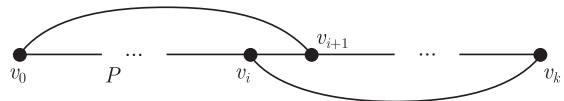
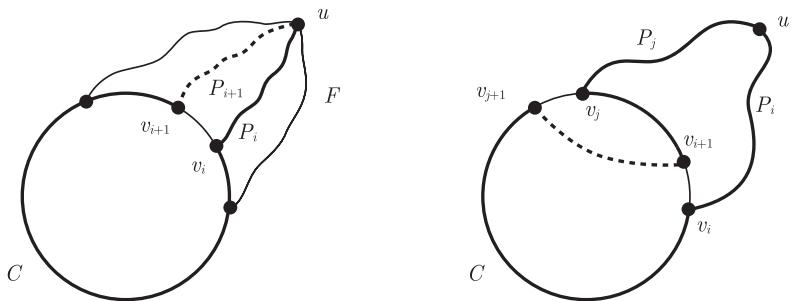

import Guide from '@/components/Guide.astro';
import Knowledge from '@/components/Knowledge.astro';
import Example from '@/components/Example.astro';
import Analysis from '@/components/Analysis.astro';
import Solution from '@/components/Solution.astro';
import Variant from '@/components/Variant.astro';
import Note from '@/components/Note.astro';
import Block from '@/components/Block.astro';
import Method from '@/components/Method.astro';
import Exercise from '@/components/Exercise.astro';

在 1.8 节，我们简要地讨论了图的 Euler 环游 (即经过每条边恰好一次的闭途径) 的存在性问题，简洁的定理 1.8.1 很好地解决了这个问题. 现在我们讨论一个关于顶点的类似问题：什么样的图 $G$ 包含一条经过每个顶点恰好一次的闭途径呢？如果 $|G| \geqslant 3$，则这样的途径是一个圈，叫做 $G$ 的 **Hamilton 圈** (Hamilton cycle). 如果 $G$ 包含一个 Hamilton 圈，则称 $G$ 是 **Hamilton 的** (Hamiltonian). 类似地，$G$ 中包含每个顶点的路称为一条 **Hamilton 路** (Hamilton path).

判断一个给定图是否包含 Hamilton 圈比判断图是否有 Euler 环游要困难很多，目前为止还没有好的刻画[^1]来判定它. 在这一章的前两节，我们给出图存在 Hamilton 圈的几个标准的充分条件，以及近期得到的一个非标准的充分条件. 10.3 节是关于一个经典定理的证明，即 Fleischner 定理：每一个 2-连通图的“平方图”包含一个 Hamilton 圈. 我们将给出这个定理和 Georgakopoulos 对这个定理的一个巧妙简短证明.

[^1]: 或者也不指望它的存在，细节见注解.

## 10.1 充分条件

什么样的条件能保证图 $G$ 包含 Hamilton 圈呢？纯粹的整体假设，比如高的边密度，是不够的：我们还是需要某些局部性质，比如每个顶点至少有两个邻点. 但是任意大的最小度 (固定常数) 也不是充分的：很容易构造一个不包含 Hamilton 圈的图，但它的最小度超过任意给定的常数界.

在这个背景下，下面这个经典结果具有重要的意义：

<Knowledge title="定理 10.1.1 (Dirac, 1952)">
每个具有 $n \geqslant 3$ 个顶点且最小度至少为 $n/2$ 的图包含 Hamilton 圈.

<Solution title="证明">
设 $G = (V, E)$ 是一个具有 $|G| = n \geqslant 3$ 和 $\delta(G) \geqslant n/2$ 的图，则 $G$ 是连通的；否则，在最小分支中的顶点度将小于 $|C| \leqslant n/2$.

设 $P = v_0 \cdots v_k$ 是 $G$ 中一条最长的路，我们把 $v_i$ 叫做边 $v_i v_{i+1}$ 的左端点，而 $v_{i+1}$ 叫做右端点. 根据 $P$ 的极大性，顶点 $v_0$ 的 $d(v_0) \geqslant n/2$ 个邻点中的每一个都是 $P$ 的一条边的右端点，并且 $d(v_0)$ 条边是不同的；类似地，$P$ 的至少 $n/2$ 条边的左端点是邻接 $v_k$ 的. 因为 $P$ 包含少于 $n$ 条边，所以它有一条边 $v_i v_{i+1}$ 同时满足这两个性质 (图 10.1.1).

<figure class="vp-figure">
  
  <figcaption>图 10.1.1 在定理 10.1.1 的证明中找到一个 Hamilton 圈</figcaption>
</figure>

我们断言圈 $C := v_0 v_{i+1} P v_k v_i P v_0$ 是图 $G$ 的一个 Hamilton 圈. 否则，由于 $G$ 是连通的，$C$ 在 $G - C$ 中有一个邻点，结合 $C$ 的一个支撑路，我们可以构造一条比 $P$ 更长的路，矛盾. ∎
</Solution>
</Knowledge>

定理 10.1.1 是最好可能的，因为我们不能用 $\lfloor n/2 \rfloor$ 来取代下界 $n/2$：如果 $n$ 是奇数，且 $G$ 是 $K^{\lceil n/2 \rceil}$ 的两个拷贝的并，它们只相交于一个共同的顶点，那么 $\delta(G) = \lfloor n/2 \rfloor$，但是 $\kappa(G) = 1$，因此 $G$ 不可能包含一个 Hamilton 圈. 换句话说，如果没有别的条件，我们需要用比 $\delta(G) \geqslant n/2$ 更高的界来确保 $G$ 是 2-连通的. 和最小度至少为 2 的条件一样，2-连通性是 Hamilton 性的平凡必要条件. 因此和最小度 $\delta$ 相比，看起来高连通度 $\kappa$ 更可能蕴含 Hamilton 性. 然而，情况并非如此：尽管每一个具有充分大 $k$-连通性的图包含一条长度至少为 $2k$ 的圈 (第 3 章，练习 21)，但是图 $K_{k,n}$ 显示这已经是最好可能的了.

更一般地，如果一个图有 $k$ 个顶点的分离集 $S$ 使得 $G - S$ 包含多于 $k$ 个分支，那么 $G$ 显然不可能是 Hamilton 的. 对于所有的非 Hamilton 图，是否都存在这样一个分离集，它产生比它本身阶数更多的分支呢？我们将在本节的最后部分来讨论这个问题.

注意到，上面提到的图也具有较大的独立集：从 $G - S$ 的每个分支中取出一个顶点，就组成了阶数至少为 $k+1$ 的独立集. 我们是否能够通过禁止大的独立集来保证 Hamilton 圈的存在呢？

条件 $\alpha(G) \leqslant k$ 本身已经保证了存在一个长度至少为 $|G|/k$ 的圈 (第 5 章，练习 13)，这个条件和 $k$-连通性相结合，确实能够保证图的 Hamilton 性.

<Knowledge title="命题 10.1.2">
如果图 $G$ 满足 $|G| \geqslant 3$ 和 $\alpha(G) \leqslant \kappa(G)$，则 $G$ 包含 Hamilton 圈.

<Solution title="证明">
令 $\kappa(G) =: k$，并设 $C$ 是 $G$ 的一个最长圈. 循环地排列 $C$ 的顶点，比如 $V(C) = \{v_i \mid i \in \mathbb{Z}_n\}$ 使得对所有 $i \in \mathbb{Z}_n$ 有 $v_i v_{i+1} \in E(C)$. 如果 $C$ 不是一个 Hamilton 圈，选取顶点 $u \in G - C$ 以及 $G$ 中的一个 $u\text{--}C$ 扇 $\mathcal{F} = \{P_i \mid i \in I\}$，其中 $I \subseteq \mathbb{Z}_n$，并且 $v_i$ 是 $P_i$ 的终点. 选择具有最大基数的 $\mathcal{F}$，那么根据 Menger 定理 (3.3.1)，对任意的 $j \notin I$，有 $u v_j \notin E(G)$，且

$$
|\mathcal{F}| \geqslant \min\{k, |C|\}. \tag{1}
$$

对任意的 $i \in I$，我们有 $i+1 \notin I$；否则，$(C \cup P_i u P_{i+1}) - v_i v_{i+1}$ 将是一个比 $C$ 更长的圈 (图 10.1.2，左图). 因此 $|\mathcal{F}| < |C|$，且根据 (1) 有 $|I| = |\mathcal{F}| \geqslant k$. 此外，对所有的 $i, j \in I$，有 $v_{i+1} v_{j+1} \notin E(G)$；否则，$(C \cup P_i u P_j) + v_{i+1} v_{j+1} - v_i v_{i+1} - v_j v_{j+1}$ 将是一个比 $C$ 更长的圈 (图 10.1.2，右图). 所以，$\{v_{i+1} \mid i \in I\} \cup \{u\}$ 是 $G$ 中至少有 $k+1$ 个顶点的独立集，这和假设 $\alpha(G) \leqslant k$ 矛盾. ∎
</Solution>
</Knowledge>

<figure class="vp-figure">
  
  <figcaption>图 10.1.2 两个比 $C$ 长的圈</figcaption>
</figure>

接下来的这个结果运用了命题 10.1.2 证明中的思想，来得到图的 Hamilton 性的局部度条件，极大地增强了 Dirac 定理以及后来这个方向中的类似结果.

<Knowledge title="定理 10.1.3 (Asratian and Khachatrian, 1990)">
设 $G$ 是阶数至少为 3 的连通图，如果对任意的导出路 $uvw$ 都有

$$
d(u) + d(w) \geqslant |N(u) \cup N(v) \cup N(w)|,
$$

则 $G$ 是 Hamilton 的.

<Solution title="证明">
考虑 $G$ 的任意一条导出路 $uvw$. 因为 $d(u) + d(w) = |N(u) \cup N(w)| + |N(u) \cap N(w)|$，所以度条件蕴含着

$$
\begin{aligned}
|N(u) \cap N(w)| &\geqslant |N(u) \cup N(v) \cup N(w)| - |N(u) \cup N(w)| \\
&= |N(v) \setminus N(\{u, w\})| \geqslant |\{u, w\}| \geqslant 2.
\end{aligned} \tag{1}
$$

特别地，$G$ 包含一个圈.

设 $C$ 是 $G$ 的一个最长圈. 假设 $G$ 不是 Hamilton 的，取顶点 $u \notin C$ 使得 $u$ 在 $C$ 上有一个邻点，并令 $V := N(u) \cap V(C)$. 对顶点 $v \in V$，令 $v^+$ 表示 $v$ 在 $C$ 上按某个固定方向的后继顶点，并令 $V^+ := \{v^+ \mid v \in V\}$.

因为 $C$ 是一个最长圈，所以有 $V \cap V^+ = \emptyset$，且

$$
V^+ \cup \{u\} \text{ 中的任意两个顶点都不相邻，并且在 } C \text{ 外也没有公共邻点} \tag{2}
$$

(对照图 10.1.2). 特别地，路 $uvv^+$ 是导出的. 因此每个 $v \in V$ 满足

$$
|N(u) \cap N(v^+)| \underset{(1)}{\geqslant} |N(v) \setminus N(\{u, v^+\})| \geqslant |N(v) \cap V^+| + 1.
$$

由 (2) 知，$u$ 和 $V^+$ 中的顶点都位于 $N(\{u, v^+\})$ 的外面，所以上述最后一个不等式成立. 因此，$G$ 中的 $V\text{--}V^+$ 边的数目 $\|V, V^+\|$ 满足

$$
\|V, V^+\| = \sum_{v \in V} |N(v) \cap V^+| \leqslant \sum_{v \in V} (|N(u) \cap N(v^+)| - 1) \underset{(2)}{=} \|V, V^+\| - |V|
$$

(从而得到矛盾). 注意到，最后一个等式之所以成立是因为由 (2) 知，$v^+$ 和 $u$ 的公共邻点都在 $V$ 中. ∎
</Solution>
</Knowledge>

让我们重新考虑这个问题，即不存在产生很多分支的小分隔这一假设是否能够保证 Hamilton 圈的存在性. 设 $t > 0$ 是一个任意实数，如果对于图 $G$ 的每个分隔 $S$，图 $G - S$ 有至多 $|S|/t$ 个分支，则图 $G$ 被称作 **$t$-坚韧的** ($t$-tough). 显然，具有 Hamilton 圈的图一定是 1-坚韧的；反过来呢？

不幸的是，不难找到一个阶数很小的图，它是 1-坚韧的但不包含 Hamilton 圈 (练习 6). 因此，坚韧度并不像 Menger 定理或者 Tutte 定理那样，可以提供 Hamilton 图的一个刻画. 然而，一个著名的猜想断言存在某个 $t$ 使得 $t$-坚韧性可以保证图的 Hamilton 性.

<Knowledge title="猜想 (Chvátal, 1973)">
**坚韧性猜想** 存在某个整数 $t$ 使得每个 $t$-坚韧的图都包含一个 Hamilton 圈.
</Knowledge>

很长一段时间以来，人们都认为坚韧性猜想即使对 $t = 2$ 也成立的，但经过多年努力已经被证明是不成立的，但对于一般的 $t$ 仍没有解决. 在练习中会看到，这个猜想是如何与这一章余下的结果联系起来的.

令人惊奇的是，Hamilton 性也和四色定理有关系. 正如我们在 6.6 节中指出的那样，四色定理等价于不存在可平面 snark，也就是说，四色定理等价于以下命题：每个无桥的可平面立方图有一个 4-流. 容易证明，在这个命题中“无桥”可以用“3-连通”取代，且每个 Hamilton 图有一个 4-流 (第 6 章，练习 16). 因此，证明四色定理，只需证明任意 3-连通可平面立方图有一个 Hamilton 圈！

不幸的是，情况并非如此：Tutte 在 1946 年构造了第一个反例. 十年以后，Tutte 证明了下面这个深刻定理，它是上述命题的一个最好可能的弱化：

<Knowledge title="定理 10.1.4 (Tutte, 1956)">
任意 4-连通可平面图包含 Hamilton 圈.
</Knowledge>

乍一看，似乎 Hamilton 圈的研究是那种不能推广到无限图的领域之一，但是下面这个充满魅力的猜想却否定了这种想法. 前面提到，无限图 $G$ 中的圈 (circle) 是，在由 $G$ 和它的末端生成的拓扑空间中，单位圆 $S^1$ 的同胚拷贝 (见 8.6 节). $G$ 的 **Hamilton 圈** (Hamilton circle) 是一个包含 $G$ 的所有顶点的圈.

<Knowledge title="猜想 (Bruhn, 2003)">
每个局部有限的 4-连通可平面图都包含 Hamilton 圈.
</Knowledge>
