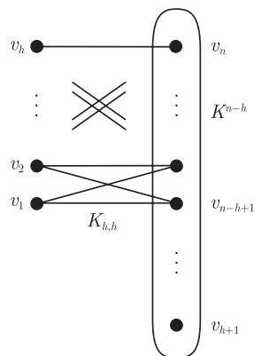

import Guide from '@/components/Guide.astro';
import Knowledge from '@/components/Knowledge.astro';
import Example from '@/components/Example.astro';
import Analysis from '@/components/Analysis.astro';
import Solution from '@/components/Solution.astro';
import Variant from '@/components/Variant.astro';
import Note from '@/components/Note.astro';
import Block from '@/components/Block.astro';
import Method from '@/components/Method.astro';
import Exercise from '@/components/Exercise.astro';

从历史的角度看，Hamilton 圈的研究，从 Dirac 定理开始，出现了一系列更弱的度条件，它们都是 Hamilton 性的充分条件. 下面这个定理将度条件演绎到了极点，它包括了所有的早期结果，在本节我们将证明这个定理.

如果 $G$ 是 $n$ 个顶点的图，其顶点度为 $d_1 \leqslant \cdots \leqslant d_n$，则 $n$ 元组 $(d_1, \cdots, d_n)$ 称为 $G$ 的**度序列** (degree sequence). 注意到，这个度序列是唯一的，尽管 $G$ 可能有若干顶点的排列均生成这个度序列. 设 $(a_1, \cdots, a_n)$ 是任意的整数序列，如果每个包含 $n$ 个顶点，且其度序列点态大于 $(a_1, \cdots, a_n)$ 的图是 Hamilton 的，则称该序列为 **Hamilton 的** (Hamiltonian). (我们称一个序列 $(d_1, \cdots, d_n)$ **点态大于** (pointwise greater) $(a_1, \cdots, a_n)$，如果对任意 $i$ 满足 $d_i \geqslant a_i$.)

下面的定理刻画了所有的 Hamilton 序列的性质：

<Knowledge title="定理 10.2.1 (Chvátal, 1972)">
如果整数序列 $(a_1, \cdots, a_n)$ 满足 $0 \leqslant a_1 \leqslant \cdots \leqslant a_n < n$ 以及 $n \geqslant 3$，则它是 Hamilton 的当且仅当对于每个 $i < n/2$，都有

$$
a_i \leqslant i \Rightarrow a_{n-i} \geqslant n - i.
$$

<Solution title="证明">
设 $(a_1, \cdots, a_n)$ 是任意一个整数序列，使得 $0 \leqslant a_1 \leqslant \cdots \leqslant a_n < n$，且 $n \geqslant 3$. 我们假设这个序列满足该定理的条件，并证明它是 Hamilton 的.

假设结论不成立，即存在一个图其度序列 $(d_1, \cdots, d_n)$ 满足，对所有 $i$，都有

$$
d_i \geqslant a_i, \tag{1}
$$

但该图没有 Hamilton 圈. 设 $G = (V, E)$ 是具有最大边数的这样的图.

根据 (1)，我们关于 $(a_1, \cdots, a_n)$ 的假设也适用于 $G$ 的度序列 $(d_1, \cdots, d_n)$，因此，对所有 $i < n/2$，有

$$
d_i \leqslant i \Rightarrow d_{n-i} \geqslant n - i. \tag{2}
$$

令 $x, y$ 是 $G$ 中不相同且不相邻的顶点，满足 $d(x) \leqslant d(y)$ 且 $d(x) + d(y)$ 尽可能的大. 容易证明，$G + xy$ 的度序列点态大于 $(d_1, \cdots, d_n)$，因此点态大于 $(a_1, \cdots, a_n)$. 因此，根据 $G$ 的极大性，新边 $xy$ 在 $G + xy$ 的 Hamilton 圈 $H$ 中，则 $H - xy$ 是 $G$ 的一条 Hamilton 路 $x_1, \cdots, x_n$，且 $x_1 = x$ 和 $x_n = y$.

与 Dirac 定理的证明一样，我们考虑指标集

$$
I := \{i \mid x x_{i+1} \in E\} \quad \text{和} \quad J := \{j \mid x_j y \in E\}.
$$

那么 $I \cup J \subseteq \{1, \cdots, n-1\}$，由于 $G$ 没有 Hamilton 圈，所以 $I \cap J = \emptyset$. 因此

$$
d(x) + d(y) = |I| + |J| < n, \tag{3}
$$

所以根据 $x$ 的选择，有 $h := d(x) < n/2$.

由于对所有 $i \in I$ 有 $x_i y \notin E$，故所有的 $x_i$ 都是 $x$ 的候选者. 因为选择的 $x, y$ 使得 $d(x) + d(y)$ 最大，故对所有 $i \in I$ 有 $d(x_i) \leqslant d(x)$，所以 $G$ 至少有 $|I| = h$ 个度至多为 $h$ 的顶点，即 $d_h \leqslant h$. 根据 (2)，这蕴含着 $d_{n-h} \geqslant n - h$，也就是说，度分别为 $d_{n-h}, \cdots, d_n$ 的 $h+1$ 个顶点的度至少为 $n - h$. 由于 $d(x) = h$，这些顶点中的一个，比方说 $z$，不与 $x$ 相邻. 因为

$$
d(x) + d(z) \geqslant h + (n - h) = n,
$$

由 (3)，这和 $x, y$ 的选择矛盾.

反过来，我们证明对定理中的任意给定序列 $(a_1, \cdots, a_n)$，对某个 $h < n/2$，满足

$$
a_h \leqslant h \quad \text{且} \quad a_{n-h} \leqslant n - h - 1,
$$

那么存在一个图，其度序列点态大于 $(a_1, \cdots, a_n)$，但是没有 Hamilton 圈. 由于这个序列

$$
(\underbrace{h, \cdots, h}_{h \text{ 次}}, \underbrace{n - h - 1, \cdots, n - h - 1}_{n - 2h \text{ 次}}, \underbrace{n - 1, \cdots, n - 1}_{h \text{ 次}})
$$

是点态大于 $(a_1, \cdots, a_n)$ 的，我们只需要找到一个具有这个度序列且没有 Hamilton 圈的图.

图 10.2.1 就是这样一个图，它拥有顶点 $v_1, \cdots, v_n$ 和边集

$$
\{v_i v_j \mid i, j > h\} \cup \{v_i v_j \mid i \leqslant h, j > n - h\}.
$$

它是 $K^{n-h}$ 和 $K_{h,h}$ 的并，这里 $K^{n-h}$ 的顶点是 $v_{h+1}, \cdots, v_n$，而 $K_{h,h}$ 的顶点集合划分成 $\{v_1, \cdots, v_h\}$ 和 $\{v_{n-h+1}, \cdots, v_n\}$. ∎
</Solution>
</Knowledge>

<figure class="vp-figure">
  
  <figcaption>图 10.2.1 两个包含 $v_1, \cdots, v_h$ 但避开 $v_{h+1}$ 的任意圈</figcaption>
</figure>

对 $G * K^1$ 类型的图应用定理 10.2.1，容易证明下面的关于 Hamilton 路的定理. 一个整数序列被称作**路-Hamilton 的** (path-Hamiltonian)，如果任意具有比它点态大的度序列的图都有一条 Hamilton 路.

<Knowledge title="推论 10.2.2">
一个整数序列 $(a_1, \cdots, a_n)$，若满足 $n \geqslant 2$ 和 $0 \leqslant a_1 \leqslant \cdots \leqslant a_n < n$，则它是路-Hamilton 的当且仅当对每个 $i \leqslant n/2$，都有 $a_i < i \Rightarrow a_{n+1-i} \geqslant n - i$.
</Knowledge>
