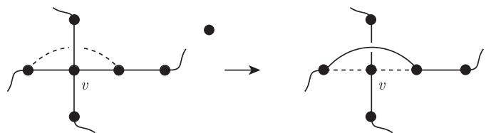
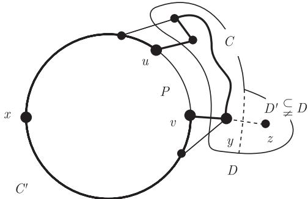
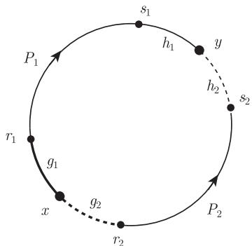
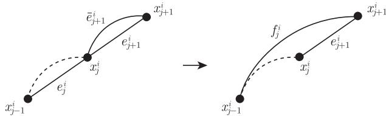

import Guide from '@/components/Guide.astro';
import Knowledge from '@/components/Knowledge.astro';
import Example from '@/components/Example.astro';
import Analysis from '@/components/Analysis.astro';
import Solution from '@/components/Solution.astro';
import Variant from '@/components/Variant.astro';
import Note from '@/components/Note.astro';
import Block from '@/components/Block.astro';
import Method from '@/components/Method.astro';
import Exercise from '@/components/Exercise.astro';

给定图 $G$ 和正整数 $d$，用 $G^d$ 表示定义在 $V(G)$ 上的一个图，它的两个顶点相邻当且仅当它们在 $G$ 中的距离至多为 $d$. 显然，$G = G^1 \subseteq G^2 \cdots$. 在本节，我们的目标是证明下面这个重要结果.

<Knowledge title="定理 10.3.1 (Fleischner, 1974)">
如果 $G$ 是 2-连通图，那么 $G^2$ 包含 Hamilton 圈.
</Knowledge>

定理 10.3.1 的证明思路大致如下：首先找到 $G$ 的一个圈 $C$. 根据归纳法，我们将用 $G^2$ 中的 $C$-路来覆盖其余的顶点，和 $C$ 中的边一样，这些路的第一条边和最后一条边都是 $G$ 中的边. 通过删除一些边和复制另外一些边，我们把 $C$ 和所有 $C$-路的并变成一个每个顶点都是偶数度的多重图，然后找到一个 Euler 环游，这个 Euler 环游 $W$ 在某些顶点经过不止一次，但是它经过多次的顶点所关联的所有边都是 $G$ 中的边. 对于所有经过某个给定顶点的边，除一条边外，我们尝试把所有其他边中每两条 $G$-边替换成 $G^2$ 中的一条边 (图 10.3.1)，从而把 Euler 环游变成 $G^2$ 中的 Hamilton 圈. 这里，最大的困难是如何保证这些跨越的提升是相互兼容的，即我们不希望在一条边的两个端点处都进行提升.

<figure class="vp-figure">
  
  <figcaption>图 10.3.1 通过提升一条边来降低 $W$ 中顶点 $v$ 的度数</figcaption>
</figure>

<Knowledge title="引理 10.3.2">
对每个 2-连通图 $G$ 和 $x \in V(G)$，都存在圈 $C \subseteq G$ 包含顶点 $x$ 以及顶点 $y \neq x$ 使得 $N_G(y) \subseteq V(C)$.

<Solution title="证明">
如果 $G$ 包含 Hamilton 圈，引理显然成立. 否则，设 $C' \subseteq G$ 是任意包含 $x$ 的圈，由于 $G$ 是 2-连通的，这样的圈总存在. 设 $D$ 是 $G - C'$ 的一个分支，我们选择 $C'$ 与 $D$ 使得 $|D|$ 是最小的，由于 $G$ 是 2-连通的，因此 $D$ 在 $C'$ 上至少有两个邻点，于是 $C'$ 包含一条在这样的两个邻点 $u$ 与 $v$ 之间的路 $P$，它的内部 $\mathring{P}$ 不包含 $x$，且在 $D$ 上没有邻点 (图 10.3.2).

<figure class="vp-figure">
  
  <figcaption>图 10.3.2 引理 10.3.2 的证明</figcaption>
</figure>

在 $C'$ 中用经过 $D$ 的 $u\text{--}v$ 路取代 $P$，我们得到一个包含 $x$ 和一个顶点 $y \in D$ 的圈 $C$. 如果 $y$ 有一个邻点 $z$ 在 $G - C$ 中，则 $z$ 将位于 $G - C$ 的一个分支 $D' \subsetneq D$ 中，和 $C'$ 与 $D$ 的选择矛盾. 因此 $y$ 的所有邻点都在 $C$ 上，即 $C$ 是满足这个引理的圈. ∎
</Solution>
</Knowledge>

在定理 10.3.1 的证明中，我们需要下面这些定义. 设 $G$ 是一个多重图，$W$ 是 $G$ 的途径. $W$ 经过顶点 $x$ 的一个**穿越** (pass) 是具有 $uexfv$ 形式的子途径，其中 $e$ 和 $f$ 都是边. (如果 $W = xfv \cdots uex$，我们也把 $uexfv$ 看作 $W$ 的一个穿越.) **提升** (lifting) 这个穿越的意思是指，如果 $u \neq v$，在 $W$ 中把这个穿越换成新的 $u\text{--}v$ 边；如果 $u = v$，就换成单个顶点 $u$. 多重图里的一条**多重路** (multipath) 是把一条路的某些边加倍得到的. 给定 $C \subseteq G$，我们把一条 $C$-路或者一个和 $C$ 恰好相交于一个顶点的圈，叫做 **$C$-迹** ($C$-trail).

<Solution title="定理 10.3.1 的证明">
设 $G = (V, E)$ 是一个 2-连通图，我们对 $|G|$ 用归纳法证明下面更强的结论：

> 对任意顶点 $x \in V$，都存在 $G^2$ 中的一个 Hamilton 圈使得圈中和 $x$ 相关联的边都在 $E$ 中.

如果 $G$ 是 Hamilton 的，结论显然成立. 否则，设 $C$ 和 $y$ 是由引理 10.3.2 给出的，对 $i = 1, 2$，设 $r_i, s_i \in V(C)$，且 $g_i, h_i \in E(C)$ 使得

$$
C = x g_1 r_1 \cdots s_1 h_1 y h_2 s_2 \cdots r_2 g_2 x.
$$

(见图 10.3.3，这里的顶点和边可以重复.)

对于 $G - C$ 的每个分支 $D$，我们首先要构造一个 $G^2 + \overline{E}$ 中 $C$-迹的集合，其中 $\overline{E}$ 表示那些新加的平行于 $G$ 的边. $D$ 中的每个顶点都恰好位于这样的一条迹中，而且这样的迹中和 $C$ 的一个顶点相关联的每条边都在 $E$ 或者 $\overline{E}$ 中.

如果 $D$ 只包含一个顶点 $u$，我们选取 $G$ 中包含 $u$ 的一条 $C$-迹，令 $E_D$ 表示它的两条边的集合；如果 $|D| \geqslant 1$，令 $\widetilde{D}$ 表示将 $G$ 通过收缩 $G - D$ 成一个顶点 $\widetilde{x}$ 而得到的 (2-连通) 图. 根据对 $\widetilde{D}$ 的归纳假设，$\widetilde{D}^2$ 中包含一个 Hamilton 圈 $\widetilde{H}$ 使得与 $\widetilde{x}$ 相关联的边都在 $E(\widetilde{D})$ 中. 记 $\widetilde{H}$ 中不在 $G^2$ 中的边为 $\widetilde{E}$，其中包括两条与 $\widetilde{x}$ 关联的边. 我们把 $\widetilde{E}$ 中的边替换成 $G$ 中的边或者新边 $\overline{e} \in \overline{E}$，从而把 $E(\widetilde{H})$ 变成了 $C$-迹的并的边集合.

考虑边 $uv \in \widetilde{E}$，其中 $u \in D$，则或者 $v = \widetilde{x}$，或者 $u$ 和 $v$ 在 $\widetilde{D}$ 中的距离至多为 2，但在 $G$ 中不为 2，因此它们是 $\widetilde{D}$ 中 $\widetilde{x}$ 的邻点. 在每种情况中，$G$ 都包含一条 $u\text{--}C$ 边. 令 $E_D$ 是由 $E(\widetilde{H}) \setminus \widetilde{E}$ 通过下面方式得到的图：在每个顶点 $u \in D$ 处，根据 $\widetilde{E}$ 包含与 $u$ 相关联的边的条数，增加相同数量的 $E$ 的 $u\text{--}C$ 边；如果 $u$ 和两条 $\widetilde{E}$ 的边关联，但是在 $G$ 中只有一条 $u\text{--}C$ 边 $e$，我们就增加 $e$ 和 $e$ 的一条新平行边 $\overline{e}$. 这样，$D$ 的每个顶点在 $(V, E_D)$ 中和在 $\widetilde{H}$ 中都有相同的度数 (即 2)，因此 $E_D$ 是一些 $C$-迹的并的边集合. 令

$$
G_0 := \left(V, E(C) \cup \bigcup_D E_D\right),
$$

即对于 $G - C$ 中的所有分支 $D$，$G_0$ 是 $C$ 和所有这些 $C$-迹的并.

接下来，我们的目标是通过复制 $C$ 中的某些边把 $G_0$ 变成一个 Euler 多重图. 因为 $G_0$ 是连通的，所以只需要通过某种方式把每个顶点的度变成偶数就可以了 (定理 1.8.1)[^1]. $G_0$ 中不在 $C$ 上的顶点已经有度数 2，为了使得 $C$ 中的顶点度也是偶数，我们顺着相反的顺序考虑 $C$ 中的顶点，即从 $x$ 开始到 $r_1$ 结束. 设 $u$ 是当前考虑的顶点，$v$ 是下一个要考虑的顶点. 对边 $e = uv$，增加一条关于它的新平行边 $\overline{e}$ 当且仅当在目前从 $G_0$ 构造得到的多重图中 $u$ 的度数是奇数. 当最后考虑 $u = r_1$ 时，所有其他顶点的度数已经是偶数了，所以 $r_1$ 的度数必然也是偶数 (命题 1.2.1)，而且没有增加和 $g_1$ 平行的边.

[^1]: 要证明定理 1.8.1 对多重图也成立，只需把每条边细分一次从而得到一个简单图即可.

<figure class="vp-figure">
  
  <figcaption>图 10.3.3 虚线边在 $G_1$ 中可能不存在，而粗线边没有平行边 (如果存在的话)</figcaption>
</figure>

从所得到的 Euler 多重图中，我们按如下规则删去一条或者两条平行边 (图 10.3.3)：如果 $g_2$ 有平行边 $\overline{g}_2$，那么同时删掉 $g_2$ 和 $\overline{g}_2$；如果 $h_2$ 有平行边 $\overline{h}_2$，那么删掉 $h_2$ 和 $\overline{h}_2$，除非删掉它们 (同时删掉 $g_2$ 和 $\overline{g}_2$) 后剩下的多重图不连通了. 我们用 $G_1$ 表示所得到的 Euler 多重图，$\overline{E} = E(G_1) \setminus E(G^2)$ 表示所有新的平行边的集合，并令 $C_1 := G_1[V(C)]$.

根据 $G_1$ 的构造和 $y$ 的定义，我们注意到 $G_1$ 的下面两条性质：

$$
G_1 \text{ 中的和 } C \text{ 上的顶点相关联的边都在 } E \cup \overline{E} \text{ 中}. \tag{1}
$$

$$
N_{G_1}(y) \subseteq \{s_1, s_2\}, \text{ 因此, } y \text{ 在 } G_1 \text{ 中的顶点度为 } 2 \text{ 或 } 4. \tag{2}
$$

设 $P_1 = x_0^1 \cdots x_{\ell_1}^1$ 是 $C_1$ 中的一条包含 $g_1$ 的 (极大) $x\text{--}y$ 多重路，$P_2 = x_0^2 \cdots x_{\ell_2}^2$ 是 $C_1$ 中其余边的一条多重路. 除非 $P_2$ 是空集，否则我们把 $P_2$ 看成从 $x_0^2 \in \{x, r_2\}$ 到 $x_{\ell_2}^2 \in \{y, s_2\}$ 的多重路. 把 $P_i$ 在 $E(C)$ 中的边 $x_{j-1}^i x_j^i$ 记作 $e_j^i$，把它在 $\overline{E}$ 中可能的平行边记作 $\overline{e}_j^i$ ($i = 1, 2$).

我们的计划是寻找一条 $G_1$ 的 Euler 环游 $W_1$ 使其能转化成为 $G^2$ 中的 Hamilton 圈. 为了更容易地赋予 $W_1$ 上述性质，先不直接定义它. 相反地，我们将从一个相关的多重图 $G_2$ 中的一条 Euler 环游 $W_2$ 中得到 $W_1$. 下面我们定义 $G_2$.

对 $i = 1, 2$ 和每个满足 $\overline{e}_{j+1}^i \in G_1$ 的 $j = 1, \cdots, \ell_i - 1$，从 $G_1$ 中删去 $e_j^i$ 和 $\overline{e}_{j+1}^i$，并增加一条新边 $f_j^i$，它连接 $x_{j-1}^i$ 和 $x_{j+1}^i$，我们称 $f_j^i$ **代表** (represent) 路 $x_{j-1}^i e_j^i x_j^i \overline{e}_{j+1}^i x_{j+1}^i \subseteq P_i$ (图 10.3.4). 注意到，每个这样的替换都使得所得到的多重图是连通的，并且保持了所有顶点度的奇偶性. 因此，从 $G_1$ 经过所有这些替换后得到的多重图 $G_2$ 是 Euler 的.

<figure class="vp-figure">
  
  <figcaption>图 10.3.4 用新边 $f_j^i$ 替换 $e_j^i$ 和 $\overline{e}_{j+1}^i$</figcaption>
</figure>

取 $G_2$ 的一条 Euler 环游 $W_2$，为了把 $W_2$ 转化成 $G_1$ 中的 Euler 环游 $W_1$，我们把 $E(W_2) \setminus E(G_1)$ 中的每条边替换为它所代表的路.

根据 (2)，存在 $W_1$ 的一条或者两条经过 $y$ 的穿越. 如果 $d(y) = 4$，根据 $G_1$ 的定义，$G_1$ 是连通的但 $G_1 - \{h_2, \overline{h}_2\}$ 不是. 因此，$W_1$ 起始或者终止于边 $h_2$ 的真 $y\text{--}y$ 子途径 $W$ 一定起始或终止于边 $\overline{h}_2$；否则，它在 $G_1 - \{h_2, \overline{h}_2\}$ 中必然包含一条 $s_2\text{--}y$ 途径，并且从 $G_1$ 中删除 $h_2$ 和 $\overline{h}_2$ 后并不影响它的连通性. 所以 $W_1$ 没有经过 $y$ 并且同时包含 $h_2$ 和 $\overline{h}_2$ 的穿越，这是因为如此的话将会导致子途径 $W$ 的闭合，从而蕴含着 $W = W_1$，与 $W$ 的定义矛盾. 若必要的话反转 $W$ 的方向，故我们可以假设：

$$
\text{如果 } W_1 \text{ 包含经过 } y \text{ 的两个穿越, 则其中一个包含 } h_1 \text{ 和 } h_2. \tag{3}
$$

我们的计划是在每个顶点 $v \in C$，通过对除一个外所有 $W_1$ 经过 $v$ 的穿越进行提升，从而把它转化成 $G^2$ 的 Hamilton 圈. 首先，对 $W_1$ 经过每个顶点的例外穿越 (即不作提升的穿越) 做标记：在 $x$ 处，把 $W_1$ 的任意穿越 $Q$ 进行标记；在 $y$ 处，把包含 $h_1$ 的穿越做标记. 对每个 $v \in V(C) \setminus \{x, y\}$，都存在唯一的指标对 $(i, j)$ 使得 $v = x_j^i$. 如果 $j \geqslant 1$，对于经过 $v = x_j^i$ 并且包含 $e_j^i$ 的穿越进行标记；如果 $j = 0$ (这时一定有 $v = x_0^2 = r_2$)，对经过 $v$ 并且包含 $\overline{e}_1^2$ (如果 $\overline{e}_1^2 \in G_1$) 的穿越进行标记；否则，对任意经过 $v$ 的穿越进行标记. 对每个顶点 $v \notin C$，对经过 $v$ 的 $W_1$ 的唯一穿越进行标记. 所以

$$
\text{在每个顶点 } v \in G, \text{ 我们对经过 } v \text{ 的恰好一个穿越进行标记.} \tag{4}
$$

为了避免在后面对没标记的穿越进行提升时产生冲突，我们需要保证 $W_1$ 中每一条边的两个端点中，至少有一个是标记的：

$$
\begin{aligned}
&\text{对 } W_1 \text{ 中的每条边 } e = uv, \text{ 我们对 } W_1 \text{ 的包含 } e \text{ 的两个穿越 (一个经过 } u, \text{ 另一个经过 } v) \text{ 中至少一个进行标记.} \\
&\text{如果 } u = x, \text{ 则对经过 } v \text{ 的穿越进行标记.}
\end{aligned} \tag{5}
$$

对于不在 $C_1$ 中的边，结论显然成立的. 对每条边 $e \in C_1$，都存在一个唯一指标对 $(i, j)$ 使得 $e = e_j^i$ 或者 $e = \overline{e}_j^i$，所以 $j \geqslant 1$. 如果 $e = e_j^i$，则 $W_1$ 中经过 $x_j^i$ 并且包含 $e$ 的穿越是有标记的；对于 $e = h_2$，由 (3) 知，结论成立. 如果 $e = \overline{e}_j^i$，我们知道经过 $x_{j-1}^i$ 并且包含 $e$ 的穿越是有标记的. 确实，首先注意到 $e$ 和 $x$ 不关联：前面提到，$\overline{g}_1$ 始终不存在；如果 $\overline{g}_2$ 存在，它也在 $G_1$ 的定义中被删除了. 因此除非 $P_2$ 起始于 $r_2$ 且 $e = \overline{e}_1^2$，否则边 $f_{j-1}^i$ 被定义为代表路 $x_{j-2}^i e_{j-1}^i x_{j-1}^i \overline{e}_j^i x_j^i$. 因为 $W_2$ 包含 $f_{j-1}^i$，所以这条路是 $W_1$ 的一个穿越. 这个穿越是有标记的，因为它经过 $x_{j-1}^i$ 并且包含 $e_{j-1}^i$. 最后，如果 $P_2$ 起始于 $r_2$ 且 $e = \overline{e}_1^2$，则经过 $r_2$ 并且包含 $e$ 的穿越是有标记的. 这就完成了 (5) 的证明.

根据 (1)，所有无标记的穿越都提升为 $G^2$ 中的边. 因为无标记的不同穿越不会共同包含一条边 (根据 (5))，因此同时把它们提升就把 $W_1$ 转化成一条 $G^2 + \overline{E}$ 中的闭途径 $\overline{H}$ (它继承了 $W_1$ 中边的循环顺序). 根据 (4)，$\overline{H}$ 仍然包含 $G$ 中的所有顶点 $v$：如果 $uv$ 是经过 $v$ 有标记穿越中的一条边，则 $\overline{H}$ 或者包含边 $uv$，或者包含穿越 $weufv$ 的提升 $wv$. 同样根据 (4)，$\overline{H}$ 经过每个顶点只有一次. 特别地，$\overline{H}$ 不能包含一对平行边. 因此，我们可以把 $\overline{H}$ 中的每条边 $\overline{e}$ 替换为它的平行边 $e \in E$, 从而得到 $G^2$ 的一个 Hamilton 圈 $H$. 因为 $Q$ 有标记，并且根据 (5)，$Q$ 中没有边在另一端点处被提升，故 $\overline{H}$ 包含 $Q$ 中的边. 根据 (1)，它们都在 $E \cup \overline{E}$ 中，所以 $H$ 中与 $x$ 相关联的边都在 $E$ 中，这正是我们所要证明的. ∎
</Solution>

Fleischner 定理可以自然地推广到局部有限图，但是证明要困难得多.

<Knowledge title="定理 10.3.3 (Georgakopoulos, 2009)">
每个 2-连通局部有限图的平方图都包含 Hamilton 圈.
</Knowledge>

作为本章的结束，我们给出一个还远远没有得到解决的猜想，它是 Dirac 定理的推广.

<Knowledge title="猜想 (Seymour, 1974)">
设 $G$ 是一个阶 $n \geqslant 3$ 的图，而 $k$ 是一个正整数. 如果 $G$ 的最小度满足

$$
\delta(G) \geqslant \frac{k}{k+1} n,
$$

那么 $G$ 包含一个 Hamilton 圈 $H$ 使得 $H^k \subseteq G$.
</Knowledge>

对 $k = 1$，这正是 Dirac 定理. Komlós, Sárközy 和 Szemerédi (1998) 证明了这个猜想对于大的 $n$ (依赖 $k$) 成立.
