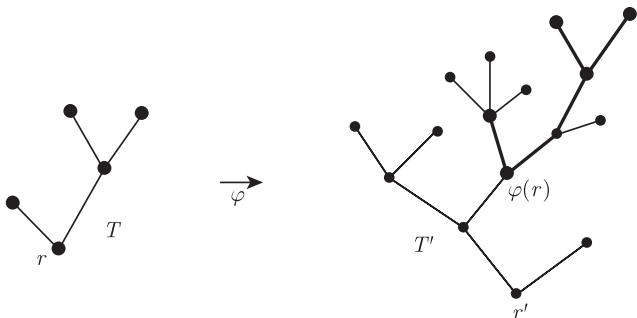

图子式定理可以表述为：有限图的集合在子式关系 $\preccurlyeq$ 下可以良拟序化. 确实，由命题 12.1.1 以及严格递减的子式序列不可能是无限的这一显而易见的事实，用前面的术语叙述就是，被良拟序化等价于不存在无限的反链.

在这一节，我们证明一个关于树的图子式定理的加强形式.

<Knowledge title="定理 12.2.1 (Kruskal, 1960)">
在拓扑子式关系下，有限树的集合被良拟序化.
</Knowledge>

<Solution title="证明">
定理 12.2.1 的证明是基于我们下面引进的有根树之间的嵌入这一概念，这个概念把普通的嵌入作为拓扑子式进行加强. 考虑两棵根分别为 $r$ 和 $r'$ 的树 $T$ 和 $T'$，如果存在一个从 $T$ 的某个细分到 $T'$ 的一棵子树 $T''$ 之间的同构 $\varphi$，并且该同构保持 $V(T)$ 上与 $r$ 和 $r'$ 相关的树序，我们就记 $T \leqslant T'$. (因此，如果在 $T$ 中有 $x < y$，那么在 $T'$ 中就有 $\varphi(x) < \varphi(y)$，见图 12.2.1.) 可以容易地验证，这是所有有根树集上的一个拟序.

<figure class="vp-figure">
  
  <figcaption>图 12.2.1 $T$ 在 $T'$ 中满足 $T \leqslant T'$ 的一个嵌入</figcaption>
</figure>

我们证明有根树集被上面定义的关系 $\leqslant$ 良拟序化，显然这蕴含着要证的定理.

假设结论不成立，为了得到矛盾，仿照引理 12.1.3 的证明. 给定 $n \in \mathbb{N}$，归纳地假设已经选定了一个有根树序列 $T_0, \dots, T_{n-1}$，使得某个有根树的坏序列以这个序列开始. 选择一个顶点数最少的有根树 $T_n$ 使得某个坏序列以 $T_0, T_1, \dots, T_n$ 开始. 对每个 $n \in \mathbb{N}$，记 $T_n$ 的根为 $r_n$.

显然，$(T_n)_{n \in \mathbb{N}}$ 是一个坏序列. 对每个 $n$，设 $A_n$ 表示 $T_n - r_n$ 的分支的集合，这里选择 $r_n$ 的邻点为这些分支的根使它们成为有根树，注意到，这些树的树序是由 $T_n$ 导出的. 我们将证明所有这些树的集合 $A := \bigcup_{n \in \mathbb{N}} A_n$ 被良拟序化.

设 $(T^k)_{k \in \mathbb{N}}$ 是 $A$ 中树的任意序列. 对每个 $k \in \mathbb{N}$，选择 $n = n(k)$ 使得 $T^k \in A_n$，并取 $k$ 使得 $n(k)$ 最小. 那么，由 $T_{n(k)}$ 的极小性和 $T^k \subsetneq T_{n(k)}$ 知

$$
T_0, \dots, T_{n(k)-1}, T^k, T^{k+1}, \dots
$$

是一个好序列. 设 $(T, T')$ 是这个序列的一个好对. 因为 $(T_n)_{n \in \mathbb{N}}$ 是坏的，所以 $T$ 不可能位于这个序列的前面 $n(k)$ 项 (即 $T_0, \dots, T_{n(k)-1}$) 中，因此 $T'$ 将会是某个 $T^i\ (i \geqslant k)$，即

$$
T \leqslant T' = T^i \leqslant T_{n(i)}.
$$

由 $k$ 的选择知 $n(k) \leqslant n(i)$，这将使得 $(T, T_{n(i)})$ 是坏序列 $(T_n)_{n \in \mathbb{N}}$ 中的一个好对. 因此 $(T, T')$ 也是 $(T^k)_{k \in \mathbb{N}}$ 的一个好对，这就证明了 $A$ 被良拟序化.

由引理 12.1.3，$[A]^{<\omega}$ 中的序列 $(A_n)_{n \in \mathbb{N}}$ 有一个好对 $(A_i, A_j)$. 设 $f: A_i \to A_j$ 是一个单射，使得对所有的 $T \in A_i$ 都有 $T \leqslant f(T)$. 现在，令 $\varphi(r_i) := r_j$，我们就把嵌入 $T \to f(T)$ 的并扩展成一个从 $V(T_i)$ 到 $V(T_j)$ 的映射 $\varphi$. 这个映射 $\varphi$ 保持了 $T_i$ 的树序，而且它定义了一个嵌入蕴含着 $T_i \leqslant T_j$，这是因为边 $r_i r \in T_i$ 很自然地映射到路 $r_j T_j \varphi(r)$ 上. 因此，$(T_i, T_j)$ 是原来的有根树的坏序列中的一个好对，矛盾. ∎
</Solution>
