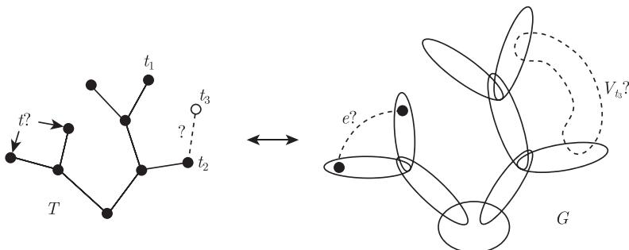
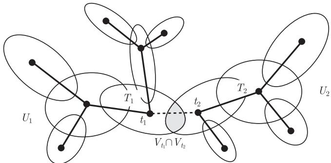

import Guide from '@/components/Guide.astro';
import Knowledge from '@/components/Knowledge.astro';
import Example from '@/components/Example.astro';
import Analysis from '@/components/Analysis.astro';
import Solution from '@/components/Solution.astro';
import Variant from '@/components/Variant.astro';
import Note from '@/components/Note.astro';
import Block from '@/components/Block.astro';
import Method from '@/components/Method.astro';
import Exercise from '@/components/Exercise.astro';

从定理 1.5.1 和推论 1.5.2，以及更深刻的 Kruskal 定理这些例子中，我们不难看出树是具有一些与众不同并且很重要性质的一类图. 因此，自然地要问这些性质在多大程度上可以移植到更一般的图上，即本身不是树但是在某种意义上与树很类似的图上. 在这一节，我们研究一个类似于树的概念，它可以推广前面所有提到的树性质（包括 Kruskal 定理），并且在图子式定理的证明中起着至关重要的作用.

设 $G$ 是一个图，$T$ 是一棵树，$\mathcal{V} = (V_t)_{t \in T}$ 是一族顶点集 $V_t \subseteq V(G)$，它以树 $T$ 的节点 $t$ 为下标. 如果 $(T, \mathcal{V})$ 满足下面三个条件，我们就把它叫做图 $G$ 的一个**树分解** (tree-decomposition)：

(T1) $V(G) = \bigcup_{t \in T} V_t$；

(T2) 任给一条边 $e \in G$，存在一个节点 $t \in T$ 使得 $e$ 的两个端点都在 $V_t$ 中；

(T3) 若 $t_1, t_2, t_3 \in T$ 并且满足 $t_2 \in t_1 T t_3$，那么 $V_{t_1} \cap V_{t_3} \subseteq V_{t_2}$ 成立.

条件 (T1) 和 (T2) 合在一起蕴含着 $G$ 是子图 $G[V_t]$ 的并，我们称这些子图以及集合 $V_t$ 本身为 $(T, \mathcal{V})$ 的**部分** (parts)，并且称 $(T, \mathcal{V})$ 是图 $G$ 的分解成 (into) 这些部分的一个树分解. 条件 (T3) 蕴含着 $(T, \mathcal{V})$ 的部分粗看起来像一棵树（图 12.3.1）.

下面讨论树分解在图子式定理的证明中所扮演的角色，在此之前，我们先给出几条关于它的基本性质. 考虑图 $G$ 的一个固定树分解 $(T, \mathcal{V})$，这里 $\mathcal{V} = (V_t)_{t \in T}$ 的定义如上.

树分解的最重要特性之一是它把树的分离性质保持到分解后的图上.

<figure class="vp-figure">
  
  <figcaption>图 12.3.1 不满足 (T2) 和 (T3) 的边和部分</figcaption>
</figure>

<Knowledge title="引理 12.3.1">
设 $t_1 t_2$ 是 $T$ 的任意一条边，$T_1$ 和 $T_2$ 是 $T - t_1 t_2$ 的分支，这里 $t_1 \in T_1, t_2 \in T_2$，那么 $V_{t_1} \cap V_{t_2}$ 在 $G$ 中分离 $U_1 := \bigcup_{t \in T_1} V_t$ 和 $U_2 := \bigcup_{t \in T_2} V_t$（图 12.3.2）.

<figure class="vp-figure">
  
  <figcaption>图 12.3.2 在 $G$ 中 $V_{t_1} \cap V_{t_2}$ 分离 $U_1$ 和 $U_2$</figcaption>
</figure>

<Solution title="证明">
在树 $T$ 中，对任意的 $t \in T_1$ 和 $t' \in T_2$，$t_1$ 和 $t_2$ 都在每条 $t\text{–}t'$ 路上. 所以，由条件 (T3) 知 $U_1 \cap U_2 \subseteq V_{t_1} \cap V_{t_2}$，因此我们只需证明 $G$ 中不存在边 $u_1 u_2$ 使得 $u_1 \in U_1 \setminus U_2$ 和 $u_2 \in U_2 \setminus U_1$. 如果 $u_1 u_2$ 是这样一条边，那么由 (T2) 知，存在一个 $t \in T$ 使得 $u_1, u_2 \in V_t$. 根据 $u_1$ 和 $u_2$ 的选取，我们既没有 $t \in T_2$ 也没有 $t \in T_1$，矛盾. ∎
</Solution>
</Knowledge>

我们把引理 12.3.1 中 $G$ 的分离 $\{U_1, U_2\}$ 称作由 $T$ 的边 $t_1 t_2$ 所导出的分离，或者更一般地称作由树分解 $(T, \mathcal{V})$ 导出的分离. 分离集 $U_1 \cap U_2 = V_{t_1} \cap V_{t_2}$ 叫做 $V_{t_1}$ 和 $V_{t_2}$ 的附着集.

树分解的**附着力** (adhesion) 是它的附着集的最大阶. (如果 $T$ 是平凡的，我们令附着力为零.) 树分解的**躯干** (torsos) 是指通过把部分 $G[V_t]$ 中的附着集完备化而得到的母图：对任意不在 $G$ 中的边，如果边的两个端点属于一个共同的附着集 $V_t \cap V_{t'}$ (这里 $tt' \in E(T)$)，就把这个边加到 $G[V_t]$ 中.

注意到，树分解可以被传递到子图上. 事实上，树分解甚至可以被传递到子式上.

<Knowledge title="引理 12.3.2">
对每个 $H \subseteq G$，$(T, (V_t \cap V(H))_{t \in T})$ 是图 $H$ 的一个树分解.
</Knowledge>

<Knowledge title="引理 12.3.3">
假设 $G$ 是一个 $IH$，它的分支集为 $U_h\ (h \in V(H))$. 设 $f: V(G) \to V(H)$ 是一个映射，它把 $G$ 的每个顶点映射到包含这个顶点的那个分支集的指标上. 对每个 $t \in T$，令 $W_t := \{f(v) \mid v \in V_t\}$ 和 $\mathcal{W} := (W_t)_{t \in T}$，则 $(T, \mathcal{W})$ 是图 $H$ 的一个树分解.

<Solution title="证明">
对于 $(T, \mathcal{W})$，条件 (T1) 和 (T2) 成立可以从它们对 $(T, \mathcal{V})$ 成立直接推出. 设 $t_1, t_2, t_3 \in T$ 满足条件 (T3)，考虑 $H$ 中的一个顶点 $h \in W_{t_1} \cap W_{t_3}$，我们证明 $h \in W_{t_2}$. 由 $W_{t_1}$ 和 $W_{t_3}$ 的定义知，集合 $U_h$ 和 $V_{t_1}$ 以及 $V_{t_3}$ 均相交. 因为 $U_h$ 在 $G$ 中是连通的，由引理 12.3.1 知，$U_h$ 也和 $V_{t_2}$ 相交. 根据 $V_{t_2}$ 的定义，所以 $h \in W_{t_2}$. ∎
</Solution>
</Knowledge>

下面是引理 12.3.1 的另外一个有用的推论：

<Knowledge title="引理 12.3.4">
如果一个顶点集不包含在 $(T, \mathcal{V})$ 的任意一个部分中，那么这个顶点集一定包含两个被 $(T, \mathcal{V})$ 的一个附着集所分离的顶点.

<Solution title="证明">
给定 $W \subseteq V(G)$，我们按下面的方法对 $T$ 的边进行定向：对每条边 $t_1 t_2 \in T$，和引理 12.3.1 中一样来定义 $U_1, U_2$，那么 $V_{t_1} \cap V_{t_2}$ 分离 $U_1$ 和 $U_2$. 除非 $V_{t_1} \cap V_{t_2}$ 分离 $W$ 中的两个顶点，否则我们总可以找到一个 $i \in \{1, 2\}$ 使得 $W \subseteq U_i$，并且把 $t_1 t_2$ 的定向指向 $t_i$.

设 $t$ 是 $T$ 中一条极大有向路的最后一个节点，那么 $T$ 在 $t$ 的所有边都指向 $t$. 我们证明 $W \subseteq V_t$. 给定 $w \in W$，设 $t' \in T$ 使得 $w \in V_{t'}$. 如果 $t' \neq t$，那么和 $t$ 关联的且在 $T$ 中分离 $t'$ 和 $t$ 的边 $e$ 指向 $t$，所以在 $T - e$ 的包含 $t$ 的分支中，存在某个 $t''$ 使得 $w$ 属于 $V_{t''}$. 因此，由 (T3) 知，$w \in V_t$. ∎
</Solution>
</Knowledge>

下面这个结果是引理 12.3.4 的一个特殊情形，我们会经常用到它.

<Knowledge title="推论 12.3.5">
图 $G$ 的任意完全子图都包含在 $(T, \mathcal{V})$ 的某个部分中.
</Knowledge>

给定图 $G$ 的树分解 $(T, \mathcal{V})$，如果所有的分离 $V_{t_1} \cap V_{t_2}$ 都导出 $G$ 的完全子图，则称这个树分解是**单纯的** (simplicial). 这个假设使得我们可以把树分解的每个部分上的结论提升到图 $G$ 本身. 例如，如果图 $G$ 的一个单纯树分解的每个部分是 $k$-可着色的，那么图 $G$ 本身也是 $k$-可着色的 (练习 19). 同样地，对某些固定的 $r$，不包含 $K^r$ 子式这一性质也是如此.

反过来，如果 $G$ 可以通过沿着完全子图粘贴 $\mathcal{H}$ 中的图递归地构造出来，那么 $G$ 有一个单纯树分解，使得每个部分是 $\mathcal{H}$ 中的元素. 例如，由 Wagner 定理 (7.3.4) 知，任意不包含 $K^5$ 子式的图有一个母图，它具有一个单纯树分解，使得每个部分是平面三角剖分或者 Wagner 图 $W$ 的拷贝；对不包含 $K^4$ 子式的图，类似结论也成立 (见命题 12.6.2).

因此，树分解可以让我们得到一些关于图性质的直观的结构性刻画. 一个特别简单的例子是下面这个关于弦图的刻画：

<Knowledge title="命题 12.3.6">
图 $G$ 是弦图当且仅当 $G$ 有一个树分解使得每个部分是完全的.

<Solution title="证明">
我们对 $|G|$ 使用归纳法. 首先假设 $G$ 有一个树分解 $(T, \mathcal{V})$ 使得对每个 $t \in T$，$G[V_t]$ 都是完全的，我们选择 $(T, \mathcal{V})$ 使得 $|T|$ 最小. 如果 $|T| \leqslant 1$，那么 $G$ 是完全的，所以是弦图. 因此，设 $t_1 t_2 \in T$ 是一条边，且对 $i = 1, 2$ 像引理 12.3.1 那样定义 $T_i$ 和 $G_i := G[U_i]$，则由 (T1) 和 (T2) 知，$G = G_1 \cup G_2$，并且由引理知 $V(G_1 \cap G_2) = V_{t_1} \cap V_{t_2}$，所以 $G_1 \cap G_2$ 是完全的. 因为 $(T_i, (V_t)_{t \in T_i})$ 是 $G_i$ 的一个具有完全部分的树分解，所以根据归纳假设知 $G_1$ 和 $G_2$ 都是弦图.（根据 $(T, \mathcal{V})$ 的选择，两个 $G_i$ 都不是 $G[V_{t_1} \cap V_{t_2}] = G_1 \cap G_2$ 的子图，因此 $G_i$ 均比 $G$ 小.）因为 $G_1 \cap G_2$ 是完全的，故 $G$ 中的任何导出圈在 $G_1$ 中或者 $G_2$ 中，因此它有一个弦，所以 $G$ 也是弦图.

反过来，假设 $G$ 是弦图. 如果 $G$ 是完全图，无须证明；否则，由命题 5.5.1 知，图 $G$ 是小的弦图 $G_1$ 和 $G_2$ 的并，并且 $G_1 \cap G_2$ 是完全的. 根据归纳假设，$G_1$ 和 $G_2$ 有树分解 $(T_1, \mathcal{V}_1)$ 和 $(T_2, \mathcal{V}_2)$ 使得每个部分是完全的. 运用推论 12.3.5，对每种情形 $G_1 \cap G_2$ 都包含在其中的一个部分中，不妨设对应的指标为 $t_1 \in T_1$ 和 $t_2 \in T_2$. 可以容易地验证，$((T_1 \cup T_2) + t_1 t_2, \mathcal{V}_1 \cup \mathcal{V}_2)$ 是 $G$ 的一个树分解使得每个部分是完全的. ∎
</Solution>
</Knowledge>

作为本节的结束，我们考虑树分解对连通性的一个应用，它推广了引理 3.1.4 中关于块-割点的结果. 至少 $k$ 个顶点的集合 $U \subseteq V(G)$ 被称作在 $G$ 中是 $(<k)$-不可分的，如果 $U$ 中任意两个顶点都不能被 $G$ 中少于 $k$ 个其他顶点（可以属于也可以不属于 $U$）分离.

一个极大的 $(<k)$-不可分顶点集被叫做 **$k$-块** ($k$-block). 所以，图的 1-块是它的分支；2-块是第 3 章中定义的支撑一个块的非单点集. 一般地，$k$-块不一定导出高连通子图，因为组成 $(<k)$-不可分集合的顶点之间的很多路可能都在集合之外，所以它的“连通性”由周围的图来衡量，它的顶点本身可能组成一个独立集.

<Knowledge title="定理 12.3.7">
对任何整数 $k \geqslant 1$，每个图 $G$ 都有一个具有下面性质的树分解 $(T, \mathcal{V})$：

(i) $(T, \mathcal{V})$ 的附着力 $< k$；

(ii) 不同的 $k$-块包含在不同的部分中. 进一步地，每两个块被一个附着集所分离，而这个附着集不比 $G$ 中分离这两个块的最小顶点集来得大；

(iii) $G$ 每个自同构作用于 $(T, \mathcal{V})$ 的部分集合上，并且它在 $V(T)$ 上所导出的作用是 $T$ 的一个自同构.
</Knowledge>

注意到，由 (i) 和引理 12.3.4，每个 $k$-块包含在某个部分中. 根据 (i) 和 (T3)，这个部分是唯一的，因此 (ii) 中的部分是恰当定义的. 命题 (iii) 意味着，对 $G$ 的每个自同构 $\varphi$ 以及每个 $t \in T$，集合 $\varphi(V_t)$ 是另外一个部分 $V_{t'}$ (也可能是 $V_t$)，并且这个映射 $\varphi: t \mapsto t'$ 是 $T$ 的一个自同构，更多的解释可以参考本章末的注释.
