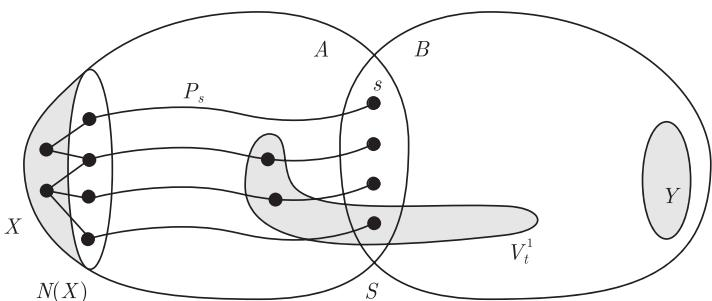

import Guide from '@/components/Guide.astro';
import Knowledge from '@/components/Knowledge.astro';
import Example from '@/components/Example.astro';
import Analysis from '@/components/Analysis.astro';
import Solution from '@/components/Solution.astro';
import Variant from '@/components/Variant.astro';
import Note from '@/components/Note.astro';
import Block from '@/components/Block.astro';
import Method from '@/components/Method.astro';
import Exercise from '@/components/Exercise.astro';

正如图 12.3.1 所显示的那样，$(T, \mathcal{V})$ 的部分反映了树 $T$ 的结构，因此在这种意义下，分解了的图 $G$ 有类似于树的结构. 然而，这只有当忽略每个部分在 $G$ 中的内部结构的时候才更明显：部分越小，和树的相似程度越高.

前面的观察启发了下面的概念. $(T, \mathcal{V})$ 的**宽度** (width) 定义为

$$
\max \{|V_t| - 1 \mid t \in T\},
$$

而图 $G$ 的**树宽** (tree-width) $\operatorname{tw}(G)$ 是 $G$ 的所有树分解的宽度的最小值. 容易验证，树本身的树宽为 1.

由引理 12.3.2 和引理 12.3.3 知，一个图的树宽不会随着删除边或者收缩边而增加：

<Knowledge title="引理 12.4.1">
如果 $H \preccurlyeq G$，则 $\operatorname{tw}(H) \leqslant \operatorname{tw}(G)$.
</Knowledge>

具有有界树宽的图和树非常相似，我们甚至可以把 Kruskal 定理的证明稍加修改运用到这类图上来. 粗略地讲，我们需要把引理 12.1.3 的证明中的“极小坏序列”的论证反复运用 $\operatorname{tw}(G)$ 次. 这就使得我们离图子式定理的证明更近了一步：

<Knowledge title="定理 12.4.2 (Robertson and Seymour, 1990)">
对每个整数 $k > 0$，树宽 $< k$ 的图集合被子式关系良拟序化.
</Knowledge>

为了使用定理 12.4.2 来证明完整的图子式定理，我们应该找到一些不满足这个定理条件的图的结果，即对树宽较大的图找到一些有用的信息. 下一个定理（即**树宽对偶定理** (tree-width duality theorem)）恰好可以实现这个想法：它揭示了使用小树宽图的结果所遇到的根本障碍，这个结构性现象出现在一个图中当且仅当图的树宽较大.

我们称 $V(G)$ 的两个子集**相互接触** (touch)，如果它们有一个公共顶点或 $G$ 包含一条它们之间的边. 图 $G$ 中一族互相接触的连通顶点集叫一个**刺藤** (bramble). 我们推广第 2 章的覆盖：如果 $V(G)$ 的一个子集和刺藤 $\mathcal{B}$ 中每个元素都相交，就称这个顶点集**覆盖** (cover) 刺藤 $\mathcal{B}$（或是 $\mathcal{B}$ 的一个覆盖 (cover)）. 覆盖刺藤的最少顶点个数称为刺藤的**阶** (order). **$k$-刺藤** ($k$-bramble) 是指一个阶为 $k$ 的刺藤.

刺藤的一个典型例子是网格中的一族交叉. $k \times k$ **网格** (grid) 是一个 $\{1, 2, \dots, k\}^2$ 上的图，它的边集为

$$
\{(i, j)(i', j'): |i - i'| + |j - j'| = 1\}.
$$

这个网格的**交叉** (cross) 是 $k^2$ 个集合

$$
C_{ij} := \{(i, \ell) \mid \ell = 1, \dots, k\} \cup \{(\ell, j) \mid \ell = 1, \dots, k\}.
$$

因此，交叉 $C_{ij}$ 是网格的第 $i$ 行和第 $j$ 列的并. 显然，$k \times k$ 网格的这些交叉形成一个 $k$-刺藤：它们被任意的行或列覆盖，与此同时任何少于 $k$ 个顶点的集合未接触到一行以及一列，因此漏掉一个交叉.

<Knowledge title="定理 12.4.3 (Seymour and Thomas, 1993)">
设 $k \geqslant 0$ 是一个整数，一个图的树宽 $< k$ 当且仅当它不包含一个阶数 $> k$ 的刺藤.

<Solution title="证明">
设 $G = (V, E)$ 是一个图. 对于充分性，设 $\mathcal{B}$ 是图 $G$ 的任意刺藤，我们证明 $G$ 的每个树分解 $(T, (V_t)_{t \in T})$ 都有一个部分来覆盖 $\mathcal{B}$.

像引理 12.3.4 的证明一样，首先给 $T$ 的边 $t_1 t_2$ 定向. 如果 $X := V_{t_1} \cap V_{t_2}$ 覆盖 $\mathcal{B}$，我们完成证明；否则，对每个和 $X$ 不相交的 $B \in \mathcal{B}$ 都存在一个 $i \in \{1, 2\}$ 使得 $B \subseteq U_i \setminus X$（定义见引理 12.3.1）. 我们已知 $B$ 是连通的，因为这些 $B$ 是互相接触的，所以这个 $i$ 对所有这样的 $B$ 是相同的. 现在，我们把边 $t_1 t_2$ 定为指向 $t_i$.

如果 $T$ 的每条边按照这种方式定向，那么它有一个节点 $t$ 使得所有与 $t$ 关联的边都指向 $t$，因此 $V_t$ 覆盖 $\mathcal{B}$——就像在引理 12.3.4 的证明中一样.

对于必要性的证明，考虑 $G$ 的一个树分解 $(T, \mathcal{V})$，这里 $\mathcal{V} = (V_t)_{t \in T}$. 如果 $x$ 是 $T$ 的叶子并满足 $|V_x| > k$ 以及关联边 $xy \in T$，我们把集合 $V_x \setminus V_y$ 叫做 $x$ 的**花瓣** (petal). 如果对至少一个 $t$ 有 $|V_t| \leqslant k$ 而且只要 $t$ 不是叶子就有 $|V_t| \leqslant k$，那么我们称分解 $(T, \mathcal{V})$ 是**好的** (good). 因此具有 $|V_x| > k$ 的任意叶子 $x$ 的邻点 $y$ 均满足 $|V_y| \leqslant k$，所以好的树分解中的花瓣是非空的并且有最多 $k$ 个邻点.

假设 $\operatorname{tw}(G) \geqslant k$，我们希望寻找一个阶 $> k$ 的刺藤. 一开始，考虑两个好树分解 $(T_1, \mathcal{V}_1)$ 和 $(T_2, \mathcal{V}_2)$，这里 $T_1 \cap T_2 = \emptyset$，且 $x \in T_1$ 的花瓣是 $X$ 而 $y \in T_2$ 的花瓣是 $Y$. 假定 $(T_1, \mathcal{V}_1)$ 对应于 $x$ 的部分恰好是 $X \cup N(X)$，$(T_2, \mathcal{V}_2)$ 对应于 $y$ 的部分恰好是 $Y \cup N(Y)$，$(T_1, \mathcal{V}_1)$ 中的花瓣都不包含 $Y$，$(T_2, \mathcal{V}_2)$ 中的花瓣都不包含 $X$，且 $X$ 和 $Y$ 不接触. 那么我们有下面的结论：

$$
\begin{aligned}
&\text{存在一个好的树分解 } (T, \mathcal{V})\text{，它的所有花瓣包含在 } (T_1, \mathcal{V}_1) \\
&\text{和 } (T_2, \mathcal{V}_2) \text{ 的花瓣中，并且 } X \text{ 和 } Y \text{ 均不是花瓣.}
\end{aligned}
\tag{$*$}
$$

确实，因为 $X$ 和 $Y$ 不接触，所以集合 $N(X)$ 与 $X$ 以及 $Y$ 均不相交，并且 $N(X)$ 在 $G$ 中分离 $X$ 和 $Y$. 因此，$G$ 有一个分离 $\{A, B\}$ 使得 $X \subseteq A \setminus B$ 和 $Y \subseteq B \setminus A$. 由于 $X$ 是一个花瓣，故 $|N(X)| \leqslant k$，选择 $\{A, B\}$ 具有最小的阶以保证 $S := A \cap B$ 的大小最多为 $k$. 因为 $S$ 的极小性和 Menger 定理 (3.3.1)，存在 $G[A]$ 中一个不交 $S\text{–}N(X)$ 路的族 $\{P_s \mid s \in S\}$ 以及 $G[B]$ 中一个不交 $S\text{–}N(Y)$ 路的族 $\{Q_s \mid s \in S\}$.

设 $H$ 是 $G$ 的一个子式，它通过删除 $A \setminus \bigcup_{s \in S} V(P_s)$ 以及收缩每条路 $P_s$ 而得到. 把收缩的分支集 $V(P_s)$ 用 $s$ 来代表，那么 $H$ 可以看成由 $G[B]$ 被加上若干条边到 $S$ 中而得到的. 设 $(T_1, \mathcal{V}_1')$ 是如同引理 12.3.2 和引理 12.3.3 中那样 $(T_1, \mathcal{V}_1)$ 在 $H$ 上导出的树分解，并把它看成 $G[B]$ 的树分解. 所以对任意 $t \in T_1$，不妨设部分 $V_t^1 \in \mathcal{V}_1$，那么 $\mathcal{V}_1'$ 的部分 $V_t$ 就是

$$
V_t = (V_t^1 \cap B) \cup \{s \in S \mid V_t^1 \cap V(P_s) \neq \emptyset\}
\tag{1}
$$

（图 12.4.1）. 特别地，因为 $V_x = X \cup N(X) \subseteq A$ 以及 $N(X)$ 与每个 $P_s$ 相交，所以 $V_x = S$. 类似地，设 $J$ 是 $G$ 的一个子式，它通过删除 $B \setminus \bigcup_{s \in S} V(Q_s)$ 以及收缩路 $Q_s$ 而得到的. 设 $(T_2, \mathcal{V}_2')$ 是 $(T_2, \mathcal{V}_2)$ 在 $J$ 上导出的树分解，和前面一样，我们把它看成是 $G[A]$ 的树分解，这里 $S$ 是对应于 $y$ 的部分.

<figure class="vp-figure">
  
  <figcaption>图 12.4.1 为了从 $V_t^1 \cap B$ 得到 $V_t$，从 $S$ 中添加两个顶点</figcaption>
</figure>

设 $T$ 是从（不交）树 $T_1$ 和 $T_2$ 通过把顶点 $x$ 和 $y$ 重合成一个新的节点 $r$ 而得到的. 由于 $Y$ 和 $X$ 是非空的，所以 $x$ 不是 $T_1$ 的唯一节点且 $y$ 不是 $T_2$ 的唯一节点，从而 $r$ 不是 $T$ 的叶子. 令 $V_r := S$. 对所有 $t \in T - r$，设 $V_t$ 是在 $\mathcal{V}_1'$ 中或者 $\mathcal{V}_2'$ 中对应于 $t$ 的部分，这里如果 $t \in T_1$，就把它看成 $B$ 的子集；如果 $t \in T_2$，就看成 $A$ 的子集. 我们将证明具有 $\mathcal{V} = (V_t)_{t \in T}$ 的分解 $(T, \mathcal{V})$ 是 $G$ 的一个满足 ($*$) 的好树分解.

应用 $(T_1, \mathcal{V}_1')$ 和 $(T_2, \mathcal{V}_2')$ 分别是 $G[B]$ 和 $G[A]$ 的树分解这一事实，不难验证 $(T, \mathcal{V})$ 确实是 $G$ 的一个树分解. $T$ 的非叶子顶点恰好是 $T_1$ 和 $T_2$ 中非叶子顶点再加上 $r$. 我们已经知道 $|S| \leqslant k$. 对 $t \in T_1 - x$，它在 $\mathcal{V}$ 中的部分 $V_t$ 不会比它在 $\mathcal{V}_1$ 中的部分 $V_t^1$ 来得大：由 (1)，对每个 $s \in V_t \setminus V_t^1$，存在 $P_s$ 在 $V_t^1 \setminus V_t$ 中的一个顶点. 类似地，对应于 $t \in T_2$ 的部分 $V_t$ 也不比它在 $\mathcal{V}_2$ 中所对应的部分大. 所以，$(T, \mathcal{V})$ 是一个好树分解.

为了证明 $(T, \mathcal{V})$ 满足 ($*$)，考虑 $T$ 的一个叶子 $z$ 在 $(T, \mathcal{V})$ 中的一个花瓣 $Z$，则 $z$ 也是 $T_1$ 或者 $T_2$ 的叶子. 我们假设 $z \in T_1$，那么有 $V_z \subseteq B$. 由 $(T, \mathcal{V})$ 的公理 (T3)，$V_z \cap V_r$ 的任意顶点属于 $V_z$ 的附着集，因此 $Z \cap S = \emptyset$，所以 $Z \subseteq B \setminus A$. 但是，这蕴含着 $Z$ 包含在 $z$ 在 $(T_1, \mathcal{V}_1)$ 中的花瓣 $Z_1$ 中：请记得对应于 $\mathcal{V}_1$ 中 $z$ 的部分 $V_z^1$ 的大小至少是 $|V_z| > k$（因此它有花瓣）并且除了 $A$ 中的顶点外它和 $V_z$ 是相同的；同样地，$z$ 在 $T_1$ 和 $T$ 中的邻点也有同样的结论. 最后，因为 $X \subseteq A \setminus B$，故有 $Z \neq X$，因为由假设知道 $z$ 在 $(T_1, \mathcal{V}_1)$ 中的花瓣 $Z_1 \supseteq Z$ 不包含 $Y$，所以 $Z \neq Y$. 我们证明了 ($*$).

现在我们用 ($*$) 来找到一个阶 $> k$ 的刺藤. 因为 $\operatorname{tw}(G) \geqslant k$，所以 $G$ 的每个好树分解都有一个花瓣. 特别地，好的树分解的所有花瓣的集合 $\mathcal{B}$ 满足：

(i) $\mathcal{B}$ 包含每个好树分解的一个花瓣；

(ii) 在对花瓣取超集合的运算下，$\mathcal{B}$ 是封闭的：如果 $X \subseteq X'$ 是好树分解的两个花瓣且 $X \in \mathcal{B}$，那么 $X' \in \mathcal{B}$.

设 $\mathcal{B}$ 是满足 (i) 和 (ii) 的好树分解的一个极小花瓣集合，并令 $\mathcal{B}' := \{X \in \mathcal{B} \mid G[X] \text{ 是连通的}\}$.

我们首先证明不存在最多 $k$ 个顶点的集合 $S$ 覆盖 $\mathcal{B}'$. 因为 $\operatorname{tw}(G) \geqslant k$，我们有 $V \setminus S \neq \emptyset$，且如果 $C_1, \dots, C_n$ 是 $G - S$ 的分支，那么 $G$ 有一个分解成 $S$ 和集合 $V(C_i) \cup S$ 的树分解，这个分解的树是一个星并且 $S$ 是它的中心部分. 这是一个好树分解，因此由 (i) 知它在 $\mathcal{B}$ 中有一个花瓣. 但是任何这样的花瓣也是 $C_i$ 的花瓣，故它是连通的，从而属于 $\mathcal{B}'$. 所以 $S$ 不能覆盖 $\mathcal{B}'$，得证.

我们通过证明 $\mathcal{B}$ 中任意两个集合都接触来完成这个定理的证明. 反证，如果存在 $X, Y \in \mathcal{B}$ 不接触，那么把它们取成是 $\mathcal{B}$ 中 $\subseteq$-极小的. 因为 $\mathcal{B} \setminus \{X\}$ 和 $\mathcal{B} \setminus \{Y\}$ 依然满足 (ii)，所以 $\mathcal{B}$ 的极小性蕴含着它们违反了 (i). 因此存在一个好树分解 $(T_1, \mathcal{V}_1)$，它在 $\mathcal{B}$ 中的唯一花瓣是 $X$，以及一个好树分解 $(T_2, \mathcal{V}_2)$，它在 $\mathcal{B}$ 中的唯一花瓣是 $Y$. 我们可以从它们所对应的部分中删去 $X \cup N(X)$ 和 $Y \cup N(Y)$ 外面的所有顶点，因此不妨假定这些部分恰好是 $X \cup N(X)$ 和 $Y \cup N(Y)$. (整理后的部分的大小还是 $> k$ 的，否则的话，修改后的树分解在 $\mathcal{B}$ 中将没有花瓣.) 由于 $(T_1, \mathcal{V}_1)$ 中任意包含 $Y$ 的花瓣是在 $\mathcal{B} \setminus \{X\}$ 中的，根据 (ii)，不存在这样的花瓣；同样地，$(T_2, \mathcal{V}_2)$ 中没有花瓣包含 $X$. 所以，$(T_1, \mathcal{V}_1)$ 和 $(T_2, \mathcal{V}_2)$ 满足 ($*$) 的假定.

由 ($*$)，$(T_1, \mathcal{V}_1)$ 和 $(T_2, \mathcal{V}_2)$ 产生了 $G$ 的一个好树分解 $(T, \mathcal{V})$，它在 $\mathcal{B}$ 中没有花瓣，与 (i) 矛盾. ∎
</Solution>
</Knowledge>

通常，定理 12.4.3 是使用图的**刺藤数** (bramble number)（即图中所有刺藤的最大阶数）来表述的，因此上一个定理可以叙述为：图的树宽恰好比它的刺藤数小 1.

我们再次用 $k \times k$ 网格中的交叉刺藤来举例说明，即使定理 12.4.3 中的充分性也十分有用：这个刺藤的阶是 $k$，所以由定理知 $k \times k$ 网格的树宽至少为 $k - 1$. (尝试不用这个定理来直接证明这个结果！)

事实上，$k \times k$ 网格的树宽是 $k$ (练习 34). 但是，比它的准确值更重要的事实是：网格的树宽随着它尺寸的增大而趋于无穷大. 我们将看到，大的网格子式是具有小树宽图的另外一个根本性障碍：不仅大的网格（因此所有包含大的网格作为子式的图，参照引理 12.4.1）有大的树宽，而且反过来，每个具有大树宽的图包含一个大的网格子式（定理 12.6.3）.

在 12.5 节中我们会把它们放在纠缠这一更宽广的框架内讨论. 纠缠是图子式理论的另外一个中心概念，使用纠缠我们可以对高连通子结构和树之间建立一个更一般的对偶理论，定理 12.4.3 将是它的特殊情形.

树宽可以表达成：

<Knowledge title="命题 12.4.4">
$\operatorname{tw}(G) = \min \{\omega(H) - 1 \mid G \subseteq H, \text{且 } H \text{ 是弦图}\}$.

<Solution title="证明">
根据推论 12.3.5 和命题 12.3.6，达到最小的每个图 $H$ 都有一个宽度为 $\omega(H) - 1$ 的树分解. 由引理 12.3.2 知，每个这样的树分解都导出 $G$ 的一个树分解，所以对每个 $H$，有 $\operatorname{tw}(G) \leqslant \omega(H) - 1$.

反过来，我们构造一个上面提到的 $H$ 使得 $\omega(H) - 1 \leqslant \operatorname{tw}(G)$. 设 $(T, \mathcal{V})$ 是 $G$ 的一个宽度为 $\operatorname{tw}(G)$ 的树分解. 对每个 $t \in T$，设 $K_t$ 是 $V_t$ 上的完全图，记 $H := \bigcup_{t \in T} K_t$. 显然 $(T, \mathcal{V})$ 也是 $H$ 的一个树分解. 根据命题 12.3.6，$H$ 是一个弦图，再由推论 12.3.5 知，$(T, \mathcal{V})$ 的宽度至少为 $\omega(H) - 1$，即 $\operatorname{tw}(G)$ 至少为 $\omega(H) - 1$. ∎
</Solution>
</Knowledge>

我们称图 $G$ 具有 $\mathcal{V} = (V_t)_{t \in T}$ 的树分解 $(T, \mathcal{V})$ 是**连接的** (linked)，或者**瘦的** (lean)，如果它满足下面的条件：

(T4) 给定 $t_1, t_2 \in T$ 以及顶点集 $Z_1 \subseteq V_{t_1}$ 和 $Z_2 \subseteq V_{t_2}$ 使得 $|Z_1| = |Z_2| =: k$，则 $G$ 或者包含 $k$ 条互不相交的 $Z_1\text{–}Z_2$ 路，或者存在一条边 $tt' \in t_1 T t_2$ 使得 $|V_t \cap V_{t'}| < k$.

在一个瘦的树分解中，“分支”中已经删除了那些对保持连通性没有必要的“累赘”. 确实，如果一个分支是厚的（即沿着 $T$ 中的一条路的附着集 $V_t \cap V_{t'}$ 都是大的），则 $G$ 在这个分支上是高度连通的，而且每个部分本身的连通性不比在 $G$ 中要求的“外部连通性”来得大：对 $t_1 = t_2$，(T4) 指出两个顶点 $k$-集合同时属于一个公共部分，只有当它们在 $G$ 中可以被少于 $k$ 顶点分离时才会发生.

在试图把图树分解成“小”部分的过程中，我们有两个准则可以选择：一是宽度的整体上“最坏情形”准则，另一个是更精密的关于瘦度的局部准则. 令人意外的是，我们总是可以找到一个树分解使得对于这两个准则同时是最优的.

<Knowledge title="定理 12.4.5 (Thomas, 1990)">
每个图 $G$ 有一个树宽为 $\operatorname{tw}(G)$ 的瘦树分解.
</Knowledge>

我们要求树分解满足的另外一个自然性质是，部分作为 $G$ 的导出子图是连通的. 我们把这样的树分解叫做**连通的** (connected)，而 $G$ 的**连通树宽** (connected tree-width) $\operatorname{ctw}(G)$ 是 $G$ 连通树分解的最小宽度.

大部分的图的连通树宽比通常的树宽要大. 例如，每个圈的树宽是 2，但是 $\operatorname{ctw}(C^n) = \lceil n/2 \rceil$ (练习 33). 和通常的树宽不同，$G$ 的子图的连通树宽可以比 $G$ 的大（例如，设 $G$ 是在一个长圈的相对顶点上加弦而得到的图）. 然而，如果 $C \subseteq G$ 是一个测地圈，即对所有顶点 $u, v \in C$ 有 $d_C(u, v) = d_G(u, v)$，则 $\operatorname{ctw}(C) \leqslant \operatorname{ctw}(G)$.

因此图中长测地圈的出现对于小的连通树宽是一个障碍，正如对大的普通树宽一样. 然而，根据下面的定理，这是唯一的障碍：

<Knowledge title="定理 12.4.6">
存在一个函数 $f: \mathbb{N}^2 \to \mathbb{N}$ 使得每个树宽 $\leqslant w \in \mathbb{N}$ 的图，如果不包含一个长度 $> k \in \mathbb{N}$ 的测地圈，那么它的连通树宽最多是 $f(w, k)$.
</Knowledge>
