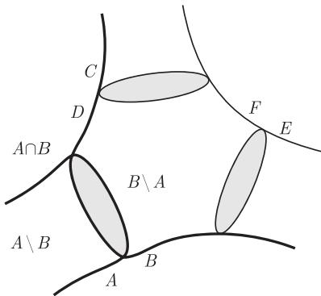
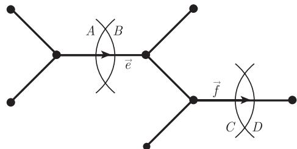
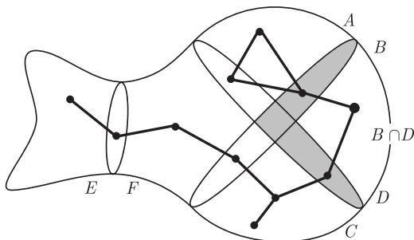
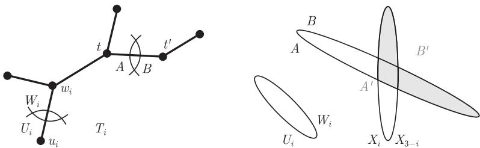

import Guide from '@/components/Guide.astro';
import Knowledge from '@/components/Knowledge.astro';
import Example from '@/components/Example.astro';
import Analysis from '@/components/Analysis.astro';
import Solution from '@/components/Solution.astro';
import Variant from '@/components/Variant.astro';
import Note from '@/components/Note.astro';
import Block from '@/components/Block.astro';
import Method from '@/components/Method.astro';
import Exercise from '@/components/Exercise.astro';

在这一章，我们已经看到稀疏图的几类子结构，它们从某种意义上讲是高连通的，但这些子结构并不是对某个大的 $k$ 是 $k$-连通子图或者子式. 大网格的子式就是这样一个例子，而 12.3 节末所定义的 $k$-块是另外一个例子，高阶的刺藤也是一个例子. 这些子结构都有一个共同特点：对图的每个低阶分离集，它们都基本上（虽然不一定完全地）包含在分离集的一侧.

比如，给定图 $G = (V, E)$ 的一个 $k$ 阶刺藤 $\mathcal{B}$，如果 $\{A, B\}$ 是一个阶 $< k$ 的分离集，则 $A \setminus B$ 或者 $B \setminus A$ (但不同时地) 包含 $\mathcal{B}$ 的一个集合. 这将有助于我们证明树宽对偶定理中的那个简单蕴含关系：$\mathcal{B}$ 可以把附着力 $< k$ 的任意树分解 $(T, \mathcal{V})$ 中分解树的每条边定向，使得边指向导出分离集中包含 $\mathcal{B}$ 中一个集合的那一侧，因此边被定向为指向 $T$ 的中心节点 $t$，这里 $V_t$ 覆盖 $\mathcal{B}$.

实际上，有时我们只关心高连通子结构是如何对 $G$ 的低阶分离集进行“定向”这一信息. 把这样的信息收集起来将得到有关高连通子结构的一个抽象概念：纠缠. 这一节的目的就是把这个概念严谨化，并根据定理 12.4.3 的精神证明关于纠缠的一个对偶定理，同时指出如何使用这个定理来表达树结构和高连通子结构之间的广义对偶关系.

图 $G$ 的分离 $\{A, B\}$ 的**定向** (orientation) 是指两个定向分离 (oriented separation) $(A, B)$ 和 $(B, A)$. 我们称 $(A, B)$ 是定向的，或者它指向 $B$ 和 $B$ 的子集. 给定分离的集合 $S$，我们用 $\vec{S} := \{(A, B) \mid \{A, B\} \in S\}$ 记它们的所有定向的集合. $S$ 的定向是 $\vec{S}$ 的子集 $O$，它包含 $S$ 中每个元素的两个定向中的恰好一个. 对定向分离的集合的族 $\mathcal{F}$，如果 $O$ 中的集合都不在 $\mathcal{F}$ 中，我们就称 $O$ **避开** (avoid) 了 $\mathcal{F}$.

给定 $G$ 的定向分离 $(A, B)$ 和 $(C, D)$，如果 $A \subseteq C$ 且 $B \supseteq D$，那么我们记 $(A, B) \leqslant (C, D)$. 对于 $G$ 的定向分离的集合 $\sigma$，如果只要 $(A, B) \leqslant (C, D)$ 且 $(C, D) \in \sigma$，$\sigma$ 就不包含 $(B, A)$，那么我们称集合 $\sigma$ 是**相容的** (consistent). 如果对不同的 $(A, B), (C, D) \in \sigma$ 都有 $(A, B) \leqslant (D, C)$，那么称 $\sigma$ 是定向分离的**星** (star)（图 12.5.1）.

<figure class="vp-figure">
  
  <figcaption>图 12.5.1 分离 $(A, B), (C, D), (E, F)$ 组成一个星</figcaption>
</figure>

例如，如果 $(T, \mathcal{V})$ 是 $G$ 的一个树分解，这里 $\mathcal{V} = (V_t)_{t \in T}$，那么把 $T$ 的边所导出的分离定向为指向某个固定的 $V_t$，这样的定向是相容的. 在这个定向下，关联 $t$ 的边所对应的分离成为定向分离的一个星. 进一步地，$G$ 的一个 $k$-块 $X$ 对 $G$ 中阶 $< k$ 的所有分离的集合 $S_k$ 定义了一个相容的定向：定向 $\{(A, B) \in \vec{S}_k \mid X \subseteq B\}$.

具有阶 $n \geqslant k$ 的刺藤 $\mathcal{B}$ 也给 $S_k$ 定义了一个定向：集合 $O = \{(A, B) \in \vec{S}_k \mid \exists X \in \mathcal{B}: X \subseteq B \setminus A\}$. 和 $k$-块的情形不同，这里不需要一个固定的刺藤，它包含在每个满足 $(A, B) \in O$ 的 $B$ 中，确实，所有这样 $B$ 的交集可能是空的. (例子?) 但是，$O$ 本身用另外一种方式表明了 $\mathcal{B}$ 具有大的阶数，即我们不能用少数几个满足 $(A, B) \in O$ 的 $A$ 来覆盖 $\mathcal{B}$：因为任何和 $A$ 相交的刺藤集合也和 $A \cap B$ 相交 (这是因为它在 $B \setminus A$ 中和刺藤集有交)，并且 $|A \cap B| \leqslant k - 1$，因此需要至少 $n / (k - 1)$ 个集合 $A$ 来覆盖 $\mathcal{B}$. 这里的想法不仅反映了而且给出了 $G$ 中一类高连通子结构，从而引导我们到下一个概念.

阶为 $k$ 的**纠缠** (tangle)，或者叫 **$k$-纠缠** ($k$-tangle)，是避开

$$
\mathcal{T} := \left\{\left\{(A_1, B_1), (A_2, B_2), (A_3, B_3)\right\} \mid G[A_1] \cup G[A_2] \cup G[A_3] = G\right\}
$$

的 $S_k$ 的一个定向. 没有提到阶数的纠缠称作 $G$ 中的纠缠.

注意，纠缠是相容的，因为 $(A, B) \leqslant (C, D)$ 蕴含着 $G[B] \cup G[C] \supseteq G[D] \cup G[C] = G$. 设 $\mathcal{T}^* := \{\sigma \in \mathcal{T} \mid \sigma \text{ 是一个星}\}$.

树 $T$ 的定向边的集合 $\vec{E}(T)$ 是一个偏序集，这里只要 $\vec{e} = (e, x, y)$ 和 $\vec{f} = (f, u, v)$ 是使得 $T$ 中的 $\{x, y\}\text{–}\{u, v\}$ 路起始于 $y$ 和终结于 $u$，就有偏序关系 $\vec{e} \leqslant \vec{f}$.

给定 $G$ 的分离所组成的集合 $S$，$S$-树 ($S$-tree) 是一个对 $(T, \alpha)$ 使得 $T$ 是一棵树，而 $\alpha: \vec{E}(T) \to \vec{S}$ 遵守这些集合上的序并且具有倒置交换性质，即如果 $\vec{e} \leqslant \vec{f}$ 就有 $\alpha(\vec{e}) \leqslant \alpha(\vec{f})$ (图 12.5.2)，以及只要 $\alpha(\vec{e}) = (A, B)$ 就有 $\alpha(\overleftarrow{e}) = (B, A)$. 例如，在树分解 $(T, \mathcal{V})$ 中，对于它导出的分离集合 $S$，分解把 $T$ 做成一棵 $S$-树.

我们称 $(T, \alpha)$ 是**构建于 $\mathcal{T}^*$ 上** (over $\mathcal{T}^*$) 的 $S$-树，如果对 $T$ 的每个节点 $t$，$\alpha$ 把指入的关联边的集合 $\vec{F}_t := \{(e, s, t) \in \vec{E}(T) \mid e = st \in T\}$ 映射到 $\mathcal{T}^*$ 的一个星.

<figure class="vp-figure">
  
  <figcaption>图 12.5.2 满足 $\alpha(\vec{e}) = (A, B) \leqslant (C, D) = \alpha(\vec{f})$ 的 $S$-树</figcaption>
</figure>

<Knowledge title="定理 12.5.1 (Robertson and Seymour, 1991)">
对所有的图 $G$ 和任何整数 $k > 0$，下面的命题是等价的：

(i) $G$ 有一个阶为 $k$ 的纠缠；

(ii) $S_k$ 有一个避免 $\mathcal{T}^*$ 的相容定向；

(iii) $G$ 没有构建于 $\mathcal{T}^*$ 上的 $S_k$-树.
</Knowledge>

在定理 12.5.1 的证明中，我们需要一个关于“交叉”分离阶数的结论（图 12.5.3）. 给定 $G$ 的两个分离 $\{A, B\}$ 和 $\{C, D\}$，容易看出 $\{A \cup C, B \cap D\}$ 和 $\{A \cap C, B \cup D\}$ 也是 $G$ 的分离. 这些角落分离 (corner separation) 的阶数之和是

$$
\left|(A \cup C) \cap (B \cap D)\right| + \left|(A \cap C) \cap (B \cup D)\right| = |A \cap B| + |C \cap D|.\tag{†}
$$

(†) 式的重要部分是不等式 “$\leqslant$”，有时它被称作子模性 (submodularity). 比如，它蕴含着在 $S_k$ 中两个分离的任意两个对立的角落分离，其中一个一定还在 $S_k$ 中. 在定理 12.5.1 的证明中，我们会两次用到这一事实.

<figure class="vp-figure">
  
  <figcaption>图 12.5.3 分离 $\{A \cup C, B \cap D\}$ 是 $\{A, B\}$ 和 $\{C, D\}$ 的四个角落分离中的一个</figcaption>
</figure>

<Knowledge title="引理 12.5.2">
对 $S_k$ 的任意相容定向 $O$，如果 $O$ 有一个子集在 $\mathcal{T}$ 中，那么它也有一个子集在 $\mathcal{T}^*$ 中.

<Solution title="证明">
考虑 $\mathcal{T}$ 中任意集合 $\sigma = \{(A_i, B_i) \mid i = 1, 2, 3\} \subseteq O$，我们证明除非 $\sigma$ 是一个星，那么总可以把它的一个分离用 $O$ 中的一个严格小的分离来代替，并保持还在 $\mathcal{T}$ 中. 经过有限步，我们可以把 $\sigma$ 变成一个星——$O$ 在 $\mathcal{T}^*$ 中的一个子集.

如果 $\sigma$ 不是一个星，我们可以假定 $(A_1, B_1) \not\leqslant (B_2, A_2)$. 由 (†) 和 $\sigma \subseteq \vec{S}_k$，我们可以进一步假定 $(C, D) := (A_1 \cap B_2, B_1 \cup A_2) \in \vec{S}_k$；另外一种情形，即 $(B_1 \cap A_2, A_1 \cup B_2) \in \vec{S}_k$，可以类似讨论. 因为 $O$ 是相容的且 $(C, D) \leqslant (A_1, B_1) \in O$，所以 $(D, C) \in O$ 不成立，从而 $(C, D) \in O$. 但是 $(C, D) < (A_1, B_1)$，这是因为由假定要么 $A_1 \not\subseteq B_2$ 要么 $B_1 \not\supseteq A_2$. 在 $\sigma$ 中用 $(C, D)$ 替换 $(A_1, B_1)$ 所得到 $\sigma'$ 就给出了想要的递减：因为任意顶点或者 $G[A_1]$ 的不在 $G[C]$ 中的边都属于 $G[A_2]$ 中，并且 $(A_2, B_2) \in \sigma'$，因此我们得到 $\sigma' \in \mathcal{T}$. ∎
</Solution>
</Knowledge>

<Solution title="定理 12.5.1 的证明">
因为纠缠是相容的，由引理 12.5.2 知 (i) 和 (ii) 是等价的.

(ii) $\to$ (iii) 假设 $G$ 有一个构建于 $\mathcal{T}^*$ 上的 $S_k$-树 $(T, \alpha)$，那么 $S_k$ 的任意定向 $O$ 通过 $\alpha$ 定义了 $T$ 边集的一个定向. 设 $t \in T$ 是 $T$ 中任意一条极大路的最后一个节点，这里路中的所有边的定向都是向前的. 那么关联 $t$ 的所有边都是指向 $t$ 的，且 $\alpha$ 把这些定向的边映射到 $\mathcal{T}^*$ 中的一个星，所以 $O$ 不能避开 $\mathcal{T}^*$.

(iii) $\to$ (ii) 考虑集合 $O^- \subseteq \vec{S}_k$，则它在 $\vec{S}_k$ 的序中是下闭的，即对每个 $(A, B) \in \vec{S}_k$，只要存在一个 $(C, D) \in O^-$ 使得 $(A, B) \leqslant (C, D)$，那么 $O^-$ 就包含 $(A, B)$，并且 $O^-$ 包含所有满足 $|A| < k$ 的定向分离 $(A, V)$：它的逆 $(V, A)$ 组成 $\mathcal{T}^*$ 中单独星的那些定向分离. 设 $\mathcal{T}^+ := \{\{(B, A)\}: (A, B) \in O^-\} \setminus \mathcal{T}^*$. 所以

$$
O^- = \left\{(A, B): \{(B, A)\} \in \mathcal{T}^* \cup \mathcal{T}^+\right\}.\tag{$*$}
$$

我们证明下面两个命题中的一个一定成立：

(1) $S_k$ 有一个避开 $\mathcal{T}^* \cup \mathcal{T}^+$ 的相容定向；

(2) $G$ 有一个构建于 $\mathcal{T}^* \cup \mathcal{T}^+$ 上的 $S_k$-树.

注意到，当 $\mathcal{T}^+ = \emptyset$ 时，这蕴含着 (iii) $\to$ (ii).

如果 $O^-$ 包含一个分离 $(X, Y)$ 以及它的逆 $(Y, X)$，那么由 ($*$) 知，具有 $T = K^2$ 的 $(T, \alpha)$ 和 $\alpha: \vec{E}(T) \to \{(X, Y), (Y, X)\}$ 满足 (2). 现在我们假定 $O^-$ 包含一个分离但不包含它的逆，那么 $O^-$ 是某个集合 $S^- \subseteq S_k$ 的定向，且 ($*$) 蕴含着

$$
O^- \text{ 不包含 } (B, A) \text{ 使得 } \{(B, A)\} \in \mathcal{T}^* \cup \mathcal{T}^+.\tag{$**$}
$$

我们对 $|S_k \setminus S^-|$ 使用归纳法来证明 (1) 或 (2) 成立. 在归纳法的初始步骤，$O^-$ 是所有 $S_k$ 的一个定向. 因为它在 $\vec{S}_k$ 中是下闭的，所以也是相容的. 因此，如果 (1) 不成立，由 ($**$) 知，$O^-$ 有一个子集 $\sigma \in \mathcal{T}^* \cup \mathcal{T}^+$，且 $|\sigma| \geqslant 2$. 设 $T$ 是具有 $n = |\sigma|$ 个叶子的星 $K_{1, n}$，而 $\alpha$ 把具有叶子 $s$ 的定向边 $(e, s, t)$ 双射地映射到 $\sigma$ 的元素. 因此，根据 $\sigma$ 的定义和 ($*$)，$(T, \alpha)$ 满足 (2).

在归纳步骤，我们有 $S_k \setminus S^- \neq \emptyset$. 选择 $S_k \setminus S^-$ 中的 $\{U_1, W_1\}$ 和 $\{U_2, W_2\}$ 使得两个 $(U_i, W_i)$ 在 $\vec{S}_k \setminus \vec{S}^-$ 中都是极小的，同时 $(U_1, W_1) \leqslant (W_2, U_2)$. 因此，$(U_i, W_i)$ 即使在 $\vec{S}_k \setminus O^-$ 中也是极小的：在 $\vec{S}_k \setminus O^-$ 中，对任意 $(U, W) < (U_i, W_i)$，根据 $(U_i, W_i)$ 在 $\vec{S}_k \setminus \vec{S}^-$ 中的极小性，我们有 $(W, U) \in O^-$，所以 $(W_i, U_i) < (W, U)$ 会属于 $O^-$（它是下闭的），这与 $(U_i, W_i) \notin \vec{S}^-$ 矛盾.

所以，集合 $O_i^- = O^- \cup \{(U_i, W_i)\}$ 在 $\vec{S}_k$ 中也是下闭的，并且是集合 $S_i^- \subseteq S_k$（它严格地包含 $S^-$）的定向. 所以，我们可以对这些 $O_i^-$ 使用归纳假设，来得到 (1) 或 (2)，这里 $\mathcal{T}_i^+ = \{\{(B, A)\}: (A, B) \in O_i^-\} \setminus \mathcal{T}^*$.

因为，只要 (1) 对 $\mathcal{T}_1^+$ 或者 $\mathcal{T}_2^+$ 成立，就对 $\mathcal{T}^+$ 成立，所以我们可以假定 $\mathcal{T}_i^+$ 都满足 (2). 设 $(T_i, \alpha_i)$ 是构建于 $\mathcal{T}^* \cup \mathcal{T}_i^+$ 上相对应的 $S_k$-树. 如果它们中的一个还是构建于 $\mathcal{T}^* \cup \mathcal{T}^+$ 上的，证明结束. 因此，我们假定它不是，那么每个 $T_i$ 有一个节点 $u_i$ 使得，对 $T_i$ 在 $u_i$ 的每条边 $e_i = u_i w_i$ 有 $\alpha_i(e_i, u_i, w_i) = (U_i, W_i)$.

每个这样的 $u_i$ 一定是一个叶子，因为否则 $(W_i, U_i) \leqslant (U_i, W_i)$，因此 $W_i \subseteq U_i$ 从而 $U_i = V$，所以 $(W_i, U_i) \in O^-$，与 $(U_i, W_i)$ 的选择矛盾. 类似地，这些叶子 $u_i$ 是唯一的. 确实，如果 $u_i'$ 是另外一个叶子，并且关联边 $e_i' = u_i' w_i'$，则 $(e_i', u_i', w_i') \leqslant (e_i, w_i, u_i)$，所以 $\alpha_i(e_i', u_i', w_i') \leqslant \alpha_i(e_i, w_i, u_i) = (W_i, U_i)$. 所以，如果 $\alpha_i(e_i', u_i', w_i') = (U_i, W_i)$，则 $(U_i, W_i) \leqslant (W_i, U_i)$，和前面一样得到矛盾.

所以，$S_k$-树 $(T_i, \alpha_i)$ 几乎是构建于 $\mathcal{T}^* \cup \mathcal{T}^+$ 上的：除了在叶子 $u_i$ 处，其他地方成立.

选择满足

$$
(U_1, W_1) \leqslant (X_1, X_2) \leqslant (W_2, U_2)
$$

且具有最小阶的分离 $\{X_1, X_2\} \in S_k \setminus S^-$. 因为 $(U_1, W_1)$ 是这样一个分离，所以符合要求的分离一定存在. 我们把映射 $\alpha_i$ 修改成映射 $\alpha_i'$ 来定义 $S_k$-树 $(T_i, \alpha_i')$. 除了在 $u_i$ 外，这些树也是构建于 $\mathcal{T}^* \cup \mathcal{T}^+$ 上的，而在 $u_i$ 外我们有 $\alpha_i'(e_i, w_i, u_i) = (X_{3-i}, X_i)$. 下一步计划是在刚刚标号的树 $T_i - u_i$ 上加上边 $w_i w_{3-i}$，并把它映射到它们的公共分离 $(X_i, X_{3-i})$，从而得到想要的构建于 $\mathcal{T}^* \cup \mathcal{T}^+$ 上的 $S_k$-树.

为了定义 $\alpha_i'$，考虑 $T_i$ 的一条边 $e$. 我们把 $e$ 的端点记为 $t, t'$ 使得 $(e_i, u_i, w_i) \leqslant (e, t, t')$. 因此，假如 $\alpha_i(e, t, t') = (A, B)$，则令

$$
\alpha_i'(e, t, t') = (A', B') := (A \cup X_i, B \cap X_{3-i})
$$

且 $\alpha_i'(e, t', t) = (B', A')$（图 12.5.4）.

<figure class="vp-figure">
  
  <figcaption>图 12.5.4 $(A, B)$ 转移成 $(A', B')$</figcaption>
</figure>

下面我们证明，和 $\alpha_i$ 一样，$\alpha_i'$ 也保持 $\vec{E}(T_i)$ 和 $\vec{S}_k$ 的序. 考虑任意的 $\vec{e} \leqslant \vec{f} \in \vec{E}(T_i)$，假设 $(A, B) = \alpha_i(\vec{e}) \leqslant \alpha_i(\vec{f}) = (C, D)$，则有 $A \subseteq C$ 和 $B \supseteq D$. 如果 $(e_i, u_i, w_i) \leqslant \vec{e}$，那么 $\alpha_i'(\vec{e}) =: (A', B') \leqslant (C', D') := \alpha_i'(\vec{f})$，这是因为 $A' = A \cup X_i \subseteq C \cup X_i = C'$ 和 $B' = B \cap X_{3-i} \supseteq D \cap X_{3-i} = D'$. 另一方面，如果 $(e_i, u_i, w_i) \leqslant \overleftarrow{e}$ 但是 $(e_i, u_i, w_i) \leqslant \vec{f}$，则 $A' = A \cap X_{3-i} \subseteq A \subseteq C \subseteq C \cup X_i = C'$，而 $B' = B \cup X_i \supseteq B \supseteq D \supseteq D \cap X_{3-i} = D'$，所以 $(A', B') \leqslant (C', D')$. 因为根据 $\alpha_i'$ 的定义，它对定向的逆是可交换的，所以所有可能的情形都考虑过了.

其次，我们证明 $\alpha_i'$ 把 $\vec{E}(T_i)$ 映射到 $\vec{S}_k$. 给定一条边 $e \in E(T_i)$，设 $\vec{e}$ 使得 $(e_i, u_i, w_i) \leqslant \vec{e}$，就如 $\alpha_i'$ 所定义那样. 则对 $\alpha_i(\vec{e}) = (A, B)$ 我们有 $\alpha_i'(\vec{e}) = (A', B') = (A \cup X_i, B \cap X_{3-i})$. 根据 (†)，有 $|A' \cap B'| \leqslant |A \cap B| \leqslant k$，这正是我们想要的，这里假定

$$
(Y_i, Y_{3-i}) := (A \cap X_i, B \cup X_{3-i})
$$

的阶不比 $\{X_1, X_2\}$ 的阶来得小. 确实，它不能来得小，由于 $(U_1, W_1) \leqslant (Y_1, Y_2) \leqslant (W_2, U_2)$，这会和我们选择的 $\{X_1, X_2\}$ 矛盾. 回顾前面，因为 $(U_i, W_i) \leqslant (X_i, X_{3-i})$ 以及 $(U_i, W_i) \leqslant (A, B)$，我们有 $U_i \subseteq X_i$ 以及 $U_i \subseteq A$，和 $W_i \supseteq X_{3-i}$ 以及 $W_i \supseteq B$，所以得到 $(U_i, W_i) \leqslant (Y_i, Y_{3-i})$ 和 $(Y_i, Y_{3-i}) \leqslant (X_i, X_{3-i}) \leqslant (W_{3-i}, U_{3-i})$.

因此，$(T_i, \alpha_i')$ 确实是一棵 $S_k$-树. 进一步地，除 $u_i$ 外，证明它是一棵构建于 $\mathcal{T}^* \cup \mathcal{T}^+$ 上的 $S_k$-树，这里

$$
\alpha_i'(e_i, w_i, u_i) = (W_i \cap X_{3-i}, U_i \cup X_i) = (X_{3-i}, X_i).
$$

给定一个叶子 $t \neq u_i$，它的关联边是 $e = st$，并设 $\alpha_i(e, s, t) = (A, B)$，那么我们有 $(e_i, u_i, w_i) \leqslant (e, s, t)$，所以

$$
\alpha_i'(e, s, t) = (A \cup X_i, B \cap X_{3-i}) \geqslant (A, B) = \alpha_i(e, s, t).
$$

因为 $(T_i, \alpha_i)$ 是构建于 $\mathcal{T}^* \cup \mathcal{T}^+$ 上的（除 $u_i$ 外），所以由 ($*$) 知 $\alpha_i(e, t, s) \in O^-$. 由于 $O^-$ 在 $\vec{S}_k$ 中是下闭的，这意味着 $\alpha_i'(e, t, s) \leqslant \alpha_i(e, t, s)$ 也在 $O^-$ 中，所以 $\{\alpha_i'(e, s, t)\} \in \mathcal{T}^* \cup \mathcal{T}^+$，这正是我们所期望的.

现在考虑非叶子节点 $t$，设指向 $t$ 的边的集合是 $\vec{F}_t = \{(f_0, s_0, t), \dots, (f_n, s_n, t)\}\ (n \leqslant 2)$. 因为 $\alpha_i'$ 保持 $\vec{E}(T_i)$ 和 $\vec{S}_k$ 的序，所以我们已经知道 $\alpha_i'(\vec{F}_t)$ 是一个星. 要证明 $\alpha_i'(\vec{F}_t) \in \mathcal{T}^*$，假定 $s_0 \in u_i T_i t$. 那么对所有 $j \geqslant 1$ 有 $(e_i, u_i, w_i) \leqslant (f_0, s_0, t) \leqslant (f_j, t, s_j)$. 记 $\alpha_i(f_j, s_j, t) =: (A_j, B_j)$ 和 $\alpha_i'(f_j, s_j, t) =: (A_j', B_j')$，我们有 $A_0' = A_0 \cup X_i$ 以及对 $j \geqslant 1$，$A_j' = A_j \cap X_{3-i}$. 所以任意顶点或者 $G[A_j]$ 的任意不在 $G[A_j']$ 中的边都属于 $G[X_i] \subseteq G[A_0']$. 由 $\alpha_i$ 把 $\vec{F}_t$ 映射到 $\mathcal{T}^*$（因为 $t$ 不是一个叶子），这蕴含着 $\alpha_i'$ 也如此.

设 $T$ 是一棵树，它是由 $T_1 - u_1$ 和 $T_2 - u_2$ 的不交并以及连接 $w_1$ 和 $w_2$ 的新边 $e$ 组成的. 对 $i = 1, 2$，设 $\alpha: \vec{E}(T) \to \vec{S}_k$ 把 $(e, w_{3-i}, w_i)$ 映射到 $\alpha_i'(e_i, u_i, w_i) = (X_i, X_{3-i})$；对 $\vec{E}(T)$ 的其他元素拓展 $\alpha_i'$，那么 $\alpha$ 关于 $\vec{e}$ 和 $(X_1, X_2)$ 的逆是可交换的，并且对所有 $t \in T$ 有 $\alpha(\vec{F}_t) = \alpha_i'(\vec{F}_t) \in \mathcal{T}^* \cup \mathcal{T}^+$，特别地，对 $t = w_i$ 也成立. 所以 $(T, \alpha)$ 满足 (2). ∎
</Solution>

如前所述，定理 12.5.1 是一个一般性结果的特殊情形，这里的 $\mathcal{T}^*$ 可以被一个定向分离的“禁用”星的族 $\mathcal{F}$ 所代替. 给定一个分离的集合 $S$，$S$ 的 **$\mathcal{F}$-纠缠** ($\mathcal{F}$-tangle) 是 $S$ 的一个相容的定向，它没有子集 $\sigma \in \mathcal{F}$. 对

$$
\mathcal{F}_k := \Big\{\sigma \subseteq \vec{S}_k: \sigma \text{ 是一个星并且 } \Big|\bigcap \{B: (A, B) \in \sigma\}\Big| < k\Big\},
$$

我们得到下面一个关于树宽的纠缠形式的对偶定理：

<Knowledge title="定理 12.5.3">
对所有的图 $G$ 和任何整数 $k > 0$，下面的命题是等价的：

(i) $G$ 有一棵构建于 $\mathcal{F}_k$ 上的 $S_k$-树；

(ii) $G$ 没有 $S_k$ 的 $\mathcal{F}_k$-纠缠.
</Knowledge>

不难证明，(i) 等价于 $G$ 的树宽小于 $k - 1$. 更一般地，设 $S$ 是一个树分解所导出的分离的集合，那么这个树分解产生一个 $S$-树；反过来，从这个 $S$-树可以容易地得到这个树分解 (练习 45).

和图的 $k$-块一样，纠缠可以被一个树分解“分离”. 图纠缠的重要内涵是它的分离，表达它最方便的方法不是通过构造树分解，而是树分解所导出的分离集合：有了这些分离，如果需要的话，可以容易地构造整个树分解. 下面让我们对它解释得更准确一些.

如果 $G$ 中的两个分离有可比的定向，就称它们是**嵌套的** (nested)；否则，称它们是**交叉的** (cross). 例如，图 12.5.3 中的分离 $\{E, F\}$ 和两个交叉分离 $\{A, B\}$ 和 $\{C, D\}$ 是嵌套的. 由树分解所导出的分离显然是嵌套的，而图的每个嵌套分离集是由某个树分解所导出的 (练习 16 和练习 42).

我们称一个分离**区分** (distinguish) 两个纠缠（它们不一定有相同阶数），如果这两个纠缠对这个分离有不同的定向. 进一步地，称这个分离**有效地** (efficiently) 区分它们，如果它们不能被更小阶数的分离所区分. 分离的集合 $S$ 在图 $G$ 中有效地区分某个纠缠的集合，如果对这个集合中的任意两个纠缠，只要它们可以被 $G$ 的某个分离区分，就可以被 $S$ 中的某个分离有效地区分.

<Knowledge title="定理 12.5.4 (Robertson and Seymour, 1991)">
每个图 $G$ 有一个嵌套分离集，它有效地区分 $G$ 中的所有纠缠.
</Knowledge>

这个定理的证明需要一个关于嵌套和交叉分离的简单结论，叫做鱼引理（参照图 12.5.3）.

<Knowledge title="引理 12.5.5">
设 $\{A, B\}$ 和 $\{C, D\}$ 是两个交叉分离，那么每个同时和 $\{A, B\}$ 和 $\{C, D\}$ 嵌套的分离 $\{E, F\}$ 也和它们的四个角落分离是嵌套的.

<Solution title="证明">
因为 $\{E, F\}$ 与 $\{A, B\}$ 和 $\{C, D\}$ 都是嵌套的，所以 $\{E, F\}$ 有一个定向 $\leqslant \{A, B\}$ 的某个定向，同时它有另一个定向 $\leqslant \{C, D\}$ 的某个定向. 如果 $\{E, F\}$ 的这些定向不能选成相同的，那么存在定向使得 $(A, B) \leqslant (E, F) \leqslant (C, D)$，即 $\{A, B\}$ 和 $\{C, D\}$ 是嵌套的，与假定矛盾.

所以 $\{E, F\}$ 有一个定向 $(E, F)$ 使得，对 $\{A, B\}$ 的适当定向 $(A, B)$ 和 $\{C, D\}$ 的适当定向 $(C, D)$，有 $(E, F) \leqslant (A, B)$ 以及 $(E, F) \leqslant (C, D)$. 因此 $(E, F) \leqslant (A \cap C, B \cup D)$. 更平凡地，有 $(E, F) \leqslant (A \cup C, B \cap D)$，$(E, F) \leqslant (A \cup D, B \cap C)$ 以及 $(E, F) \leqslant (C \cup B, A \cap D)$. ∎
</Solution>
</Knowledge>

<Solution title="定理 12.5.4 的证明">
选择 $G$ 中具有以下性质嵌套分离的极大序列 $S$，并用 $|s|$ 记分离 $s$ 的阶数：

(i) 每个 $s \in S$ 有效地区分 $G$ 中某两个纠缠；

(ii) 对每个 $s \in S$，$S$ 中在 $s$ 前面的分离有效地区分 $G$ 中阶数最多为 $|s|$ 的所有纠缠.

我们断言 $S$ 有效地区分 $G$ 中的所有纠缠.

假设存在 $G$ 中的两个纠缠 $\tau, \tau'$，它们被 $G$ 中的某个分离 $t$ 有效地区分，但不被 $S$ 中的任意分离有效地区分. 选择 $\tau, \tau'$ 和 $t$ 使得 $t$ 具有最小的阶数（设为 $k$），则 $\tau$ 和 $\tau'$ 的阶数 $> k$. 同时 $t$ 把它们有效地区分. 特别地，$t \notin S$. 在阶数为 $k$ 并有效地区分 $\tau$ 和 $\tau'$ 的所有分离中，选择 $t$ 和 $S$ 中尽可能多的分离是嵌套的.

$S$ 中所有分离的阶数最多是 $k$. 确实如此，如果 $s \in S$ 有阶数 $|s| > k$，那么由 (ii) 知，具有阶数 $k + 1 \leqslant |s|$ 的纠缠 $\tau \cap \vec{S}_{k+1}$ 和 $\tau' \cap \vec{S}_{k+1}$ 会被 $S$ 中的某个分离所区分，那么这也会区分 $\tau$ 和 $\tau'$，矛盾.

因为我们不能把 $t$ 加到 $S$ 中，所以存在某个 $s \in S$（设 $s$ 的阶为 $\ell$）和 $t$ 交叉.（确实，根据 $k$ 的极小性，把 $t$ 加到 $S$ 不能违反 (ii)，即使 $S$ 中所有分离的阶数都 $< k$.）由 (i) 知，分离 $s$ 有效地区分某两个纠缠 $\sigma$ 和 $\sigma'$.

设 $t = \{A, B\}$ 使得 $(A, B) \in \tau$ 和 $(B, A) \in \tau'$，而 $s = \{C, D\}$ 使得 $(C, D) \in \sigma$ 和 $(D, C) \in \sigma'$. 因为 $s$ 不能把 $\tau$ 和 $\tau'$ 区分开来，我们可以假定它们都包含 $(C, D)$. 我们将证明角落分离 $r = \{A \cup C, B \cap D\}$ 和 $r' = \{B \cup C, A \cap D\}$ 的阶数 $> k$.

假定 $|r| \leqslant k$，由引理 12.5.5 知，如果 $S$ 的一个分离和 $t$ 是嵌套的，那么它也和 $r$ 是嵌套的，因为 $S$ 的每个这样的分离 $\{E, F\}$ 不仅和 $t$ 是嵌套的也与 $s$ 是嵌套的（注意它们都属于 $S$）. 进一步地，$r$ 和 $s$ 是嵌套的，但 $r$ 和 $t$ 是交叉的. 因此，$r$ 比 $t$ 和 $S$ 中的更多分离嵌套，这和 $t$ 的选择矛盾，原因是 $r$ 也区分 $\tau$ 和 $\tau'$：由于 $(A, B) \in \tau$ 和 $(C, D) \in \tau$，且 $\tau$ 是一个纠缠，所以有 $(A \cup C, B \cap D) \in \tau$；根据 $\tau'$ 的相容性以及 $(B \cap D, A \cup C) \leqslant (B, A) \in \tau'$，我们知道 $(B \cap D, A \cup C)$ 属于 $\tau'$.

因此 $r$ 和 $r'$ 的阶数 $> k$. 所以，由子模性 (†) 知，交叉对 $t$ 和 $s$ 的另外两个角落分离的阶小于 $\ell = |s|$. 因为 $s$ 可以有效地区分 $\sigma$ 和 $\sigma'$，所以两个角落分离都不能区分 $\sigma$ 和 $\sigma'$. 根据相容性，它们的定向 $(A \cap C, B \cup D) \leqslant (C, D) \in \sigma$ 和 $(B \cap C, A \cup D) \leqslant (C, D) \in \sigma$ 都属于 $\sigma$，所以也属于 $\sigma'$. 由于 $(D, C) \in \sigma'$，但 $G[A \cap C] \cup G[B \cap C] \cup G[D] = G$，这与 $\sigma'$ 是一个纠缠矛盾. ∎
</Solution>

根据定理 12.3.7 的精神，我们可以把定理 12.5.4 加强成一个“典范”版本：找到一个分离的嵌套集合，而且在 $G$ 的自同构下是不变的. 细节见本章后的注释.
