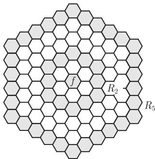
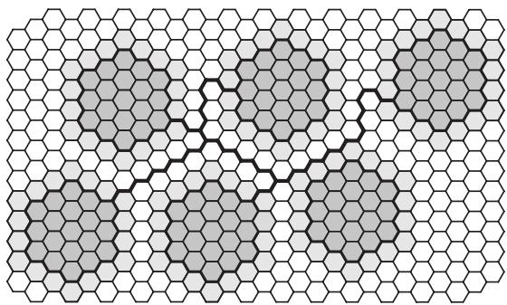
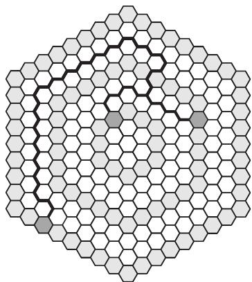
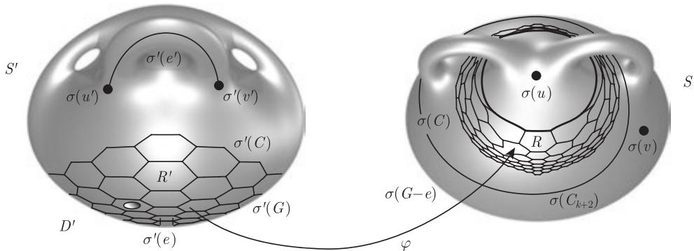
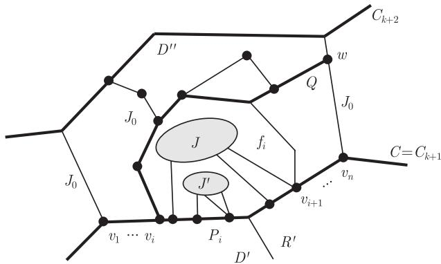

import Guide from '@/components/Guide.astro';
import Knowledge from '@/components/Knowledge.astro';
import Example from '@/components/Example.astro';
import Analysis from '@/components/Analysis.astro';
import Solution from '@/components/Solution.astro';
import Variant from '@/components/Variant.astro';
import Note from '@/components/Note.astro';
import Block from '@/components/Block.astro';
import Method from '@/components/Method.astro';
import Exercise from '@/components/Exercise.astro';

图论中经常出现一些在子式关系下封闭的图性质. 最常见的例子是，可嵌入到某个固定曲面上的性质，比如可平面性.

根据 Kuratowski 定理，可平面性可以通过禁用子式 $K^5$ 和 $K_{3,3}$ 来刻画，在下面的意义下，这是可平面性的一个**好刻画** (good characterization)：假如我们要说服某人一个图是可平面的，如果可以给出一个平面上的画法，（至少直觉上）就很容易令人信服. 但是，如果图是非可平面的，那么怎样让人相信不存在平面画法呢？根据 Kuratowski 定理，我们也有一个简单的办法：只需要在图中展示一个 $IK^5$ 或 $IK_{3,3}$ 就可以作为非可平面性的“证据”. 简单的命题 12.6.2 是另外一个好刻画的例子：要证明图的树宽 $< 3$，我们只需要给出一个适当的树分解；否则，我们可以找到一个 $IK^4$ 作为“证据”.

毫无疑问，用禁用子式的集合来刻画性质 $\mathcal{P}$ 的这类定理是图论中最吸引人的结果之一. 像我们在引理 12.6.1 中看到的那样，只要 $\mathcal{P}$ 是子式封闭的，就存在一个这样的刻画：$\mathcal{P} = \operatorname{Forb}_{\preccurlyeq}(\overline{\mathcal{P}})$，这里 $\overline{\mathcal{P}}$ 是 $\mathcal{P}$ 的补. 然而，一个很自然的想法是希望禁用子式的集合尽可能的小. 的确，存在一个唯一的最小的这样集合，即

$$
\mathcal{K}_{\mathcal{P}} := \{H \mid H \text{ 在 } \overline{\mathcal{P}} \text{ 中是 } \preccurlyeq\text{-极小的}\},
$$

它满足 $\mathcal{P} = \operatorname{Forb}_{\preccurlyeq}(\mathcal{K}_{\mathcal{P}})$，且这个集合包含在每个满足 $\mathcal{P} = \operatorname{Forb}_{\preccurlyeq}(\mathcal{H})$ 的其他集合 $\mathcal{H}$ 中. 我们称 $\mathcal{K}_{\mathcal{P}}$ 为 $\mathcal{P}$ 的 **Kuratowski 集** (Kuratowski set).

显然，$\mathcal{K}_{\mathcal{P}}$ 的元素在子式关系 $\preccurlyeq$ 下是不可比较的. Robertson 和 Seymour 的**图子式定理** (graph minor theorem) 指出，$\preccurlyeq$-不可比较的图的集合一定是有限的.

<Knowledge title="定理 12.7.1 (Robertson and Seymour, 1986–2004)">
所有的有限图在子式关系 $\preccurlyeq$ 下被良拟序化.
</Knowledge>

我们将在本节的最后部分给出图子式定理证明的思路.

<Knowledge title="推论 12.7.2">
任何关于子式封闭的图性质的 Kuratowski 集都是有限的.
</Knowledge>

作为推论 12.7.2 的一个特殊情形，对每个曲面 $S$，我们得到了 Kuratowski 型的定理：曲面 $S$ 的可嵌入性 $\mathcal{P}(S)$ 可以用有限个禁用子式组成的集合 $\mathcal{K}_{\mathcal{P}(S)}$ 来刻画.

<Knowledge title="推论 12.7.3">
对每个曲面 $S$，都存在一个图的有限集 $\{H_1, \dots, H_n\}$，使得任意图可嵌入到 $S$ 中当且仅当它不包含 $H_1, \dots, H_n$ 中的任何一个作为子式.

<Solution title="证明">
由它们的极小性，$\mathcal{K}_{\mathcal{P}(S)}$ 中的图在子式关系下是不可比较的. 如果它们的树宽是有界的，那么 $\mathcal{K}_{\mathcal{P}(S)}$ 是被子式关系良拟序化的（定理 12.4.2），因此一定是有限的. 所以，假设它们的树宽是无界的，设 $r$ 由引理 12.7.4 给出，由定理 12.6.3 知，某个 $H \in \mathcal{K}_{\mathcal{P}(S)}$ 有一个足够大的网格子式可以包含 $H^r$. 根据命题 1.7.3，$H^r$ 是 $H$ 的一个拓扑子式，这与 $r$ 的选取矛盾. ∎
</Solution>
</Knowledge>

虽然推论 12.7.3 可以从图子式定理容易推出，但它也可以被直接证明. 我们下一步的目标就是给出它的一个直接证明，关键的步骤是证明在 $\mathcal{K}_{\mathcal{P}(S)}$ 中的图不包含任意大的网格作为子式（引理 12.7.4），因此它们的树宽是有界的（定理 12.6.3），所以 $\mathcal{K}_{\mathcal{P}(S)}$ 被良拟序化（定理 12.4.2），从而是有限的.

引理 12.7.4 的证明很好地体现了图子式和曲面拓扑之间是如何相互影响的，根据定理 12.6.6 的方法（我们这里没有提供证明），这个相互关系也是图子式定理证明的关键要素. 附录 B 概括了一些这里用到的关于曲面的背景知识，其中包括证明中用到的一个引理. 为了方便（参考命题 1.7.3 (ii)），我们将使用六边形网格而不是方形网格.

我们用 $H^r$ 表示一个平面六边形网格，它的对偶具有半径 $r$（图 12.7.1）. $H^r$ 的对偶的中心点所对应的面叫做**中心面** (central face).（通常，当我们提到 $H^r$ 的面 (face) 时，均指它的六边形面，而不是它的那个外部面.）我们称 $H^r$ 的一个子网格 $H^k$ 是**规范的** (canonical)，如果它们的中心面是重合的. 记 $S_k$ 为 $H^r$ 中的规范子网格 $H^k$ 的外围圈，例如，$S_1$ 是 $H^r$ 的中心面的六边形边界. **环** (ring) $R_k$ 是 $H^r$ 的子图，它由 $S_k$ 和 $S_{k+1}$ 以及它们之间的边构成.

<figure class="vp-figure">
  
  <figcaption>图 12.7.1 具有中心面 $f$，环 $R_2$ 和 $R_5$ 的六边形网格 $H^6$</figcaption>
</figure>

<Knowledge title="引理 12.7.4">
对每个曲面 $S$，都存在一个整数 $r$ 使得，关于“不可嵌入 $S$”这个性质，不存在一个极小图，它包含 $H^r$ 作为拓扑子式.

<Solution title="证明">
假设 $G$ 是不能嵌入到曲面 $S$ 中的图且 $G$ 是关于这个性质极小的，证明的主要思路如下：因为 $G$ 是不能嵌入到 $S$ 中的极小图，所以可以把它嵌入到一个稍微大一点的曲面 $S'$ 上，如果 $G$ 包含一个非常大的 $H^r$ 网格，那么根据引理 B.6，某个大的 $H^m$ 子网格在曲面 $S'$ 上是平的，也就是说，它的所有面的并在 $S'$ 中是一个圆盘 $D'$. 我们从这个 $H^m$ 网格的中间选取一条边 $e$，并把 $G - e$ 嵌入到 $S$ 中. 同样地，根据引理 B.6，$H^m$ 的一个环在 $S$ 中也将是平的. 我们可以把原来嵌入到 $D'$ 内的 $G$ 的（可平面）子图嵌入到这个环中，注意到，这个子图包含边 $e$. $G$ 剩下的部分可以像以前一样在 $S$ 中嵌入到这个环外部，从而把整个 $G$ 都嵌入到 $S$ 中，得到矛盾.

更正式地，设 $\varepsilon := \varepsilon(S)$ 是曲面 $S$ 的 Euler 亏格. 令 $r$ 足够大使得 $H^r$ 包含 $\varepsilon + 3$ 个互不相交的 $H^{m+1}$ 的拷贝，其中 $m := 3\varepsilon + 4$. 我们证明 $G$ 不包含 $TH^r$ 作为子图.

设 $e' = u'v'$ 是 $G$ 的一条任意边，选取 $G - e'$ 在曲面 $S$ 中的一个嵌入 $\sigma'$，并选取一个面使得 $u'$ 在边界上，而另外一个面使得 $v'$ 在边界上. 在每个面上切除一个圆盘，在两个洞处加上一个环柄得到一个 Euler 亏格为 $\varepsilon + 2$ 的曲面 $S'$ (引理 B.3). 把 $e'$ 沿着环柄嵌入，从而把 $\sigma'$ 扩展成为图 $G$ 在曲面 $S'$ 上的一个嵌入.

假设 $G$ 有一个子图 $H = TH^r$，设映射 $f: H^r \to H$ 把 $H^r$ 的顶点映射到对应的分支顶点上，把边映射到 $H$ 中这两个顶点之间对应的路上. 我们证明 $H^r$ 有一个子网格 $H^m$（不必是规范的），它的六边形面的边界（在 $\sigma' \circ f$ 下）对应 $S'$ 中的圈，这里的圈是不交开圆盘的边界.

根据 $r$ 的选取，我们可以在 $H^r$ 中找到 $\varepsilon + 3$ 个不相交的 $H^{m+1}$ 的拷贝，这些 $H^{m+1}$ 的规范子网格 $H^m$ 不仅不相交，而且在 $H^r$ 中它们之间的距离比较远，从而删除这些子网格后有一棵树 $T \subseteq H^r$ 使得 $T$ 和每个 $H^m$ 有一条边连接（图 12.7.2）. 因此只要我们从每个 $H^m$ 中挑选出一个六边形，在 $S'$ 中删除这些六边形的象 $C$，$S'$ 中剩下部分中包含 $(\sigma' \circ f)(T)$ 的分支 $D_0$ 将和所有这些 $C$ 的边界相交. 因此，由引理 B.6 和 $\varepsilon(S') = \varepsilon + 2$ 知，不可能所有被圈 $C$ 围起来的圆盘在 $S'$ 中都和 $(\sigma' \circ f)(T)$ 不相交.

<figure class="vp-figure">
  
  <figcaption>图 12.7.2 $H^m\ (m = 3)$ 的不交拷贝被一棵树和 $H^r$ 的余下部分连接起来</figcaption>
</figure>

因此，对 $H^r$ 中 $H^m$ 的一个拷贝，它的每个六边形在 $S'$ 中的象把一个和 $(\sigma' \circ f)(T)$ 不交的开圆盘围起来. 我们证明这些圆盘是不相交的；否则，其中有一个（记为 $D$）包含另外一个这样的圆盘的边界上的一个点 $x$，但 $D$ 也包含 $(\sigma' \circ f)(T)$，与假设矛盾，这是因为在 $(\sigma' \circ f)(H^r) \subseteq S'$ 中可以把 $x$ 和 $(\sigma' \circ f)(T)$ 连接起来且避开 $D$ 的边界.

从现在开始，我们考虑这个固定的 $H^m$ 而不是它的母图 $H^r$. 记 $C_i := f(S_i)$ 是这个 $H^m$ 的同心圆 $S_i\ (i = 1, \dots, m)$ 在 $G$ 中的象.

选取 $C_1$ 的一条边 $e = uv$，以及 $G - e$ 在 $S$ 中的一个嵌入 $\sigma$. 同前面一样，引理 B.6 蕴含着 $H^m$ 中的 $\varepsilon + 1$ 个不相交的环 $R_{3i+2}\ (i = 0, \dots, \varepsilon)$ 中的一个（记为 $R_k$）有如下性质：$R_k$ 的六边形（在 $\sigma \circ f$ 下）对应于 $S$ 中的圈，这里的圈包围着不相交的开圆盘（图 12.7.3）. 设 $R \supseteq (\sigma \circ f)(R_k)$ 是 $S$ 中这些圆盘的并的闭包，它在 $S$ 中是一个柱面. 这个特别环 $R_k \subseteq H^m$ 的周长圈 $S_{k+1}$ 在映射 $f$ 下的象是圈 $C := C_{k+1}$，而这个柱面的两个边界圆中的一个是 $G$ 的这个圈 $C$ 在映射 $\sigma$ 下的象.

令 $H' := f(H^{k+1}) \subseteq G$，这里 $H^{k+1}$ 在 $H^m$ 中是规范的. 前面提到，$\sigma' \circ f$ 把 $H^{k+1}$ 的六边形映射到 $S'$ 中围着不交开圆盘的圈，这些圆盘的并在 $S'$ 中的闭包是 $S'$ 中的一个圆盘 $D'$，这里 $D'$ 是由 $\sigma'(C)$ 围起来的. 删除 $D'$ 内部和 $\sigma'(G)$ 不交的一个小开圆盘，就得到一个包含 $\sigma'(H')$ 的柱面 $R' \subset S'$.

我们现在把嵌入 $\sigma: G - e \hookrightarrow S$ 和 $\sigma': G \hookrightarrow S'$ 结合得到嵌入 $\sigma'': G \hookrightarrow S$. 这个新的嵌入和 $G$ 的选取矛盾. 设 $\varphi: \sigma'(C) \to \sigma(C)$ 是 $S'$ 中 $C$ 的象和 $S$ 中 $C$ 的象之间的同胚，它是两个嵌入之间的转换，即使得 $\sigma|_C = (\varphi \circ \sigma')|_C$ 成立，然后把它扩展成一个同胚 $\varphi: R' \to R$. 现在的想法是，在 $G$ 中 $\sigma'$ 映射到 $D'$ 的部分（也包括那个未定义 $\sigma$ 的边 $e$）把 $\sigma''$ 定义为 $\varphi \circ \sigma'$，在 $G$ 的剩余部分把 $\sigma''$ 定义为 $\sigma$（图 12.7.4）.

<figure class="vp-figure">
  
  <figcaption>图 12.7.3 把从环 $R_2, R_5, R_8, \dots$ 中选择的六边形用一棵树连接起来</figcaption>
</figure>

<figure class="vp-figure">
  
  <figcaption>图 12.7.4 把 $\sigma: G - e \hookrightarrow S$ 和 $\sigma': G \hookrightarrow S'$ 结合得到 $\sigma'': G \hookrightarrow S$</figcaption>
</figure>

为了使得这两个局部映射能够兼容，我们首先在 $C$ 上把 $\sigma''$ 定义为 $\sigma|_C = (\varphi \circ \sigma')|_C$；然后，分别在 $G - C$ 的每个分支上定义 $\sigma''$. 因为 $\sigma'(C)$ 在 $S'$ 中把圆盘 $D'$ 围起来，所以 $\sigma'$ 把 $G - C$ 的每个分支 $J$ 整个地映射到 $D'$ 或者到 $S' \setminus D'$ 中. 在所有的满足 $\sigma'(J) \subseteq D'$ 的分支 $J$ 上以及连接到 $G$ 的所有边上，我们把 $\sigma''$ 定义为 $\varphi \circ \sigma'$，因此 $\sigma''$ 把这些分支嵌入到 $R$ 中，由于 $e \in f(H^k) = H' - C$，故这包括了 $G - C$ 中包含 $e$ 的分支.

剩下要做的是，对由 $\sigma'$ 映射到 $S' \setminus D'$ 的那些 $G - C$ 的分支来定义 $\sigma''$. 由于 $\sigma'(C_k) \subseteq D'$，故它们和 $C_k$ 不相交. 因为 $\sigma(C \cup C_k)$ 在 $S$ 中是 $R$ 的前沿，这意味着对每个这样的分支 $J$，有 $\sigma(J) \subseteq S \setminus R$ 或者 $\sigma(J) \subseteq R$.

对 $G - C$ 中包含 $C_{k+2}$ 的分支 $J_0$，结论 $\sigma(J_0) \subseteq R$ 不可能成立，这是因为 $S_{k+2} \cap R_k = \emptyset$，这意味着 $\sigma(C_{k+2})$ 处于一个圆盘 $D \subseteq R$ 中，而这个圆盘对应于 $R_k$ 的一个面，但这是不可能的，原因是 $S_{k+2}$ 和 $S_{k+1}$ 中处于这个面外部的顶点之间有边相连. 因此，有 $\sigma(J_0) \subseteq S \setminus R$，并且可以在 $J_0$ 和 $G$ 的所有 $J_0\text{–}C$ 边上把 $\sigma''$ 定义为 $\sigma$.

接下来，考虑 $G - C$ 中那些没有和 $C$ 有边连接的分支 $J$. 如果 $\sigma(J) \subseteq S \setminus R$，我们在 $J$ 上把 $\sigma''$ 定义为 $\sigma$；如果 $\sigma(J) \subseteq R$，那么 $J$ 是可平面的，因为和 $C$ 没有边相连，所以我们定义 $\sigma''$ 把 $J$ 映射到 $R$ 中任意还没有被 $\sigma''$ 用过的开圆盘上.

我们需要在 $G - C$ 中满足如下性质的分支 $J \neq J_0$ 上定义 $\sigma''$：$\sigma'$ 把 $J$ 映射到 $S' \setminus D'$ 上而且 $G$ 包含一条 $J\text{–}C$ 边. 用 $\mathcal{J}$ 表示所有这些分支 $J$ 的集合，我们将根据它们和 $C$ 的连接情况进行分组，然后依次对每组定义 $\sigma''$.

由于 $m \geqslant k + 2$，故圆盘 $D'$ 处于 $S'$ 中一个大的圆盘的内部，这个大圆盘是 $D'$ 和闭圆盘 $D''$ 的并，这里的 $D''$ 被 $R_{k+1}$ 中的六边形在映射 $\sigma' \circ f$ 下的象围起来. 由 $\mathcal{J}$ 的定义，嵌入 $\sigma'$ 把每个 $J \in \mathcal{J}$ 映射到这样一个圆盘 $D''$（图 12.7.5）. 设 $P$ 是 $C$ 中满足 $\sigma'(P) = \sigma'(C) \cap D''$（这是 $S_{k+1}$ 上一条或者两条连续边在 $f$ 下的象）的路，并设 $v_1, \dots, v_n$ 是那些在 $J_0$ 中拥有一个邻点的顶点，并且它们沿着 $P$ 的自然顺序排列，记 $P_i$ 是 $P$ 上从 $v_i$ 到 $v_{i+1}$ 的一段. 对任意的 $v_i\ (1 < i < n)$，选取一条 $v_i\text{–}J_0$ 边，并通过 $J_0$ 把它扩展成一条从 $v_i$ 到 $C_{k+2}$ 的路 $Q$（由 $J_0$ 的定义知这条路是存在的），设 $w$ 是 $\sigma'$ 把 $Q$ 映射到 $D''$ 的边界圈上的第一个顶点. 对于 $\sigma'(v_i Q w)$ 以及沿着 $D''$ 的边界圈连接 $\sigma'(v_i)$ 和 $\sigma'(w)$ 的两个弧，我们运用引理 4.1.2 知，不存在经过 $D''$ 连接 $\sigma'(P_{i-1})$ 和 $\sigma'(P_i)$ 并避开 $\sigma'(v_i Q w)$ 的弧. 因此，每个满足 $\sigma'(J) \subseteq D''$ 的 $J \in \mathcal{J}$ 的所有在 $C$ 上的邻点都属于同一个 $P_i$，并且 $\sigma'$ 把 $J$ 映射到平面图 $\sigma'(G[J_0 \cup C]) \cap D''$ 中边界包含 $P_i$ 的面 $f_i$ 上. 对 $\sigma'$ 映射到这个 $f_i\ (i = 1, \dots, n-1)$ 上的所有 $J \in \mathcal{J}$，我们依次定义 $\sigma''$.

<figure class="vp-figure">
  
  <figcaption>图 12.7.5 对于和同一个 $P_i \subseteq C$ 连接的分支 $J, J' \in \mathcal{J}$，我们同时定义 $\sigma''$</figcaption>
</figure>

为了定义 $\sigma''$，我们选取 $S \setminus R$ 中的一个开圆盘 $D_i$，使得它的边界圈包含 $\sigma(P_i)$ 且避开目前为止已经定义过的 $\sigma''$ 的象，这样的 $D_i$ 存在于 $S$ 中 $\sigma(C)$ 的一个带形邻域中，这是因为依附着 $C$ 的路段 $P_j \neq P_i$ 的分支 $J' \in \mathcal{J}$ 和 $\mathring{P}_i$ 之间并没有边. 选取一个从 $f_i$ 的边界圈到满足 $\sigma|_{P_i} = (\varphi_i \circ \sigma')|_{P_i}$ 的 $D_i$ 的边界圈上的同胚 $\varphi_i$，把这个同胚扩展为一个从 $S'$ 中 $f_i$ 的闭包到 $S$ 中 $D_i$ 的闭包的同胚. 对每个满足 $\sigma'(J) \subseteq f_i$ 的 $J \in \mathcal{J}$，以及对 $G$ 中所有的 $J\text{–}C$ 边，把 $\sigma''$ 定义为 $\varphi_i \circ \sigma'$. ∎
</Solution>
</Knowledge>

最后，我们回到图子式定理的证明本身. 虽然完整的证明将需要一本或者两本书的篇幅，但现在我们对它的主要证明思路和整体结构已经有了很好的了解. 关于曲面的背景知识，参阅附录 B.

<Solution title="图子式定理的证明（概略）">
我们需要证明，每个有限图的无限序列

$$
G_0, G_1, G_2, \dots
$$

都包含一个好对 (good pair)，即包含两个满足 $G_i \preccurlyeq G_j\ (i < j)$ 的图. 我们可以假设对每个 $i \geqslant 1$，$G_0 \not\preccurlyeq G_i$，否则 $G_0$ 和包含它作为子式的图 $G_i$ 形成一个好对. 因此，所有的图 $G_1, G_2, \dots$ 都在 $\operatorname{Forb}_{\preccurlyeq}(G_0)$ 中，我们在寻找一个好对的过程中可以使用这些图的共同结构.

当 $G_0$ 是可平面图时，我们已经看到如何利用这个结构：$\operatorname{Forb}_{\preccurlyeq}(G_0)$ 中的图具有有界树宽（推论 12.6.4），故由定理 12.4.2 知，它们可以被良拟序化. 一般地，因为 $G_0 \preccurlyeq K^n$（这里 $n := |G_0|$），所以只需要考虑 $G_0 = K^n$ 的情形即可. 因此，我们不妨设对所有的 $i \geqslant 1$，有 $K^n \not\preccurlyeq G_i$.

现在，我们按上面提到的思路进行证明：$\operatorname{Forb}_{\preccurlyeq}(K^n)$ 中的图可以用它们的树分解来刻画，且就像在 Kruskal 定理中一样，树结构有助于证明它们可以被良拟序化. 但是正如 Wagner 定理 (7.3.4) 中 $n = 5$ 时的情形那样，这些树分解中的部分不再受阶数的限制，而是与更微观的结构有关. 粗略地讲，对每个 $n$，存在一个由曲面组成的有限集 $\mathcal{S}$ 使得每个不包含 $K^n$ 子式的图有一个树分解，它的每个部分“几乎”可以嵌入到其中一个曲面 $S \in \mathcal{S}$ 中，见定理 12.6.6. 由定理 12.4.2 的一个推广（因此也是 Kruskal 定理的推广），我们只需要证明这些树分解的所有部分所组成的集合可以被良拟序化，从而所有分解成这些部分的图也可以被良拟序化. 因为 $\mathcal{S}$ 是有限的，所以每个这样的部分的无限序列都有一个无限子序列，使得子序列的成员都（几乎）可以嵌入到同一个曲面 $S \in \mathcal{S}$ 中. 因此我们需要证明的是：给定任意曲面 $S$，所有可以嵌入到 $S$ 中的图在子式关系下可以被良拟序化.

为了实现上面的目标，我们对曲面 $S$ 的 Euler 亏格使用归纳法，所用的方法和前面一样. 如果 $H_0, H_1, H_2, \dots$ 是可嵌入到曲面 $S$ 中的图的一个无限序列，我们可以假设 $H_1, H_2, \dots$ 中的每一个都不包含 $H_0$ 作为子式. 对于 $S = S^2$，我们回到了 $H_0$ 是可平面的情况，所以可以开始归纳. 在归纳过程中，假设 $S \neq S^2$. 禁用子式 $H_0$ 再次限制了图 $H_1, H_2, \dots$ 的结构，这次是从拓扑意义上限制：每个 $H_i\ (i \geqslant 1)$ 中有一个嵌入，使得 $H_i$ 和某个圈 $C_i \subseteq S$（这里的 $C_i$ 也不把 $S$ 中的任何圆盘围起来）相交于有界多个顶点且不和边相交，把这些顶点记作 $X_i \subseteq V(H_i)$（$|X_i|$ 的界依赖于 $H_0$ 而不依赖于 $H_i$）. 沿着 $C_i$ 切开，并盖上这个（些）洞，我们得到一个或者两个具有更小 Euler 亏格的新曲面. 如果这个切割只生成一个新曲面 $S_i$，那么 $H_i - X_i$ 的嵌入仍然视为 $H_i$ 在 $S_i$ 中的一个几乎嵌入（因为 $X_i$ 很小）. 如果有无限多个这样的 $i$，那么曲面 $S_i$ 中的无穷多个是相同的，根据归纳假设，在对应的图 $H_i$ 中，可以找到一个好对. 另一方面，如果对无穷多个 $i$，我们都得到两个曲面 $S_i'$ 和 $S_i''$（不妨设它们是相同的曲面），那么 $H_i$ 可以相应地分解成子图 $H_i'$ 和 $H_i''$ 嵌入到这两个曲面中，且 $V(H_i' \cap H_i'') = X_i$. 由归纳假设知，所有的这些子图放在一起同样可以被良拟序化，因此由引理 12.1.3 知，所有的图对 $(H_i', H_i'')$ 也可以被良拟序化. 运用引理 12.1.3 的一个改进（它不仅考虑到图 $H_i'$ 和 $H_i''$ 本身，而且考虑到 $X_i$ 在它们中的位置），最后我们得到指标 $i, j$，使得不仅 $H_i' \preccurlyeq H_j'$ 和 $H_i'' \preccurlyeq H_j''$ 成立，而且使得这些子式的嵌入可以扩展成 $H_i$ 在 $H_j$ 中的子式嵌入，从而完成了图子式定理的证明. ∎
</Solution>

图子式定理不能扩展到任意基数的图上，但是它可能可以推广到可数图上，但无论它是否可以推广都将是一个很棘手的问题，这可能和下面的漂亮猜想有关，从这个猜想可以很容易地推出关于有限图的图子式定理（练习 54）. 如果存在一个从 $G$ 的一个子图到图 $H$ 的收缩，且这个收缩不是从 $G$ 到 $H$ 的同构，则称 $H$ 是 $G$ 的**真子式** (proper minor).

<Note title="自子式猜想 (Seymour, 20 世纪 80 年代)">
每个可数的无限图都是它自身的真子式.
</Note>

除了对“纯”图论的影响外，图子式定理也对算法理论有着深远的影响. 运用 $\operatorname{Forb}_{\preccurlyeq}(K^n)$ 中图的结构定理 (12.6.6)，Robertson 和 Seymour 证明了验证任意固定子式的存在可以“快速”实现：对每个图 $H$，都存在一个多项式时间算法（它是一个三次多项式，虽然系数非常大而且依赖于 $H$）来检验输入的图是否包含 $H$ 作为它的子式. 由图子式定理知，每个子式封闭的图性质 $\mathcal{P}$ 可以由多项式时间（最多是三次的）来确定：如果 $\mathcal{K}_{\mathcal{P}} = \{H_1, \dots, H_k\}$ 是禁用子式的对应集合，那么检验一个图 $G$ 与 $\mathcal{P}$ 的隶属关系可以简化成检验 $k$ 个 $H_i \preccurlyeq G$ 命题.

下面的例子将说明上面的算法结论如何深远地影响了图的算法复杂性理论. 如果一个图可以嵌入到 $\mathbb{R}^3$ 中使得所有的圈都不形成非平凡纽结，则称这个图是**无纽结的** (knotless). 在图子式定理出现之前，确定是否存在纽结是一个公开问题，即是否存在任何算法（不管它多么慢）可以确定任意给定的图是无纽结的. 到目前为止，还没有这样的算法，但是，可以容易地“看出”无纽结性质在子式关系下是封闭的：把嵌入到三维空间中的图的一条边进行收缩不会产生一个以前没有的纽结，因此由图子式定理知，存在一个算法可以确定无纽结性质——甚至是（三次的）多项式时间算法！

对这样一个长期未解的问题有如此意想不到的解答令人印象深刻，但如果只把它看成图子式定理的推论就有失公平，因为同样重要的是在它的证明过程中发展起来的一些技巧，以及处理和构造子式的方法，其中大部分在这里甚至没有涉及，但是它将会影响图论未来多年的发展.
