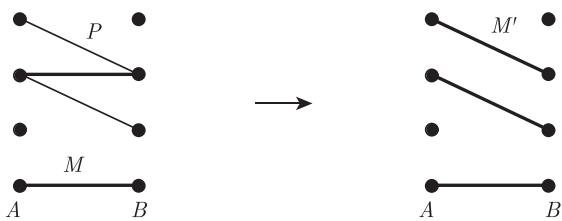
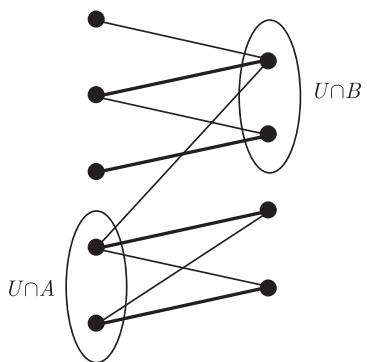
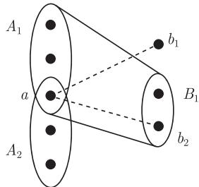
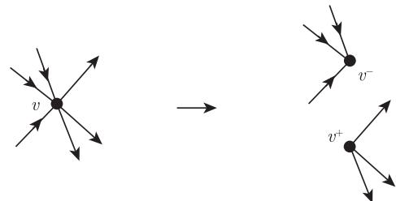

import Guide from '@/components/Guide.astro';
import Knowledge from '@/components/Knowledge.astro';
import Example from '@/components/Example.astro';
import Analysis from '@/components/Analysis.astro';
import Solution from '@/components/Solution.astro';
import Variant from '@/components/Variant.astro';
import Note from '@/components/Note.astro';
import Block from '@/components/Block.astro';
import Method from '@/components/Method.astro';
import Exercise from '@/components/Exercise.astro';

给定一个图，如果我们希望找到它的尽可能多的独立边，应该怎么做呢？我们是否可以将图中所有顶点两两配对成独立边呢？如果不行，又如何肯定这不可能呢？有点出乎意料的是，这一基本问题不仅是许多应用问题的核心，也产生了若干相当有趣的图论问题。

在图 $G = (V, E)$ 中，独立边构成的集合 $M$ 称为一个**匹配** (matching)。设 $U \subseteq V$，如果 $U$ 中的每个顶点都与 $M$ 中的一条边相关联，则称 $M$ 是 $U$ 的一个匹配，或者说 $U$ 中的顶点被 $M$ **匹配** (matched)，而其他不与 $M$ 中任何边相关联的顶点称为**非匹配** (unmatched) 顶点。

$k$-正则的支撑子图称为一个 **$k$-因子** ($k$-factor)。所以，一个子图 $H \subseteq G$ 是 $G$ 的 1-因子当且仅当 $E(H)$ 是 $V$ 的一个匹配。如何刻画具有 1-因子的图，即刻画包含所有顶点的匹配，是我们本章中前两节要讨论的主要问题。

给定图族 $\mathcal{H}$，匹配问题的一个推广就是在已知图 $G$ 中寻找尽可能多的顶点不相交的子图，使得每个子图都同构于 $\mathcal{H}$ 中的一个元素，这就是所谓的**填装** (packing) 问题，它和**覆盖** (covering) 问题紧密相关。覆盖问题是指在 $G$ 中找到一个尽可能小的顶点集，使得 $G$ 中任意一个子图，只要同构于 $\mathcal{H}$ 中的一个元素，就与这个顶点集相交。显然，如果 $\mathcal{H}$ 中的 $k$ 个子图可以不相交地填充到 $G$ 中，则任何覆盖必须包含至少 $k$ 个顶点。假如不存在恰好只有 $k$ 个顶点的覆盖，那么是否总是存在最多 $f(k)$ 个顶点的覆盖呢（这里的 $f(k)$ 只依赖于 $\mathcal{H}$ 而不依赖于 $G$）？在 2.3 节中，我们将证明当 $\mathcal{H}$ 是一族圈时，总存在这样一个函数 $f$。

在 2.4 节，我们会考虑边的填装和覆盖：在一个给定图中，我们能找到多少棵边不相交的支撑树呢？至少需要多少棵树才能覆盖图中所有的边呢？在 2.5 节，我们将证明一个有向图的路覆盖定理，它蕴含着偏序上的著名 Dilworth 对偶定理。

## 2.1 二部图中的匹配

在这一节，我们总是假设 $G = (V, E)$ 是一个具有二部划分 $\{A, B\}$ 的固定二部图。设 $a, a'$ 等表示属于 $A$ 的顶点，而 $b, b'$ 等表示属于 $B$ 的顶点。

如何找到 $G$ 中包含尽可能多条边的匹配呢？对于 $G$ 的任意匹配 $M$，一条关于 $M$ 的**交错路** (alternating path) 是指 $G$ 中一条从 $A$ 中非匹配顶点出发，其边在 $E\setminus M$ 和 $M$ 中交错出现的路。注意到，这里的路允许是平凡的，即只包含初始顶点。若交错路 $P$ 结束于 $B$ 中一个非匹配顶点，则称 $P$ 为**增广路** (augmenting path) (图 2.1.1)。我们可以通过 $P$ 将 $M$ 扩充成一个更大的匹配：$M$ 和 $E(P)$ 的对称差仍是一个匹配 (考虑关联一个给定顶点的边)，并且被匹配的顶点集增加了两个顶点，即 $P$ 的端点。

<figure class="vp-figure">
  
  <figcaption>图 2.1.1 通过交错路 $P$ 对匹配 $M$ 进行扩充</figcaption>
</figure>

交错路在寻找更大的匹配中发挥了重要的作用。事实上，从任何一个匹配开始，通过不断地运用增广路对匹配进行改进，直到匹配不能进行任何改进为止，这样所得到的匹配是最优的，即它具有最大可能的边数（练习 1）。寻找最大匹配的算法问题最终归结为寻找增广路的问题，这是一个非常有趣并且更容易理解的算法问题。

第一个定理通过某种对偶条件刻画了 $G$ 中具有最大基数的匹配。对于集合 $U \subseteq V$，如果 $G$ 中的每条边都与 $U$ 中的一个顶点相关联，则称 $U$ 是 $E$ 的一个 **(顶点)覆盖** ((vertex) cover)。

<Knowledge title="定理 2.1.1 (König, 1931)">
$G$ 中匹配的最大基数等于其边的顶点覆盖的最小基数。

<Solution title="证明">
设 $M$ 是 $G$ 中具有最大基数的匹配。从 $M$ 的每一条边中选择一个端点组成集合 $U$ 如下：如果存在一条交错路终止于这条边在 $B$ 中的端点，则选择此端点；否则，选择这条边在 $A$ 中的端点（图 2.1.2）。下面证明这 $|M|$ 个顶点构成的集合 $U$ 覆盖 $E$。由于 $E$ 的任何一个顶点覆盖必须覆盖 $M$，因此不存在少于 $|M|$ 个顶点的覆盖，所以定理成立。

<figure class="vp-figure">
  
  <figcaption>图 2.1.2 顶点覆盖 $U$</figcaption>
</figure>

注意到，如果交错路 $P$ 的一个端点是 $B$ 中的一个顶点 $b$，那么 $b \in U$：因为 $M$ 是最大匹配，而 $P$ 不是一个增广路，因此 $b$ 被匹配到 $A$ 中的某个顶点 $a$，然而当构造 $U$ 时，考虑到边 $ab \in M$，我们会把 $b$ 放入 $U$ 中。

为了证明 $U$ 覆盖 $E$，取定 $E$ 中的任意边 $ab$。如果 $a \in U$，问题得证，因此我们可以假定 $a \notin U$。为了证明 $b \in U$，只需论证存在某个交错路具有端点 $b$。如果 $a$ 不被任何顶点匹配，则 $ab$ 就是这样一个交错路；否则，对某个顶点 $b' \in B$，我们有 $ab' \in M$。由于 $a \notin U$，因此存在一条交错路 $P$ 结束于 $b'$。根据 $b$ 是否属于 $P$，要么 $Pb$ 要么 $Pb'ab$ 是一条结束于 $b$ 的交错路。∎
</Solution>
</Knowledge>

让我们回到原来的主题，即寻找 1-因子存在的充分必要条件。在二部图的情形，我们也可以考虑更一般性的问题，即 $G$ 什么时候包含一个饱和 $A$ 的匹配，这时如果 $|A| = |B|$，它将成为 $G$ 的 1-因子，这也是 $G$ 包含 1-因子的必要条件。

存在饱和 $A$ 的匹配的一个明显必要条件是 $A$ 的每一个子集在 $B$ 中都有足够多的邻点，即对所有的 $S \subseteq A$，有

$$
|N(S)| \geqslant |S|.
$$

下述的**婚姻定理** (marriage theorem) 表明，事实上，这个显而易见的必要条件也是充分的：

<Knowledge title="定理 2.1.2 (Hall, 1935)">
$G$ 包含饱和 $A$ 的匹配当且仅当，对所有的 $S \subseteq A$ 均有 $|N(S)| \geqslant |S|$。

<Solution title="证明">
我们给出三个证明，每个具有不同的特点[^1]。在所有的证明中，我们假定 $G$ 满足婚姻条件，目标是找到一个饱和 $A$ 的匹配。

**第一个证明** 设 $M$ 是 $G$ 的任意匹配且包含一个非匹配顶点 $a \in A$，我们证明存在一个关于 $M$ 的增广路。

设 $A'$ 是 $A$ 中满足可以从 $a$ 经过一条非平凡交错路到达的顶点的集合，而 $B' \subseteq B$ 是这些路上所有倒数第二个顶点的集合。这些路的最后一条边都在 $M$ 中，因此 $|A'| = |B'|$，由婚姻条件知，存在从 $S = A' \cup \{a\}$ 中的一个顶点 $v$ 到 $B \setminus B'$ 中的一个顶点 $b$ 的边。

因为 $v \in A' \cup \{a\}$，所以存在一条从 $a$ 到 $v$ 的交错路 $P$。注意到 $b \notin P$，并且 $P$ 在 $B$ 中的顶点属于 $B'$，因此 $Pvb$ 是一条从 $a$ 到 $b$ 的交错路。如果 $b$ 是被匹配的，比如说 $a'b \in M$，那么 $Pvba'$ 是一条交错路使得 $b$ 属于 $B'$，但是 $b \notin B'$，因此 $b$ 是不被匹配的，故 $Pvb$ 就是要找的增广路。

**第二个证明** 我们对 $|A|$ 用归纳法。当 $|A| = 1$ 时，结论显然成立。假设 $|A| \geqslant 2$，且当 $|A|$ 较小时，婚姻条件可以保证饱和 $A$ 的匹配的存在性。

若对每个非空子集 $S \subseteq A$ 均有 $|N(S)| \geqslant |S| + 1$，则任选一条边 $ab \in G$，并考虑图 $G' := G - \{a, b\}$，那么每个非空子集 $S \subseteq A \setminus \{a\}$ 都满足

$$
|N_{G'}(S)| \geqslant |N_G(S)| - 1 \geqslant |S|,
$$

故由归纳假设知，$G'$ 包含 $A \setminus \{a\}$ 的一个匹配，连同边 $ab$，就得到了 $G$ 中一个饱和 $A$ 的匹配。

假设存在 $A$ 的一个非空真子集 $A'$，使得对于 $B' := N(A')$ 有 $|B'| = |A'|$。由归纳假设，图 $G' := G[A' \cup B']$ 包含饱和 $A'$ 的一个匹配。然而 $G - G'$ 也满足婚姻条件：对任何满足 $|N_{G - G'}(S)| < |S|$ 的集合 $S \subseteq A \setminus A'$，有 $|N_G(S \cup A')| < |S \cup A'|$，与假设矛盾。同样由归纳法得，图 $G - G'$ 包含饱和 $A \setminus A'$ 的一个匹配，把这两个匹配放在一起从而得到了 $G$ 中一个饱和 $A$ 的匹配。

在最后的证明中，设 $H$ 是 $G$ 的一个满足婚姻条件且包含 $A$ 的边极小子图。注意到，对每个 $a \in A$，把 $S = \{a\}$ 代入婚姻条件可知 $d_H(a) \geqslant 1$。

**第三个证明** 我们证明对每个顶点 $a \in A$ 均有 $d_H(a) = 1$。由婚姻条件，不存在 $H$ 的两条边在 $B$ 中有公共顶点，因此 $H$ 的边构成了饱和 $A$ 的一个匹配。

假设 $a$ 在 $H$ 中有两个不同的邻点 $b_1$ 和 $b_2$，由 $H$ 的定义知，图 $H - ab_1$ 和图 $H - ab_2$ 不满足婚姻条件。因此，对 $i = 1, 2$，存在一个包含 $a$ 的集合 $A_i \subseteq A$ 使得对 $B_i := N_{H - ab_i}(A_i)$，有 $|A_i| > |B_i|$（图 2.1.3）。由 $b_1 \in B_2$ 和 $b_2 \in B_1$ 知

$$
\begin{aligned}
|N_H(A_1 \cap A_2 \setminus \{a\})| &\leqslant |B_1 \cap B_2| \\
&= |B_1| + |B_2| - |B_1 \cup B_2| \\
&= |B_1| + |B_2| - |N_H(A_1 \cup A_2)| \\
&\leqslant |A_1| - 1 + |A_2| - 1 - |A_1 \cup A_2| \\
&= |A_1 \cap A_2| - 2 \\
&= |A_1 \cap A_2 \setminus \{a\}| - 1.
\end{aligned}
$$

所以 $H$ 不满足婚姻条件，与假设矛盾。

<figure class="vp-figure">
  
  <figcaption>图 2.1.3 $B_1$ 包含 $b_2$ 但不包含 $b_1$</figcaption>
</figure>

∎
</Solution>
</Knowledge>

[^1]: 这个定理也可以很容易地从 König 定理推出（见练习 5）。

最后这个证明有一个漂亮的“对偶”命题：对每个 $b \in B$ 均有 $d_H(b) \leqslant 1$。细节参考练习 6 及其提示。

<Knowledge title="推论 2.1.3">
每一个 $k$-正则二部图 ($k \geqslant 1$) 包含 1-因子。

<Solution title="证明">
若 $G$ 是 $k$-正则的，则显然有 $|A| = |B|$；由定理 2.1.2，只需证明 $G$ 包含一个饱和 $A$ 的匹配。对每个集合 $S \subseteq A$，共有 $k|S|$ 条边与 $N(S)$ 相关联，且这些边属于 $G$ 中与 $N(S)$ 相关联的 $k|N(S)|$ 条边中的一部分，所以 $k|S| \leqslant k|N(S)|$，即 $G$ 确实满足婚姻条件。∎
</Solution>
</Knowledge>

在某些实际应用问题中，匹配不是以图的全局性为考量来选取的，而是通过在局部做独立的决定而由相关的顶点逐步形成的。一个典型的情形就是顶点对于选取哪条边来匹配顶点是有优先考量的，而不是对所有的关联边一视同仁。这样，若 $M$ 是一个匹配，$e = ab$ 是一条不属于 $M$ 的边，且 $a$ 和 $b$ 都倾向于 $e$ 胜过它们当前的匹配边（若它们是被匹配的话），那么 $a$ 和 $b$ 可能倾向包含 $e$ 而抛弃先前的匹配边，从而在局部上改变了 $M$。因此，匹配 $M$ 尽管可能是最大的，但却是不稳定的。

更正式地，由 $E(v)$ 上的线性序 $\leqslant_v$ 所形成的序族 $(\leqslant_v)_{v\in V}$ 被称为 $G$ 的一个**优先集** (set of preferences)。如果对每条边 $e\in E\setminus M$，都存在一条边 $f\in M$ 使得 $e$ 和 $f$ 有一个公共顶点 $v$ 且 $e <_v f$，则称匹配 $M$ 在 $G$ 中是**稳定的** (stable)。下面的结果通常被称为**稳定婚姻定理** (stable marriage theorem)。关于这个定理的其他证明参见练习 16 和练习 17。

<Knowledge title="定理 2.1.4 (Gale and Shapley, 1962)">
对任意给定优先集，$G$ 都包含一个稳定匹配。

<Solution title="证明">
对于 $G$ 中的匹配 $M$ 和 $M' (M' \neq M)$，如果 $M$ 比 $M'$ 使得 $B$ 中的顶点更快乐，也就是说，对每一个顶点 $b$，如果与 $b$ 相关联的边 $f' \in M'$ 以及边 $f \in M$ 总是满足 $f' \leqslant_b f$，那么称匹配 $M$ 在 $G$ 中比匹配 $M' \neq M$ **更好** (better)，我们将构造一序列越来越好的匹配。因为这些匹配对每个顶点 $b$ 最多增加 $d(b)$ 次快乐，因此这个过程一定会结束。

给定一个匹配 $M$，若 $e = ab \in E \setminus M$ 且以 $b$ 为端点的边 $f \in M$ 满足 $f <_b e$，则称顶点 $a \in A$ 对于 $b \in B$ 是**可接受的** (acceptable)；如果 $a$ 是非匹配的，或者它的匹配边 $f \in M$ 满足对所有使得 $a$ 对于 $b$ 是可接受的边 $e = ab$ 都有 $f >_a e$，则称 $a \in A$ 与 $M$ **相处快乐** (happy with)。

从空匹配开始，让我们构造一个匹配序列使得 $A$ 中所有顶点是快乐的。给定这样一个匹配 $M$，考察未被匹配的但对某个 $b \in B$ 是可接受的顶点 $a \in A$（如果不存在这样的 $a$，则终止序列），添加 $\leqslant_a$-极大边 $ab$ 到 $M$ 使得 $a$ 对于 $b$ 是可接受的，并从 $M$ 中删除以 $b$ 为端点的边。

显然，在我们的序列中每个匹配都比前一个更好，同时它们都使得 $A$ 中顶点是快乐的（从一开始就是这样，即 $M = \varnothing$ 时）。所以，这个序列将继续进行下去直到终止于匹配 $M$，使得 $A$ 中没有非匹配顶点对于它在 $B$ 中的所有邻点是可接受的。由于 $A$ 中每个被匹配的顶点与 $M$ 相处是快乐的，故这个匹配是稳定的。∎
</Solution>
</Knowledge>

尽管婚姻定理的表述看起来比较局限，但它在图论及其他领域中都属于应用最为广泛的图论定理之一。然而，将一个问题重新叙述为二部图的匹配的形式通常需要灵活掌握。作为一个简单的例子，我们现在用婚姻定理来推导图论中最早的结果之一，这个结果的原始证明一点也不简单，当然也不简短。

<Knowledge title="推论 2.1.5 (Petersen, 1891)">
每个具有大于零偶数顶点度的正则图都有 2-因子。

<Solution title="证明">
设 $G$ 是一个 $2k$-正则图 ($k \geqslant 1$)，不妨设 $G$ 是连通的。由定理 1.8.1 知，图 $G$ 包含一个欧拉环游 $v_0 e_0 \cdots e_{\ell-1} v_\ell$，且 $v_\ell = v_0$。用一对顶点 $(v^-, v^+)$ 代替每个顶点 $v$，用边 $v_i^+ v_{i+1}^-$ 代替每一条边 $e_i = v_i v_{i+1}$ (图 2.1.4)，得到的二部图 $G'$ 是 $k$-正则的，故由推论 2.1.3 知，$G'$ 有 1-因子。将每个顶点对 $(v^-, v^+)$ 整合成一个顶点 $v$，那么 $G'$ 的 1-因子就转化成 $G$ 的一个 2-因子。

<figure class="vp-figure">
  
  <figcaption>图 2.1.4 推论 2.1.5 的证明中顶点的分裂过程</figcaption>
</figure>

∎
</Solution>
</Knowledge>
