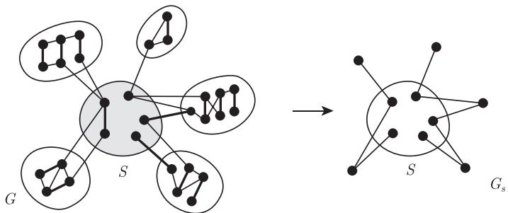
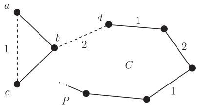

import Guide from '@/components/Guide.astro';
import Knowledge from '@/components/Knowledge.astro';
import Example from '@/components/Example.astro';
import Analysis from '@/components/Analysis.astro';
import Solution from '@/components/Solution.astro';
import Variant from '@/components/Variant.astro';
import Note from '@/components/Note.astro';
import Block from '@/components/Block.astro';
import Method from '@/components/Method.astro';
import Exercise from '@/components/Exercise.astro';

给定图 $G$，我们用 $\mathcal{C}_G$ 表示它的分支的集合，用 $q(G)$ 表示 $\mathcal{C}_G$ 中**奇分支** (odd component) (即阶为奇数的分支) 的个数。若 $G$ 有 1-因子，显然对所有的 $S \subseteq V(G)$，有

$$
q(G - S) \leqslant |S|,
$$

这是因为 $G - S$ 的每个奇分支都有一条因子边与 $S$ 相连。

同时，1-因子存在的这个明显必要条件也是充分的：

<Knowledge title="定理 2.2.1 (Tutte, 1947)">
图 $G$ 有 1-因子当且仅当对所有的 $S \subseteq V(G)$，有 $q(G - S) \leqslant |S|$。

<Solution title="证明">
设 $G = (V, E)$ 是不含 1-因子的图。我们的目标是找到一个与 Tutte 条件相悖的坏集合 $S \subseteq V$。

<figure class="vp-figure">
  
  <figcaption>图 2.2.1 $q = 3$ 时 Tutte 条件 $q(G - S)\leqslant |S|$，以及定理 2.2.3 中的收缩图 $G_S$</figcaption>
</figure>

不妨设 $G$ 是不含 1-因子的边极大图，即如果 $G'$ 是由 $G$ 通过增加边得到的图，且 $S \subseteq V$ 对 $G'$ 而言是个坏集合，那么 $S$ 对 $G$ 也是一个坏集合：$G' - S$ 的任何奇分支都是 $G - S$ 的某些分支的并，这些分支中总有一个仍是奇的。

那么 $G$ 是怎样的一个图呢？如果 $G$ 有一个坏集合 $S$，那么由它的边极大性和定理的条件不难看出：

$$
\text{$G - S$ 的所有分支都是完全的，且每个顶点 $s \in S$ 与 $G - s$ 的所有顶点相邻接。} \tag{*}
$$

反过来，如果集合 $S \subseteq V$ 满足 $(*)$，那么集合 $S$ 或者空集一定是坏的：如果 $S$ 不是坏集合，我们可以将 $G - S$ 的奇分支与 $S$ 中不同的顶点连接起来，并把剩下的顶点两两配对，除非 $|G|$ 是奇数，而在这种情况下 $\varnothing$ 是个坏集合。

因此，只需证明 $G$ 有一个满足 $(*)$ 的顶点集合 $S$。令 $S$ 表示与其他每个顶点都相邻的顶点的集合。如果这个集合 $S$ 不满足 $(*)$，那么存在 $G - S$ 的一个分支包含不相邻的顶点 $a, a'$。令 $a, b, c$ 依次表示该分支中一条最短 $a - a'$ 路上的前三个顶点，则 $ab, bc \in E$ 而 $ac \notin E$。因为 $b \notin S$，故存在顶点 $d \in V$ 使得 $bd \notin E$。由 $G$ 的极大性知，$G + ac$ 中存在 $V$ 的一个 1-因子 $M_1$，$G + bd$ 中存在 $V$ 的一个 1-因子 $M_2$。

令 $P = d \cdots v$ 表示 $G$ 中一条从 $d$ 开始的极长路，它以 $M_1$ 中的边为起始边，并交替地包含 $M_1$ 和 $M_2$ 中的边（图 2.2.2）。若 $P$ 的最后一条边属于 $M_1$，则 $v = b$，因为其他情况下，$P$ 可继续走下去，这时，令 $C := P + bd$。若 $P$ 的最后一条边属于 $M_2$，则由 $P$ 的极大性知，以 $v$ 为端点的 $M_1$-边一定是 $ac$，所以 $v \in \{a, c\}$，这时，令

<figure class="vp-figure">
  
  <figcaption>图 2.2.2 若 $S$ 不满足 (*)，导出矛盾</figcaption>
</figure>

$C$ 表示圈 $dPvbd$。在每一种情况下，$C$ 都是一个偶圈，它的边每隔一条在 $M_2$ 中，且唯一不属于 $E$ 的边是 $bd$。用 $C - M_2$ 的边替换 $M_2$ 中在 $C$ 上的边，我们得到了 $V$ 的一个包含在 $E$ 中的 1-因子，矛盾。∎
</Solution>
</Knowledge>

<Knowledge title="推论 2.2.2 (Petersen, 1891)">
每个无桥的立方图都有 1-因子。

<Solution title="证明">
我们证明任何一个无桥立方图 $G$ 都满足 Tutte 条件。给定 $S \subseteq V(G)$，考虑 $G - S$ 的奇分支 $C$。因为 $G$ 是立方的，所以 $C$ 中顶点（在 $G$ 中的）度数之和为奇数，但是这个度数和中由 $C$ 中的边产生的部分为偶数，故 $G$ 有奇数条 $S - C$ 边，从而至少有 3 条这样的边（因为 $G$ 不含桥）。所以 $S$ 和 $G - S$ 之间的边的总数至少为 $3q(G - S)$。然而，由于 $G$ 是立方图，所以 $S$ 和 $G - S$ 之间边的总数至多为 $3|S|$，从而 $q(G - S) \leqslant |S|$，正如所希望的那样。∎
</Solution>
</Knowledge>

为了使匹配理论中所运用的技巧更清楚明了，现给出 Tutte 定理的第二个证明。事实上，我们将证明一个更强的结果，这个结果从匹配的角度给出了任意图上的一个有趣结构。如果它满足 Tutte 定理的条件，那么这个结构将立即蕴含着一个 1-因子。

非空图 $G = (V, E)$ 称为**因子临界的** (factor-critical)，如果 $G$ 不包含 1-因子但对每个顶点 $v \in G$，图 $G - v$ 包含 1-因子。给定集合 $S \subseteq V$，令 $G_S$ 是由 $G$ 通过把分支 $C \in \mathcal{C}_{G-S}$ 收缩成单个顶点，并删除 $S$ 内部的边而得到的图。（正式地，图 $G_S$ 的顶点集为 $S \cup \mathcal{C}_{G-S}$，而边集为 $\{sC \mid \exists c \in C \text{ 使得 } sc \in E\}$，见图 2.2.1。）如果 (二部[^1]) 图 $G_S$ 包含饱和 $S$ 的一个匹配，我们称顶点集合 $S$ 与 $\mathcal{C}_{G-S}$ 是**可匹配的** (matchable)。

[^1]: $S$ 或 $\mathcal{C}_{G-S}$ 为空集的这两种（允许的）情形除外。

<Knowledge title="定理 2.2.3">
每个图 $G = (V,E)$ 都包含一个顶点集 $S$ 满足下面两条性质：

(i) $S$ 与 $\mathcal{C}_{G - S}$ 是可匹配的；

(ii) $G - S$ 的每个分支都是因子临界的。

给定任意这样的集合 $S$，图 $G$ 包含 1-因子当且仅当 $|S| = |\mathcal{C}_{G-S}|$。

<Solution title="证明">
首先注意到定理的最后部分的论断可以立即由论断 (i) 和 (ii) 推出：若 $G$ 有 1-因子，则 $q(G-S) \leqslant |S|$，从而如前所述有 $|S| = |\mathcal{C}_{G-S}|$；反过来，如果 $|S| = |\mathcal{C}_{G-S}|$，那么由 (i) 和 (ii) 可直接推出 1-因子的存在。

下面对 $|G|$ 用归纳法来证明满足 (i) 和 (ii) 的集合 $S$ 的存在性。对 $|G| = 0$，可令 $S = \varnothing$。对给定图 $G$ 且 $|G| > 0$，假设对包含较少顶点的图结论成立。

考虑不满足 Tutte 条件的最坏情况下的集合 $T \subseteq V$，即

$$
d(T) := d_G(T) := q(G - T) - |T|
$$

是最大的，并令 $S$ 是满足上述条件的最大的这种集合 $T$。注意到 $d(S) \geqslant d(\varnothing) \geqslant 0$。首先证明每个分支 $C \in \mathcal{C}_{G-S} =: \mathcal{C}$ 是奇的。如果 $|C|$ 是偶数，任取一个顶点 $c \in C$，考虑 $T := S \cup \{c\}$。由于 $C - c$ 是奇数阶的，它至少有一个奇分支，这个分支也是 $G - T$ 的一个分支。因此，

$$
q(G - T) \geqslant q(G - S) + 1 \quad \text{且} \quad |T| = |S| + 1,
$$

所以 $d(T) \geqslant d(S)$，这与 $S$ 的选择矛盾。

下面证明结论 (ii)，即每个 $C \in \mathcal{C}$ 是因子临界的。假设存在 $C \in \mathcal{C}$ 和 $c \in C$ 使得 $C' := C - c$ 不含 1-因子。由归纳假设（以及前面所证的事实，即对固定的 $G$ 本定理蕴含着 Tutte 定理），存在集合 $S' \subseteq V(C')$ 满足

$$
q(C' - S') > |S'|.
$$

既然 $|C|$ 是奇数，那么 $|C'|$ 是偶数，从而 $q(C' - S')$ 和 $|S'|$ 要么同为偶数，要么同为奇数，故它们不可能恰好相差 1。因此我们可以将上面的不等式改进为

$$
q(C' - S') \geqslant |S'| + 2,
$$

从而 $d_{C'}(S') \geqslant 2$，所以对于 $T := S \cup \{c\} \cup S'$，我们有

$$
d(T) \geqslant d(S) - 1 - 1 + d_{C'}(S') \geqslant d(S),
$$

其中，第一个 “-1” 来自 $C$ 作为奇分支的减少，第二个 “-1” 来自集合 $T$ 包含 $c$。和前面一样，这与 $S$ 的选择矛盾。

余下还需证明 $S$ 与 $\mathcal{C}_{G - S}$ 可匹配。如果不成立，则由婚姻定理知，存在一个集合 $S' \subseteq S$ 与 $\mathcal{C}$ 中少于 $|S'|$ 个分支相连接。由于 $\mathcal{C}$ 的其他分支也是 $G - (S \setminus S')$ 的分支，故集合 $T = S \setminus S'$ 满足 $d(T) > d(S)$，这与 $S$ 的选择矛盾。∎
</Solution>
</Knowledge>

给定任意图 $G$，Tutte 定理的结论很容易由这个结果推出。事实上，由 (i) 和 (ii)，我们可得 $|S| \leqslant |\mathcal{C}_{G-S}| = q(G - S)$（因为因子临界图一定有奇数阶），从而 Tutte 条件 $q(G - S) \leqslant |S|$ 蕴含着 $|S| = |\mathcal{C}_{G-S}|$，由定理 2.2.3 的最后一部分论述知 1-因子存在。

让我们再一次考察定理 2.2.3 中的集合 $S$ 以及 $G$ 中的任意匹配 $M$。和前面一样，记 $\mathcal{C} := \mathcal{C}_{G-S}$，另外 $k_S$ 表示 $M$ 中至少有一个端点属于 $S$ 的边的数目，$k_{\mathcal{C}}$ 表示 $M$ 中两个端点全在 $G - S$ 中的边的个数。由于每个 $C \in \mathcal{C}$ 为奇数阶，故它的顶点中至少有一个不与第二种类型的边相关联。因此，每个匹配 $M$ 都满足

$$
k_S \leqslant |S| \quad \text{且} \quad k_{\mathcal{C}} \leqslant \frac{1}{2} (|V| - |S| - |\mathcal{C}|). \tag{1}
$$

此外，$G$ 包含一个匹配 $M_0$ 同时满足上述两种情况的等式：首先根据 (i) 在 $S$ 与 $\bigcup \mathcal{C}$ 之间选择 $|S|$ 条边，然后用 (ii) 在每个分支 $C \in \mathcal{C}$ 中找到一个合适的且包含 $\frac{1}{2} (|C| - 1)$ 条边的集合。这样，这个匹配 $M_0$ 恰有

$$
|M_0| = |S| + \frac{1}{2} (|V| - |S| - |\mathcal{C}|) \tag{2}
$$

条边。

把 (1) 和 (2) 合起来，我们看到每一个具有最大基数的匹配 $M$ 使得 (1) 中的不等式取等号：由 $|M| \geqslant |M_0|$ 和 (2) 知，$M$ 包含至少 $|S| + \frac{1}{2} (|V| - |S| - |\mathcal{C}|)$ 条边，从而 (1) 中的两个不等式都不可能是严格的。但是，(1) 中的等式还表明 $M$ 具有上述结构：由 $k_S = |S|$ 知，每个顶点 $s \in S$ 是满足 $t \in G - S$ 的边 $st \in M$ 的一个端点；由 $k_{\mathcal{C}} = \frac{1}{2} (|V| - |S| - |\mathcal{C}|)$ 知，对每个 $C \in \mathcal{C}$，$M$ 恰包含 $C$ 的 $\frac{1}{2} (|C| - 1)$ 条边。最后，因为后面提到的这些边在每个 $C$ 中只错过了一个顶点，那么对于不同的 $s$ 上述的边 $st$ 的端点 $t$ 属于不同的分支 $C$ 中。

注意到，看似技术性的定理 2.2.3 隐藏了大量的结构信息：它包含了关于任意图中最大匹配的详细且本质性的描述。关于这个结构性定理的完整描述（它通常被称为 **Gallai-Edmonds 匹配定理** (Gallai-Edmonds matching theorem)）的出处，我们将在本章结尾的注解中给出。
