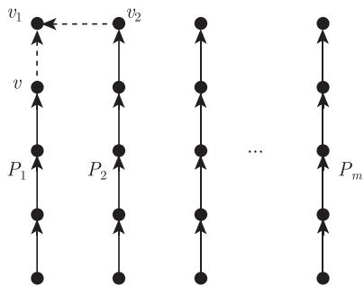

import Guide from '@/components/Guide.astro';
import Knowledge from '@/components/Knowledge.astro';
import Example from '@/components/Example.astro';
import Analysis from '@/components/Analysis.astro';
import Solution from '@/components/Solution.astro';
import Variant from '@/components/Variant.astro';
import Note from '@/components/Note.astro';
import Block from '@/components/Block.astro';
import Method from '@/components/Method.astro';
import Exercise from '@/components/Exercise.astro';

让我们再次回到二部图的 König 对偶定理，即定理 2.1.1。如果对图 $G$ 的每条边给一个从 $A$ 到 $B$ 的定向，那么这个定理告诉我们需要多少条边不交有向路来覆盖 $G$ 的所有顶点：每条有向路的长度是 0 或 1，明显地，在这样的“路覆盖”中，当路的条数最少时，就是当它包含尽可能多长度为 1 的路时；换句话说，当它包含最大基数的匹配时。

在这一节我们把上面的问题进行推广：在一个给定的有向图中需要多少条有向路来覆盖它的整个顶点集？当然，这个问题在无向图中也可以提出。然而，在无向图的情况这个问题比较简单（作为练习），同时有向图的情形也有一个有趣的推论。

**有向路** (directed path) 是一个有向图 $P \neq \varnothing$，它的顶点 $x_0, \dots, x_k$ 各不相同且所有边 $e_0, \dots, e_{k-1}$ 满足 $e_i$ 是一条由 $x_i$ 指向 $x_{i+1}$ 的边，其中 $i < k$。在这一节，路始终指“有向路”。上面提到的顶点 $x_k$ 称作路 $P$ 的**最终顶点** (last vertex)，当 $\mathcal{P}$ 是一个路的集合时，我们把最终顶点的集合记作 $\operatorname{ter}(\mathcal{P})$。一个有向图 $G$ 的**路覆盖** (path cover) 是 $G$ 中若干不相交路的集合，它们可以覆盖 $G$ 中所有的顶点。

<Knowledge title="定理 2.5.1 (Gallai and Milgram, 1960)">
每个有向图 $G$ 有一个路覆盖 $\mathcal{P}$ 和一个顶点独立集 $\{v_P \mid P \in \mathcal{P}\}$ 使得对每个 $P \in \mathcal{P}$，有 $v_P \in P$。

<Solution title="证明">
显然，图 $G$ 总是有路覆盖，例如那些平凡路。我们通过对 $|G|$ 用归纳法来证明：对于 $G$ 的任意具有极小 $\operatorname{ter}(\mathcal{P})$ 的路覆盖 $\mathcal{P} = \{P_1, \dots, P_m\}$，存在一个顶点集 $\{v_P \mid P \in \mathcal{P}\}$ 符合要求。对每个 $i$，记 $v_i$ 为 $P_i$ 的最终顶点。

若 $\operatorname{ter}(\mathcal{P}) = \{v_1, \dots, v_m\}$ 是独立的，则无须再证，因此不妨假设 $G$ 有一条从 $v_2$ 到 $v_1$ 的边。因为 $P_2 v_2 v_1$ 也是一条路，由 $\operatorname{ter}(\mathcal{P})$ 的极小性知 $v_1$ 不是 $P_1$ 中唯一的顶点。设 $v$ 是 $P_1$ 中先于 $v_1$ 的顶点，那么 $\mathcal{P}' := \{P_1 v, P_2, \dots, P_m\}$ 是 $G' := G - v_1$ 的路覆盖（图 2.5.1）。显然，任意在 $G'$ 中代表 $\mathcal{P}'$ 的独立集对 $G$ 中的 $\mathcal{P}$ 也成立，所以我们需要确定的是，是否可以对 $\mathcal{P}'$ 使用归纳假设。因此只需证明 $\operatorname{ter}(\mathcal{P}') = \{v, v_2, \dots, v_m\}$ 在 $G'$ 的所有路覆盖的最终顶点集合中是极小的。

假设 $G'$ 有路覆盖 $\mathcal{P}''$ 且 $\operatorname{ter}(\mathcal{P}'') \subseteq \operatorname{ter}(\mathcal{P}')$。如果一条路 $P \in \mathcal{P}''$ 结束于 $v$，我们可以把 $\mathcal{P}''$ 中的 $P$ 用 $Pvv_1$ 来代替，从而得到 $G$ 的一个路覆盖，它的最终顶点集是 $\operatorname{ter}(\mathcal{P})$ 的真子集，这与 $\mathcal{P}$ 的选取矛盾。如果一条路 $P \in \mathcal{P}''$ 结束于 $v_2$（同时不存在路结束于 $v$），我们类似地把 $\mathcal{P}''$ 中的 $P$ 由 $Pv_2 v_1$ 代替，从而与 $\operatorname{ter}(\mathcal{P})$ 的极小性矛盾。因此 $\operatorname{ter}(\mathcal{P}'') \subseteq \{v_3, \dots, v_m\}$，但此时 $\mathcal{P}''$ 和平凡路 $\{v_1\}$ 一起构成 $G$ 的路覆盖，与 $\operatorname{ter}(\mathcal{P})$ 的极小性矛盾。

<figure class="vp-figure">
  
  <figcaption>图 2.5.1 $G$ 和 $G'$ 的路覆盖</figcaption>
</figure>

∎
</Solution>
</Knowledge>

作为定理 2.5.1 的推论，我们得到偏序集理论中的一个经典结果。前面提到过，在偏序集 $(P, \leqslant)$ 中，如果一个子集的元素是两两可比较的，那么它是一个**链** (chain)；如果它的元素是两两不可比较的，称它为一个**反链** (antichain)。

<Knowledge title="推论 2.5.2 (Dilworth, 1950)">
在每个有限偏序集 $(P, \leqslant)$ 中，并集为 $P$ 的最少链数等于 $P$ 中反链的最大个数。

<Solution title="证明">
若 $A$ 是 $P$ 中基数最大的反链，则显然 $P$ 不能被少于 $|A|$ 条链覆盖。反过来，把定理 2.5.1 应用到顶点集为 $P$ 的有向图上，这里边集为 $\{(x, y) \mid x < y\}$，则 $|A|$ 条链是足够的。∎
</Solution>
</Knowledge>
