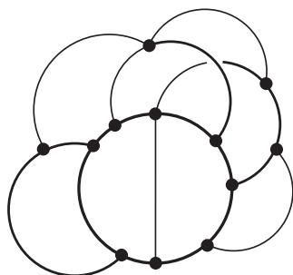
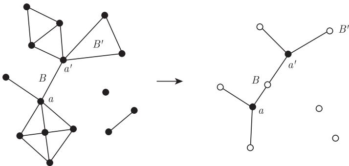

import Guide from '@/components/Guide.astro';
import Knowledge from '@/components/Knowledge.astro';
import Example from '@/components/Example.astro';
import Analysis from '@/components/Analysis.astro';
import Solution from '@/components/Solution.astro';
import Variant from '@/components/Variant.astro';
import Note from '@/components/Note.astro';
import Block from '@/components/Block.astro';
import Method from '@/components/Method.astro';
import Exercise from '@/components/Exercise.astro';

1.4 节中给出的 $k$-连通性的定义并不直观, 因为它没有揭示出 $k$-连通图的“连通特性”, 而只是告诉我们需要至少 $k$ 个顶点使图不连通. 下面的定义不仅仅蕴含了上述定义, 而且还更具有描述性: “如果一个图的任意两个顶点之间都有 $k$ 条独立路相连, 则它是 $k$-连通的 ($k$-connected)".

这两个定义其实是等价的, 只是同一性质的两个方面, 这是图论中的经典结果之一. 在 3.3 节, 我们将深入地研究 Menger (1927) 的这个定理.

在 3.1 节和 3.2 节, 我们讨论 2-连通图和 3-连通图的结构. 对于这些较小的 $k$ 值, 我们可以给出一个如何构造这类图的简单的一般性描述.

在 3.4 节和 3.5 节, 我们将考察连通性中更新的, 但和标准概念同样重要的其他概念: 对 $G$ 的子图 $H$, $G$ 中 $H$-路的个数, 以及 $G$ 中连接指定顶点对之间的不交路的存在性.

## 3.1 2-连通图以及子图

最简单的 2-连通图是圈, 其他的图都可以由一个圈通过不断地添加路而得到.

<Knowledge title="命题 3.1.1">
一个图是 2-连通的当且仅当它可以从一个圈开始, 通过在已构造的图 $H$ 上连续地添加 $H$-路而构造得到 (图 3.1.1).

<figure class="vp-figure">
  
  <figcaption>图 3.1.1 2-连通图的构造</figcaption>
</figure>

<Solution title="证明">
显然, 每一个按照上述方法构造出来的图都是 2-连通的.

反过来, 给定一个 2-连通图 $G$, 则 $G$ 包含一个圈, 因此 $G$ 包含一个按照上述方法构造出来的极大子图 $H$. 由于任意一条边 $xy \in E(G) \setminus E(H)$, 其中 $x, y \in H$, 将定义一条 $H$-路, 故 $H$ 是 $G$ 的导出子图. 这样, 若 $H \neq G$, 则由 $G$ 的连通性知存在一条边 $vw$ 满足 $v \in G - H$, 且 $w \in H$. 因为 $G$ 是 2-连通的, 所以 $G - w$ 包含一条 $v\text{-}H$ 路 $P$. 于是, $wvP$ 是 $G$ 中的一条 $H$-路, 且 $H \cup wvP$ 是 $G$ 中比 $H$ 更大的可构造子图, 这与 $H$ 的极大性矛盾. ∎
</Solution>
</Knowledge>

正如任意一个图可以分解成极大连通子图 (即分支) 一样, 我们尝试把连通图分解成它的极大 2-连通子图, 这些子图不一定是互不相交的, 而且不一定覆盖 $G$ 的全部. 然而, 可以很容易地把“极大 2-连通子图”这一概念弱化, 使得满足弱化条件的子图覆盖 $G$ 的全部并且几乎是互不相交的. 这些“块”放在一起看起来像一棵树, 准确地反映了图 $G$ 根据这些块所形成的整体结构.

严格地讲, **块** (block) 是一个不含割点[^1] 的极大连通子图. 因此, 图 $G$ 的每个块或者是一个极大 2-连通子图, 或者是一个桥 (连同其端点), 或者是一个孤立顶点. 反过来, 每一个这样的子图是一个块. 由它的极大性知, $G$ 的不同块之间至多在一个顶点处相重叠, 这个顶点就是 $G$ 的割点. 因此, 图 $G$ 的每一条边都属于一个唯一的块, 且 $G$ 是它的块的并.

圈和键被看作单个块:

<Knowledge title="引理 3.1.2">
设 $G$ 是一个任意图.

(i) $G$ 的所有圈恰好是它的所有块中的圈.

(ii) $G$ 的所有键恰好是它的所有块中的那些极小割.

<Solution title="证明">
(i) 图 $G$ 的任意圈都是不含割点的连通子图, 因此它包含在某个极大的这样的子图中. 由定义, 这个子图是 $G$ 的一个块.

(ii) 证明可以通过不断地使用下面这个观察而得到: 考虑 $G$ 中的任意割, 设 $xy$ 是这个割的一条边, 而 $B$ 为包含该边的块. 根据块的定义中 $B$ 的极大性, $G$ 不包含 $B$-路. 因此, $G$ 的每条 $x\text{-}y$ 路都在 $B$ 中, 故割中属于 $B$ 的边即使在 $G$ 中也把 $x$ 和 $y$ 分离. ∎
</Solution>
</Knowledge>

因为每条边属于唯一一个块, 因此“属于同一个块”是图的边集上的一个等价关系, 这个等价关系可以用其他两种有趣的形式表示出来:

<Knowledge title="引理 3.1.3">
对于图 $G$ 的不同边 $e$ 和 $f$, 下面的命题是等价的:

(i) 边 $e, f$ 属于 $G$ 的同一个块;

(ii) 边 $e, f$ 属于 $G$ 的同一个圈;

(iii) 边 $e, f$ 属于 $G$ 的同一个键.

<Solution title="证明">
(i) $\to$ (ii) 显然, 我们只需要证明 2-连通图的任意两个顶点 2-集合可以由两条不相交的路连接即可. 根据命题 3.1.1,[^2] 这可以容易地通过归纳法得到.

(ii) $\to$ (iii) 从圈 $C \ni e, f$ 上删除边 $e, f$, 从而把 $V(C)$ 划分成两个连通集合, 把这个划分扩充为图 $G$ 中包含 $C$ 的两个顶点连通集合 (如何才能做到呢?), 那么这两个集合之间的边形成了 $G$ 的一个包含 $e, f$ 的键.

(iii) $\to$ (i) 由引理 3.1.2 (ii) 知, 两条边属于同一个键仅当它们属于同一个块. ∎
</Solution>
</Knowledge>

最后这个关于块的引理显示了这些块是如何形成 $G$ 的粗略结构的. 令 $A$ 表示 $G$ 的割点的集合, $\mathcal{B}$ 表示它的块集合. 于是, 我们自然地得到了 $A \cup \mathcal{B}$ 上的一个二部图, 其边集为 $\{aB \mid a \in B\}$, 它叫做图 $G$ 的**块图** (block graph), 见图 3.1.2.

<figure class="vp-figure">
  
  <figcaption>图 3.1.2 图和它的块图</figcaption>
</figure>

<Knowledge title="引理 3.1.4">
每个连通图的块图是一棵树.
</Knowledge>

引理 3.1.4 可以推广到具有高连通度的图上: 每一个 $(k-1)$-连通图都有一个基本的树形分解, 它把所有“$k$-块”分离开来. 这个结果的准确叙述参见定理 12.3.7, 以及第 12 章的练习 17 (对 $k=3$ 的情形).

[^1]: …… 的子图, 但它可能包含 $G$ 的割点.
[^2]: 见练习 5. 注意到, 这是 Menger 定理 (3.3.1) $k=2$ 的情形.
