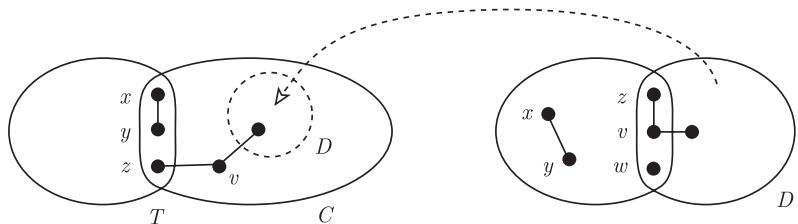
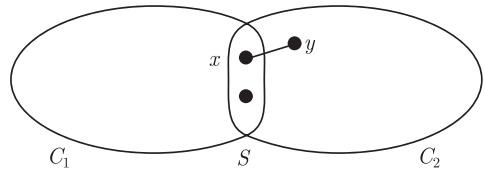
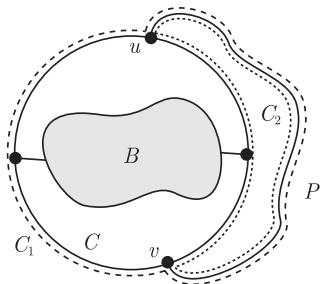
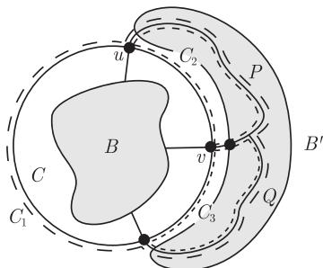

import Guide from '@/components/Guide.astro';
import Knowledge from '@/components/Knowledge.astro';
import Example from '@/components/Example.astro';
import Analysis from '@/components/Analysis.astro';
import Solution from '@/components/Solution.astro';
import Variant from '@/components/Variant.astro';
import Note from '@/components/Note.astro';
import Block from '@/components/Block.astro';
import Method from '@/components/Method.astro';
import Exercise from '@/components/Exercise.astro';

在这一节, 我们将描述如何从 $K^4$ 开始, 通过一系列保持 3-连通性的基本运算而得到每个 3-连通图. 之后我们将证明 Tutte 的关于 3-连通图的圈空间的代数结构定理, 这个结果将在 4.5 节再一次发挥重要的作用.

命题 3.1.1 描述了 2-连通图是如何从一个圈出发, 通过一系列运算归纳地构造出来的. 在这个过程中, 所有构造的图都是 2-连通的, 因此通过这种方法构造得到的图都是 2-连通图. 现在我们要对 3-连通图做类似的构造, 将证明每个 3-连通的图 $G \neq K^4$ 有两种方式可以变成一个较小的 3-连通图: 删除一条边 (并压缩所产生的 2 度顶点), 或者收缩一条边. 逆转这个过程就产生了两个由 $K^4$ 构造所有 3-连通图的不同方法.

给定图 $G$ 及它的一条边 $e$, 我们用 $G \dot{-} e$ 表示在 $G - e$ 中压缩 $e$ 的可能 2 度顶点所得到的多重图[^3].

<Knowledge title="引理 3.2.1">
设 $e$ 是图 $G$ 的一条边, 如果 $G \dot{-} e$ 是 3-连通的, 那么 $G$ 也是.

<Solution title="证明">
把 $G$ 看成是 $G \dot{-} e$ 加边 $e$ 后得到的, 我们把 $G \dot{-} e$ 的顶点叫做 $G$ 的旧顶点, 而 $G$ 的其他顶点叫做新顶点 (即 $e$ 的端点). 因为 $G \dot{-} e$ 是 3-连通的且没有平行边, 所以容易看出 $G$ 中不存在两个顶点 $x_1, x_2$ 可以把一个新顶点和所有旧顶点分离开来. 因此, 我们只需证明 $\{x_1, x_2\}$ 不能分离两个旧顶点. 否则, 假定这些旧顶点在 $G \dot{-} e$ 中被 $x_1'$ 和 $x_2'$ 分离, 这里要么 $x_i' = x_i$, 要么 $x_i'$ 是 $G \dot{-} e$ 中被 $x_i$ 细分的边 (如果 $x_i$ 是新顶点). 由命题 1.4.2 知, 这和我们的假定 $G \dot{-} e$ 是 3-连通的矛盾. ∎
</Solution>
</Knowledge>

<Knowledge title="引理 3.2.2">
每个 3-连通图 $G \neq K^4$ 包含一条边 $e$ 使得 $G \dot{-} e$ 也是 3-连通的.

<Solution title="证明">
我们首先证明 $G$ 包含一个 $TK^4$. 设 $C$ 是一个最短圈, 而 $P = u \cdots v$ 是 $G$ 的一条 $C$-路. 那么 $\mathring{P} \neq \varnothing$, 这是因为 $C$ 是导出的, 因此 $G - \{u, v\}$ 包含一条 $C\text{-}P$ 路 $Q$, 此时 $C \cup P \cup Q = TK^4$.

因为 $G \neq K^4$, 所以存在一个 3-连通图 $J \not\cong G$ 使得 $G$ 包含一个 $TJ$. 选择 $J$ 使得 $\|J\|$ 最大, 因此 $H = TJ \subseteq G$ 满足 $\|H\|$ 最大. 我们将寻找一条边 $e$ 使得 $G \dot{-} e \simeq J$.

显然 $H \neq G$. 设 $P = u \cdots v$ 是 $G$ 中的一条 $H$-路, 如果可能, 选择 $P$ 使得

$$
u \text{ 和 } v \text{ 不在 } J \text{ 的同一个(细分)边上.} \tag{*}
$$

如果 $P$ 不满足 $(*)$, 那么 $H = J$, 这是因为 $G$ 是 3-连通的, 所以细分 $J$ 的一条边的顶点可以由一条 $H$-路连接到 $J$ 中不在同一条细分边的另外一个顶点. 根据假设, 因为 $P$ 不满足 $(*)$, 故蕴含着 $uv \in E(J) = E(H)$. 因为 $G$ 没有平行边, 所以 $P$ 有一个内部顶点. 从而 $(H - uv) \cup P$ 是另外一个 $TJ$, 且边数比 $H$ 多, 这与 $H$ 的选取矛盾.

因此 $P$ 满足 $(*)$. 压缩 $H \cup P$ 中所有 2 度顶点得到一个多重图 $J'$ 使得 $J' \dot{-} e = J$, 这里 $e$ 是对应于 $P$ 的那条边. 由 $(*)$, 边 $e$ 不和 $J$ 中的边平行, 因此 $J'$ 是一个图 (即不是多重图). 由引理 3.2.1, $J'$ 是 3-连通的. 因此, 由 $J$ 的极大性得到 $J' \simeq G$. ∎
</Solution>
</Knowledge>

<Knowledge title="定理 3.2.3 (Tutte, 1966)">
图 $G$ 是 3-连通的当且仅当存在图序列 $G_0, \cdots, G_n$ 使得

(i) $G_0 = K^4$, $G_n = G$;

(ii) 对每个 $i < n$, $G_{i+1}$ 包含一条边 $e$ 使得 $G_i = G_{i+1} \dot{-} e$.

进一步地, 这个序列中的每个图都是 3-连通的.

<Solution title="证明">
如果 $G$ 是 3-连通的, 使用引理 3.2.2 依次寻找 $G_n, \cdots, G_0$.

反过来, 如果 $G_0, \cdots, G_n$ 是任意满足 (i) 和 (ii) 的图序列, 由引理 3.2.1 知, 所有的这些图, 特别地 $G = G_n$ 是 3-连通的. ∎
</Solution>
</Knowledge>

定理 3.2.3 使得我们可以递归地构造所有的 3-连通图. 从 $K^4$ 开始, 我们在已经构造的图上加一条与 (ii) 不矛盾的边, 这条边在两个已经存在的顶点之间, 或者在新增加的细分顶点之间 (但不在同一条边上), 或者在一个旧顶点和一个新插入的细分顶点之间.

我们现在考虑第二种方法, 即通过不断地收缩边把 3-连通图约化成 $K^4$. 在下面的讨论中, 我们只考虑图, 而不是多重图.

<Knowledge title="引理 3.2.4">
在每个 3-连通图 $G \neq K^4$ 中, 存在一条边 $e$ 使得 $G / e$ 仍是 3-连通的.

<Solution title="证明">
假设不存在这样的边 $e$, 那么对于每条边 $xy \in G$, 图 $G / xy$ 包含一个至多 2 个顶点的分隔 $S$. 由于 $\kappa(G) \geqslant 3$, 图 $G / xy$ 中的收缩后顶点 $v_{xy}$ (见 1.7 节) 属于 $S$ 且 $|S| = 2$, 即 $G$ 有一个顶点 $z \notin \{x, y\}$ 使得 $\{v_{xy}, z\}$ 分离 $G / xy$. 于是, 图 $G / xy$ 中任何两个被 $\{v_{xy}, z\}$ 所分离的顶点都在 $G$ 中被 $T := \{x, y, z\}$ 所分离. 因为不存在 $T$ 的真子集可以分离 $G$, 所以 $T$ 中的每个顶点在 $G - T$ 的每个分支 $C$ 中都有一个邻点.

我们选取边 $xy$, 顶点 $z$ 和分支 $C$ 使得 $|C|$ 尽可能小, 并在 $C$ 中选取 $z$ 的一个邻点 $v$ (图 3.2.1). 根据假设, 图 $G / zv$ 同样不是 3-连通的, 因此仍存在一个顶点 $w$ 使得 $\{z, v, w\}$ 分离 $G$, 和前面一样, $\{z, v, w\}$ 中每个顶点在 $G - \{z, v, w\}$ 的每个分支中都有一个邻点.

<figure class="vp-figure">
  
  <figcaption>图 3.2.1 引理 3.2.4 证明中的分离顶点</figcaption>
</figure>

由于 $x$ 与 $y$ 相邻, $G - \{z, v, w\}$ 有一个分支 $D$ 使得 $D \cap \{x, y\} = \varnothing$. 因此, $v$ 在 $D$ 中的每个邻点也在 $C$ 中 (因为 $v \in C$), 从而 $D \cap C \neq \varnothing$ 且由 $D$ 的选择知 $D \subsetneq C$, 这与 $xy, z$ 和 $C$ 的选择矛盾. ∎
</Solution>
</Knowledge>

<Knowledge title="定理 3.2.5 (Tutte, 1961)">
图 $G$ 是 3-连通的当且仅当存在图序列 $G_0, \cdots, G_n$ 满足下面两个性质:

(i) $G_0 = K^4$ 且 $G_n = G$;

(ii) 对每个 $i < n$, $G_{i+1}$ 包含一条边 $xy$, 其中 $d(x), d(y) \geqslant 3$, 使得 $G_i = G_{i+1} / xy$.

此外, 这种序列中的每个图都是 3-连通的.

<Solution title="证明">
如果 $G$ 是 3-连通的, 那么由引理 3.2.4 知, 存在一个满足 (i) 和 (ii) 的 3-连通图序列 $G_0, \cdots, G_n$.

反过来, 为了证明定理的最后一个结论, 设 $G_0, \cdots, G_n$ 是满足 (i) 和 (ii) 的一个图序列, 我们证明对每个 $i < n$, 如果 $G_i$ 是 3-连通的, 那么图 $G_{i+1}$ 也是 3-连通的. 假设这不成立, 令 $S$ 是 $G_{i+1}$ 中一个至多包含 2 个顶点的分隔, 而 $C_1, C_2$ 是 $G_{i+1} - S$ 的两个分支. 由于 $x$ 和 $y$ 相邻, 所以可以假设 $\{x, y\} \cap V(C_1) = \varnothing$ (图 3.2.2). 那么, $C_2$ 既不同时包含顶点 $x$ 和 $y$, 也不包含顶点 $v \notin \{x, y\}$: 否则, 在 $G_i$ 中 $v_{xy}$ 或 $v$ 可通过至多两个顶点从 $C_1$ 中分离出来, 矛盾. 但是, $C_2$ 现仅包含一个顶点, 它要么是 $x$ 要么是 $y$, 但这与假设 $d(x), d(y) \geqslant 3$ 矛盾. ∎

<figure class="vp-figure">
  
  <figcaption>图 3.2.2 定理 3.2.5 证明中 $xy \in G_{i+1}$ 的位置</figcaption>
</figure>
</Solution>
</Knowledge>

和定理 3.2.3 一样, 定理 3.2.5 使得我们可以从 $K^4$ 开始, 通过局部的改变来递归地构造所有的 3-连通图. 给定一个已经构造好的 3-连通图, 选定任何一个顶点 $v$, 把该顶点分裂成两个相邻的顶点 $v'$ 和 $v''$, 并随意地将它们连接到 $v$ 以前的邻点上使得每个至少连接两个邻点. 这就是 Tutte 的**轮子定理** (wheel theorem)[^4] 的核心思想.

对更大的整数 $k$, 上面的构造不再成立: 不是每个 $k$-连通图都可以通过收缩一条边来得到另外一个 $k$-连通图的. 然而, 对每个 $k$ 存在一个常数 $n_k$ 使得, 每个 $k$-连通图通过删除或者收缩一条边而得到的图中没有小于 $k$ 的分离集, 满足分离的两部分都有至少 $n_k$ 个顶点. 详见本章末的注解.

<Knowledge title="定理 3.2.6 (Tutte, 1963)">
3-连通图的圈空间是由它的非分离导出圈所生成的.

<Solution title="证明">
设 $G$ 是一个给定的 $n$ 个顶点的图. 为了证明 $G$ 的每个圈 $C$ 是它的非分离导出圈的和, 我们对 $k(C) := n - b$ 用归纳法, 这里 $b$ 表示 $G - C$ 的分支的最大顶点数 (如果存在分支), 如果 $V(C) = V(G)$, 那么 $b = 0$.

当 $k(C) = 0$ 时, 不存在圈 $C$, 因此归纳法的基本步骤成立. 设 $C$ 是归纳步骤中给定的圈, 如果 $C$ 是一个支撑圈, 那么它是两个圈 $C_1, C_2 \subseteq C + e$ 的和, 这里 $e$ 是一条弦. 因为 $k(C_1), k(C_2) < n = k(C)$, 由归纳法得证.

其次, 假设 $G - C \neq \varnothing$, 设 $B$ 是 $G - C$ 的一个最大分支. 假设

$$
G - B \text{ 包含一条 } C\text{-路 } P = u \cdots v \text{ 使得 } C \text{ 的两个 } u\text{-}v \text{ 路都包含一个属于 } N(B) \text{ 的内点.} \tag{*}
$$

那么 $C$ 是两个包含 $P$ 的圈 $C_1, C_2 \subseteq C \cup P$ 的和, 且对每个这样的圈 $C_i$, 存在 $G - C_i$ 的一个分支严格包含 $B$ (图 3.2.3). 因此 $k(C_i) < k(C)$, 由归纳法得证.

<figure class="vp-figure">
  
  <figcaption>图 3.2.3 $C_1$ 和 $C_2$ 用虚线表示</figcaption>
</figure>

最后, 假设 $(*)$ 不成立, 那么 $C$ 的每个顶点都有一条边连接到 $B$. (事实上, 否则, $C$ 包含一个 $N(B)$-路 $Q = x \cdots y$ 使得 $\mathring{Q} \neq \varnothing$. 因为 $G$ 是 3-连通的, 所以 $C - Q \neq \varnothing$, 同时 $G - \{x, y\}$ 中有一个 $\mathring{Q} - (C - Q)$ 路. 从而, 这样的路 $P$ 满足 $(*)$.) 由于 $V(C) = N(B)$, 故 $C$ 的任意弦都是满足 $(*)$ 的一条路 $P$, 因此 $C$ 是无弦的. 除非 $C$ 本身是导出的且是非分离的, 那么 $G - C$ 有一个分支 $B' \neq B$. 设 $P = u \cdots v$ 是一个通过 $B'$ 的 $C$-路, 且 $Q$ 是 $G - \{u, v\}$ 中的 $C\text{-}P$ 路, 注意到 $Q$ 也不和 $B$ 相交, 所以 $C \cup P \cup Q$ 包含三个圈 $C_1, C_2, C_3$, 它们的和是 $C$, 且每个避开 $C$ 的一个顶点 (图 3.2.4). 因为 $C$ 的每个顶点连接到 $B$, 所以对每个 $i$, $k(C_i) < k(C)$, 归纳证明完成. ∎

<figure class="vp-figure">
  
  <figcaption>图 3.2.4 三个圈 $C_1, C_2$ 和 $C_3$ 一起组成 $C$, 同时每个圈都避开 $C$ 上连接到 $B$ 的一个顶点</figcaption>
</figure>
</Solution>
</Knowledge>

[^3]: 关于多重图中压缩顶点的正式定义见 1.10 节. 前面提到, 3-连通多重图不能有平行边. 因为平行边的出现是只有当一个顶点被压缩了, 而所产生的平行边没有删除才能发生, 所以在引理 3.2.1 中我们的假定 “$G \dot{-} e$ 是 3-连通的”, 实际上蕴涵由 $G$ 所生成的新图不能有平行边, 即事实上 $G \dot{-} e$ 是一个简单图.
[^4]: 形如 $C^n * K^1$ 的图称为轮子 (wheel), 所以 $K^4$ 是最小的轮子.
