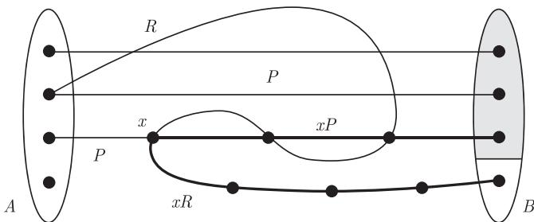
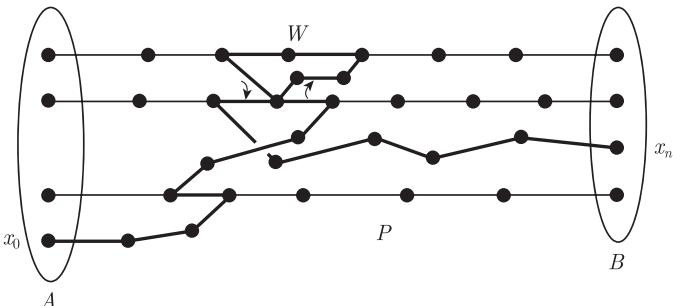
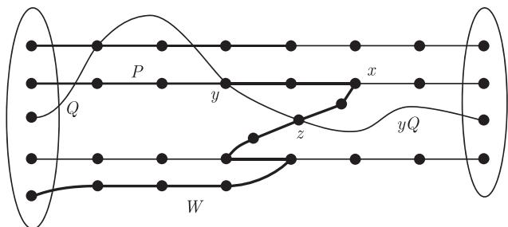

import Guide from '@/components/Guide.astro';
import Knowledge from '@/components/Knowledge.astro';
import Example from '@/components/Example.astro';
import Analysis from '@/components/Analysis.astro';
import Solution from '@/components/Solution.astro';
import Variant from '@/components/Variant.astro';
import Note from '@/components/Note.astro';
import Block from '@/components/Block.astro';
import Method from '@/components/Method.astro';
import Exercise from '@/components/Exercise.astro';

下面的定理是图论中重要的基石之一.

<Knowledge title="定理 3.3.1 (Menger, 1927)">
设 $G = (V, E)$ 是一个图且 $A, B \subseteq V$. 那么, $G$ 中分离 $A$ 和 $B$ 的顶点的最小数目等于 $G$ 中互不相交的 $A\text{-}B$ 路的最大数目.

<Solution title="证明">
我们给出三个证明. 给定 $G, A, B$ 如定理所述, 用 $k = k(G, A, B)$ 表示 $G$ 中把 $A$ 和 $B$ 分离所需要的最少顶点个数. 显然, 图 $G$ 不可能包含多于 $k$ 条不交 $A\text{-}B$ 路, 我们的任务是证明存在 $k$ 条这样的路.

**第一个证明** 对 $\|G\|$ 使用归纳法. 若 $G$ 不含边, 则 $|A \cap B| = k$ 且存在 $k$ 条平凡的 $A\text{-}B$ 路. 因此, 假设 $G$ 包含边 $e = xy$. 如果 $G$ 没有 $k$ 条不交的 $A\text{-}B$ 路, 那么 $G / e$ 也没有, 这里, 如果在 $G$ 中 $x$ 和 $y$ 两顶点中至少有一个属于 $A$ (或者 $B$), 我们把收缩顶点 $v_e$ 看成 $G / e$ 中 $A$ (或者 $B$) 的元素. 由归纳假设, $G / e$ 包含一个少于 $k$ 个顶点的 $A\text{-}B$ 分隔 $Y$, 其中顶点 $v_e$ 一定在 $Y$ 中, 否则, $Y \subseteq V$ 就是 $G$ 的一个 $A\text{-}B$ 分隔. 于是, $X := (Y \setminus \{v_e\}) \cup \{x, y\}$ 是 $G$ 的一个恰好有 $k$ 个顶点的 $A\text{-}B$ 分隔.

现在考察图 $G - e$. 因为 $x, y \in X$, 所以 $G - e$ 中的每个 $A\text{-}X$ 分隔也是 $G$ 中的 $A\text{-}B$ 分隔, 因此这个 $A\text{-}X$ 分隔至少有 $k$ 个顶点. 由归纳假设, $G - e$ 中存在 $k$ 条不交的 $A\text{-}X$ 路; 类似地, $G - e$ 中存在 $k$ 条不交的 $X\text{-}B$ 路. 由于 $X$ 分离 $A$ 和 $B$, 这两个路系统不可能在 $X$ 外面相交, 因此它们可以合并成 $k$ 条不交的 $A\text{-}B$ 路.

令 $\mathcal{P}$ 表示一个不交 $A\text{-}B$ 路的集合, 而 $\mathcal{Q}$ 表示另外一个这样的集合. 我们说 $\mathcal{Q}$ **超过** (exceed) $\mathcal{P}$, 如果 $A$ 中属于 $\mathcal{P}$ 的某条路上的顶点集合是 $A$ 中属于 $\mathcal{Q}$ 的某条路上的顶点集合的真子集; 同样地, 对 $B$ 也成立. 那么, 特别地, $|\mathcal{Q}| \geqslant |\mathcal{P}| + 1$.

**第二个证明** 我们证明下面这个更强的结论:
> 如果 $\mathcal{P}$ 是 $G$ 中包含少于 $k$ 条不交 $A\text{-}B$ 路的集合, 那么 $G$ 包含一个具有 $|\mathcal{P}| + 1$ 条不交 $A\text{-}B$ 路的集合, 它超过 $\mathcal{P}$.

保持 $G$ 和 $A$ 不变, 我们让 $B$ 变化并对 $|\bigcup \mathcal{P}|$ 使用归纳法. 令 $R$ 表示一条 $A\text{-}B$ 路, 它避开了 $B$ 中在 $\mathcal{P}$ 的某条路上的 (少于 $k$ 个) 顶点. 如果 $R$ 避开 $\mathcal{P}$ 中所有的路, 那么 $\mathcal{P} \cup \{R\}$ 超过 $\mathcal{P}$, 这正是想要的. (当 $\mathcal{P} = \varnothing$ 时, 这种情况会发生, 从而开始归纳法.) 否则, 令 $x$ 是 $R$ 中最后一个属于某条路 $P \in \mathcal{P}$ 上的顶点 (图 3.3.1). 令

$$
B' := B \cup V(xP \cup xR) \quad \text{和} \quad \mathcal{P}' := (\mathcal{P} \setminus \{P\}) \cup \{Px\}.
$$

于是, $|\mathcal{P}'| = |\mathcal{P}|$ (但 $|\bigcup \mathcal{P}'| < |\bigcup \mathcal{P}|$) 且 $k(G, A, B') \geqslant k(G, A, B)$, 从而由归纳假设知, 存在一个超过 $\mathcal{P}'$ 的集合 $\mathcal{Q}'$, 它包含 $|\mathcal{P}'| + 1$ 条不交的 $A\text{-}B'$ 路. 从而, $\mathcal{Q}'$ 包含一条终止于 $x$ 的路 $Q$ 和一条唯一的路 $Q'$, 它的最后一个顶点 $y$ 不是 $\mathcal{P}'$ 中某条路的最后一个顶点.

<figure class="vp-figure">
  
  <figcaption>图 3.3.1 Menger 定理的第二个证明中的路</figcaption>
</figure>

如果 $y \notin xP$, 令 $\mathcal{Q}$ 表示在 $\mathcal{Q}'$ 中通过添加 $xP$ 到 $Q$, 并添加 $yR$ 到 $Q'$ (如果 $y \notin B$) 而得到的集合. 否则, $y \in \mathring{x}P$, 我们令 $\mathcal{Q}$ 表示在 $\mathcal{Q}'$ 中通过添加 $xR$ 到 $Q$, 并添加 $yP$ 到 $Q'$ 所得到的集合. 正如所希望的那样, 在所有可能的情形, $\mathcal{Q}$ 都超过 $\mathcal{P}$. ∎
</Solution>
</Knowledge>

应用到二部图上, Menger 定理的特殊情形就是 König 定理 (2.1.1). 对于第三个证明, 我们将把 König 定理证明中的交错路方法应用到定理 3.3.1 这个更一般的情形中. 再次给定 $G, A, B$, 并令 $\mathcal{P}$ 表示 $G$ 中不交 $A\text{-}B$ 路的集合. 我们称一个 $A\text{-}B$ 分隔 $X \subseteq V$ **在 $\mathcal{P}$ 上**, 如果它是从 $\mathcal{P}$ 的每条路上恰好选取一个顶点而组成的. 如果可以找到这样一个分隔 $X$, 则显然有 $k \leqslant |X| = |\mathcal{P}|$, 从而 Menger 定理得证.

令

$$
\begin{aligned}
V[\mathcal{P}] &:= \bigcup \{V(P) \mid P \in \mathcal{P}\}, \\
E[\mathcal{P}] &:= \bigcup \{E(P) \mid P \in \mathcal{P}\}.
\end{aligned}
$$

我们称图 $G$ 中的途径 $W = x_0 e_0 x_1 e_1 \cdots e_{n-1} x_n$ (这里, 只要 $i \neq j$, 就有 $e_i \neq e_j$) 是关于 $\mathcal{P}$ **交替的** (alternate)(图 3.3.2), 如果它在 $A \setminus V[\mathcal{P}]$ 中开始, 并且对于所有的 $i < n$ 下面三个条件成立 (在 (iii) 中有 $e_{-1} := e_0$):

(i) 如果 $e_i = e \in E[\mathcal{P}]$, 那么 $W$ 反向穿过 $e$, 即对于某个 $P \in \mathcal{P}$ 有 $x_{i+1} \in P \mathring{x}_i$;

(ii) 如果 $x_i = x_j$ ($i \neq j$), 那么 $x_i \in V[\mathcal{P}]$;

(iii) 如果 $x_i \in V[\mathcal{P}]$, 那么 $\{e_{i-1}, e_i\} \cap E[\mathcal{P}] \neq \varnothing$.

注意到, 由 (ii) 知, 任何 $V[\mathcal{P}]$ 外面的顶点在 $W$ 上至多出现一次. 由于 $W$ 上的边 $e_i$ 互不相同, (iii) 蕴含着任何顶点 $v \in V[\mathcal{P}]$ 在 $W$ 上至多出现两次. 对于 $v \neq x_n$, 这只能以下面两种方式出现. 如果对于 $0 < i < j < n$ 有 $x_i = x_j$, 那么
$$
\begin{aligned}
&\text{要么 } e_{i-1}, e_j \in E[\mathcal{P}] \text{ 且 } e_i, e_{j-1} \notin E[\mathcal{P}], \\
&\text{要么 } e_i, e_{j-1} \in E[\mathcal{P}] \text{ 且 } e_{i-1}, e_j \notin E[\mathcal{P}].
\end{aligned}
$$

<figure class="vp-figure">
  
  <figcaption>图 3.3.2 一条从 $A$ 到 $B$ 的交错途径</figcaption>
</figure>

除非特别声明, 下面所使用的“交错”均是关于固定路体系 $\mathcal{P}$ 的.

下面两个引理一起组成了 Menger 定理的第三个证明. 我们用一种可以在第 8 章重新使用的方式来描述和证明它, 第 8 章将证明无限图的 Menger 定理.

<Knowledge title="引理 3.3.2">
如果一条如上所述的交错途径 $W$ 在 $B \setminus V[\mathcal{P}]$ 中终止, 那么 $G$ 包含一个由不交 $A\text{-}B$ 路组成的集合, 它超过 $\mathcal{P}$.

<Solution title="证明">
我们可以假定 $W$ 只有第一个顶点在 $A \setminus V[\mathcal{P}]$ 中, 并且仅有最后一个顶点在 $B \setminus V[\mathcal{P}]$ 中. 设 $H$ 是定义在 $V(G)$ 上的图, 它的边集是 $E[\mathcal{P}]$ 与 $\{e_0, \cdots, e_{n-1}\}$ 的对称差. 在 $H$ 中, $\mathcal{P}$ 中路的端点和 $W$ 的端点均为度 1 (如果路或 $W$ 是平凡的, 则度为 0), 其他顶点的度为 0 或 2.

因此, 对于每个顶点 $a \in (A \cap V[\mathcal{P}]) \cup \{x_0\}$, 图 $H$ 中包含 $a$ 的分支是一条从 $a$ 开始, 在 $A$ 或 $B$ 终止的路, 不妨设该路为 $P = v_0 \cdots v_k$. 利用条件 (i) 和 (iii), 对 $i = 0, \cdots, k-1$ 进行归纳, 易证 $P$ 在 $\mathcal{P}$ 或 $W$ 的前行方向上穿越每条边 $e_i = v_i v_{i+1}$. (准确地说, 如果 $e \in P'$, 其中 $P' \in \mathcal{P}$, 那么 $v_i \in P' \mathring{v}_{i+1}$; 如果 $e = e_j \in W$, 那么 $v_i = x_j$ 且 $v_{i+1} = x_{j+1}$.) 所以 $P$ 是一条 $A\text{-}B$ 路. (当 $G$ 是无限图时, 最后这个结论使用了 $W$ 只和 $\mathcal{P}$ 中有限条路相交这一事实, 因此 $H$ 的每个分支是有限的.)

类似地, 对于每个顶点 $b \in (B \cap V[\mathcal{P}]) \cup \{x_n\}$, 图 $H$ 中存在一条终止于 $b$ 的 $A\text{-}B$ 路. 因此, 图 $H$ 中 $A\text{-}B$ 路的集合超过 $\mathcal{P}$. ∎
</Solution>
</Knowledge>

<Knowledge title="引理 3.3.3">
如果不存在一条如上面所述的交错途径 $W$ 终止于 $B \setminus V[\mathcal{P}]$, 那么 $G$ 包含一个 $\mathcal{P}$ 上的 $A\text{-}B$ 分隔.

<Solution title="证明">
令

$$
A_1 := A \cap V[\mathcal{P}] \quad \text{且} \quad A_2 := A \setminus A_1
$$

和

$$
B_1 := B \cap V[\mathcal{P}] \quad \text{且} \quad B_2 := B \setminus B_1.
$$

对每条路 $P \in \mathcal{P}$, 让 $x_P$ 表示 $P$ 中位于某条交错途径上的最后一个顶点, 如果这样的顶点不存在, 则 $x_P$ 表示 $P$ 的第一个顶点. 我们的目标是证明

$$
X := \{x_P \mid P \in \mathcal{P}\}
$$

与 $G$ 中每条 $A\text{-}B$ 路相交, 于是, $X$ 是 $\mathcal{P}$ 上的一个 $A\text{-}B$ 分隔.

假设存在一条避开 $X$ 的 $A\text{-}B$ 路 $Q$. 我们知道 $Q$ 与 $V[\mathcal{P}]$ 相交, 不然, 它会是一条终止于 $B_2$ 的交错途径. 现在, $Q$ 中的 $A\text{-}V[\mathcal{P}]$ 路或者是一条交错途径, 或者是仅由 $\mathcal{P}$ 中某些路的第一个顶点组成的路. 所以, $Q$ 也与顶点集合 $V[\mathcal{P}']$ 相交, 其中

$$
\mathcal{P}' := \{P x_P \mid P \in \mathcal{P}\}.
$$

令 $y$ 表示 $Q$ 上最后一个在 $V[\mathcal{P}']$ 中的顶点, 不妨设 $y \in P \in \mathcal{P}$, 令 $x := x_P$. 因为 $Q$ 避开 $X$, 所以 $Q$ 也避开 $x$, 因此我们有 $y \in P \mathring{x}$. 特别地, $x = x_P$ 不是 $P$ 的第一个顶点, 从而存在一条终止于 $x$ 的交错途径 $W$. 于是, $W \cup xPyQ$ 是一条从 $A_2$ 到 $B$ 的途径 (图 3.3.3). 如果这条途径是交错的且终止于 $B_2$, 则我们得到所需要的矛盾.

<figure class="vp-figure">
  
  <figcaption>图 3.3.3 引理 3.3.3 证明中的交错途径</figcaption>
</figure>

$W \cup xPyQ$ 怎样才可能不是交错的呢? 例如, $W$ 可能已经使用了 $xPy$ 的一条边, 但是, 如果 $x'$ 是 $W$ 上第一个在 $x P \mathring{y}$ 中的顶点, 那么 $W' := W x' P y$ 是一条从 $A_2$ 到 $y$ 的交错途径. (这里 $W x'$ 指 $W$ 上从最开始到 $x'$ 首次出现处的那一段, 从那儿 $W'$ 沿着 $P$ 返回到 $y$.) 即使新的途径 $W' y Q$ 不一定是交替的 (例如, $W'$ 仍然可能与 $\mathring{y}Q$ 相交), 但是由 $\mathcal{P}'$ 和 $W$ 的定义, 以及 $Q$ 上 $y$ 的选择, 我们有

$$
V(W') \cap V[\mathcal{P}] \subseteq V[\mathcal{P}'] \quad \text{且} \quad V(\mathring{y}Q) \cap V[\mathcal{P}'] = \varnothing.
$$

这样, $W'$ 和 $\mathring{y}Q$ 只可能在 $\mathcal{P}$ 的外部相交.

如果 $W'$ 确实与 $\mathring{y}Q$ 相交, 令 $z$ 表示 $W'$ 在 $\mathring{y}Q$ 上的第一个顶点, 且记 $W'' := W' z Q$; 否则, 记 $W'' := W' \cup yQ$. 在这两种情形, $W''$ 是关于 $\mathcal{P}'$ 交替的, 这是因为 $W'$ 是关于 $\mathcal{P}'$ 交替的, 且 $\mathring{y}Q$ 避开 $V[\mathcal{P}']$. (在第二种情形, 即使 $y$ 在 $W'$ 上出现两次, $W''$ 在顶点 $y$ 处仍然满足条件 (iii), 因为此时 $W''$ 包含整条途径 $W'$ 而非最开始的那一段 $W' y$.) 所以, 由 $\mathcal{P}'$ 的定义, $W''$ 避开 $V[\mathcal{P}] \setminus V[\mathcal{P}']$. 这样, $W''$ 是关于 $\mathcal{P}$ 交替的且终止于 $B_2$, 与假设矛盾. ∎
</Solution>
</Knowledge>

**Menger 定理的第三个证明** 让 $\mathcal{P}$ 包含 $G$ 中尽可能多的不交 $A\text{-}B$ 路, 于是, 由引理 3.3.2 知, 不存在终止于 $B \setminus V[\mathcal{P}]$ 的交错途径. 由引理 3.3.3, 这表明 $G$ 在 $\mathcal{P}$ 上有一个 $A\text{-}B$ 分隔 $X$, 从而有 $k \leqslant |X| = |\mathcal{P}|$, 正是我们想要证明的.

如果一族 $a\text{-}B$ 路的任意两条都仅有一个公共顶点 $a$, 则这族路被称为 $a\text{-}B$ **扇** (fan).

<Knowledge title="推论 3.3.4">
对 $B \subseteq V$ 及 $a \in V \setminus B$, $G$ 中使 $a$ 和 $B$ 分离的顶点最小数目等于 $G$ 中组成 $a\text{-}B$ 扇的路的最大数目.

<Solution title="证明">
令 $A := N_G(a)$, 对图 $G - a$ 应用定理 3.3.1 即可. ∎
</Solution>
</Knowledge>

<Knowledge title="推论 3.3.5">
设 $a$ 和 $b$ 是图 $G$ 中两个不同的顶点.

(i) 如果 $ab \notin E$, 则 $G$ 中使 $a$ 和 $b$ 分离的顶点最小数目等于 $G$ 中独立 $a\text{-}b$ 路的最大数目.

(ii) $G$ 中使 $a$ 和 $b$ 分离的边的最小数目等于 $G$ 中边不交的 $a\text{-}b$ 路的最大数目.

<Solution title="证明">
(i) 令 $A := N_G(a)$ 和 $B := N_G(b)$, 对图 $G - \{a, b\}$ 运用定理 3.3.1 即可.

(ii) 令 $A := E(a)$ 和 $B := E(b)$, 将定理 3.3.1 应用到 $G$ 的线图上即可. ∎
</Solution>
</Knowledge>

<Knowledge title="定理 3.3.6 (Menger 定理的整体形式)">
(i) 一个图是 $k$-连通的当且仅当它的任意两个顶点之间都有 $k$ 条独立路.

(ii) 一个图是 $k$-边连通的当且仅当它的任意两个顶点之间都有 $k$ 条边不交的路.

<Solution title="证明">
(i) 如果 $G$ 中任意两个顶点之间都有 $k$ 条独立路, 那么 $|G| > k$ 且 $G$ 不可能被少于 $k$ 个顶点所分离, 因此, $G$ 是 $k$-连通的.

反过来, 假设 $G$ 是 $k$-连通的 (并且, 包含多于 $k$ 个顶点), 但 $G$ 中存在顶点 $a, b$ 不能被 $k$ 条独立路连接. 由推论 3.3.5 (i) 知, $a$ 和 $b$ 是相邻的, 令 $G' := G - ab$, 则图 $G'$ 至多包含 $k - 2$ 条独立 $a\text{-}b$ 路. 由推论 3.3.5 (i), 我们可以用至多 $k - 2$ 个顶点的集合 $X$ 在 $G'$ 中将 $a$ 与 $b$ 分离. 因为 $|G| > k$, 故 $G$ 中至少还存在另外一个顶点 $v \notin X \cup \{a, b\}$. 现在, 在 $G'$ 中 $X$ 将 $v$ 和 $a$ 或 $b$ 分离, 这里不妨设与 $a$ 分离. 但是, $G$ 中分离 $v$ 和 $a$ 的集合 $X \cup \{b\}$ 至多有 $k - 1$ 个顶点, 与 $G$ 的 $k$-连通性矛盾.

(ii) 由推论 3.3.5 (ii) 直接推出. ∎
</Solution>
</Knowledge>
