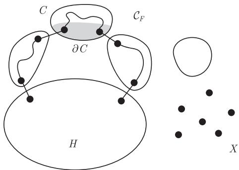

import Guide from '@/components/Guide.astro';
import Knowledge from '@/components/Knowledge.astro';
import Example from '@/components/Example.astro';
import Analysis from '@/components/Analysis.astro';
import Solution from '@/components/Solution.astro';
import Variant from '@/components/Variant.astro';
import Note from '@/components/Note.astro';
import Block from '@/components/Block.astro';
import Method from '@/components/Method.astro';
import Exercise from '@/components/Exercise.astro';

与Menger定理类似, 我们可以考虑下面这个问题: 给定一个图 $G$ 以及一个导出子图 $H$ , 在 $G$ 中我们可以找到多少条独立的 $H$ -路呢?

在本节, 我们给出 Mader 的一个深刻定理, 但不给出证明, 该定理用类似于 Menger 定理的方式解决了上述的问题. 进一步地, 定理阐述了这样一个事实: 从某些分隔的大小可以自然地产生的这样路的个数的上界, 而这个上界是可以通过选择合适的路集合而达到的.

那么这个上界会是怎样的呢？显然，如果 $X \subseteq V(G - H)$ 和 $F \subseteq E(G - H)$ 满足 $G$ 中每一条 $H$ -路都有一个顶点或一条边属于 $X \cup F$ ，那么 $G$ 不可能包含多于 $|X \cup F|$ 条独立的 $H$ -路。所以，这样一个集合 $X \cup F$ 的最小基数是独立 $H$ -路的最大数目的一个自然上界。（注意，每一条 $H$ -路与 $G - H$ 相交，这是因为 $H$ 在 $G$ 中是导出的且 $H$ 的边不能看成 $H$ -路。）

与Menger定理比较, 这个界仍可以改进. $|X \cup F|$ 的极小性表明 $F$ 中的边没有端点在 $X$ 中: 否则, 分隔不需要这条边. 令 $Y := V(G - H) \setminus X$ , 并用 $\mathcal{C}_F$ 表示图 $(Y, F)$ 的分支的集合. 由于每条避免 $X$ 的 $H$ -路都包含 $F$ 的一条边, 故对某个 $C \in \mathcal{C}_F$ 它包含至少两个 $\partial C$ 中的顶点, 其中 $\partial C$ 表示 $C$ 中有一个邻点属于 $G - X - C$ 的顶点集合 (图3.4.1). 因此, $G$ 中独立 $H$ -路的数目具有上界

$$
M _ {G} (H) := \min \left(| X | + \sum_ {C \in \mathcal {C} _ {F}} \left\lfloor \frac {1}{2} | \partial C | \right\rfloor\right),
$$

其中, 最小遍取所有上面讨论的 $X$ 和 $F: X \subseteq V(G - H)$ 且 $F \subseteq E(G - H - X)$ 使得 $G$ 中每条 $H$ -路都有一个顶点或一条边属于 $X \cup F$ .

<figure class="vp-figure">
  
  <figcaption>图 3.4.1 $G - X$ 中的一条 $H$ -路</figcaption>
</figure>

Mader 定理指出这个上界总可以通过某个独立 $H$ -路的集合达到:

<Knowledge title="定理 3.4.1 Mader, 1978">
给定图 $G$ 及它的一个导出子图 $H, G$ 中总存在 $M_G(H)$ 条独立的 $H$ -路.

为了直接得到类似于Menger定理的顶点和边版本, 我们考虑上述问题中当 $F$ 或 $X$ 是空集这两种特殊情形. 给定一个导出子图 $H \subseteq G$ , 用 $\kappa_{H}(G)$ 表示与 $G$ 中的每条 $H$ -路都相交的顶点集合 $X \subseteq V(G - H)$ 的最小基数. 类似地, 用 $\lambda_{H}(G)$ 表示与 $G$ 中的每条 $H$ -路都相交的边集合 $F \subseteq E(G)$ 的最小基数.
</Knowledge>

<Knowledge title="推论 3.4.2">
给定图 $G$ 及它的一个导出子图 $H, G$ 中存在至少 $\frac{1}{2}\kappa_H(G)$ 条独立的 $H$ -路和至少 $\frac{1}{2}\lambda_H(G)$ 条边不交的 $H$ -路.

<Solution title="证明">
要证明第一个结论, 令 $k$ 表示 $G$ 中独立 $H$ -路的最大数目. 由定理3.4.1知, 存在集合 $X \subseteq V(G - H)$ 以及 $F \subseteq E(G - H - X)$ 满足

$$
k = | X | + \sum_ {C \in \mathcal {C} _ {F}} \left\lfloor \frac {1}{2} | \partial C | \right\rfloor ,
$$

使得 $G$ 中每一条 $H$ -路都有一个顶点在 $X$ 中或一条边在 $F$ 中. 对每个具有 $\partial C \neq \varnothing$ 的 $C \in \mathcal{C}_F$ , 任选一个顶点 $v \in \partial C$ 并令 $Y_C := \partial C \setminus \{v\}$ , 如果 $\partial C = \varnothing$ , 则令 $Y_C := \varnothing$ . 那么, 对所有的 $C \in \mathcal{C}_F$ , 有 $\left\lfloor \frac{1}{2} |\partial C| \right\rfloor \geqslant \frac{1}{2} |Y_C|$ . 此外, 对 $Y := \bigcup_{C \in \mathcal{C}_F} Y_C$ , 每条 $H$ -路都有一个顶点在 $X \cup Y$ 中. 因此

$$
k \geqslant | X | + \sum_ {C \in \mathcal {C} _ {F}} \frac {1}{2} | Y _ {C} | \geqslant \frac {1}{2} | X \cup Y | \geqslant \frac {1}{2} \kappa_ {H} (G),
$$

这正是我们想证明的.

考虑图 G 的线图, 由第一个结论知第二个结论成立 (练习 25).

令人惊讶的是, 推论 3.4.2 中的界 (作为一般的界) 是最好的, 即我们可以找到具体的 G 和 H, 使得 G 不包含多于 $\frac{1}{2}\kappa_{H}(G)$ 条独立的 H-路或多于 $\frac{1}{2}\lambda_{H}(G)$ 条边不交的 H-路 (练习 26 和练习 27).
</Solution>
</Knowledge>
