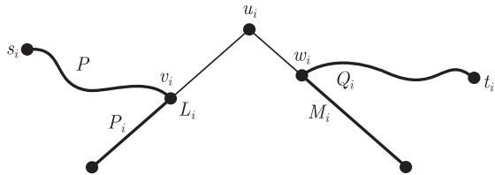
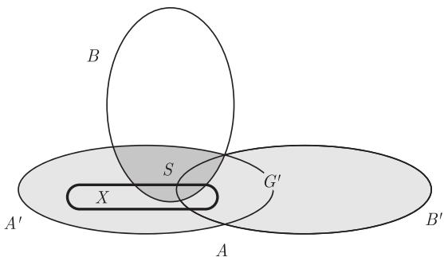
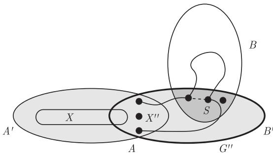

import Guide from '@/components/Guide.astro';
import Knowledge from '@/components/Knowledge.astro';
import Example from '@/components/Example.astro';
import Analysis from '@/components/Analysis.astro';
import Solution from '@/components/Solution.astro';
import Variant from '@/components/Variant.astro';
import Note from '@/components/Note.astro';
import Block from '@/components/Block.astro';
import Method from '@/components/Method.astro';
import Exercise from '@/components/Exercise.astro';

设 G 是一个图, $X \subseteq V(G)$ 是一个顶点集, 我们称 X 在 G 中是连接的 (linked), 如果在 X 中无论如何选取不同的顶点 $s_{1}, \cdots, s_{\ell}, t_{1}, \cdots, t_{\ell}$ , 总能在 G 中找到不相交的路 $P_{1}, \cdots, P_{\ell}$ 使得每条路 $P_{i}$ 连接 $s_{i}$ 到 $t_{i}$ , 并且没有内部顶点属于 X. 因此, 与 Menger 定理不同, 我们不仅寻找两个顶点集之间的不相交路, 还要求每条路都连接一对特定的端点.

如果 $|G| \geqslant 2k$ 且每一个包含至多 2k 个顶点的集合 X 在 G 中是连接的, 那么 G 是 k-连接的 (k-linked). 显然, 这等价于要求 $|G| \geqslant 2k$ 并且任意选择恰好 2k 个不同顶点 $s_{1}, \cdots, s_{k}, t_{1}, \cdots, t_{k}$ , 那么总存在不相交的路 $P_{i} = s_{i} \cdots t_{i}$ (我们总可以通过添加虚拟顶点使得 X 的阶数成为 2k). 实际上, 后者更容易证明, 因为我们无须担心 X 中的内部顶点.

显然, 每个 $k$ -连接图是 $k$ -连通的, 但是逆命题远不成立: $k$ -连接性显然是一个比 $k$ -连通性要强很多的性质. 本节将证明, 对某个函数 $f: \mathbb{N} \longrightarrow \mathbb{N}$ , 通过假设图是$f(k)$ -连通的, 我们可以保证图是 $k$ -连接的. 首先借用第 7 章的一个引理, 对 “这样的函数 $f$ 一定存在” 这一命题给出一个漂亮且简单的证明. 在本节的剩余部分, 我们将证明 $f$ 甚至可以是线性的.

简洁证明的基本思路如下：如果能够证明 $G$ 包含一个大的完全图的细分 $K$ ，那么可以用Menger定理把 $X$ 中的顶点不相交地连接到 $K$ 的分支顶点，然后希望通过 $K$ 的细分边将它们按照要求两两配对。当然，这就要求路在到达 $K$ 的分支顶点以前不能使用太多的细分边。

引理意味着, 足够大的连通度确实可以保证这样一个完全拓扑子式 $K$ 的存在, 证明将在7.2节中给出, 在那里我们也会考虑若干类似结果. 由定理1.4.3, 只需假定 $G$ 有大的平均度就可以了:

<Knowledge title="引理 3.5.1">
存在一个函数 $h: N \longrightarrow N$ 使得对所有 $r \in N$ ，每个平均度至少为 $h(r)$ 的图都包含一个拓扑子式 $K^{r}$ .
</Knowledge>

<Knowledge title="定理 3.5.2 Jung, 1970; Larman and Mani, 1970">
存在一个函数 $f: N \longrightarrow N$ 使得对所有的 $k \in N$ ，每个 $f(k)$ -连通的图是 k-连接的.

<Solution title="证明">
设 $h$ 是引理3.5.1中的函数, 我们证明定理对 $f(k) = h(3k) + 2k$ 成立. 设 $G$ 是一个 $f(k)$ -连通的图, 那么 $d(G) \geqslant \delta(G) \geqslant \kappa(G) \geqslant h(3k)$ ; 设 $K$ 是如引理3.5.1中所述的 $G$ 的一个 $TK^{3k}$ , 并令 $U$ 表示其分支顶点的集合.

为了证明 G 是 k-连接的, 先给定不同的顶点 $s_{1}, \cdots, s_{k}$ 和 $t_{1}, \cdots, t_{k}$ , 由 $f(k)$ 的定义, 我们有 $\kappa(G) \geqslant 2k$ . 所以, 由 Menger 定理 (3.3.1) 知, G 包含不交路 $P_{1}, \cdots, P_{k}, Q_{1}, \cdots, Q_{k}$ 使得每条 $P_{i}$ 从 $s_{i}$ 开始, 每条 $Q_{i}$ 从 $t_{i}$ 开始, 并且所有的路都终止于 U, 但内部顶点都不属于 U. 选定这些路的集合 P 使得它们在 $E(K)$ 外面的总边数尽可能小.

令 $u_{1},\cdots,u_{k}$ 表示 U 中不是 P 中某条路的终点的 k 个顶点。对每个 $i=1,\cdots,k$ ，令 $L_{i}$ 表示 K 中的 U-路（即 $K^{3k}$ 的细分边），它从 $u_{i}$ 开始到 $P_{i}$ 在 U 中的终点处终止；并令 $v_{i}$ 表示 $L_{i}$ 中第一个属于某条路 $P\in P$ 的顶点。由 P 的定义，P 在 $E(K)$ 外部的边数不超过 $Pv_{i}L_{i}u_{i}$ 在 $E(K)$ 外部的边数，所以 $v_{i}P=v_{i}L_{i}$ ，因此 $P=P_{i}$ （图 3.5.1）。类似地，如果 $M_{i}$ 表示 K 中从 $u_{i}$ 开始到 $Q_{i}$ 在 U 中的终点处终止的 U-路， $w_{i}$ 表示 $M_{i}$ 中第一个属于 P 中某条路的顶点，那么这条路就是 $Q_{i}$ 。从而, 路 $s_{i}P_{i}v_{i}L_{i}u_{i}M_{i}w_{i}Q_{i}t_{i}$ 对不同的 i 是不相交的, 所以 G 是 k-连接的.

<figure class="vp-figure">
  
  <figcaption>图 3.5.1 构造一条经过 $u_{i}$ 的 $s_i - t_i$ 路</figcaption>
</figure>

引理3.5.1中的 $h$ (将在命题7.2.2的证明中给出)是关于 $r$ 的一个指数函数，所以只提供了定理3.5.2的函数 $f(k)$ 的一个指数上界.因为 $2\varepsilon (G)\geqslant \delta (G)\geqslant \kappa (G)$ 下面的结果意味着函数 $f$ 有个线性界 $f(k) = 16k$
</Solution>
</Knowledge>

<Knowledge title="定理 3.5.3 Thomas and Wollan, 2005">
设 G 是一个图, 且 $k \in N$ . 如果 G 是 2k-连通的且 $\varepsilon(G) \geqslant 8k$ , 那么 G 是 k-连接的.

证明定理 3.5.3 前, 我们先给出一个引理.
</Knowledge>

<Knowledge title="引理 3.5.4">
每个满足 $\delta(G) \geqslant 8k \geqslant |H|/2$ 的图 H 包含一个 k-连接的子图.

<Solution title="证明">
如果 H 本身是 k-连接的, 那么结论显然成立, 故假设 H 不是 k-连接的, 那么可以找到一个集合 X, 它包含 2k 个顶点 $s_{1}, \cdots, s_{k}, t_{1}, \cdots, t_{k}$ , 而这些顶点不能由 H 中不相交的路 $P_{i} = s_{i} \cdots t_{i}$ 连接. 令 P 表示包含尽可能多这样路的集合, 它们的内部顶点不在 X 中并且每条路的长度至多为 7. 如果有若干个这样的集合 P, 我们就选择一个满足 $| \cup P|$ 最小的 P. 不妨设 P 不包含从 $s_{1}$ 到 $t_{1}$ 的路. 令 J 表示 H 中由 X 以及 P 中所有路的顶点一起导出的子图, 记 K := H - J.

注意到每个顶点 $v \in K$ 在任意给定的路 $P_{i} \in P$ 上至多有 3 个邻点：如果它有 4 个邻点，那么用路 uvw 代替路段 $uP_{i}w$ （即 $P_{i}$ 中第一个和最后一个邻点之间的路段），将使得 $|\bigcup P|$ 减小，这与 P 的选择矛盾。因此对所有的 $i = 1, \cdots, k, v$ 在 J 中最多有 3 个邻点，即在 J 中最多有 3k 个邻点。由假设 $\delta(H) \geqslant 8k$ 以及 $|H| \leqslant 16k$ 和 $|X| = 2k$ ，我们可以推出

$$
\delta (K) \geqslant 5 k \quad {\text {且}} \quad | K | \leqslant 1 4 k.\tag{1}
$$

下一个目标是证明 $K$ 是不连通的。由于 $\mathcal{P}$ 中每条路至多有八个顶点，故有 $|J - \{s_1, t_1\}| \leqslant 8(k - 1)$ 。因此， $s_1$ 在 $K$ 中有一个邻点 $s$ ，而 $t_1$ 在 $K$ 中有一个邻点 $t$ 。令 $S := \{s' \in K \mid d_K(s, s') \leqslant 2\}$ 和 $T := \{t' \in K \mid d_K(t, t') \leqslant 2\}$ 。因为 $H - \bigcup \mathcal{P}$ 不包含长度至多为 7 的 $s_1 - t_1$ 路，故有 $S \cap T = \varnothing$ ，因此在 $K$ 中没有 $S - T$ 边。要证明 $K$ 是不连通的，只需证明 $V(K) = S \cup T$ 。对任意顶点 $v \in K - (S \cup T)$ ，集合 $N_K(s), N_K(t)$ 和 $N_K(v)$ 是互不相交的且每个集合的基数至少为 $5k$ ，这与 (1) 矛盾。所以 $K$ 是不连通的；令 $C$ 表示它的较小分支。由 (1) 知

$$
2 \delta (C) \geqslant 2 \delta (K) \geqslant 7 k + 3 k \geqslant \frac {1}{2} | K | + 3 k \geqslant | C | + 3 k.\tag{2}
$$

我们通过证明 $C$ 是 $k$ -连接的来结束定理的证明. 因为 $\delta(C) \geqslant 5k$ , 故有 $|C| \geqslant 2k$ . 设 $Y$ 是 $C$ 中至多有 $2k$ 个顶点的集合. 由 (2) 知, $Y$ 中任意两个顶点都至少有 $3k$ 个公共的邻点, 且这些公共邻点中至少有 $k$ 个在 $Y$ 的外部. 因此, 通过那些内部顶点均在 $Y$ 的外部的长为 2 的路, 我们可以归纳地连接 $Y$ 中任意 $\ell \leqslant k$ 对想要连接的顶点.

在证明定理 3.5.3 之前, 我们先看一下证明的主要思想. 为了证明 G 是 k-连接的, 给定包含 2k 个顶点的集合 X, 证明 X 在 G 中是连接的. 在理想的情况, 我们希望利用引理 3.5.4 在 G 中某处找到一个连接子图 L, 然后由 Menger 定理 (3.3.1) 并通过假设 $\kappa(G) \geqslant 2k$ 得到 $|X|$ 条不交的 X-L 路. 从而, 通过这些路和 L 得到 X 是连接的, 完成证明.

不幸的是, 我们不能期望找到一个子图 $H$ 使得 $\delta(H) \geqslant 8k$ 同时 $|H| \leqslant 16k$ (在这种情况, 利用引理3.5.4可找到 $L$ ), 参考推论11.2.3. 然而, 找到一个包含这样子图的子式 $H \preccurlyeq G$ 却并不困难(第7章练习21), 甚至可以使 $X$ 的顶点属于 $H$ 的不同分支集合中. 于是可以把 $X$ 看成 $V(H)$ 的子集, 从而引理3.5.4给出了 $H$ 的一个连接子图 $L$ . 现在, 唯一的问题是 $H$ 不再是 $2k$ -连通的, 即假设条件 $\kappa(G) \geqslant 2k$ 不能确保我们可以利用 $H$ 中 $|X|$ 条不交路将 $X$ 连接到 $L$ .

接下来是证明中的巧妙之处：它将假设条件 $\kappa \geqslant 2k$ 放宽成一个可以传递到 $H$ 上的较弱假设。这个较弱假设是：如果我们可以用少于 $|X|$ 个顶点把 $X$ 从 $G$ （或 $H$ ）的另外部分分离出来，那么这个另外部分一定是“轻的”：粗略地说， $\varepsilon$ 自身的值一定不超过 $8k$ 。如果不能用 $|X|$ 条不交路把 $X$ 连接到 $L$ ，那么 $H$ 包含一个分离 $\{A, B\}$ 使得 $X \subseteq A, L \subseteq B$ 且 $|A \cap B| < |X|$ ，所以我们知道 $\varepsilon$ 在 $H[A]$ 上仍然至少为 $8k$ ，这是因为 $H$ 的 $B$ -部分是“轻的”。

现在, 证明的思路是继续在 $H' := H[A]$ 上用归纳法. 因为 $\varepsilon$ 仅仅在 $H'$ 上较大并不足够, 因此这里仍需要一些技巧: 进一步要求, 对 $H'$ 的每个满足 $X \subseteq A'$ 的低阶分离 $(A', B')$ , $B'$ 的部分是“轻的”; 这并不一定成立, 但是如果它不成立, 那么我们将可以在 $H'[B']$ 上使用归纳法来证明 “ $A' \cap B'$ 在 $H'[B']$ 中是连接的”, 使用这个事实来证明 $X$ 在 $H$ 中是连接的.

给定 $k \in \mathbb{N}$ , 图 $G$ 以及 $A, B, X \subseteq V(G)$ . 如果 $\{A, B\}$ 是 $G$ 的一个真分离, 其阶至多为 $|X|$ 且 $X \subseteq A$ , 则称有序对 $(A, B)$ 为 $G$ 的一个 $X$ -分离 (X-separation). 如果 $|A \cap B| < |X|$ , 则称它是一个小的 $X$ -分离 (small X-separation); 如果 $A \cap B$ 在 $G[B]$ 中是连接的, 则称这个 $X$ -分离是连接的 (linked).

我们称集合 $U \subseteq V(G)$ 在 $G$ 中是轻的 (light), 如果 $\| U\|^{+} \leqslant 8k|U|$ , 其中 $\| U\|^{+}$ 代表至少有一个端点在 $U$ 中的 $G$ 的边的条数. 如果一个顶点集合不是轻的, 就称它是重的 (heavy).

定理 3.5.3 的证明 给定 $k \in N$ ，我们证明下述命题：

设 $G = (V,E)$ 是一个图， $X \subseteq V(G)$ 是一个最多包含 $2k$ 个顶点的集

合. 如果 $V \setminus X$ 是重的, 且对每一个小的 $X$ -分离 $(A, B)$ , 集合 $B \setminus A$

$(*)$

是轻的, 那么 $X$ 在 $G$ 中是连接的.

要证明 (\*) 蕴含着本定理, 假设 $\kappa(G) \geqslant 2k$ 且 $\varepsilon(G) \geqslant 8k$ , 设 $X$ 是恰好包含 $2k$ 个

顶点的集合, 那么 $G$ 中没有小的 $X$ -分离, 并且 $V \setminus X$ 是重的, 这是因为

$$
\| V \setminus X \| ^ {+} \geqslant \| G \| - \binom {2 k} {2} > 8 k | V | - 1 6 k ^ {2} = 8 k | V \setminus X |.
$$

由 (\*) 知, X 在 G 中是连接的, 从而证明了 G 是 k-连接的.

对 $|G|$ 用归纳法来证明 $(*)$ , 并且对于 $|G|$ 的每个值, 对 $\|V \setminus X\|^{+}$ 用归纳法. 如果 $|G|=1$ , 那么 $X$ 在 $G$ 中是连接的. 在归纳步骤中, 给定 $G$ 和 $X$ 如 $(*)$ 中所述. 先证明下列命题:

$$
\text { 我们可以假设 } G \text { 没有连接的 } X \text {-分离}.\tag{1}
$$

我们用反证法证明 (1), 假设 $G$ 有一个连接的 $X$ -分离 $(A, B)$ . 选择一个 $X$ -分离使得 $A$ 达到极小, 并且令 $S := A \cap B$ .

首先考虑 $|S| = |X|$ 的情形, 如果 $G[A]$ 包含 $|X|$ 条不交的 $X - S$ 路, 因为 $(A, B)$ 是连接的, 那么 $X$ 在 $G$ 中是连接的, 所以完成 (\*) 的证明; 否则, 由Menger定理(3.3.1), $G[A]$ 有一个小的 $X$ -分离 $(A', B')$ 使得 $B' \supseteq S$ . 如果选择一个具有最小阶 (即 $|A' \cap B'|$ 最小) 的分离, 又由Menger定理知, 我们可以在 $G[B']$ 中用 $|A' \cap B'|$ 条不交的路将 $A' \cap B'$ 连接到 $S$ . 那么, $(A', B' \cup B)$ 是 $G$ 的一个连接的 $X$ -分离, 又与 $(A, B)$ 的选择矛盾.

所以 $|S| < |X|$ . 设 $G'$ 是由 $G[A]$ 通过添加 $S$ 中所有缺失的边而得到的图, 它使得 $G'[S]$ 是 $G'$ 的一个完全子图. 因为 $(A, B)$ 是一个小的 $X$ -分离, (\*) 中的假设表明 $B \setminus A$ 在 $G$ 中是轻的. 因此, $G'$ 是由 $G$ 通过删除 $X$ 外部的 $|B \setminus A|$ 个顶点和至多 $8k|B \setminus A|$ 条边, 并可能添加若干边而得到的图. 因为 $V \setminus X$ 在 $G$ 中是重的, 这蕴含着

$$
A \setminus X   \text { 在 }   G ^{\prime}   \text { 中是重的. }
$$

为了能够对 $G'$ 应用归纳假设, 我们接下来证明对于 $G'$ 的每个小 $X$ -分离 $(A', B')$ , 集合 $B' \setminus A'$ 在 $G'$ 中是轻的; 否则, 选择一个使得 $B'$ 极小的反例 $(A', B')$ . 因为 $G'[S]$ 是完全的, 所以有 $S \subseteq A'$ 或 $S \subseteq B'$ .

如果 $S \subseteq A'$ , 那么 $B' \cap B \subseteq S \subseteq A'$ , 所以 $(A' \cup B, B')$ 是 $G$ 的一个小 $X$ -分离. 此外,

$$
B ^{\prime} \setminus (A ^{\prime} \cup B) = B ^{\prime} \setminus A ^{\prime},
$$

且在 $S$ 上 $G' - E$ 中没有边与这个集合相关联 (图3.5.2). 因此, 由 $(A', B')$ 的选择知, 关于“这个集合在 $G'$ 是重的”这一假设蕴含着它在 $G$ 中也是重的. 因为 $(A' \cup B, B')$ 是 $G$ 的一个小 $X$ -分离, 这与 (\*) 中的假设矛盾.

<figure class="vp-figure">
  
  <figcaption>图 3.5.2 如果 $S \subseteq A'$ ，那么 $(A' \cup B, B')$ 是 G 的一个 X-分离</figcaption>
</figure>

因此 $S \subseteq B'$ . 由 $(A', B')$ 的选择知, 图 $G'' := G'[B']$ 对 $X'' := A' \cap B'$ 满足 (\*) 中的假设. 实际上, $B' \setminus X'' = B' \setminus A'$ 是重的, 由 $B'$ 的极小性知, $G''$ 的任何小 $X''$ -分离 $(A'', B'')$ 使得 $B'' \setminus A''$ 是轻的, 这是因为 $(A' \cup A'', B'')$ 是 $G'$ 的小 $X$ -分离, 且 $B'' \setminus A'' = B'' \setminus (A' \cup A'')$ .

由归纳假设知, $X''$ 在 $G''$ 中是连接的. 但是, $X''$ 在 $G[B' \cup B]$ 中也是连接的: 因为 $S$ 在 $G[B]$ 中是连接的, 我们只需在 $G'$ 的定义中用通过 $B$ 的不交路替代 $S$ 上添加的所有边 (图3.5.3) 即可. 但是现在 $(A', B' \cup B)$ 是 $G$ 的一个连接的 $X$ -分离, 该分离与 $(A, B)$ 的选择中 $A$ 的极小性相悖.

<figure class="vp-figure">
  
  <figcaption>图 3.5.3 如果 $S \subseteq B'$ ，那么 $(A', B' \cup B)$ 在 G 中是连接的</figcaption>
</figure>

这样, 我们就证明了 $G'$ 关于 $X$ 满足 (\*) 中的假设. 由于 $\{A, B\}$ 是一个真分离, 故 $G'$ 中的顶点比 $G$ 中的少, 因此由归纳假设, $X$ 在 $G'$ 中是连接的. 和前面一样, 用通过 $B$ 的路替代 $S$ 上 $G' - E$ 的边, 可以将 $G'$ 中 $X$ 的任何连接关系转变成 $G$ 中的连接关系, 从而 (\*) 得证, 即证明了 (1).

下一个目标是, 利用归纳假设来证明可以假设 G 不仅具有大的平均度, 还具有大的最小度. 为了证明 X 在 G 中是连接的, 令 $s_{1}, \cdots, s_{\ell}, t_{1}, \cdots, t_{\ell}$ 表示 X 中的不同顶点, 我们希望可以用不交路 $P_{i} = s_{i} \cdots t_{i}$ 连接它们. 在 G 中添加那些不在 X 的边 (边 $s_{i} t_{i}$ 除外), 因为路 $P_{i}$ 的内部顶点不允许在 X 中, 这些新边既不影响 (\*)

的假设也不影响 (\*) 的结论.

这个修改后, 我们可以证明下述结论:

我们可以假设任何两个不同时属于 X 的相邻顶点 u, v 至少有

8k-1 个公共邻点.

(2)

为了证明 (2), 令 $e = uv$ 是这样的一条边, $n$ 表示 $u$ 和 $v$ 的公共邻点的个数, $G' := G / e$ 表示收缩 $e$ 后得到的图. 因为 $u, v$ 不全在 $X$ 中, 我们也可以把 $X$ 看成 $V' := V(G')$ 的一个子集, 如果 $X \cap \{u, v\} \neq \emptyset$ , 用 $X$ 中的 $u$ 或 $v$ 代替收缩顶点 $v_e$ . 我们的目标是证明, 如果 (2) 的结论 $n \geqslant 8k - 1$ 成立, 那么 $G'$ 已经满足 (\*) 中的假设. 于是, 由归纳假设, $X$ 在 $G'$ 中是连接的, 从而 $G'$ 中存在想要的路 $P_1, \cdots, P_\ell$ . 如果其中一条路包括 $v_e$ , 用 $u$ 或 $v$ 或 $uv$ 代替 $v_e$ , 将该路转化成 $G$ 中的一条路, (\*) 的证明完成.

为了证明 $G'$ 满足关于 $X$ 的 $(*)$ 中的假设, 我们首先证明 $V' \setminus X$ 是重的. 由于 $V \setminus X$ 是重的且 $|V' \setminus X| = |V \setminus X| - 1$ , 因此只需证明 $e$ 的收缩会损失至多 $8k$ 条与 $X$ 外部的一个顶点相关联的边即可. 如果 $u$ 和 $v$ 都在 $X$ 的外部, 那么损失的这样边的条数仅为 $n + 1$ : 与 $u$ 和 $v$ 的每一个公共邻点相关联的边以及 $e$ . 但是, 如果 $u \in X$ , 那么 $v \notin X$ , 我们损失了 $G$ 中所有的 $X - v$ 边 $xv$ , 这里 $x \neq u$ : 虽然把 $xv$ 算入 $\|V \setminus X\|^+$ 中, 但边 $xv_e$ 在 $G'[X]$ 中, 且它没有算入 $\|V' \setminus X\|^+$ 中. 如果 $x$ 不是 $u$ 和 $v$ 的公共邻点, 那么这是一个额外的损失. 但是 $u$ 与除了最多一个顶点外的每个 $x \in X \setminus \{u\}$ 相邻 (由关于 $G[X]$ 的假设知), 所以除了至多一个顶点以外的每个这样的 $x$ 实际上是 $u$ 和 $v$ 的公共邻点. 这样总共减少了至多 $n + 2$ 条边. 除非 $n \geqslant 8k - 1$ (这将对 $u$ 和 $v$ 直接证明 (2)), 这意味着我们损失了至多 $8k$ 条边, 从而证明了 $V' \setminus X$ 是重的.

剩下需要证明的是, 对于 $G'$ 的每个小 $X$ -分离 $(A', B')$ , 集合 $B' \setminus A'$ 是轻的. 设 $(A', B')$ 是一个使得 $B'$ 极小的反例. 于是, 像 (1) 的证明一样, $G'[B']$ 关于 $X' := A' \cap B'$ 满足 (\*) 中的条件. 由归纳假设知 $X'$ 在 $G'[B']$ 中是连接的. 设 $A$ 和 $B$ 是由 $A'$ 和 $B'$ 通过用 $u$ 和 $v$ 替换 $v_e$ 而得到的 (如果有必要的话), 且令 $X'' := A \cap B$ . 我们将证明 $G$ 的分离 $(A, B)$ 与假设 (1) 矛盾.

分别考虑 $v_e$ 的两个可能位置. 如果 $v_e$ 属于 $A' \setminus B'$ 或者 $B' \setminus A'$ , 则 $u, v \in A \setminus B$ 或者 $u, v \in B \setminus A$ . 因为 $X'' = X'$ 在 $G'[B']$ 中是连接的, 所以它在 $G[B]$ 中也是连接的: 如果 $v_e$ 在关于 $X'$ 的连接路上, 那么只需要用 $u$ 或 $v$ 或 $uv$ 替换它, 这和 (1) 矛盾. 另外一种可能是 $v_e \in X'$ . 我们证明 $G[B]$ 关于 $X''$ 满足 (\*) 的假设, 因此由归纳法 $X''$ 在 $G[B]$ 中是连接的, 这又和 (1) 矛盾. 因为 $(A', B')$ 是一个小 $X$ -分离, 所以

$$
\left| X ^{\prime\prime} \right| \leqslant \left| X ^{\prime} \right| + 1 \leqslant | X | \leqslant 2 k.
$$

此外, $B \setminus X'' = B' \setminus A'$ 在 $G$ 中是重的, 这是因为由 $(A', B')$ 的选择知它在 $G'$ 中是重的. 现在考虑 $G[B]$ 的一个小 $X''$ -分离 $(A'', B'')$ , 因为 $|X''| \leqslant |X|$ , 于是 $(A \cup A'', B'')$ 是 $G$ 的一个小 $X$ -分离. 因此, 由 (\*) 中的假设知 $B'' \setminus A'' = B'' \setminus (A \cup A'')$ 是轻的. 因此 $G[B]$ 确实满足 (\*) 中关于 $X''$ 的前提条件, (2) 的证明完成.

通过收缩一条边, 我们刚刚用归纳法证明了可以假设 $V \setminus X$ 中的顶点具有大的度. 通过删除一条边, 我们再次使用归纳法证明这些度不能太大. 因为当 $V = X$ 时 (\*) 成立, 所以可以假设 $V \setminus X \neq \emptyset$ ; 令 $d^{*}$ 表示 $V \setminus X$ 的顶点在 $G$ 中的最小度. 下面证明

$$
\text { 我们可以假设 } 8 k \leqslant d ^ {*} \leqslant 1 6 k - 1.\tag{3}
$$

如果假设 $G$ 在 $X$ 外部没有孤立顶点 (显然, 根据归纳法我们可以这样假设), 则 (3) 中的下界可以由 (2) 推出. 对于上界, 让我们先看看如果删除一条边 $e$ (它的端点 $u$ 和 $v$ 不同时在 $X$ 中) 之后会发生什么情况. 如果 $G - e$ 关于 $X$ 满足 (\*) 中的假设, 那么由归纳法知 $X$ 在 $G - e$ 中是连接的, 所以在 $G$ 中也是连接的; 如果不满足, 那么或者 $V \setminus X$ 在 $G - e$ 中是轻的, 或者 $G - e$ 包含一个小 $X$ -分离 $(A, B)$ 使得 $B \setminus A$ 是重的. 如果后者发生, 那么 $e$ 一定是一条 $(A \setminus B)-(B \setminus A)$ 边: 否则, $(A, B)$ 也将是 $G$ 的一个小 $X$ -分离, 并且 $B \setminus A$ 在 $G$ 中也是重的, 与 (\*) 中的假设矛盾. 但是, 如果 $e$ 是这样的一条边, 那么 $u$ 和 $v$ 的任意公共邻点都属于 $A \cap B$ , 从而存在少于 $|X| \leqslant 2k$ 个这样的邻点, 这与 (2) 矛盾.

所以 $V \setminus X$ 在 $G - e$ 中一定是轻的. 对于 $G$ , 这蕴含着

$$
\| V \setminus X \| ^ {+} \leqslant 8 k | V \setminus X | + 1.\tag{4}
$$

为了证明上式蕴含着想要的 $d^{*}$ 的上界, 我们估计一下顶点 $x \in X$ 连接到 $V \setminus X$ 的边的条数 $f(x)$ . 一定存在至少一条这样的边, 不妨记为 $xy$ , 因为否则 $(X, V \setminus \{x\})$ 会是 $G$ 的一个小 $X$ -分离, 与 (\*) 中的假设矛盾. 但是这样的话, 由 (2) 知, $x$ 和 $y$ 具有至少 $8k - 1$ 个公共邻点, 其中至多有 $2k - 1$ 个属于 $X$ , 所以 $f(x) \geqslant 6k$ . 因为

$$
2 \| V \setminus X \| ^ {+} = \sum_ {v \in V \setminus X} d _ {G} (v) + \sum_ {x \in X} f (x),
$$

$d^{*}\geqslant 16k$ 的假设于是将蕴含着

$$
2 (8 k | V \setminus X | + 1) \underset {(4)} {\geqslant} 2 \| V \setminus X \| ^ {+} \geqslant 1 6 k | V \setminus X | + 6 k | X |,
$$

导出 $2 \geqslant 6k|X|$ 的矛盾, 所以我们完成了 (3) 的证明.

为了完成 (\*) 的证明, 选择一个度为 $d^{*}$ 的顶点 $v_{0} \in V \setminus X$ , 并考虑 $G$ 中由 $v_{0}$ 及其邻集导出的子图 $H$ . 由 (2), 我们有 $\delta(H) \geqslant 8k$ ; 进一步地, 由 (3) 和 $v_{0}$ 的选择, 有 $|H| \leqslant 16k$ . 于是, 由引理3.5.4, $H$ 包含一个 $k$ -连接的子图; 令 $L$ 是它的顶点集. 由“ $k$ -连接”的定义, 有 $|L| \geqslant 2k \geqslant |X|$ . 如果 $G$ 包含 $|X|$ 条不交的 $X-L$ 路, 正如想要的那样, $X$ 在 $G$ 中是连接的; 如果不包含, 那么 $G$ 有一个小 $X$ -分离 $(A, B)$ 满足 $L \subseteq B$ . 假如选择具有最小阶的 $(A, B)$ , 则由Menger定理(3.3.1), $G[B]$ 包含 $|A \cap B|$ 条不交的 $(A \cap B)-L$ 路. 但是如此的话, $(A, B)$ 会是一个连接的 $X$ -分离, 与(1)矛盾.
</Solution>
</Knowledge>
