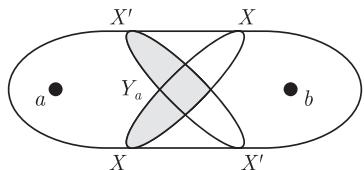

import Guide from '@/components/Guide.astro';
import Knowledge from '@/components/Knowledge.astro';
import Example from '@/components/Example.astro';
import Analysis from '@/components/Analysis.astro';
import Solution from '@/components/Solution.astro';
import Variant from '@/components/Variant.astro';
import Note from '@/components/Note.astro';
import Block from '@/components/Block.astro';
import Method from '@/components/Method.astro';
import Exercise from '@/components/Exercise.astro';

## 第3章 习题

<Exercise title="练习 1">
证明： $X$ 是一个极小的 $a - b$ 分隔当且仅当 $X$ 中的每个顶点在 $G - X$ 的包含 $a$ 的分支 $C_a$ 中有一个邻点，并在 $G - X$ 的包含 $b$ 的分支 $C_b$ 中也有一个邻点.

<Solution title="提示">
运用"分离"和"分立"的定义.
</Solution>
</Exercise>

<Exercise title="练习 2">
$^{-}$ (继续上题)

设 $X^{\prime}\subseteq V(G)\setminus \{a,b\}$ 是另外一个 $a - b$ 分隔，相应地定义 $C_a^\prime$ 和 $C_b^\prime$ ，证明

$$
Y _ {a} := \left(X \cap C _ {a} ^{\prime}\right) \cup \left(X \cap X ^{\prime}\right) \cup \left(X ^{\prime} \cap C _ {a}\right)
$$

和

$$
Y _ {b} := \left(X \cap C _ {b} ^{\prime}\right) \cup \left(X \cap X ^{\prime}\right) \cup \left(X ^{\prime} \cap C _ {b}\right)
$$

均把 a 和 b 分离 (图 3.6.1).

<figure class="vp-figure">
  
  <figcaption>图 3.6.1 练习2中的分隔</figcaption>
</figure>

<Solution title="提示">
用文字描述一下示意图所表达的含义
</Solution>
</Exercise>

<Exercise title="练习 3">
(继续上题)

如果 $X$ 和 $X'$ 都是极小的 $a - b$ 分隔, 那么 $Y_{a}$ 和 $Y_{b}$ 也是吗? 如果 $|X|$ 和 $|X'|$ 是关于 $a - b$ 分隔最小的, 那么 $|Y_{a}|$ 和 $|Y_{b}|$ 也是最小的吗?

<Solution title="提示">
用练习 回答第一个问题第二个问题需要一个初等计算，示意图中已经给出了提示
</Solution>
</Exercise>

<Exercise title="练习 4">
设 $X$ 和 $X'$ 是 $G$ 的极小分隔使得 $X$ 至少和 $G - X'$ 的两个分支相交. 证明 $X'$ 和 $G - X$ 的每个分支相交, 且 $X$ 和 $G - X'$ 的每个分支相交.

<Solution title="提示">
只有第一部分需要证明，第二部分由对称性即可得到.记得用练习
</Solution>
</Exercise>

<Exercise title="练习 5">
$^{-}$ 由命题 3.1.1 推导 Menger 定理 (3.3.1) 中 k=2 的情形.

<Solution title="提示">
- 根据四个顶点中的多少个连接到新的 路上，对归纳步骤分情况讨论-
</Solution>
</Exercise>

<Exercise title="练习 6">
$^{-}$ 在块的正式定义给出后, 证明块的基本性质.

<Solution title="提示">
一个块怎样才不是一个极大的 连通子圈?由此还可得到什么结果?
</Solution>
</Exercise>

<Exercise title="练习 7">
证明：任意连通图的块图是一棵树.

<Solution title="提示">
由图本身的连通性推导块图的连迪性，同时由每个块的极大性可推出它的无圈性
</Solution>
</Exercise>

<Exercise title="练习 8">
设 $G$ 是一个 $k$ -连通图, 而 $xy$ 是 $G$ 的一条边. 证明: $G / xy$ 是 $k$ -连通的当且仅当 $G - \{x, y\}$ 是 $(k - 1)$ -连通的.

<Solution title="提示">
- 假设 $G / x y$ 不是 连通的，分情况讨论。 $v _ { x y }$ 在一个至多有 $k - 1$ 个顶点的分隔的内部或者它的外部-
</Solution>
</Exercise>

<Exercise title="练习 9">
(i) 设 $e$ 是 2-连通图 $G \neq K^3$ 的一条边. 证明: $G - e$ 或者 $G / e$ 也是 2-连通的.

$$
G \neq K ^ {3}
$$

$$
G / f
$$

<Solution title="提示">
根据命题 3.1. ，用归纳法证明.

10+ 假设收缩 和删除 之后所得到的闺中都有一个坠分隔，那么这些分隔相茸的位置有什么关系呢?
</Solution>
</Exercise>

<Exercise title="练习 10">
$^{+}$ 设 e 是 3-连通图 $G \neq K^{4}$ 的一条边. 证明: $G \dot{-} e$ 或者 G/e 也是 3-连通的.
</Exercise>

<Exercise title="练习 11">
不使用定理 3.2.6 证明 3-连通图的每条边都在一个非分离的导出圈上.

<Solution title="提示">
模仿定理 3.2.6 的证明

12‘ $G - e$ 中的非分离导出圃，而 中是 的弦时，则 的两个非分离导出圈上.

13+ $e = x y$ 是被收缩的边如果顶点 $v \in G$ 和 $x , y$ 都相邻，则认为四在 $G / e$ 中也出现(它变为边 $v v _ { e } )$ 而 $v y$ 成删去的平行边.因此，把 $E ( G / e )$ 看作 $E ( G )$ 的一个子集如中要生成的圃，则我们希望它的边集也是 $G / e$ 中的一个圈，这个圈由 $G / e$ 中的非分离导出圈生戚，并希望它们对应于 的非分离导出圈.这个方法对于后者不一定行得遇，但对于需要时添加三角形四百是可以的.这样的三角形在 巾是非分离的，因此它们可以随意地添加
</Solution>
</Exercise>

<Exercise title="练习 12">
基于引理 3.2.2, 给出定理 3.2.6 一个归纳证明 (允许使用前面的练习).
</Exercise>

<Exercise title="练习 13">
$^{+}$ 基于引理 3.2.4, 给出定理 3.2.6 一个归纳证明.
</Exercise>

<Exercise title="练习 14">
$^{+}$ 证明：每个具有 $\kappa(G)=2$ 的传递图 G 是一个圈.

<Solution title="提示">
+ 练习 以及引理 3.2.4的证明会有所帮助
</Solution>
</Exercise>

<Exercise title="练习 15">
$^{-}$ 在 Menger 定理的第一个证明中, 如果只有当 A 在 G 中同时包含 e 的两个端点时, 我们才把 G/e 中的收缩顶点 $v_{e}$ 放在 A 中 (对 B 做同样处理), 那么证明在哪个地方开始出现问题?

<Solution title="提示">
- 一步一步地 仔细阅读证明，直到找到论证不成立的地方构造一个恰当的反例来解释
</Solution>
</Exercise>

<Exercise title="练习 16">
当我们试图证明一个未知的蕴含关系 $a \Rightarrow b$ 时, 可以通过考虑某个显然蕴含 $b$ 的结论 $c$ , 然后证明 $a \Rightarrow c \Rightarrow b$ , 但是这样的尝试可能存在风险: 如果 $c$ 太强了, 即使 $a \Rightarrow b$ 成立, 那么 $a \Rightarrow c$ 也可能不成立. 可是, 在Menger定理的第一个证明中, 我们正是这样做的: 首先证明了一个看起来很强的结论, 给定 $G, A, B$ 和 $G$ 的任意一条边 $e$ , 我们可以收缩或者删除 $e$ 而不减少 $k(G, A, B)$ , 从而由归纳法得到 $k$ 条不相交 $A-B$ 路的存在性. 你是否从证明的一开始就确定这样的思路不会出现风险呢?

<Solution title="提示">
在这个问题中，命题 $a , b$ 的具体内容是什么?蕴含关系 $b \Rightarrow c$ 是否可以帮助我们评估通过 的证明路径是个危险的选择?
</Solution>
</Exercise>

<Exercise title="练习 17">
(i) 找出下面 Menger 定理 (3.3.1) 的“简短证明”中的错误: 设 $X$ 是一个最小的 $A - B$ 分隔. 用 $G_A$ 表示由 $X$ 导出的 $G$ 的子图以及 $G - X$ 中与 $A$ 相交的那些分支; 类似地定义 $G_B$ . 由 $X$ 的极小性, 在 $G_A$ 中不可能存在少于 $|X|$ 个顶点的 $A - X$ 分隔, 所以由归纳法知 $G_A$ 包含 $k$ 条互不相交的 $A - X$ 路; 类似地, $G_B$ 包含 $k$ 条互不相交的 $X - B$ 路. 这些路结合在一起形成了 $G$ 中所需要的 $A - B$ 路.

(ii) 通过考虑 $A$ 和 $B$ 外面的顶点或边, 来弥补 (i) 中证明的缺陷.

<Solution title="提示">
(i) 检查归纳法. (ii) 尝试去删除这样一个顶点或者边，然后使用归纳法如果我们找不到这样的顶点或者边 会是什么样的图呢?如果认为有必要，可以使用 Könìg 的匹配定理.
</Solution>
</Exercise>

<Exercise title="练习 18">
对 $\| G\|$ 使用归纳法证明Menger定理, 如下: 给定一条边 $e = xy$ , 考虑 $G - e$ 的一个最小 $A - B$ 分隔 $S$ . 证明归纳假设蕴含着 $G$ 的一个解, 除非 $S \cup \{x\}$ 和 $S \cup \{y\}$ 都是 $G$ 中的最小 $A - B$ 分隔. 然后说明如果这两个分隔都不被取作前一个练习中的 $X$ 就给出了一个有效的证明, 那么只剩下一个简单情形需要处理.

<Solution title="提示">
有多大?为了证明剩下的筒单情形，先解决前一个练习将会有帮助.
</Solution>
</Exercise>

<Exercise title="练习 19">
给出推论 3.3.5 (ii) 的证明细节.

<Solution title="提示">
$L ( G )$ 中选取极小的不交 A-B
</Solution>
</Exercise>

<Exercise title="练习 20">
$^{-}$ 证明：给定图 G 的两个互不相交的顶点集 A, B, 那么分离 A, B 的最小边数等于 G 中边不交 A-B 路的最大个数.

<Solution title="提示">
把问题简化为书中已证明的某个定理
</Solution>
</Exercise>

<Exercise title="练习 21">
设 $k \geqslant 2$ . 证明: 每个至少有 $2k$ 个顶点的 $k$ -连通图包含一个长度至少为 $2k$ 的圈.

<Solution title="提示">
考虑最长圈 其他的顶点是如何连接到 上的?

22‘ 考虑个经过尽可能多的给定 个顶点的国如果其中的个顶点漏掉了，是否可以重新安排圈上的顶点来经过它?
</Solution>
</Exercise>

<Exercise title="练习 22">
设 $k \geqslant 2$ . 证明: $k$ -连通图中任意的 $k$ 个顶点位于一个公共圈上.
</Exercise>

<Exercise title="练习 23">
找到平面上的一个子集 $D$ 以及两个无限子集 $A, B \subseteq D$ , 使得对于每个有限集 $X \subseteq D$ 存在 $D \setminus X$ 中的一个 $A - B$ 弧但 $D$ 不包含不交 $A - B$ 弧的无限集合.

<Solution title="提示">
尝试让 是闭的单位正方形.
</Solution>
</Exercise>

<Exercise title="练习 24">
$^{+}$ 给定图 $G = (V, E)$ 的一族不相交顶点集 S，如果 G 中一条路连接 S 中不同的集合，并且没有内部顶点属于 $S := \bigcup S$ ，则称这条路是 S-路。证明 Mader 定理的如下版本和定理 3.4.1 等价：G 中不相交 S-路的最大个数等于 $|V_{0}| + \sum_{i=1}^{r} \left\lfloor \frac{1}{2} |\partial V_{i}| \right\rfloor$ 的最小取值，这里和式遍取 V 的所有满足以下条件的顶点划分 $\{V_{0}, \cdots, V_{r}\}$ ： $G - V_{0}$ 中的每个 S-路有一条边的两个端点都在某个 $V_{i}$ 中；而 $\partial V_{i}$ 表示 $V_{i}$ 的顶点集，它要么在 $S$ 中，要么包含 $V_{0}\cup V_{i}$ 以外的邻点.

<Solution title="提示">
+ 两个版本在两方面是不同的不交的 s-路对比独立 一路，所有的划分对比某些划分对这两方面的不同分别处理:基于 $( G - H ) - X$ 的任意划分来寻找 H-路的版本，然后证明这个练习和书中的版本都与 路版本等价.
</Solution>
</Exercise>

<Exercise title="练习 25">
从推论3.4.2中关于顶点的结论来推导关于边的结论. (提示: 令 $h$ 是 $H$ 的一个顶点, 而 $e \in E(G) \setminus E(H)$ 是关联 $h$ 的一条边. 设 $G'$ 是由 $H$ 和线图 $L(G)$ 的不交并, 通过添加所有的边 $he$ 而得到的图. 考虑图 $G'$ 中的 $H$ -路.)

<Solution title="提示">
考虑提示中所给的图证明 和所有 H-路相交的任意顶点集对应于 $E ( G ) \setminus E ( H )$ 中的

一个类似集合辅助闺中的一对独立 H-路对应 中的什么?
</Solution>
</Exercise>

<Exercise title="练习 26">
设 $G$ 是由图 $H = \overline{K^{2m + 1}}$ 和 $k$ 个 $K^{2m + 1}$ 的不交拷贝的并组成的, 并添加连接 $H$ 和每个 $K^{2m + 1}$ 之间双射的边. 证明: $G$ 包含最多 $km = \frac{1}{2}\kappa_G(H)$ 个独立的 $H$ -路.

<Solution title="提示">
单个 $K ^ { 2 m + 1 }$ 可以包含多少条路?
</Solution>
</Exercise>

<Exercise title="练习 27">
找到一个二部图 $G$ , 它的二部划分集分别是 $A$ 和 $B$ 使得对 $H := G[A]$ , $G$ 中最多有 $\frac{1}{2} \lambda_G(H)$ 条边不交的 $H$ -路.

<Solution title="提示">
对于 中的顶点，选择适当的顶点度

也+设 是新的顶点集上的(无边)图.如果 $G ^{\prime}$ 不包含 IGI/2 条独立 路，则考虑 Mader定程提供的集合 F. 如果 不包含 园子，使用这两个集合来寻找一个合适的集合作为Tutte 定理中 的角色
</Solution>
</Exercise>

<Exercise title="练习 28">
$^{+}$ 从 Mader 定理推导 Tutte 的 1-因子定理 (2.2.1).
(提示：从给定的图 G, 对每个顶点 $v \in G$ 添加一个新的顶点 $v'$ ，并连接 v 和 $v'$ ，从而扩展成图 $G'$ . 选取 $H \subseteq G'$ 使得 G 的 1-因子对应于 $G'$ 中足够大的独立 H-路的集合.)
</Exercise>

<Exercise title="练习 29">
$^{-}$ 证明: 2k-边连通图在以下意义下是 k-边连接的: 对所有不同的顶点 $s_{1}, \cdots, s_{k}, t_{1}, \cdots, t_{k}$ ，存在边不相交路 $P_{i} = s_{i} \cdots t_{i} (i = 1, \cdots, k)$ .

<Solution title="提示">
- 让所有的路都通过一个顶点，
</Solution>
</Exercise>

<Exercise title="练习 30">
$^{-}$ 证明：k-连接的图是 $(2k-1)$ -连通的。它是 2k-连通的吗？

<Solution title="提示">
- 如果两个顶点 被少于放 个顶点分离，则把 \{5\} \{t\} 扩充成证明 不是 连接的.
</Solution>
</Exercise>

<Exercise title="练习 31">
对每个 $k \in \mathbb{N}$ , 寻找尽可能大的 $\ell = \ell(k)$ 使得不是每个 $\ell$ -连通图都是 $k$ -连接的.

<Solution title="提示">
为了构造一个不是 连接的商连通圈，首先给定顶 $s _ { 1 } , s _ { 2 } , \cdots , s _ { k } , t _ { 1 } , t _ { 2 } , \cdots , t _ { k }$ ，通过指定某些边不存在使得想要的连接路所需要的顶点总数大子圈中所剩下的顶点个数为了使得图具有商连迪性，除指定的不存在的边外，添加所有其他边

32‘ $2 k - | S \cup T |$ 使用归纳法，其中 $S : = \{ s _ { 1 } , \cdot \cdot \cdot , s _ { k } \} , T : = \{ t _ { 1 } , \cdot \cdot \cdot , t _ { k } \}$ . 在归纳步攘，记得使用 ð(G) 2k -1 (练习 30).
</Solution>
</Exercise>

<Exercise title="练习 32">
证明: 如果 G 是 k-连接的, 且 $s_{1}, s_{2}, \cdots, s_{k}, t_{1}, t_{2}, \cdots, t_{k}$ 不必是不相同的顶点, 但对于所有的 i 有 $s_{i} \neq t_{i}$ , 那么对 $i = 1, \cdots, k$ , G 包含独立路 $P_{i} = s_{i} \cdots t_{i}$ .
</Exercise>

<Exercise title="练习 33">
仔细检查定理 3.5.3 的证明过程, 观察 $\|V \setminus X\|^{+}$ 的使用. 如果用 $\|G[V \setminus X]\|$ 代替, 那么证明在什么地方会出错呢? 哪个论证会更简单些呢?

<Solution title="提示">
特别注意归纳论证部分
</Solution>
</Exercise>

<Exercise title="练习 34">
应用定理 3.5.3 来证明, 引理 3.5.1 中的函数 h 可以选成 $h(r) = cr^{2}$ , 这里 $c \in N$ .

<Solution title="提示">
为了构造 $T K ^ { r }$ J 首先选取分支顶点和它们的邻点，
</Solution>
</Exercise>
