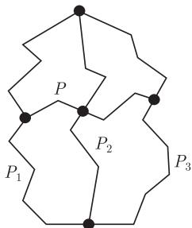
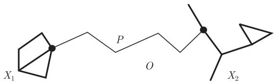

import Guide from '@/components/Guide.astro';
import Knowledge from '@/components/Knowledge.astro';
import Example from '@/components/Example.astro';
import Analysis from '@/components/Analysis.astro';
import Solution from '@/components/Solution.astro';
import Variant from '@/components/Variant.astro';
import Note from '@/components/Note.astro';
import Block from '@/components/Block.astro';
import Method from '@/components/Method.astro';
import Exercise from '@/components/Exercise.astro';

在纸上画一个图时, 自然地, 我们总是想尽量地画得清楚些. 一个明显的减少混乱的画法是避免相交. 例如, 可以试问, 画图时能否把任意两条边只相交于端点, 而不相交于任何其他点.

用这种方式画出的图就称作平面图 (plane graph); 能够以这种方式画出的抽象图称作可平面图 (planar graph). 在这一章, 我们研究平面图和可平面图, 以及这二者之间的关系: 如何把一个抽象可平面图用完全不同方式画出来. 4.1 节收集了一些基本的拓扑结果, 这样我们就可以在后面准确地证明所有结论而没有太多技术性的困难. 4.2 节开始研究平面图的一些构造性质. 4.3 节探讨同一个图的两种画法之间的不同. 这一节的主要结果是, 在某种很强的但自然的拓扑意义下, 3-连通可平面图本质上只有一种画法. 接下来的两节, 我们致力于证明所有经典的可平面刻画, 这些条件告诉我们何时一个抽象图是可平面的. 我们以平面对偶性 (plane duality) 来结束这一章, 平面对偶性这个概念和代数、着色, 以及图的流性质之间有着迷人的联系 (见 1.9 节和 6.5 节).

对于图的画法, 传统的方法是用欧拉平面上的点来表示顶点, 而用这些点之间的曲线来表示边, 且不同的曲线只在共同的端点相交. 为了避免不必要的拓扑复杂化, 接下来, 我们只考虑曲线是分段直线的情形, 不难证明任意画法都能以这种直线方式代替, 所以这两个画法是同一件事.

## 4.1 拓扑知识准备

本节简要地回忆一些基础的拓扑概念和以后需要的一些事实. 到目前为止, 所有这些事实都有简单易懂的证明 (证明的来源可参考注解部分). 由于那些证明不涉及图理论, 所以这里不再重复: 我们的真正目的只是收集那些需要的结论, 而不给出证明. 接下来, 所有的证明都从这些定义和事实推出 (这些证明往往由几何直观所启发, 但并不依赖它们), 所以现在给出的准备会帮助我们把证明中那些基础性的拓扑讨论降到最低.

在欧氏平面中, 一个直线段 (straight line segment) 是在 $\mathbb{R}^2$ 中, 对不同的点 $p, q \in \mathbb{R}^2$, 具有形式 $\{p + \lambda(q - p) \mid 0 \leqslant \lambda \leqslant 1\}$ 的子集. 一个多边形 (polygon) 是 $\mathbb{R}^2$ 的子集, 它是有限多个直线段的并集, 且与单位圆 $S^1$ 同构 ($S^1$ 为 $\mathbb{R}^2$ 中与原点距离为 1 的点集). 这里, 和稍后一样, 我们总是假设拓扑空间的任意子集都拥有子空间拓扑. 一个多边形弧 (polygonal arc) 是 $\mathbb{R}^2$ 的子集, 它是有限多个直线段的并, 而且与闭单位区间 $[0,1]$ 同构. 在这个同构下, 0 和 1 的象是多边形弧的端点 (endpoint), 弧连接 (link) 两个端点, 且弧处于两个端点之间 (between). 在这一章, 我们把多边形弧简称为弧 (arc). 如果 $P$ 是 $x$ 和 $y$ 之间的弧, 称点集 $P \setminus \{x, y\}$ 为 $P$ 的内部 (interior), 并记为 $\mathring{P}$. 作为 $[0,1]$ 的连续映象, 弧以及弧的有限交是紧致的, 所以在 $\mathbb{R}^2$ 中是闭的, 因此它们的补在 $\mathbb{R}^2$ 中是开的.

设 $O \subseteq \mathbb{R}^2$ 是一个开集. 两个点在 $O$ 中由一个弧相连定义了 $O$ 上的一个等价关系, 相应的等价类也是开的, 它们是 $O$ 的区域 (region). 闭集合 $X \subseteq \mathbb{R}^2$ 分离 (separate) $O$ 的区域 $O'$, 如果 $O' \setminus X$ 包含多于一个区域; 集合 $X \subseteq \mathbb{R}^2$ 的前沿 (frontier) 是指所有的点 $y \in \mathbb{R}^2$ 所组成的集合 $Y$, 这里 $y$ 的每个邻集和 $X$ 及 $\mathbb{R}^2 \setminus X$ 都相交. 注意到, 如果 $X$ 是开的, 那么它的前沿包含在 $\mathbb{R}^2 \setminus X$ 中.

设 $X$ 是点和弧的有限并, $\mathbb{R}^2 \setminus X$ 的区域 $O$ 的前沿有两个重要的性质. 第一个是关于可连接性的: 如果 $x \in X$ 在 $O$ 的前沿上, 那么 $x$ 可以和 $O$ 中的某个点由一条直线段连接, 其中直线段的内部完全在 $O$ 的内部. 作为一个推论, $O$ 的前沿上的任意两个点可以由一条完全处于 $O$ 中的弧线连接 (为什么呢?). 第二个关于 $O$ 的前沿的重要性质是, 它把 $O$ 和 $\mathbb{R}^2$ 的其他部分分离开来. 确实, 如果 $\varphi : [0,1] \to P \subseteq \mathbb{R}^2$ 是连续的, 其中 $\varphi(0) \in O$ 和 $\varphi(1) \notin O$, 那么 $P$ 和 $O$ 的前沿至少交于点 $\varphi(y)$, 其中 $y := \inf \{x \mid \varphi(x) \notin O\}$, 这是 $P$ 在 $\mathbb{R}^2 \setminus O$ 中的第一个点 (first point).

<Knowledge title="定理 4.1.1 (多边形的 Jordan 曲线定理)">
对每个多边形 $P \subseteq \mathbb{R}^{2}$, 集合 $\mathbb{R}^{2} \setminus P$ 恰好有两个区域. 每个区域由整个多边形 $P$ 作为它的前沿. ∎
</Knowledge>

有了定理 4.1.1 的帮助, 不难证明下面的引理.

<Knowledge title="引理 4.1.2">
设 $P_{1}, P_{2}, P_{3}$ 是三条弧, 具有相同的两个端点但是其余部分不相交.

(i) $\mathbb{R}^2 \setminus (P_1 \cup P_2 \cup P_3)$ 恰好有三个区域, 其前沿为 $P_1 \cup P_2$, $P_2 \cup P_3$ 和 $P_1 \cup P_3$.

(ii) 如果 $P$ 是 $\mathring{P}_1$ 中的一个点和 $\mathring{P}_3$ 中一个点之间的弧 (图 4.1.1), 并且它的内部位于包含 $\mathring{P}_2$ 的区域 $\mathbb{R}^2 \setminus (P_1 \cup P_3)$ 中, 那么 $\mathring{P} \cap \mathring{P}_2 \neq \varnothing$. ∎

<figure class="vp-figure">
  
  <figcaption>图 4.1.1 引理 4.1.2 (ii) 中的弧</figcaption>
</figure>
</Knowledge>

下一个引理阐述了一条弧不能分离平面, 这补充了 Jordan 曲线定理. 为了后面更方便的应用, 我们把它稍作推广:

<Knowledge title="引理 4.1.3">
设 $X_{1}, X_{2} \subseteq \mathbb{R}^{2}$ 是不相交的集合, 且 $X_{1}, X_{2}$ 都是有限多个点和弧的并集. 设 $P$ 是 $X_{1}$ 中一个点和 $X_{2}$ 中一个点之间的弧, 它的内部位于 $\mathbb{R}^{2} \setminus (X_{1} \cup X_{2})$ 的区域 $O$ 中, 那么 $O \setminus P$ 是 $\mathbb{R}^{2} \setminus (X_{1} \cup P \cup X_{2})$ 的区域. ∎

<figure class="vp-figure">
  
  <figcaption>图 4.1.2 $P$ 不能分离 $\mathbb{R}^2\setminus (X_1\cup X_2)$ 的区域 $O$</figcaption>
</figure>
</Knowledge>

下面仍需介绍一些术语和事实, 只有在 4.3 节中考虑图画法的等价性时, 这些术语和事实才会被用到.

同往常一样, 用 $S^n$ 来记 $n$-维球面, 即 $\mathbb{R}^{n+1}$ 中和原点的距离为 1 的点集. 2-维球面减掉它的“北极点” $(0,0,1)$ 后和平面同胚, 让我们选定一个这样的同胚 $\pi: S^2 \setminus \{(0,0,1)\} \to \mathbb{R}^2$ (比如, 球极平面映射). 若 $P \subseteq \mathbb{R}^2$ 是一个多边形, 而 $O$ 是 $\mathbb{R}^2 \setminus P$ 的有界区域, 称 $C := \pi^{-1}(P)$ 是 $S^2$ 上的一个圈 (circle), 而集合 $\pi^{-1}(O)$ 和 $S^2 \setminus \pi^{-1}(P \cup O)$ 是 $S^2 \setminus C$ 的区域 (region).

我们最后的工具是 Jordan 和 Schoenflies 定理, 为了应用方便对它稍作调整:

<Knowledge title="定理 4.1.4">
设 $\varphi: C_{1} \to C_{2}$ 是 $S^{2}$ 中两个圈的同胚, 令 $O_{1}$ 是 $S^{2} \setminus C_{1}$ 的区域, 而 $O_{2}$ 是 $S^{2} \setminus C_{2}$ 的区域. 那么, $\varphi$ 可以拓广为从 $C_{1} \cup O_{1}$ 到 $C_{2} \cup O_{2}$ 的一个同胚. ∎
</Knowledge>
