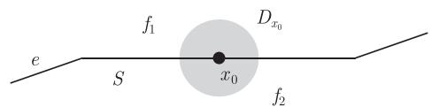
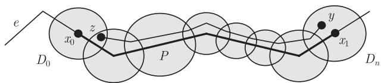
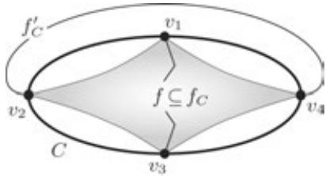

import Guide from '@/components/Guide.astro';
import Knowledge from '@/components/Knowledge.astro';
import Example from '@/components/Example.astro';
import Analysis from '@/components/Analysis.astro';
import Solution from '@/components/Solution.astro';
import Variant from '@/components/Variant.astro';
import Note from '@/components/Note.astro';
import Block from '@/components/Block.astro';
import Method from '@/components/Method.astro';
import Exercise from '@/components/Exercise.astro';

平面图 (plane graph) 是具有下列性质的有限集合对 $(V, E)$ (这里 $V$ 中的元素仍然叫做顶点 (vertex), $E$ 中的元素仍叫做边 (edge)):

(i) $V \subseteq \mathbb{R}^2$;

(ii) 每条边是两个顶点之间的弧;

(iii) 不同的边有不同的端点集合;

(iv) 一条边的内部不包含顶点和任何其他边的点.

平面图 $(V,E)$ 很自然地定义了 $V$ 上的一个图 $G$. 在不引起混淆的情况下, 我们还用抽象图 $G$ 表示平面图 $(V,E)$, 或者表示点集 $V \cup \bigcup E$; 类似地, 通常的符号也将被用到与抽象图相对的平面边、子图等等. $^{1}$

当 $G$ 是平面图时, 我们称 $\mathbb{R}^2 \setminus G$ 的区域为 $G$ 的面 (face), 它是 $\mathbb{R}^2$ 的开子集, 因此它的前沿在 $G$ 中. 因为 $G$ 是有界的, 也就是说, $G$ 位于某个足够大的圆盘 $D$ 之中, 所以它的面恰好有一个是无界的, 即包含 $\mathbb{R}^2 \setminus D$ 的面, 这个面叫做 $G$ 的外部面 (outer face), 其余的面叫做内部面 (inner face), 我们把 $G$ 的面的集合记作 $F(G)$.

平面图的面和它的子图有着明显的联系：

<Knowledge title="引理 4.2.1">
设 $G$ 是平面图, $f \in F(G)$ 是一个面, 且 $H \subseteq G$ 是一个子图.

(i) $H$ 有一个包含 $f$ 的面 $f'$.

(ii) 如果 $f$ 的前沿位于 $H$ 中, 那么 $f' = f$.

<Solution title="证明">
(i) 显然, 在 $f$ 中等价的点, 在 $\mathbb{R}^2 \setminus H$ 中也是等价的, 让 $f'$ 表示 $\mathbb{R}^2 \setminus H$ 中包含它们的等价类.

(ii) 4.1 节中提到, $f$ 和 $f' \setminus f$ 之间的任何弧与 $f$ 的前沿 $X$ 相交. 如果 $f' \setminus f \neq \varnothing$, 那么存在一条在 $f'$ 中的弧, 它在 $X$ 中的点不处于 $H$ 中. 因此 $X \not\subseteq H$. ∎
</Solution>
</Knowledge>

在这一节, 我们希望为平面图的 (简单但) 准确的介绍打好基础, 所以让我们再次回到平面的初等拓扑邻域, 并证明一些看起来十分明显的结论: $^{2}$ 平面图 $G$ 的面的前沿总是 $G$ 的子图, 而不能是, 例如, 半条边.

下面的引理对这一事实, 以及两个类似的“明显”平面性质, 给出了严格的叙述.

<Knowledge title="引理 4.2.2">
设 $G$ 是一个平面图, 且 $e$ 是 $G$ 的边.

(i) 如果 $X$ 是 $G$ 的一个面的前沿, 那么或者 $e \subseteq X$, 或者 $X \cap \mathring{e} = \varnothing$.

(ii) 如果 $e$ 位于一个圈 $C \subseteq G$ 上, 那么 $e$ 位于 $G$ 的恰好两个面的前沿上, 且这两个前沿包含在 $C$ 的两个不同的面中.

(iii) 如果 $e$ 不属于任何圈, 那么 $e$ 恰好位于 $G$ 的一个面的前沿上.

<Solution title="证明">
我们把这三个结论一起证明. 首先, 考虑一个点 $x_0 \in \mathring{e}$, 根据 $e$ 是否位于 $G$ 的圈中, 证明 $x_0$ 位于恰好两个面上, 或者一个面的前沿上. 然后证明 $\mathring{e}$ 的每个其他点位于与 $x_0$ 相同面的前沿上. 那么 $e$ 的端点也会位于这些面的前沿上, 这是由于 $e$ 的端点的每个邻集也是 $e$ 的内部点的邻集.

因为 $G \setminus \mathring{e}$ 是紧致的, 所以在每个点 $x \in \mathring{e}$ 的周围可以找到一个开圆盘 $D_x$, 它只和包含 $x$ 的 (一个或两个) 直线段相交.

我们从一条直线段 $S \subseteq e$ 中选取一个内部点 $x_0$, 那么 $D_{x_0} \cap G = D_{x_0} \cap S$, 所以 $D_{x_0} \setminus G$ 是两个开的半圆盘的并. 既然这些半圆盘不和 $G$ 相交, 那么它们每个都位于 $G$ 的一个面中. 记这些面为 $f_1$ 和 $f_2$, 那么它们是 $G$ 中包含 $x_0$ 在其前沿上可能的面, 而且它们可能重合 (图 4.2.1).

<figure class="vp-figure">
  
  <figcaption>图 4.2.1 引理 4.2.2 的证明中 $G$ 的两个面 $f_{1}$ 和 $f_{2}$</figcaption>
</figure>

如果 $e$ 位于一个圈 $C \subseteq G$ 中, 那么 $D_{x_0}$ 和 $C$ 的两个面都相交 (定理 4.1.1). 由引理 4.2.1, 因为 $f_1$ 和 $f_2$ 都包含在 $C$ 的面中, 所以这说明 $f_1 \neq f_2$. 如果 $e$ 不位于任何圈中, 那么 $e$ 是一个桥, 如同在引理 4.1.3 中一样, 所以连接两个不相交的点集 $X_1, X_2$, 而且 $X_1 \cup X_2 = G \setminus \mathring{e}$. 明显地, $f_1 \cup \mathring{e} \cup f_2$ 是 $G - e$ 的面 $f$ 的子集. 由引理 4.1.3 知, $f \setminus \mathring{e}$ 是 $G$ 的一个面. 而 $f$ 的定义蕴含着 $f_1, f_2 \subseteq f \setminus \mathring{e}$. 由于 $f_1$ 和 $f_2$ 也是 $G$ 的面, 所以 $f_1 = f \setminus \mathring{e} = f_2$.

现在考虑任意其他的点 $x_1 \in \mathring{e}$. 设 $P$ 是从 $x_0$ 到包含在 $e$ 中的 $x_1$ 的弧. 由于 $P$ 是紧致的, 所以有限多个圆盘 $D_x$ (这里 $x \in P$) 覆盖 $P$. 让我们根据这些圆盘的中心在 $P$ 上的自然顺序排列为 $D_0, \dots, D_n$, 必要的话, 增加 $D_{x_0}$ 或 $D_{x_1}$, 我们可以假设 $D_0 = D_{x_0}$ 及 $D_n = D_{x_1}$. 对 $n$ 用归纳法, 可以很容易地证明, 每个点 $y \in D_n \setminus e$ 可以由 $(D_0 \cup \dots \cup D_n) \setminus e$ 的内部的一条弧连接到点 $z \in D_0 \setminus e$ (图 4.2.2), 那么 $y$ 和 $z$ 在 $\mathbb{R}^2 \setminus G$ 中是等价的. 因此 $D_n \setminus e$ 中的每个点位于 $f_1$ 或 $f_2$ 中, 那么 $x_1$ 不能位于 $G$ 的任何其他面的前沿上. 由于 $D_0 \setminus e$ 的两个圆盘都能以这种方式 (交换 $D_0$ 和 $D_n$ 的作用) 连接到 $D_n \setminus e$, 因此 $x_1$ 同时位于 $f_1$ 和 $f_2$ 的前沿上. ∎

<figure class="vp-figure">
  
  <figcaption>图 4.2.2 一条与 $P$ 靠近的从 $y$ 到 $D_0$ 的弧</figcaption>
</figure>
</Solution>
</Knowledge>

<Knowledge title="推论 4.2.3">
一个面的前沿总是一个子图的点集合. ∎
</Knowledge>

如果 $G$ 的子图上的点集是面 $f$ 的前沿, 那么我们说这个子图界定 (bound) 面 $f$, 并称它是边界 (boundary), 记为 $G[f]$, 我们说面和它边界上的顶点和边相关联 (incident). 由引理 4.2.1 (ii), $G$ 的每个面也是它的边界的面, 我们将会在后面的证明中频繁地使用这个事实.

<Knowledge title="命题 4.2.4">
一个平面森林恰好只有一个面.

<Solution title="证明">
对边数用归纳法并使用引理 4.1.3 即可. ∎
</Solution>
</Knowledge>

除了一个例外, 平面图的不同面都有不同的边界.

<Knowledge title="引理 4.2.5">
如果平面图的不同面都具有相同的边界, 那么这个图一定是个圈.

<Solution title="证明">
设 $G$ 是一个平面图, 且令 $H \subseteq G$ 是 $G$ 的不同面 $f_{1}, f_{2}$ 的边界. 由于 $f_{1}$ 和 $f_{2}$ 也是 $H$ 的面, 命题 4.2.4 蕴含着 $H$ 包含一个圈 $C$. 由引理 4.2.2 (ii) 知, $f_{1}$ 和 $f_{2}$ 包含在 $C$ 的不同面中. 因为 $f_{1}$ 和 $f_{2}$ 都把 $H$ 作为边界, 这表明 $H = C$: $H$ 的任何其他顶点或边将位于 $C$ 的一个面中, 所以不会位于另一个面的边界上. 因此 $f_{1}$ 和 $f_{2}$ 是 $C$ 的不同的面. 由于 $C$ 只有两个面, 故 $f_{1} \cup C \cup f_{2} = \mathbb{R}^{2}$, 因此 $G = C$. ∎
</Solution>
</Knowledge>

<Knowledge title="命题 4.2.6">
在 2-连通平面图中, 每个面都被一个圈界定.

<Solution title="证明">
设 $f$ 是 2-连通平面图 $G$ 的一个面. 对 $\| G\|$ 用归纳法来证明 $G[f]$ 是一个圈. 如果 $G$ 本身是一个圈, 由定理 4.1.1, 结论成立, 因此假设 $G$ 不是一个圈.

由命题 3.1.1, 存在一个 2-连通平面图 $H \subseteq G$ 和一个平面 $H$-路 $P$, 使得 $G = H \cup P$. $P$ 的内部位于 $H$ 的一个面 $f'$ 中, 由归纳假设, $H$ 被一个圈 $C$ 界定.

若 $G[f] \subseteq H$, 则 $f$ 也是 $H$ 的一个面 (引理 4.2.1 (ii)), 由归纳假设, 定理得证; 如果 $G[f] \not\subseteq H$, 则 $G[f]$ 与 $P \setminus H$ 相交, 故 $f \subseteq f'$, 且 $G[f] \subseteq C \cup P$ (为什么?). 由引理 4.2.1 (ii) 知 $f$ 是 $C \cup P$ 的面, 所以被一个圈界定 (引理 4.1.2 (i)). ∎
</Solution>
</Knowledge>

在 3-连通图中, 我们可以通过纯组合的语言, 从其他圈中识别出面的边界.

<Knowledge title="命题 4.2.7">
3-连通平面图中的面边界恰好就是它的所有非分离导出圈.

<Solution title="证明">
设 $G$ 是一个 3-连通平面图, 且 $C \subseteq G$. 如果 $C$ 是一个非分离导出圈, 那么由 Jordan 曲线定理知, 它的两个面不能都包含 $G \setminus C$ 的点, 所以它界定 $G$ 的一个面.

反之, 假设 $C$ 界定一个面 $f$. 由命题 4.2.6 知, $C$ 是一个圈. 如果 $C$ 有一条弦 $e = xy$, 由于 $G$ 是 3-连通的, 因此 $C - \{x, y\}$ 的分支由 $G$ 中的 $C$-路连接. 这条路和 $e$ 都穿越 $C$ 的另一个面 (不是 $f$), 但不相交, 这和引理 4.1.2 (ii) 矛盾.

我们仍需证明 $C$ 不分离 $G - C$ 中的任意两个顶点 $x, y$. 由 Menger 定理 (3.3.6), $x$ 和 $y$ 在 $G$ 中由三条独立路连接. 明显地, $f$ 位于它们并的面中, 且由引理 4.1.2 (i), 这个面只被其中的两条路界定, 因此第三条路避开 $f$ 和它的边界 $C$. ∎
</Solution>
</Knowledge>

平面图 $G$ 被称作极大平面图 (maximal plane), 或简称极大的 (maximal), 如果不能添加一条新边形成平面图 $G' \supsetneqq G$, 且 $V(G') = V(G)$. 如果 $G$ 的每个面 (包含外部面) 都被三角形界定, 我们称 $G$ 是平面三角剖分 (plane triangulation).

<Knowledge title="命题 4.2.8">
一个阶至少为 3 的平面图是极大平面图当且仅当它是一个平面三角剖分.

<Solution title="证明">
设 $G$ 是一个阶至少为 3 的平面图. 容易看出, 如果 $G$ 的每个面被一个三角形界定, 那么 $G$ 是极大平面图. 的确, 任何添加的边 $e$ 的内部位于 $G$ 的一个面中, 且它的端点在这个面的边界上, 因此这些端点在 $G$ 中已经相邻, 故 $G \cup e$ 不能满足平面图定义的条件 (iii).

反之, 假设 $G$ 是极大平面图且 $f \in F(G)$ 是一个面, 记 $H := G[f]$. 由于 $G$ 作为平面图是极大的, 所以 $G[H]$ 是完全的: $H$ 的任意两个在 $G$ 中不相邻的顶点可以经过 $f$ 的弧来连接, 从而把 $G$ 扩展成一个更大的平面图. 因此, 对于某个 $n$, $G[H] = K^n$, 虽然我们并不知道 $G[H]$ 的哪条边在 $H$ 中.

首先证明 $H$ 包含一个圈. 否则, $G \setminus H \neq \varnothing$: 如果 $n \geqslant 3$, 根据 $G \supseteq K^n$; 否则, 根据 $|G| \geqslant 3$. 另一方面, 由命题 4.2.4, 有 $f \cup H = \mathbb{R}^2$, 因此 $G = H$, 矛盾.

由于 $H$ 包含一个圈, 因此只需证明 $n \leqslant 3$, 则 $H = K^3$, 得证. 假设 $n \geqslant 4$, 令 $C = v_1v_2v_3v_4v_1$ 是 $G[H](=K^n)$ 中的一个圈. 由 $C \subseteq G$, 面 $f$ 包含在 $C$ 的面 $f_C$ 中, 设 $f_C'$ 是 $C$ 的另一个面. 由于顶点 $v_1$ 和 $v_3$ 在 $f$ 的边界上, 它们能够由内部在 $f_C$ 中且避开 $G$ 的弧连接. 因此由引理 4.1.2 (ii) 知, $G[H]$ 的平面边 $v_2v_4$ 穿越了 $f_C'$, 而不是 $f_C$ (图 4.2.3). 类似地, 由于 $v_2, v_4 \in G[f]$, 边 $v_1v_3$ 穿越 $f_C'$. 但是边 $v_1v_3$ 和 $v_2v_4$ 是不相交的, 这和引理 4.1.2 (ii) 矛盾. ∎

<figure class="vp-figure">
  
  <figcaption>图 4.2.3 $G$ 的边 $v_{2}v_{4}$ 穿越面 $f_{C}^{\prime}$</figcaption>
</figure>
</Solution>
</Knowledge>

下面这个关于平面的经典 Euler 结果 (1752) (这里仅叙述它的最简单形式) 显示了图论和拓扑拥有共同的起源. 这个定理把平面图中顶点数、边数和面数联系起来: 取定适当的正负号后, 这些个数加起来总是 2. Euler 定理的广义形式指出, 对可以适当地嵌入到其他曲面上的图也有同样的结果: 这个和总是一个固定的数目, 它只依赖于曲面, 而不依赖图, 且这个数目对不同的 (闭的可定向) 曲面而不同. 因此, 对于任何两个这样的曲面, 通过一个嵌入到这两个曲面中的图的简单算术不变量, 可以把它们区别开来! $^{3}$

下面我们证明 Euler 定理的最简单形式.

<Knowledge title="定理 4.2.9 (Euler 公式)">
设 $G$ 是一个连通平面图, 具有 $n$ 个顶点、$m$ 条边及 $\ell$ 个面, 那么

$$
n - m + \ell = 2.
$$

<Solution title="证明">
固定 $n$ 且对 $m$ 运用归纳法. 对于 $m \leqslant n - 1$, $G$ 是一棵树且 $m = n - 1$ (为什么呢?), 那么根据命题 4.2.4, 结论成立.

其次, 令 $m \geqslant n$, 则 $G$ 有一条边 $e$ 位于一个圈上. 令 $G' := G - e$, 由引理 4.2.2 (ii), $e$ 恰好位于 $G$ 的两个面 $f_1, f_2$ 的边界上, 且由于 $\mathring{e}$ 中的点在 $\mathbb{R}^2 \setminus G'$ 中都是等价的, 所以存在 $G'$ 的一个面 $f_e$ 包含 $\mathring{e}$. 我们证明

$$
F(G) \setminus \{f_1, f_2\} = F(G') \setminus \{f_e\}, \tag{*}
$$

那么 $G'$ 恰好比 $G$ 少一个面和一条边, 因此根据对 $G'$ 的归纳假设, 结论成立.

对 (\*) 的证明, 首先给定 $f \in F(G) \setminus \{f_1, f_2\}$, 由引理 4.2.2 (i), 有 $G[f] \subseteq G \setminus \mathring{e} = G'$, 因此由引理 4.2.1 (ii) 知 $f \in F(G')$. 明显地, $f \neq f_e$, 从而证明了 (\*) 的一个方向的包含关系.

反过来, 考虑任何面 $f' \in F(G') \setminus \{f_e\}$. 显然, $f' \neq f_1, f_2$ 且 $f' \cap \mathring{e} = \varnothing$. 因此 $f'$ 的每两个点均位于 $\mathbb{R}^2 \setminus G$ 中且都等价, 所以 $G$ 有一个包含 $f'$ 的面 $f$. 然而, 由引理 4.2.1 (i), $f$ 处于 $G'$ 的一个面 $f''$ 中. 因此 $f' \subseteq f \subseteq f''$, 且由于 $f'$ 和 $f''$ 都是 $G'$ 的面, 所以有 $f' = f = f''$. ∎
</Solution>
</Knowledge>

<Knowledge title="推论 4.2.10">
具有 $n \geqslant 3$ 个顶点的平面图至多有 $3n - 6$ 条边. 每个具有 $n$ 个顶点的平面三角剖分恰好有 $3n - 6$ 条边.

<Solution title="证明">
由命题 4.2.8 知, 我们只需证明第二个结论. 在平面三角剖分 $G$ 中, 每个面的边界恰好包含三条边, 且每个边恰好位于两个面的边界上 (引理 4.2.2). 在 $E(G) \cup F(G)$ 上具有边集 $\{ef \mid e \subseteq G[f]\}$ 的二部图恰好有 $2|E(G)| = 3|F(G)|$ 条边. 由这个等式, 在 Euler 公式中, 我们可以用 $2m/3$ 代替 $\ell$, 因此得到 $m = 3n - 6$. ∎
</Solution>
</Knowledge>

Euler 公式在证明某个图不是平面图时十分有用. 例如, 图 $K^5$ 有 $10 > 3 \cdot 5 - 6$ 条边, 多于推论 4.2.10 所允许的边数, 所以 $K^5$ 不是一个平面图. 同样地, $K_{3,3}$ 也不是一个平面图: 因为 $K_{3,3}$ 是 2-边连通的但不包含三角形, 所以平面图 $K_{3,3}$ 的每个面被长度 $\geqslant 4$ 的圈界定 (命题 4.2.6). 正如推论 4.2.10 的证明一样, 这意味着 $2m \geqslant 4\ell$, 代入 Euler 公式中, 就得到 $m \leqslant 2n - 4$, 但是 $K_{3,3}$ 有 $9 > 2 \cdot 6 - 4$ 条边.

明显地, 和 $K^5$ 以及 $K_{3,3}$ 一样, 它们的细分也不是平面图.

<Knowledge title="推论 4.2.11">
任何平面图均不包含 $K^5$ 或 $K_{3,3}$ 作为它的拓扑子式. ∎
</Knowledge>

令人惊奇的是, 平面图的这个简单性质把它和所有其他图区分开来: 在 4.4 节我们会证明, 任意图可以画在一个平面上当且仅当它没有 $K^5$ 或 $K_{3,3}$ 作为 (拓扑) 子式.
