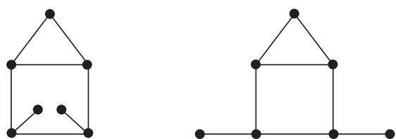
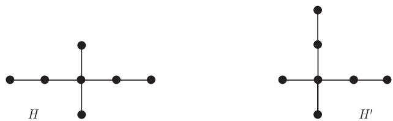
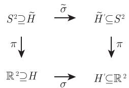

import Guide from '@/components/Guide.astro';
import Knowledge from '@/components/Knowledge.astro';
import Example from '@/components/Example.astro';
import Analysis from '@/components/Analysis.astro';
import Solution from '@/components/Solution.astro';
import Variant from '@/components/Variant.astro';
import Note from '@/components/Note.astro';
import Block from '@/components/Block.astro';
import Method from '@/components/Method.astro';
import Exercise from '@/components/Exercise.astro';

一个 (抽象) 图 $G$ 在平面上的嵌入, 或称平面嵌入 (planar embedding), 是 $G$ 和一个平面图 $H$ 之间的一个同构, 其中 $H$ 叫做 $G$ 的画法 (drawing). 在这一节, 我们研究一个图的两个平面嵌入之间的不同之处.

对可平面图 $G$, 如何评估它的两种嵌入 $\rho: G \to H$ 和 $\rho': G \to H'$ 之间的相似度呢? 一个明显方法是, 把 $H$ 和 $H'$ 看作抽象图, 考虑它们之间的标准同构映射 $\sigma := \rho' \circ \rho^{-1}$, 看看在平面中, 这个同构遵守或保持了多少关于它们位置的信息. 比如, 如果 $\sigma$ 由一个简单的平面旋转导出, 我们就不能把 $\rho$ 和 $\rho'$ 看成 $G$ 的真正不同画法.

首先考虑任意一个在平面图 $H = (V, E)$ 和 $H' = (V', E')$ 之间的抽象同构 $\sigma: V \to V'$, 它们的面集合分别是 $F(H) =: F$ 和 $F(H') =: F'$, 我们尝试衡量 $\sigma$ 遵守或保持 $H$ 和 $H'$ 作为平面图的特征的程度. 接下来, 我们提出了三个逐步降低严谨程度 (但增加可操作的程度) 的标准, 然后证明对于大多数图这三个标准是一致的. 特别地, 应用前面考虑过的同构 $\sigma = \rho' \circ \rho^{-1}$, 这三个标准将显示, 从本质上讲, 3-连通图只有一种画法.

衡量抽象同构 $\sigma$ 保持 $H$ 和 $H'$ 的平面特征的第一个标准可能是最自然的一个了. 直观上, 如果 $\sigma$ 是由平面 $\mathbb{R}^2$ 到自身的同胚导出的, 我们称它是“拓扑的”. 然而, 为了避免让 $H$ 和 $H'$ 的外部面具有特殊地位, 选择 4.1 节中的同胚 $\pi : S^2 \setminus \{(0,0,1)\} \to \mathbb{R}^2$ 来绕开这个问题: 如果存在一个同胚 $\varphi : S^2 \to S^2$ 使得 $\psi := \pi \circ \varphi \circ \pi^{-1}$ 在 $V \cup E$ 上导出 $\sigma$, 则称 $\sigma$ 是平面图 $H$ 和 $H'$ 之间的拓扑同构 (topological isomorphism). (更准确地说, 我们要求 $\psi$ 在 $V$ 上与 $\sigma$ 一致, 且它把每个平面边 $xy \in H$ 映射到平面边 $\sigma(x)\sigma(y) \in H'$. 除非 $\varphi$ 固定了点 $(0,0,1)$, 否则映射 $\psi$ 在 $\pi(\varphi^{-1}(0,0,1))$ 上无定义.)

<figure class="vp-figure">
  
  <figcaption>图 4.3.1 一个图的两个非拓扑同构的画法 (为什么不同构呢?)</figcaption>
</figure>

可以证明, 在拓扑同构意义下, 内部面和外部面的确没有什么分别: 如果我们选取 $\varphi$ 为 $S^2$ 上的旋转, 它把 $H$ 的某个内部面的一个点的 $\pi^{-1}$-象映射到 $S^2$ 的北极点 $(0,0,1)$ 上, 那么 $\psi$ 把这个面的其余部分映射到 $\psi(H)$ 的外部面. (为了保证 $\psi(H)$ 的边还是分段直线的, 可以适当地调整 $\varphi$.)

若 $\sigma$ 是如上所述的拓扑同构, 除了可能的一对点外 (在此处 $\psi$ 或 $\psi^{-1}$ 未定义), 那么 $\psi$ 把 $H$ 的面映射到 $H'$ 的面上 (证明?). 用这种方法, $\sigma$ 自然地扩展为双射 $\sigma: V \cup E \cup F \to V' \cup E' \cup F'$, 它保持了顶点、边和面的关联性.

让我们把拓扑同构的最后这个性质选作第二个标准, 来考察平面图之间的抽象同构如何保持平面中位置的关联性: 称 $\sigma$ 是平面图 $H$ 和 $H'$ 之间的组合同构 (combinatorial isomorphism), 如果它能扩展成一个双射 $\sigma: V \cup E \cup F \to V' \cup E' \cup F'$, 使得它不仅保持顶点与边的关联性, 也保持顶点和边与面的关联性. (严格地说, 一个顶点或边 $x \in H$ 位于一个面 $f \in F$ 的边界上当且仅当 $\sigma(x)$ 位于面 $\sigma(f)$ 的边界上.)

<figure class="vp-figure">
  
  <figcaption>图 4.3.2 一个图的两种画法, 它是组合同构的但不是拓扑同构的 (为什么呢?)</figcaption>
</figure>

若 $\sigma$ 是平面图 $H$ 和 $H'$ 的组合同构, 那么它把 $H$ 的面的边界映射到 $H'$ 的面的边界上, 我们把这个性质选定为第三个标准. 如果平面图 $H$ 和 $H'$ 满足

$$
\{\sigma (H [ f ]) \mid f \in F \} = \{H ^{\prime} [ f ^{\prime} ] \mid f ^{\prime} \in F ^{\prime} \},
$$

则称 $\sigma$ 是平面图 $H$ 和 $H'$ 的图论同构 (graph theoretical isomorphism). 因此, 我们不再记录哪个面是被一个已知子图所界定的: 我们保留的唯一信息是一个子图是否界定一个面, 并且要求 $\sigma$ 把子图相互映射. 乍一看, 第三个标准也许没有前面两个自然, 然而它有其应用上的优势, 因为形式上较弱的条件更容易验证. 此外, 它在多数情况下和其他两个标准是等价的.

正如我们已经看到的, 两个平面图之间的每个拓扑同构也是组合的, 且每个组合同构也是图论同构的. 下面定理显示了, 对于大多数图, 逆命题也成立:

<Knowledge title="定理 4.3.1">
(i) 两个平面图之间的每个图论同构也是组合的; 它扩展到面的双射是唯一的当且仅当这个图不是一个圈.

(ii) 两个 2-连通平面图之间的每个组合同构也是拓扑的.

<Solution title="证明">
设 $H = (V, E)$ 和 $H' = (V', E')$ 是两个平面图, 令 $F(H) =: F$ 和 $F(H') =: F'$, 并设 $\sigma: V \to V'$ 是对应抽象图之间的同构. 通过令 $\sigma(xy) := \sigma(x)\sigma(y)$, 把 $\sigma$ 扩展成从 $V \cup E$ 到 $V' \cup E'$ 的一个映射.

(i) 如果 $H$ 是圈, 由 Jordan 曲线定理知结论成立. 现在假设 $H$ 不是圈, 令 $\mathcal{B}$ 和 $\mathcal{B}'$ 分别是 $H$ 和 $H'$ 的面边界的集合, 若 $\sigma$ 是一个图论同构, 那么映射 $B \mapsto \sigma(B)$ 是 $\mathcal{B}$ 和 $\mathcal{B}'$ 之间的双射. 由引理 4.2.5 知, 映射 $f \mapsto H[f]$ 是 $F$ 和 $\mathcal{B}$ 之间的双射; 对 $F'$ 和 $\mathcal{B}'$, 也有类似的结论. 这三个双射的复合是 $F$ 和 $F'$ 之间的双射, 这里我们选取 $\sigma: F \to F'$. 根据构造, $\sigma$ 到 $V \cup E \cup F$ 上的这个扩展保持了关联性 (且是具有这个性质唯一的一个), 所以 $\sigma$ 的确是一个组合同构.

(ii) 假设 $H$ 是 2-连通的, 而 $\sigma$ 是一个组合同构. 我们要构造一个同胚 $\varphi: S^2 \to S^2$, 使得对每个顶点或平面边 $x \in H$, $\pi^{-1}(x)$ 映射到 $\pi^{-1}(\sigma(x))$. 由于 $\sigma$ 是一个组合同构, 因此 $\tilde{\sigma}:\pi^{-1}\circ\sigma\circ\pi$ 是一个双射, 它保持了从 $\tilde{H}:=\pi^{-1}(H)$ 的顶点、边和面 $^{4}$ 到 $\tilde{H}':=\pi^{-1}(H')$ 的顶点、边和面的关联关系.

<figure class="vp-figure">
  
  <figcaption>图 4.3.3 通过 $\sigma$ 来定义 $\tilde{\sigma}$</figcaption>
</figure>

我们分三步来构造 $\varphi$. 第一步, 在 $\tilde{H}$ 的顶点集上定义 $\varphi$: 对所有的 $x \in V(\tilde{H})$, 令 $\varphi(x) := \tilde{\sigma}(x)$, 这是 $V(\tilde{H})$ 和 $V(\tilde{H}')$ 之间的一个平凡同胚.

第二步, 把 $\varphi$ 扩展成 $\tilde{H}$ 和 $\tilde{H}'$ 之间的同胚使得它导出 $V(\tilde{H}) \cup E(\tilde{H})$ 上的 $\tilde{\sigma}$. 我们可以一条边一条边进行: 通过把 $x$ 映射到 $\varphi(x)$ 并把 $y$ 映射到 $\varphi(y)$ 的同胚, 从而 $\tilde{H}$ 的每条边 $xy$ 都和 $\tilde{H}'$ 的边 $\tilde{\sigma}(xy) = \varphi(x)\varphi(y)$ 同胚. 对 $\tilde{H}$ 的每条边取一个同胚, 所有这些同胚的并就成为 $\tilde{H}$ 和 $\tilde{H}'$ 之间的同胚映射, 这正是我们寻找的 $\varphi$ 扩展到 $\tilde{H}$ 上的同胚: 我们只需验证在顶点处的连续性 (这里边同胚在顶点处重叠), 而这根据我们的假设 (即两个图和它们各自的边都具有 $\mathbb{R}^3$ 中的拓扑子空间) 可以立即得到.

第三步, 扩展同胚 $\varphi: \tilde{H} \to \tilde{H}'$ 到整个 $S^2$ 上, 这可以通过类似于第二步的方法 (这里, 我们一个面一个面的) 来完成. 由命题 4.2.6, 所有 $\tilde{H}$ 和 $\tilde{H}'$ 中的面边界是圈. 如果 $f$ 是 $\tilde{H}$ 的一个面且 $C$ 是边界, 那么 $\tilde{\sigma}(C) := \bigcup \{\tilde{\sigma}(e) \mid e \in E(C)\}$ 界定 $\tilde{H}'$ 的面 $\tilde{\sigma}(f)$. 由定理 4.1.4, 我们可以把目前为止定义的同胚 $\varphi: C \to \tilde{\sigma}(C)$ 扩展成从 $C \cup f$ 到 $\tilde{\sigma}(C) \cup \tilde{\sigma}(f)$ 的同胚. 最后, 对 $\tilde{H}$ 的每个面 $f$ 取一个同胚, 则所有这些同胚的并就是我们想要的同胚 $\varphi: S^2 \to S^2$; 同前面一样, 连续性很容易得到验证. ∎
</Solution>
</Knowledge>

让我们回到原来的目标, 即平面嵌入的等价定义. 一个图 $G$ 的两个平面嵌入 $\rho, \rho'$ 是拓扑等价的 (topologically equivalent)(相应地, 组合等价的 (combinatorially equivalent)), 如果 $\rho' \circ \rho^{-1}$ 是 $\rho(G)$ 和 $\rho'(G)$ 之间的拓扑 (相应地, 组合) 同构. 如果 $G$ 是 2-连通的, 根据定理 4.3.1, 这两个定义是一致的, 因此我们可以简单地称等价嵌入 (equivalent embedding). 显然, 对任何一个给定图, 这确实是它的平面嵌入集合上的一个等价关系.

注意到, $G$ 的两个不等价嵌入的画法也可能是拓扑同构的 (练习 14): 因为对于两个嵌入的等价, 我们不光要求存在它们的象之间的 (拓扑或组合) 同构, 也要求典型同构 $\rho' \circ \rho^{-1}$ 是拓扑的或组合的.

即使在这个强条件下, 3-连通图在等价意义下也只有一个嵌入.

<Knowledge title="定理 4.3.2 (Whitney, 1933)">
3-连通图的任何两个平面嵌入是等价的.

<Solution title="证明">
设 $G$ 是 3-连通图, 它有两个平面嵌入 $\rho: G \to H$ 和 $\rho': G \to H'$. 由定理 4.3.1, 只需证明 $\rho' \circ \rho^{-1}$ 是一个图论同构即可, 也就是说, 对每个子图 $C \subseteq G$, $\rho(C)$ 界定 $H$ 的一个面当且仅当 $\rho'(C)$ 界定了 $H'$ 的一个面. 由命题 4.2.7, 马上可以得到要证的结论. ∎
</Solution>
</Knowledge>
