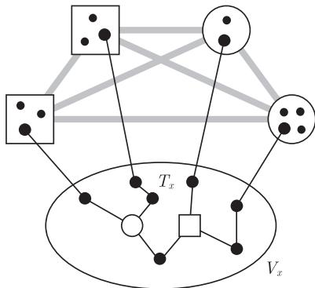
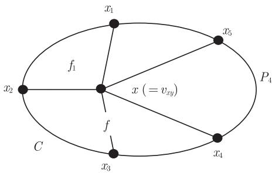
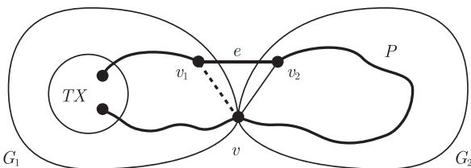
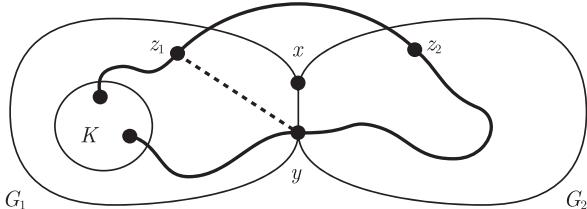

import Guide from '@/components/Guide.astro';
import Knowledge from '@/components/Knowledge.astro';
import Example from '@/components/Example.astro';
import Analysis from '@/components/Analysis.astro';
import Solution from '@/components/Solution.astro';
import Variant from '@/components/Variant.astro';
import Note from '@/components/Note.astro';
import Block from '@/components/Block.astro';
import Method from '@/components/Method.astro';
import Exercise from '@/components/Exercise.astro';

如果一个图可以嵌入到平面上 (即它和一个平面图同构), 就称它为可平面的 (planar). 一个可平面图是极大的 (maximal), 或极大可平面的 (maximally planar), 如果它是可平面的但不能通过增加边 (但不增加顶点) 扩充成更大的可平面图.

极大可平面图画在纸上后显然是极大平面图; 然而, 反之并不明显: 当我们开始画一个可平面图时, 有没有可能半途上就得到了一个极大的平面真子图而停下来呢? 我们的第一个命题说明, 这永远不会发生, 也就是说, 一个平面图不会仅仅因为画的不恰当而不是极大平面图.

<Knowledge title="命题 4.4.1">
(i) 每个极大平面图是极大可平面的.

(ii) 具有 $n \geqslant 3$ 个顶点的可平面图是极大可平面的当且仅当它有 $3n - 6$ 条边.

<Solution title="证明">
运用命题 4.2.8 和推论 4.2.10 即可. ∎
</Solution>
</Knowledge>

哪些图是可平面的呢? 从推论 4.2.11 知道, 可平面图不能包含 $K^5$ 或 $K_{3,3}$ 作为拓扑子式. 在这一节, 我们的目标是证明一个惊人的逆命题, 即 Kuratowski 的经典定理: 不包含拓扑子式 $K^5$ 或 $K_{3,3}$ 的图是可平面的.

在证明 Kuratowski 定理之前, 我们注意到对这个定理只需考虑通常的子式即可, 而不需要考虑拓扑子式.

<Knowledge title="引理 4.4.2">
一个图包含 $K^5$ 或 $K_{3,3}$ 子式当且仅当它包含 $K^5$ 或 $K_{3,3}$ 拓扑子式.

<Solution title="证明">
由命题 1.7.3 知, 我们只需证明每个包含 $K^5$ 子式的图 $G$ 要么包含 $K^5$ 作为拓扑子式, 要么包含 $K_{3,3}$ 作为子式. 因此, 假设 $G \succcurlyeq K^5$, 且令 $K$ 是 $G$ 中 $K^5$ 的极小模型, 从而 $K$ 的每个分支集合导出 $K$ 中的一棵树, 并且在任意 $K$ 的两个分支集合中恰好有一条边. 如果选取由分支集合 $V_x$ 导出的树, 且添加四条边把它和其他分支集合连接, 就得到另一棵树 $T_x$. 由 $K$ 的极小性, 树 $T_x$ 恰好有 4 个叶子, 即 $V_x$ 在其他分支集合中的 4 个邻点 (图 4.4.1).

<figure class="vp-figure">
  
  <figcaption>图 4.4.1 每个 $IK^5$ 包含一个 $TK^5$ 或 $IK_{3,3}$</figcaption>
</figure>

若五棵树 $T_x$ 中的每棵都是 $TK_{1,4}$, 那么 $K$ 是一个 $TK^5$, 结束. 若 $T_x$ 中有一棵不是 $TK_{1,4}$, 那么它恰好有两个度数为 3 的顶点, 将 $V_x$ 收缩到这两个顶点, 而其他每个分支集合收缩成一个单独顶点, 我们得到一个 6 个顶点的图, 它包含 $K_{3,3}$. 因此, $G \succcurlyeq K_{3,3}$, 定理得证. ∎
</Solution>
</Knowledge>

我们首先对 3-连通图证明 Kuratowski 定理, 这是整个证明的中心, 从它一般情形可以容易推出.

<Knowledge title="引理 4.4.3">
每个不包含 $K^5$ 或 $K_{3,3}$ 子式的 3-连通图 $G$ 是可平面的.

<Solution title="证明">
对 $|G|$ 使用归纳法. 当 $|G| = 4$ 时, 有 $G = K^4$, 所以结论成立. 现在令 $|G| > 4$, 且假设结论对于较小的图成立. 由引理 3.2.4, $G$ 包含边 $xy$ 使得 $G / xy$ 还是 3-连通的. 由于子式关系是传递的, 故 $G / xy$ 也不包含 $K^5$ 或 $K_{3,3}$ 子式, 由归纳假设知, $G / xy$ 有一个平面画法 $\tilde{G}$. 设 $f$ 是 $\tilde{G} - v_{xy}$ 的包含点 $v_{xy}$ 的面, 且令 $C$ 是 $f$ 的边界. 设 $X := N_G(x) \setminus \{y\}$ 和 $Y := N_G(y) \setminus \{x\}$, 因为 $v_{xy} \in f$, 所以 $X \cup Y \subseteq V(C)$. 明显地,

$$
\tilde{G}' := \tilde{G} - \{v_{xy}v \mid v \in Y \setminus X\}
$$

可以看作 $G - y$ 的画法, 其中顶点 $x$ 由点 $v_{xy}$ 表示 (图 4.4.2). 我们的目的是把 $y$ 添加到这个画法中, 从而得到 $G$ 的一个画法.

由于 $\tilde{G}$ 是 3-连通的, 故 $\tilde{G} - v_{xy}$ 是 2-连通的, 所以 $C$ 是一个圈 (命题 4.2.6). 令 $x_1, \dots, x_k$ 是把 $X$ 中的顶点沿着这个圈给出的顺序, 并且设 $P_i = x_i \dots x_{i+1}$ 是 $C$ 上两顶点之间的 $X$-路 ($i = 1, \dots, k$ 且 $x_{k+1} := x_1$). 我们证明, 对于某个 $i$ 有 $Y \subseteq V(P_i)$; 否则, 如果对某个 $i$, $y$ 有一个邻点 $y' \in \mathring{P}_i$, 那么它也有另外一个邻点 $y'' \in C - P_i$, 并且这些邻点在 $C$ 中被 $x' := x_i$ 和 $x'' := x_{i+1}$ 分离. 如果 $Y \subseteq X$ 且 $|Y \cap X| \leqslant 2$, 则 $y$ 在 $C$ 上恰好有两个邻点 $y', y''$, 但它们不在同一个 $P_i$ 中, 故 $y'$ 和 $y''$ 在 $C$ 上被两个顶点 $x', x'' \in X$ 所分离. 在其中任一情形, $x, y', y''$ 和 $y, x', x''$ 是 $G$ 中一个 $TK_{3,3}$ 的分支顶点, 矛盾. 余下的唯一情形是 $x$ 和 $y$ 在 $C$ 上有三个共同邻点, 那么这些顶点和 $x$ 以及 $y$ 一起形成一个 $TK^5$, 也产生矛盾.

<figure class="vp-figure">
  
  <figcaption>图 4.4.2 $\tilde{G}'$ 作为 $G - y$ 的一种画法: 顶点 $x$ 由点 $v_{xy}$ 代表</figcaption>
</figure>

现在固定 $i$, 使得 $Y \subseteq P_i$. 集合 $C \setminus P_i$ 包含在圈 $C_i := xx_iP_ix_{i+1}x$ 的两个面的一个中, 用 $f_i$ 记 $C_i$ 的另一个面. 由于 $f_i$ 包含 $f$ 的点 (在 $x$ 附近) 但不包含它的边界 $C$ 上的点, 所以有 $f_i \subseteq f$. 此外, 满足 $j \notin \{i, i+1\}$ 的平面边 $xx_j$ 和 $C_i$ 只相交于顶点 $x$, 并且在 $C \setminus P_i$ 中终止于面 $f_i$ 的外面, 所以 $f_i$ 不和这些边中的任何一个相交. 因此 $f_i \subseteq \mathbb{R}^2 \setminus \tilde{G}'$, 也就是说, $f_i$ 包含在 (因此等于) $\tilde{G}'$ 的一个面中. 所以通过在 $f_i$ 中安置 $y$ 以及它的关联边把 $\tilde{G}'$ 的一个画法扩展到 $G$ 上. ∎
</Solution>
</Knowledge>

比较 Kuratowski 定理的其他证明, 上面的证明有很多吸引人的特点, 比如它可以容易地调整成为一个画法, 在这种画法下每个内部面是凸的 (作为练习). 特别地, 每条边可以画成直线. 注意到, 3-连通性是必要的: 2-连通可平面图不一定有使得所有内部面是凸的画法 (能找到这样的例子吗?), 尽管它总是有一个直线的画法 (练习 15).

原则上, 把一般的 Kuratowski 定理简化到 3-连通情形并不难, 这可以通过对由归纳假设得到的局部画法进行巧妙地处理和结合而实现. 比如, 如果 $\kappa(G) = 2$, 那么 $G$ 可以表示为 $G = G_1 \cup G_2$, 且 $V(G_1 \cap G_2) = \{x, y\}$, 进一步地, 如果 $G$ 没有 $TK^5$ 或 $TK_{3,3}$ 子图, 那么 $G_1 + xy$ 或 $G_2 + xy$ 也不包含这样的子图, 我们可以尝试将这些图的画法结合而得到 $G + xy$ 的一个画法. (若 $xy$ 已经是 $G$ 的一条边, 同样地也可以这样处理 $G_1$ 和 $G_2$.) 对于 $\kappa(G) \leqslant 1$, 情况变得更简单了. 然而, 即使假设所有出现的平面边都是直的, 这些几何操作也需要一些繁琐的转化和缩放.

作为另外的选择, 下面给出更具有独创性的组合方法. 为了证明给定的图 $G \not\supseteq TK^5, TK_{3,3}$ 是可平面的, 首先向 $G$ 中添加边直到它变成边极大的, 并且不包含 $TK^5$ 或 $TK_{3,3}$. 在引理 4.4.5 中, 我们证明了这样可以使图成为 3-连通的, 由引理 4.4.3 知它是可平面的.

对引理 4.4.5 的证明, 我们还需要另一个引理. 这里, 我们把它叙述得更具一般性, 以便在第 7 章里还可以再用. 在这里的应用中, 令 $\mathcal{X} := \{K^5, K_{3,3}\}$.

<Knowledge title="引理 4.4.4">
设 $\mathcal{X}$ 是 3-连通图的集合, $G$ 是具有真分离 $\{V_1, V_2\}$ 的图, 且 $\kappa(G) \leqslant 2$. 如果 $G$ 不包含 $\mathcal{X}$ 中的任何拓扑子式, 且它是边极大的, 那么 $G_1 := G[V_1]$ 和 $G_2 := G[V_2]$ 也是如此, 并且 $G_1 \cap G_2 = K^2$.

<Solution title="证明">
首先注意到每个顶点 $v \in S := V_1 \cap V_2$ 在 $G_i - S$ ($i = 1,2$) 的每个分支中有一个邻点; 否则, $S \setminus \{v\}$ 会分离 $G$, 和 $|S| = \kappa(G)$ 矛盾. 由 $G$ 的极大性, 每条添加到 $G$ 的边 $e$ 位于 $TX \subseteq G + e$ 中, 其中 $X \in \mathcal{X}$. 对于下面考虑的所有 $e$ 的选取, $X$ 的 3-连通性蕴含着这个 $TX$ 的分支顶点都位于同一个 $V_i$ 中, 不妨设它为 $V_1$. ($e$ 的位置对于 $V_1$ 和 $V_2$ 来说总是对称的, 所以这个假设不失一般性.) 从而 $TX$ 和 $V_2$ 至多交于一条路 $P$, 这里 $P$ 对应于 $X$ 的一条边.

若 $S = \varnothing$, 通过选取 $e$ 使得一个端点在 $V_1$ 中而另一个在 $V_2$ 中, 我们马上得到矛盾. 若 $S = \{v\}$ 是一个单独顶点, 令 $e$ 连接 $v$ 在 $V_1 \setminus S$ 中的一个邻点 $v_1$ 到 $v$ 在 $V_2 - S$ 中的一个邻点 $v_2$ (图 4.4.3), 则 $P$ 包含 $v$ 和边 $e = v_1v_2$. 用边 $vv_1$ 代替路段 $vPv_2v_1$, 我们得到 $G_1 \subseteq G$ 中的一个 $TX$, 矛盾.

<figure class="vp-figure">
  
  <figcaption>图 4.4.3 如果 $G + e$ 包含一个 $TX$, 则 $G_{1}$ 或 $G_{2}$ 也包含</figcaption>
</figure>

所以 $|S| = 2$, 令 $S = \{x, y\}$. 若 $xy \notin G$, 令 $e := xy$, 且在产生的 $TX$ 中将 $e$ 替换成一个通过 $G_2$ 的 $x - y$ 路, 这在 $G$ 中产生了一个 $TX$, 矛盾. 因此 $xy \in G$, 且 $G[S] = K^2$.

剩下需证明的是 $G_1$ 和 $G_2$ 不包含 $\mathcal{X}$ 中的任何拓扑子式, 且是边极大的. 设 $e'$ 是 $G_1$ 中的额外边, 如果必要的话, 将 $xPy$ 替换为边 $xy$, 我们得到一个 $TX$, 它或者在 $G_1 + e'$ 中 (即说明 $G_1$ 是边极大的, 这正是我们想要的), 或者在 $G_2$ 中 (这与 $G_2 \subseteq G$ 矛盾). ∎
</Solution>
</Knowledge>

<Knowledge title="引理 4.4.5">
若 $|G| \geqslant 4$, 且 $G$ 是关于 $TK^5, TK_{3,3} \not\subseteq G$ 边极大的, 那么 $G$ 是 3-连通的.

<Solution title="证明">
对 $|G|$ 运用归纳法. 若 $|G| = 4$, 则 $G = K^4$, 结论成立. 现在令 $|G| > 4$, 且设 $G$ 是不包含 $TK^5$ 或 $TK_{3,3}$ 的边极大图. 假设 $\kappa(G) \leqslant 2$, 如同引理 4.4.4 中那样选取 $G_1$ 和 $G_2$. 对于 $\mathcal{X} := \{K^5, K_{3,3}\}$, 引理指出 $G_1 \cap G_2$ 是 $K^2$, 不妨设它的顶点是 $x, y$, 并且 $G_1$ 和 $G_2$ 均为不包含 $TK^5$ 或 $TK_{3,3}$ 的边极大图. 由归纳假设, $G_1$ 和 $G_2$ 要么是三角形, 要么是 3-连通的. 因为即使把 $TK^5$ 或 $TK_{3,3}$ 作为通常的子式, $G_1$ 和 $G_2$ 也不包含它们 (引理 4.4.2), 所以由引理 4.4.3 知 $G_1$ 和 $G_2$ 是可平面的. 对每个 $i = 1,2$, 分别选取 $G_i$ 的一个画法, 并选择一个面 $f_i$ 使得边 $xy$ 在它的边界上, 以及一个顶点 $z_i \neq x, y$ 在 $f_i$ 的边界上. 设 $K$ 是抽象图 $G + z_1z_2$ 中的 $TK^5$ 或 $TK_{3,3}$ (图 4.4.4).

<figure class="vp-figure">
  
  <figcaption>图 4.4.4 在 $G + z_{1}z_{2}$ 中的一个 $TK^5$ 或 $TK_{3,3}$</figcaption>
</figure>

如果 $K$ 的所有分支顶点都位于同一个 $G_i$ 中, 那么 $G_i + xz_i$ 或者 $G_i + yz_i$ (或者 $G_i$ 本身, 如果 $z_i$ 已经分别地和 $x$ 或 $y$ 相邻) 包含一个 $TK^5$ 或 $TK_{3,3}$, 这和推论 4.2.11 矛盾, 这是因为由 $z_i$ 的选取知这些图是可平面的. 由于 $G + z_1z_2$ 不包含 $(G_1 - G_2)$ 和 $(G_2 - G_1)$ 之间的四条独立路, 因此这两个子图不能都包含 $TK^5$ 的一个分支顶点, 且不能都包含 $TK_{3,3}$ 的两个分支顶点. 所以 $K$ 是一个 $TK_{3,3}$, 它仅在 $G_2 - G_1$ 或 $G_1 - G_2$ 的一个中有分支顶点 $v$ (妨设 $v$ 在 $G_2 - G_1$ 中). 然而, 由 $z_1$ 的选取, 图 $G_1 + v + \{vx, vy, vz_1\}$ 也是可平面的且包含 $TK_{3,3}$, 这和推论 4.2.11 矛盾. ∎
</Solution>
</Knowledge>

<Knowledge title="定理 4.4.6 (Kuratowski, 1930; Wagner, 1937)">
对于图 $G$, 下面的命题是等价的:

(i) $G$ 是可平面的;

(ii) $G$ 不包含 $K^5$ 或 $K_{3,3}$ 作为子式;

(iii) $G$ 不包含 $K^5$ 或 $K_{3,3}$ 作为拓扑子式.

<Solution title="证明">
由推论 4.2.11、引理 4.4.2、引理 4.4.3 和引理 4.4.5 推出. ∎
</Solution>
</Knowledge>

<Knowledge title="推论 4.4.7">
每个具有至少四个顶点的极大可平面图是 3-连通的.

<Solution title="证明">
使用引理 4.4.5 以及定理 4.4.6 即得. ∎
</Solution>
</Knowledge>
