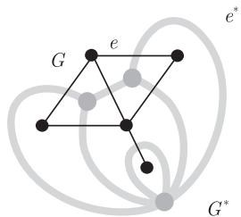

import Guide from '@/components/Guide.astro';
import Knowledge from '@/components/Knowledge.astro';
import Example from '@/components/Example.astro';
import Analysis from '@/components/Analysis.astro';
import Solution from '@/components/Solution.astro';
import Variant from '@/components/Variant.astro';
import Note from '@/components/Note.astro';
import Block from '@/components/Block.astro';
import Method from '@/components/Method.astro';
import Exercise from '@/components/Exercise.astro';

在这一节, 我们运用 MacLane 定理来揭示另外一个平面性和代数结构之间的联系, 即如下定义的平面对偶性和圈空间与割空间的对偶性 (在 1.9 节和 2.4 节中有所提及) 之间的联系.

平面多重图 (plane multigraph) 是一个有限集合对 (分别表示顶点集和边集) $G = (V, E)$ , 它满足下列条件:

(i) $V \subseteq R^{2};$

(ii) 每条边要么是两个顶点之间的弧, 要么是恰好包含一个顶点 (即它的端点) 的多边形;

(iii) 除了它自己的端点, 一条边不包含顶点或其他边的点.

我们可以把平面图中定义的术语自由地转移到平面多重图上. 注意到, 如同在抽象多重图中一样, 环和双边都看作是圈.

考虑图 4.6.1 中的平面多重图 G, 在 G 的每个面的内部放置一个新顶点, 并把这些新的顶点连接起来形成另一个平面多重图 $G^{*}$ 如下: 对于 G 的每条边 e, 把和 e 关联的两个面中的新顶点用边 $e^{*}$ 连接 ( $e^{*}$ 穿过 e), 如果 e 只和一个面关联, 我们在这个面的新顶点添加一个环 $e^{*}$ , 并和 e 交叉. 以这种方式构造的平面多重图 $G^{*}$ 在下面的意义下和 G 对偶: 若我们对 $G^{*}$ 进行和上面相同的操作, 所得到的平面多重图和 G 非常相似. 实际上, G 本身可以通过这种方法从 $G^{*}$ 重新得到.

<figure class="vp-figure">
  
  <figcaption>图 4.6.1 一个平面图和它的对偶</figcaption>
</figure>

为了更准确地表达这个运算, 设 $G = (V, E)$ 和 $(V^{*}, E^{*})$ 是任意两个平面多重图, 令 $F(G) =: F$ 和 $F((V^{*}, E^{*})) =: F^{*}$ . 我们称 $(V^{*}, E^{*})$ 是 $G$ 的平面对偶 (plane dual), 并记为 $(V^{*}, E^{*}) =: G^{*}$ , 如果存在双射

$$
F \to V ^ {*} \qquad E \to E ^ {*} \qquad V \to F ^ {*}
$$

$$
f \mapsto v ^ {*} (f) \qquad e \mapsto e ^ {*} \qquad v \mapsto f ^ {*} (v)
$$

满足下面条件:

(i) 对所有 $f \in F$ 有 $v^{*}(f) \in f;$

(ii) 对所有 $e \in E$ , $|e^* \cap G| = |\stackrel{\circ}{e}^* \cap \stackrel{\circ}{e}| = |e \cap G^*| = 1$ , 且对每个 $e$ 和 $e^*$ , 这个交点是一条直线段的内部点;

(iii) 对所有 $v \in V$ , 有 $v \in f^{*}(v)$ .

每个连通平面多重图都有平面对偶. 确实, 为了满足条件 (i), 我们可以首先从 $G$ 的面 $f$ 中选取点 $v^{*}(f)$ 作为 $G^{*}$ 的顶点, 然后根据 (ii) 的要求用独立弧连接这些顶点, 其次使用 $G$ 的连通性证明的确存在满足 (iii) 的双射 $V \to F^{*}$ (练习 35).

如果 $G_{1}^{*}$ 和 $G_{2}^{*}$ 是 $G$ 的两个平面对偶, 那么显然 $G_{1}^{*} \simeq G_{2}^{*}$ . 事实上, 可以证明自然的双射 $v_{1}^{*}(f) \mapsto v_{2}^{*}(f)$ 是 $G_{1}^{*}$ 和 $G_{2}^{*}$ 之间的拓扑同构. 在这种意义下, 平面对偶是唯一的, 所以可以称 $G^{*}$ 是 $G$ 的平面对偶.

最后, $G$ 反过来也是 $G^{*}$ 的平面对偶. 确实, 由 $G^{*}$ 的定义中双射的逆映射可以得到: 对 $f^{*}(v) \in F^{*}$ 和 $v^{*}(f) \in V^{*}$ , 令 $v^{*}(f^{*}(v)) := v$ 及 $f^{*}(v^{*}(f)) := f$ , 我们看到关于 $G^{*}$ 的条件 (i) 和 (iii), 变成了 $G$ 的 (iii) 和 (i); 而条件 (ii) 在 $G$ 和 $G^{*}$ 中是对称的. 容易看出, 对偶图是连通的 (练习34), 因此这个对称性蕴含着连通性也是 $G$ 有对偶的必要条件.

也许平面对偶性最有趣的地方是, 它从几何上把两类边集, 即圈和键, 联系了起来, 前面我们已经看到了它们是如何代数地联系起来的 (定理 1.9.4).

<Knowledge title="命题 4.6.1">
对任意连通平面多重图 G, 集合 $E \subseteq E(G)$ 是 G 中一个圈的边集当且仅当 $E^{*} := \{e^{*} \mid e \in E\}$ 是 $G^{*}$ 的键.

<Solution title="证明">
由 $G^{*}$ 定义中的条件 (i) 和 (ii) 知, $G^{*}$ 的两个顶点 $v^{*}(f_{1})$ 和 $v^{*}(f_{2})$ 属于 $G^{*} - E^{*}$ 的同一个分支当且仅当 $f_{1}$ 和 $f_{2}$ 位于 $\mathbb{R}^2 \setminus \bigcup E$ 的同一个区域中: $G^{*} - E^{*}$ 中的每个 $v^{*}(f_{1}) - v^{*}(f_{2})$ 路是 $\mathbb{R}^2 \setminus \bigcup E$ 中 $f_{1}$ 和 $f_{2}$ 之间的弧; 反过来, 每条这样的 (具有 $P \cap V(G) = \emptyset$ ) 弧 $P$ 定义了 $G^{*} - E^{*}$ 中 $v^{*}(f_{1})$ 和 $v^{*}(f_{2})$ 之间的一个途径.

如果 $C \subseteq G$ 是一个圈, 且 $E = E(C)$ , 由 Jordan 曲线定理和上面的对应关系, $G^{*} - E^{*}$ 恰好有两个分支, 所以 $E^{*}$ 是 $G^{*}$ 的一个键, 即一个极小非空割.

反过来, 如果 $E \subseteq E(G)$ 使得 $E^{*}$ 是 $G^{*}$ 中的割, 由命题4.2.4和上面的对应关系, 则 $E$ 包含一个圈 $C \subseteq G$ 的边. 若 $E^{*}$ 是个键, 那么 $E$ 不能包含任何其他边 (根据前面证明的蕴含关系), 故 $E = E(C)$ .

命题 4.6.1 指出如何把平面对偶性推广到抽象多重图上. $^{5}$ 如果 $E(G^{*}) = E(G)$ , 并且 $G^{*}$ 的键恰好是 $G$ 的圈的边集合, 则称多重图 $G^{*}$ 是多重图 $G$ 的抽象对偶 (abstract dual). (现在 $G$ 或 $G^{*}$ 不一定是连通的.)

圈和键之间的对应关系可以扩展到它们生成的空间上：
</Solution>
</Knowledge>

<Knowledge title="命题 4.6.2">
如果 $G^{*}$ 是 G 的抽象对偶, 那么 $G^{*}$ 的割空间是 G 的圈空间, 也就是说

$$
\mathcal {C} ^ {*} (G ^ {*}) = \mathcal {C} (G).
$$

<Solution title="证明">
由于 $G$ 的圈恰好是 $G^{*}$ 的键, 所以它们在 $\mathcal{E}(G) = \mathcal{E}(G^{*})$ 中生成的子空间 $\mathcal{C}(G)$ 和由 $G^{*}$ 的键生成的子空间是相同的. 由引理 1.9.3 可知, 这就是空间 $\mathcal{C}^{*}(G^{*})$ . ☐
</Solution>
</Knowledge>

根据定理 1.9.4, 命题 4.6.2 蕴含着, 若 $G^{*}$ 是 G 的抽象对偶, 那么 G 也是 $G^{*}$ 的抽象对偶. 可以证明, 如果 G 是 3-连通的, 则 $G^{*}$ (在添加若干独立顶点后, 以及同构意义下) 是唯一的. 由引理 3.1.3 知, $E(G) = E(G^{*})$ 的非空子集是 G 的一个块的边集当且仅当它是 $G^{*}$ 的一个块的边集. 由引理 3.1.2, 这蕴含着 $G^{*}$ 的块是 G 的块的对偶.

尽管抽象对偶的概念来自平面对偶的推广, 但反之亦然. 由定理 1.9.4 知, 图的圈和键形成了自然的、相关的边集. 因此, 下面问题的提出也不是不可想象的: 对于某些图, 一些边集组成的族之间的正交性也许可以给出足够多类似的相交规律, 使得某个族在一个图中组成圈的集合, 在另一个图中变成键的集合; 反之亦然. 也就是说, 我们问哪些图可以把它的整个边集变成一个新的顶点集, 在重新定义关联关系后, 使得用来形成圈的那些边恰好变成键 (且反之亦然)? 寻找这样一类图是一个不容易达到的目标, 更不用说像所有可平面图这样一个庞大且自然的图类.

作为经典平面图理论的精粹之一, 现在我们证明可平面图恰好是可以实现这个目标的图类, 所以存在抽象对偶成为一个新的平面性准则. 反之, 这个定理也可以理解为存在抽象对偶这一基本性质的拓扑刻画:

<Knowledge title="定理 4.6.3 Whitney, 1932">
一个图是可平面的当且仅当它有一个抽象对偶.

<Solution title="证明">
设 $G$ 是一个可平面图, 我们考虑它的任意一种画法. 这个画法的每个分支 $C$ 有一个平面对偶 $C^*$ . 把这些 $C^*$ 看作抽象多重图, 并设 $G^*$ 是它们的不交并, 那么 $G^*$ 的键恰好是 $C^*$ 的所有键, 由命题4.6.1知, 这些极小割对应于 $G$ 中的圈.

反之, 假设 $G$ 有抽象对偶 $G^{*}$ . 为了证明 $G$ 是可平面的, 根据定理4.5.1和命题4.6.2, 我们只需证明 $\mathcal{C}^{*}(G^{*})$ 有一个稀疏基. 由命题1.9.2知, 它的确有.

抽象图和平面图的对偶理论都可以推广到无限图. 由于这些图可以有无限键, 所以它们的对偶必然有 “无限圈”. 这样的概念的确存在, 且非常引人入胜: 它们是由图和它的末端所组成的空间中的拓扑圈, 见 8.6 节.
</Solution>
</Knowledge>
