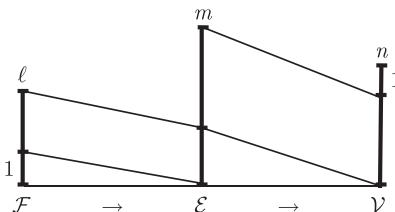

import Guide from '@/components/Guide.astro';
import Knowledge from '@/components/Knowledge.astro';
import Example from '@/components/Example.astro';
import Analysis from '@/components/Analysis.astro';
import Solution from '@/components/Solution.astro';
import Variant from '@/components/Variant.astro';
import Note from '@/components/Note.astro';
import Block from '@/components/Block.astro';
import Method from '@/components/Method.astro';
import Exercise from '@/components/Exercise.astro';

## 第4章 习题

<Exercise title="练习 1">
证明：每个图都可以嵌入到 $\mathbb{R}^3$ 中使得所有边是直线.

<Solution title="提示">
归纳地把顶点嵌入进去那么，哪里不可以放置新顶点?
</Solution>
</Exercise>

<Exercise title="练习 2">
$^{-}$ 由引理 4.1.2 直接证明 $K_{3,3}$ 不是可平面的.

<Solution title="提示">
参考圈1.6.2
</Solution>
</Exercise>

<Exercise title="练习 3">
这里给出“每个阶数 $\geqslant 4$ 的极大平面图都是最小度为3的平面三角剖分”的归纳“证明”：归纳法由 $K^4$ 开始。在归纳推导过程中，考虑任意阶为 $n \geqslant 4$ 的极大平面图 $G$ ，以及通过所有可能的方法在 $G$ 中添加新的顶点 $v$ 而得到的阶为 $n + 1$ 的极大平面图 $G'$ 。

无论是怎样得到 $G'$ , $v$ 一定位于 $G$ 的一个面中, 由归纳假设, 这个面的边界是一个三角形. 因为 $G'$ 是极大可平面的, 所以 $v$ 一定连接这个三角形的三个顶点. 显然, $G'$ 是另外一个三角剖分, 并且有 $\delta(G') = d(v) = 3$ .

(i) $^{-}$ 找出“证明”中的错误.

(ii) 找到一个反例, 并解释 “证明” 忽略了什么.

<Solution title="提示">
对(斗，如果需要提示，可以重新考虑一下归纳法为什么以及如何成立的间的主妥任务不是找到一个反例(这很容易)，而是好好地理解为什么"证明"不仅"违反"归纳证明的规则，而且它不成立.
</Solution>
</Exercise>

<Exercise title="练习 4">
证明：每个可平面图是三个森林的并.

<Solution title="提示">
使用定理 2.4.3.
</Solution>
</Exercise>

<Exercise title="练习 5">
古希腊人特别喜欢每个面的边界长度都相同的正则平面图.

(i) 设顶点度为 $d \geqslant 3$ 而圈长记为 $\ell$ , 证明只存在有限多个具有参数 $(d, \ell)$ 的古希腊人喜欢的图. 你能对这样图的个数给出一个上界吗?

(ii) $^{+}$ 证明：在拓扑同构意义下，只存在有限多个这样的平面图.

<Solution title="提示">
(i)，使用 Euler 公式以及双重计数来证明 不能同时都很大对 (ii)，分步构造同构也
</Solution>
</Exercise>

<Exercise title="练习 6">
富勒烯 (fullerene) 是完全由碳原子组成的分子, 它是一个立方平面图, 所有的面都是五边形或六边形. 因为碳原子可以形成双键, 证明原则上每一个这样的图可以通过 (4-价) 碳原子实现.

<Solution title="提示">
为了把给定立方阁变成 正则多重图，需要傲的是找出哪些边需要加倍。一旦确定了要找的东西，就可以参考本书前面章节的有关结果
</Solution>
</Exercise>

<Exercise title="练习 7">
足球由五边形和六边形 (但不一定是正则形) 缝合而成, 使得缝合线形成一个三正则可平面图. 那么, 足球有多少个五边形呢?

<Solution title="提示">
这个练习不是一个笑话使用 Euler 公式进行双重计数，你会投意到自己是多么幸运
</Solution>
</Exercise>

<Exercise title="练习 8">
$^{-}$ (继续练习 6 和练习 7)
如果富勒烯包含相邻的五边形, 就会变得不稳定. 证明: 稳定的富勒烯包含至少 60 个碳原子.

<Solution title="提示">
… 如果五边形不共享一条边，那么它们在图中的位雷在哪里?

模仿推论 4.2.10 的证明.
</Solution>
</Exercise>

<Exercise title="练习 9">
设 $G$ 是阶为 $n$ 的图, 它可以嵌入到 Euler 示性数为 $\chi$ 的曲面中, 但不能嵌入到具有更大 Euler 示性数的简单曲面中, 证明 $G$ 最多有 $3n - 3\chi$ 条边. (提示: 可以使用已知的事实: 如此嵌入的图的每个面是一个拓扑圆盘, 这样的嵌入满足广义 Euler 公式, $n - m + \ell = \chi$ .)
</Exercise>

<Exercise title="练习 10">
对可平面图, 找到关于 3-连通图圈空间的 Tutte 定理 (3.2.6) 的一个直接证明.

<Solution title="提示">
运用命题 4.2.7
</Solution>
</Exercise>

<Exercise title="练习 11">
$^{-}$ 证明：图 4.3.1 中的两个平面图不是组合同构的（从而也不是拓扑同构的）.

<Solution title="提示">
把两种画法之间的差别表达达成关于顶点、面和它们之间关联关系的正式命题
</Solution>
</Exercise>

<Exercise title="练习 12">
证明：图4.3.2中的两个图是组合同构的，但不是拓扑同构的.

<Solution title="提示">
组合的使用定义;拓扑的=把 $H ^{\prime}$ 的短的(分别地，长的)分支的相对位置严格地表达成$H ^{\prime}$ 的性质，这个性质被任何拓扑同构所保持，但 不具有这个性质.
</Solution>
</Exercise>

<Exercise title="练习 13">
$^{-}$ 证明：关于平面嵌入的等价定义确实定义了一个等价关系.

<Solution title="提示">
- 考虑自反性、对称性、传递性.
</Solution>
</Exercise>

<Exercise title="练习 14">
找到一个 2-连通可平面图, 它的所有画法都是拓扑同构的, 但它的平面嵌入不都是等价的.

<Solution title="提示">
找到一个圈，它的面法看起来都一样，但它存在一个自同构不能推广成平面 的一个同

胚把这个同胚解释成 $\sigma _ { 2 } \circ \sigma _ { 1 } ^ { - 1 }$
</Solution>
</Exercise>

<Exercise title="练习 15">
$^{+}$ 证明：每个平面图都组合同构于一个所有边是直线的平面图.
(提示: 给定平面三角剖分, 归纳地构造一个图论意义下的同构平面图使得它的边都是直线. 为了有助于归纳证明, 对内部面需要增加什么性质?)
对下面两个练习, 不要使用 Kuratowski 定理.

<Solution title="提示">
+ 星形 每一个内部面都包含一个点，它可以看到整个面边界.
</Solution>
</Exercise>

<Exercise title="练习 16">
证明：可平面图的每个子式是可平面的．从而推导，图是可平面的当且仅当它是一个网格的子式．（网格在12.4节中定义）

<Solution title="提示">
考虑平面图而不是可平面圈，
</Solution>
</Exercise>

<Exercise title="练习 17">
(i) 证明: 原则上, 可平面图可以像 Kuratowski 定理那样进行刻画, 也就是说, 存在图集合 $\mathcal{X}$ 使得图 $G$ 是可平面的当且仅当 $G$ 没有子式属于 $\mathcal{X}$ . (ii) 是否每一个图性质都可以用这种方式刻画呢? 如果不是, 哪些可以呢?

<Solution title="提示">
(i) 集舍 可能是无限的

(ii) 考虑所有有限图的族，它的序由于式关系给出那么，由"禁用子式"的集合 $\chi$ 所刻画的图性质是如何包含在这个族中呢?
</Solution>
</Exercise>

<Exercise title="练习 18">
是否每个可平面图都有一个画法使得所有内部面都是凸的？

<Solution title="提示">
由下一个练习知，任何反倒可以被最多两个顶点分离.
</Solution>
</Exercise>

<Exercise title="练习 19">
修改引理 4.4.3 的证明使得所有内部面都是凸的.

<Solution title="提示">
把额外的条件结合到证明的归纳假设中 如果我们禁止具有 180 度角的多边形，这会有助于我们的证明
</Solution>
</Exercise>

<Exercise title="练习 20">
是否每个极小非可平面图 $G$ (即非可平面图 $G$ , 但它的所有真子图都是平面的) 都包含一条边 $e$ 使得 $G - e$ 是极大可平面的？如果我们关于子式而不是子图定义“极小”，结论会改变吗？

<Solution title="提示">
考虑边数
</Solution>
</Exercise>

<Exercise title="练习 21">
证明：在阶至少为6的极大可平面图上增加一条新边同时产生 $TK^{5}$ 子图和 $TK_{3,3}$ 子图.

<Solution title="提示">
使用事实 极大可平面图总是\$崽匾的，以及每个顶点的邻点导出一千圈.
</Solution>
</Exercise>

<Exercise title="练习 22">
通过巧妙地处理平面图 (即避免使用引理 4.4.5), 从 3-连通的情形来证明广义 Kuratowski 定理.
(不要把它当成初等拓扑练习来做. 对证明中的拓扑部分, 给出大体的描述即可.)

<Solution title="提示">
如果 $G = G _ { 1 } \cup G _ { 2 }$ 且 $G _ { 1 } \cap G _ { 2 } = \overline { { K ^ { 2 } } }$ 证明就遇到了问题;但是，如果我们比必要的再多嵌入一点，问题就没有了
</Solution>
</Exercise>

<Exercise title="练习 23">
如果图有一个画法使得每个顶点都位于外部面的边界上，则称它是外可平面图 (outer-planar graph). 证明：一个图是外可平面的当且仅当它不包含 $K^4$ 或 $K_{2,3}$ 作为子式.

<Solution title="提示">
- 对给定的图 进行适当的修改来模拟外平面性-
</Solution>
</Exercise>

<Exercise title="练习 24">
证明：2-连通平面图是二部的当且仅当每一个面被一个偶圈界定.

<Solution title="提示">
面边界将生成 C(G)
</Solution>
</Exercise>

<Exercise title="练习 25">
设 $G = G_{1} \cup G_{2}$ , 且 $|G_{1} \cap G_{2}| \leqslant 1$ . 证明: 如果 $\mathcal{C}(G_{1})$ 和 $\mathcal{C}(G_{2})$ 都有稀疏基, 则 $\mathcal{C}(G)$ 也有.

<Solution title="提示">
使用事实 ${ \mathcal { C } } ( G )$ 是 $\mathcal { C } ( G _ { 1 } )$ 和 $\mathcal { C } ( G _ { 2 } )$ 的直和
</Solution>
</Exercise>

<Exercise title="练习 26">
在一个 2-连通平面图的所有面边界中, 找到一个圈空间基.

<Solution title="提示">
是面边界证明 我们需要所有其他的面边界来生成 C(G) 中的 要么为了方便我们使用练习 39(i) 直接证明这个结论，要么利用 Eul由公式和定理1.9.5 给出漂亮的证明.
</Solution>
</Exercise>

<Exercise title="练习 27">
证明：阶为 $n$ 的3-连通图包含至少 $n / 2$ 个外围圈. 这个下界是紧的吗？

<Solution title="提示">
使用闺赞间维数.
</Solution>
</Exercise>

<Exercise title="练习 28">
$^{+}$ 对 2-连通平面图, 给出 Euler 公式的一个代数证明, 基本思路如下: 类似于给定图的顶点空间 V 和边空间 E, 定义 ( $F_{2}$ 上的) 面空间 (face space) F. 用明显的方式定义边界映射 (boundary map) $F \rightarrow E \rightarrow V$ , 首先确定在单个面或边上 (即在 F 和 E 的标准基上) 的映射, 然后把这些映射线性地推广到整个 F 和 E 上. 确定这些同胚的核和象, 然后从这些空间 F, E 和 V 的维数导出 Euler 公式.
给定图 G 的子图族, 如果 G 的每条边都恰好属于其中两个子图, 我们称这个子图族是 G 的双覆盖 (double cover). 一个由圈组成的双覆盖叫做双圈覆盖 (cycle double cover).

<Solution title="提示">
+ 参考示意图.

<figure class="vp-figure">
  
</figure>
</Solution>
</Exercise>

<Exercise title="练习 29">
设 $G$ 是一个2-连通图, 它的圈空间由圈的稀疏集合 $\mathcal{B}$ 生成. 根据 MacLane 定理, $G$ 中存在一个由生成 $\mathcal{C}(G)$ 的圈组成的双覆盖, 即 $G$ 的任意画法中的那些圈边界. 直接证明 (即不使用 MacLane 定理) $\mathcal{B}$ 可以拓广成为 $G$ 的双圈覆盖 $\mathcal{D}$ .

<Solution title="提示">
是杏覆盖每一条边至少一次?我们是杏可以重新覆盖那些没有覆盖两次的边，而不覆盖任何一条边工三次?
</Solution>
</Exercise>

<Exercise title="练习 30">
$^{+}$ (为拓扑学者准备的) 构造性地证明 MacLane 定理中的如下非平凡蕴含关系: 假定给定图 G 是 2-连通的, 根据上一个练习, 所以具有一个由生成 $\mathcal{C}(G)$ 的圈组成的双覆盖 D. 对这些圈 C 的每一个, 取定一个圆盘并把它的边界和 C 重合.
(i) 证明：得到的空间是一个曲面，即没有边界的紧致 2-流形.

(ii) 使用定理 1.9.5 证明这个曲面的 Euler 示性数至少是 2. (这意味着它一定是球面, 我们可以假定这是已知的.)

<Solution title="提示">
+ (i) 我们主要是证明每个顶点"有一个邻域同胚于 $\mathbb { R } ^ { 2 }$ 在与 关联的边上，定义一个辅助图 $H _ { v }$ 对于两条边 $e , f \in V ( H _ { v } )$ 如果存在 中的--1'-圈包含 $f ,$ 那么连接和 $f . H _ { v }$ 具有什么结构呢?为了证明 是连通的，首先假定它不成立，然后找到的一个圈使得它不能被 生成.在 (ii) 中，我们需要证明的是 不可能是线性独立的
</Solution>
</Exercise>

<Exercise title="练习 31">
从上面两个练习推导, 给定 2-连通可平面图 $G$ 和 $\mathcal{C}(G)$ 的由圈组成的稀疏基 $\mathcal{B}$ , 存在 $G$ 的一个画法使得 $\mathcal{B}$ 中的圈恰好是内部面的边界.

<Solution title="提示">
$| \mathcal D \backslash B |$ 有多大?
</Solution>
</Exercise>

<Exercise title="练习 32">
$^{+}$ 设 C 是平面中的一条闭曲线, 在平面的任意给定点, 它与本身最多相交一次, 并且每个这样的自交都是真交叉 (proper crossing). 如果可以把这些交叉安排成从上穿过和从下穿过, 使得沿着这个曲线前行时从上穿过和从下穿过交错出现, 那么我们称 C 是交错的 (alternating).

(i) 证明每个这样的曲线都是交错的, 或找到一个反例.

(ii) 如果 (i) 中的曲线不是闭的, 结论会改变吗?

<Solution title="提示">
+ 先解决练习 24.
</Solution>
</Exercise>

<Exercise title="练习 33">
$^{-}$ 平面上树的平面对偶是什么呢？

<Solution title="提示">
它具有多少个顶点?
</Solution>
</Exercise>

<Exercise title="练习 34">
$^{-}$ 证明：平面多重图的平面对偶总是连通的.

<Solution title="提示">
用直线连接对偶的两个给定顶点 然后使用这个在对偶图中找到它们之间的一条路

35+ 依次定义所需要的双射 $F \to V ^ { * } , E \to E ^ { * } , V \to F ^ { * }$ 憾，同时构造阁 $G ^ { * }$
</Solution>
</Exercise>

<Exercise title="练习 35">
$^{+}$ 证明：连通平面多重图有一个平面对偶.
</Exercise>

<Exercise title="练习 36">
证明：平面多重图的任何两个平面对偶是组合同构的.

<Solution title="提示">
使用与两个对偶图对应的双射来定义想要的同构 并证明这个问构是组合的
</Solution>
</Exercise>

<Exercise title="练习 37">
设 $G^{*}$ 是 $G$ 的抽象对偶, 而 $e = e^{*}$ 是一条边. 证明下面两个结果:

(i) $G^{*} / e^{*}$ 是 $G - e$ 的抽象对偶;

(ii) $^{+}$ G\* - e\* 是 G/e 的抽象对偶.

<Solution title="提示">
观察一下平面上发生的事情 在证明中使用抽象对偶来避免连通性问题如果在间的证明中遇到困难，可以使用 道路集舍包含关系，而不使用集合等式.
</Solution>
</Exercise>

<Exercise title="练习 38">
找到一个连通图使得它有两个非同构的抽象对偶. 是否能找到 2-连通的例子呢?

<Solution title="提示">
考虑画法.
</Solution>
</Exercise>

<Exercise title="练习 39">
设 $G, G^{*}$ 是对偶平面图. 证明下面的结论:

(i) 如果 $G$ 是 2-连通的, 则 $G^{*}$ 也是 2-连通的;

(ii) 如果 G 是 3-连通的, 则 $G^{*}$ 也是 3-连通的;

(iii) 如果 $G$ 是 4-连通的, 则 $G^{*}$ 不一定是 4-连通的.

<Solution title="提示">
在平面中使用 Menger 定理的恰当形式，我们可以容易地证明。)和 (ii). 不用 ger定理来证明 (i) 也有启发性，这可以通过在平面中删除一个不破坏 $G ^ { * }$ 的连迪性的顶点而直接证明. (但是，注意到，如果你用不到 的鸟连迪性，那么证明中就一定有错误最后，只使用抽象对俩，也可以对 (i) 给自一个简单而漂亮的证明.对 (iii)，记得使用命4.2.8
</Solution>
</Exercise>

<Exercise title="练习 40">
对命题 4.6.2 后面的结论给出详细的证明, 除了关于 $G^{*}$ 的唯一性部分 (这将在练习 41 (ii) 中证明).

<Solution title="提示">
借助抽象对偶的准确定义
</Solution>
</Exercise>

<Exercise title="练习 41">
设 $G^{*} = (V^{*}, E^{*})$ 是连通多重图 $G = (V, E)$ 的连通抽象对偶。 $G$ 是否有一个画法使得它的平面对偶同构于 $G^{*}$ ? (甚至是“典型”同构？在什么意义下呢？)

(i) 对 2-连通图 G, 使用练习 30 中的方法证明这一结论.

(ii) 证明 3-连通图的抽象对偶是唯一的. (这个结论的准确含义是什么呢? 给出唯一性的定义使得它比“在同构意义下”更强.)

(iii) 对于一般性结论给出反例.

<Solution title="提示">
(i)，一开始先决定哪个边集应该来界定 的面对 (ii)，运用画法的唯一性对 (iii)重新安排那些块.
</Solution>
</Exercise>

<Exercise title="练习 42">
对于具有相同边集的连通多重图 $G = (V, E)$ 和 $G' = (V', E)$ ，证明下面的命题是等价的：

(i) G 和 $G'$ 相互是抽象对偶;

(ii) 给定任意集合 $F \subseteq E$ , 多重图 $(V, F)$ 是一棵树当且仅当 $(V', E \setminus F)$ 是一棵树.

<Solution title="提示">
可以直接证明这个结论，而不需要平面性.
</Solution>
</Exercise>
