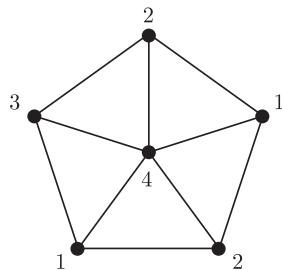
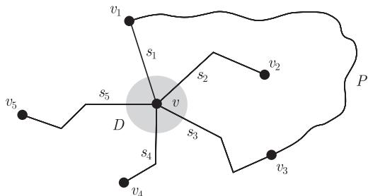

import Guide from '@/components/Guide.astro';
import Knowledge from '@/components/Knowledge.astro';
import Example from '@/components/Example.astro';
import Analysis from '@/components/Analysis.astro';
import Solution from '@/components/Solution.astro';
import Variant from '@/components/Variant.astro';
import Note from '@/components/Note.astro';
import Block from '@/components/Block.astro';
import Method from '@/components/Method.astro';
import Exercise from '@/components/Exercise.astro';

在一张世界地图上, 需要用几种颜色去给每个国家着色, 使得任何两个相邻国家的颜色不同呢? 国会需要召开一系列会议, 每个委员会开一天会, 并且部分委员在多个委员会任职, 那么我们需要多少天才能安排完所有的会议日程呢? 根据每个老师给每个班级上课的时数, 我们怎样才能排出一个使用尽可能少的天数的课时表呢?

图 $G = (V, E)$ 的一个顶点着色 (vertex colouring) 定义为映射 $c : V \longrightarrow S$, 使得任意两个相邻的顶点 $v$ 和 $w$ 均有 $c(v) \neq c(w)$. 我们称 $S$ 里的元素为可用颜色 (colours). 我们对 $S$ 的兴趣所在是它的基数: 通常, 我们试图找出最小的整数 $k$, 使得 $G$ 有一个 $k$-着色 ($k$-colouring), 即一个顶点着色 $c : V \longrightarrow \{1, \cdots, k\}$, 这个 $k$ 就叫做图 $G$ 的 (顶点) 色数 ((vertex-) chromatic number), 表示为 $\chi(G)$. 若 $\chi(G) = k$, 称图 $G$ 是 $k$-色的 ($k$-chromatic); 如果 $\chi(G) \leqslant k$, 则称图 $G$ 是 $k$-可着色的 ($k$-colourable).

<figure class="vp-figure">
  
  <figcaption>图 5.0.1 顶点着色 $V \longrightarrow \{1, \cdots, 4\}$</figcaption>
</figure>

注意到, 图 $G$ 的 $k$-着色其实就是把 $V(G)$ 划分成 $k$ 个独立集, 这里每个独立集被称为一个色类 (colour class). 例如, 非平凡的 2-可着色图恰好是一个二部图. 从历史的角度来讲, 着色的术语来自我们上面提到的地图着色问题, 从而它引导出决定可平面图的最大色数问题. 委员会时间表问题也可以叙述成一个顶点着色问题. (如何叙述呢?)

图 $G = (V, E)$ 的一个边着色 (edge colouring) 是一个映射 $c : E \longrightarrow S$, 使得任意两条相邻的边 $e$ 和 $f$, 满足 $c(e) \neq c(f)$. 边着色 $c : E \longrightarrow \{1, \cdots, k\}$ 称为图 $G$ 的一个 $k$-边着色 ($k$-edge-colouring), 所用的最小整数 $k$ 叫做 $G$ 的边色数 (edge-chromatic number), 也称为色指数 (chromatic index), 记作 $\chi^{\prime}(G)$. 前面提到的第三个应用问题可以叙述成一个二部多重图的边着色问题. (如何叙述呢?)

显然, 图 $G$ 的每个边着色对应于其线图 $L(G)$ 的一个顶点着色; 反之亦然. 特别地, $\chi^{\prime}(G) = \chi(L(G))$. 因此如何找到一个好的边着色, 可以看作更一般的顶点着色问题在这类特殊图中的限制形式. 我们将看到, 上述两种着色问题之间的关系, 从已知的结果中可以看出, 它们有着显著的差异: 对于 $\chi$, 我们仅有粗略的估计, 而其对应的 $\chi^{\prime}$ 我们知道它只能取 $\Delta$ 和 $\Delta + 1$ 中间的一个.

## 5.1 地图和可平面图的着色

如果有人声称图论中的某个问题被外界所熟悉, 那一定是指下面的四色定理 (four colour theorem) (这个定理蕴含着: 每个地图最多只需四种颜色来着色):

<Knowledge title="定理 5.1.1 (四色定理)">
每个可平面图是 4-可着色的.
</Knowledge>

关于四色定理证明的一些讨论和其历史, 可以参考这一章最后的注解. 在这里, 我们证明下面较弱的形式.

<Knowledge title="定理 5.1.2 (五色定理)">
每个可平面图是 5-可着色的.

<Solution title="证明">
设 $G$ 是一个有 $n \geqslant 6$ 个顶点和 $m$ 条边的平面图. 我们归纳地假设, 每个具有少于 $n$ 个顶点的平面图均是 5-可着色的. 由推论 4.2.10, 有

$$
d(G) = \frac{2m}{n} \leqslant \frac{2(3n-6)}{n} < 6.
$$

设 $v \in G$ 是顶点度不大于 5 的顶点. 由归纳假设知, 图 $H := G - v$ 存在一个顶点着色 $c : V(H) \longrightarrow \{1, \cdots, 5\}$. 如果 $v$ 的邻点最多用了 4 种颜色, 那么 $c$ 可以扩充为图 $G$ 的一个 5-着色. 所以我们可以假设顶点 $v$ 恰有 5 个邻点, 且每个邻点着有不同的颜色.

设 $D$ 是一个足够小的包含 $v$ 的开圆盘, 使得它只与关联 $v$ 的五条边的直线段相交. 我们按照这些线段在 $D$ 中的循环位置列举为 $s_{1}, \cdots, s_{5}$, 并且假设 $vv_{i}$ 是包含 $s_{i}$ 的边 ($i = 1, \cdots, 5$, 见图 5.1.1). 不失一般性, 我们可以假设对于每个 $i$, 有 $c(v_{i}) = i$.

<figure class="vp-figure">
  
  <figcaption>图 5.1.1 五色定理的证明</figcaption>
</figure>

首先证明每条 $v_{1} - v_{3}$ 路 $P \subseteq H - \{v_2, v_4\}$ 在 $H$ 中把 $v_{2}$ 和 $v_{4}$ 分开. 显然, 这个结论成立当且仅当在 $G$ 中的圈 $C := vv_{1}Pv_{3}v$ 把 $v_{2}$ 和 $v_{4}$ 分开, 我们可通过说明 $v_{2}$ 和 $v_{4}$ 在 $C$ 的不同面中来证明这个结论.

我们在 $D$ 中分别选取 $s_2$ 和 $s_4$ 的内点 $x_2$ 和 $x_4$, 那么在 $D \setminus (s_1 \cup s_3) \subseteq \mathbb{R}^2 \setminus C$ 中, 每一个点都可以通过一条多边弧连接到 $x_2$ 或 $x_4$. 这说明 $x_2$ 和 $x_4$ (因此 $v_2$ 和 $v_4$ 也是一样) 在 $C$ 的不同面中, 否则, $D$ 只与 $C$ 的两个面中的一个相交, 这与 $v$ 属于这两个面的边界这一事实矛盾 (定理 4.1.1).

给定 $i, j \in \{1, \cdots, 5\}$, 设 $H_{i,j}$ 是由着色 $i$ 和 $j$ 的顶点所导出的 $H$ 的子图. 我们可以假设 $H_{1,3}$ 中包含 $v_{1}$ 的分支 $C_{1}$ 也包含 $v_{3}$. 如果把 $C_{1}$ 中所有着色 1 和 3 的顶点交换颜色, 我们就得到了 $H$ 的另一个 5-着色. 如果 $v_{3} \notin C_{1}$, 那么在这个新着色中, $v_{1}$ 和 $v_{3}$ 都着色 3, 这时我们可以给 $v$ 着色 1. 因此, $H_{1,3}$ 包含一条 $v_{1}-v_{3}$ 路 $P$. 上面已经证明, 在 $H$ 中 $P$ 把 $v_{2}$ 和 $v_{4}$ 分开. 因为 $P \cap H_{2,4} = \varnothing$, 这意味着 $v_{2}$ 和 $v_{4}$ 属于 $H_{2,4}$ 的不同分支. 在包含 $v_{2}$ 的那个分支里, 交换颜色 2 和 4, 因此把 $v_{2}$ 重新着色为 4. 现在 $v$ 就没有着色 2 的邻点, 我们可以给它着此色了. ∎
</Solution>
</Knowledge>

作为上面两个著名定理的背景, 我们给出另一个著名的结果.

<Knowledge title="定理 5.1.3 (Grötzsch, 1959)">
每个不包含三角形的可平面图是 3-可着色的.
</Knowledge>
