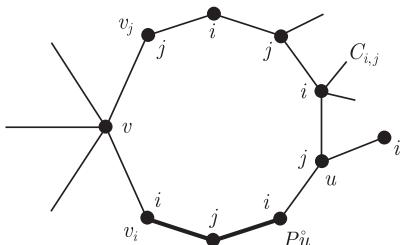
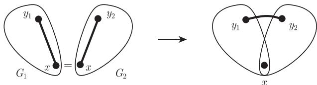

import Guide from '@/components/Guide.astro';
import Knowledge from '@/components/Knowledge.astro';
import Example from '@/components/Example.astro';
import Analysis from '@/components/Analysis.astro';
import Solution from '@/components/Solution.astro';
import Variant from '@/components/Variant.astro';
import Note from '@/components/Note.astro';
import Block from '@/components/Block.astro';
import Method from '@/components/Method.astro';
import Exercise from '@/components/Exercise.astro';

给定一个图, 我们怎样来决定它的色数呢? 怎样才能找到一个使用尽可能少颜色的顶点着色呢? 色数与图的其他不变量 (例如平均度、连通度或者围长) 的关系是怎样的呢?

从色数的定义, 我们可以直接得到下面这个上界.

<Knowledge title="命题 5.2.1">
每个具有 $m$ 条边的图满足

$$
\chi(G) \leqslant \frac{1}{2} + \sqrt{2m + \frac{1}{4}}.
$$

<Solution title="证明">
设 $c$ 是图 $G$ 中一个具有 $k = \chi(G)$ 种颜色的顶点着色, 那么在 $G$ 的每两个色类之间都至少存在一条边, 否则, 我们可以把这两个色类着同一种颜色. 因此 $m \geqslant \frac{1}{2} k(k - 1)$. 从这个不等式中解出 $k$, 就得到了我们想要的结论. ∎
</Solution>
</Knowledge>

一个明显的不用太多颜色来着色图的方法是下面的贪婪算法 (greedy algorithm): 从图 $G$ 的一个固定顶点序列 $v_{1}, \cdots, v_{n}$ 开始, 依次考虑顶点, 给每个顶点 $v_{i}$ 着第一个可用的颜色, 比如, 在 $v_{1}, \cdots, v_{i-1}$ 中, 找到 $v_{i}$ 的邻点中还未用过的最小正整数来给顶点 $v_{i}$ 着色. 用这种方法, 永远不会使用多于 $\Delta(G) + 1$ 种颜色, 即使对选择不当的序列 $v_{1}, \cdots, v_{n}$ 也是一样. 如果 $G$ 是完全图或者奇圈, 那么这是最好可能的.

一般而言, 即使是对于贪婪着色, 这个上界 $\Delta + 1$ 仍然是很大. 事实上, 用上面的算法对顶点 $v_{i}$ 着色时, 我们只需要 $d_{G[v_{1}, \cdots, v_{i}]}(v_{i}) + 1$ 种颜色, 而不是 $d_{G}(v_{i}) + 1$ 种颜色, 就可以进行下去. 注意到, 这个时候, 对于 $j > i$, 算法忽略了 $v_{i}$ 的邻点 $v_{j}$, 因此对于大多数图而言, 有着很大的空间去改进 $\Delta + 1$ 这个上界, 这可以通过选择一个特别有利的顶点顺序来开始着色: 先选择那些顶点度比较大的顶点 (这时大部分邻点被忽略), 最后选择那些顶点度比较小的顶点. 局部来看, 如果 $v_{i}$ 是 $G[v_{1}, \cdots, v_{i}]$ 中度数最小的顶点, 则我们需要的 $d_{G[v_{1}, \cdots, v_{i}]}(v_{i}) + 1$ 种颜色也是最少的, 这可以容易地实现, 只需要首先选取具有 $d(v_{n}) = \delta(G)$ 的顶点 $v_{n}$, 然后再取图 $G - v_{n}$ 中度数最小的顶点作为 $v_{n-1}$, 依次进行下去.

找个最小的 $k$ 使得图 $G$ 有这样一个顶点序列, 使得它的每个顶点只有少于 $k$ 个邻点排在它前面, 这个 $k$ 就叫做 $G$ 的着色数 (colouring number), 记为 $\operatorname{col}(G)$. 我们上面刚刚讨论的序列表明 $\operatorname{col}(G) \leqslant \max_{H \subseteq G} \delta(H) + 1$. 但是对于 $H \subseteq G$, 因为在 $H$ 的任意序列中, 最后的那个顶点的“向后度数”就是它在 $H$ 中的原来度数, 它至少为 $\delta(H)$, 所以显然有 $\operatorname{col}(G) \geqslant \operatorname{col}(H)$ 和 $\operatorname{col}(H) \geqslant \delta(H) + 1$. 因此我们证明了下面的结论.

<Knowledge title="命题 5.2.2">
每个图 $G$ 满足

$$
\chi(G) \leqslant \operatorname{col}(G) = \max \{\delta(H) \mid H \subseteq G\} + 1.
$$
</Knowledge>

一个图的着色数与它的荫度有密切关系, 参考定理 2.4.3 后的解释.

命题 5.2.2 显示, 每个 $k$-色的图都包含一个最小度至少为 $k-1$ 的子图. 事实上, 它有一个 $k$-色的这种子图.

<Knowledge title="引理 5.2.3">
每个 $k$-色的图都包含一个最小度至少为 $k-1$ 的 $k$-色子图.

<Solution title="证明">
给定图 $G$ 且 $\chi(G) = k$, 设 $H \subseteq G$ 是满足 $\chi(H) = k$ 极小的. 如果 $H$ 包含一个顶点 $v$ 使得 $d_H(v) \leqslant k - 2$, 则可以把 $H - v$ 的 $(k - 1)$-着色拓广成 $H$ 的一个 $(k - 1)$-着色, 与 $H$ 的选取矛盾. ∎
</Solution>
</Knowledge>

我们已经看到, 对每个满足 $\chi(G) \leqslant \Delta(G) + 1$ 的图 $G$, 等号在完全图和奇圈时成立. 对于其他情况, 这个一般的界可以作少许的改进.

<Knowledge title="定理 5.2.4 (Brooks, 1941)">
设 $G$ 是一个连通图. 如果 $G$ 既不是完全图, 也不是奇圈, 那么

$$
\chi(G) \leqslant \Delta(G).
$$

<Solution title="证明">
我们对 $|G|$ 使用归纳法. 如果 $\Delta(G) \leqslant 2$, 那么 $G$ 是一条路或一个圈, 结论显然成立. 因此假设 $\Delta := \Delta(G) \geqslant 3$, 并且结论对于顶点数较小的图都成立. 假设 $\chi(G) > \Delta$.

设 $v$ 是 $G$ 的一个顶点, 令 $H := G - v$, 由归纳假设知, $\chi(H) \leqslant \Delta$, 并且对 $H$ 的每个分支 $H^{\prime}$ 有 $\chi(H^{\prime}) \leqslant \Delta(H^{\prime}) \leqslant \Delta$, 除非 $H^{\prime}$ 是完全图或是奇圈, 在这种情况下, 有 $\chi(H^{\prime}) = \Delta(H^{\prime}) + 1 \leqslant \Delta$, 这是因为 $H^{\prime}$ 的每个顶点在 $H^{\prime}$ 中都具有最大度, 并且这样一个顶点和 $v$ 在 $G$ 中也是相邻的.

因为 $H$ 可以 $\Delta$-着色但 $G$ 不能, 所以我们有下面的结论:

$$
\begin{aligned}
&H \text{ 的每个 } \Delta\text{-着色, 在 } v \text{ 的邻点使用了所有的颜色 } 1, \dots , \Delta. \\
&\text{特别地, } d(v) = \Delta.
\end{aligned}\tag{1}
$$

给定 $H$ 的任何一个 $\Delta$-着色, 我们用 $v_{i}$ 表示 $v$ 的着色 $i$ 的邻点 ($i = 1, \cdots, \Delta$). 对 $i \neq j$, 用 $H_{i,j}$ 表示由着色 $i$ 或 $j$ 的顶点所导出的 $H$ 的子图.

$$
\text{对于所有 } i \neq j \text{, 顶点 } v_i \text{ 和 } v_j \text{ 在 } H_{i,j} \text{ 的同一个分支 } C_{i,j} \text{ 中.} \tag{2}
$$

否则, 我们可以在其中的一个分支中交换 $i$ 和 $j$ 的颜色, 从而 $v_{i}$ 和 $v_{j}$ 可以着同一种颜色, 与 (1) 矛盾.

$$
C_{i,j} \text{ 总是一条 } v_i - v_j \text{ 路.} \tag{3}
$$

确实, 令 $P$ 是 $C_{i,j}$ 中一条 $v_i - v_j$ 路, 因为 $d_H(v_i) \leqslant \Delta - 1$, 所以 $v_i$ 的所有邻点着两两不同的颜色, 否则, 我们可以重新给 $v_i$ 着色, 与 (1) 矛盾. 因此, $P$ 上 $v_i$ 的邻点也是它在 $C_{i,j}$ 上的唯一邻点; 对 $v_j$ 有同样的结论. 所以, 若 $C_{i,j} \neq P$, 那么在 $H$ 中 $P$ 包含一个内部顶点, 它有三个着同样颜色的邻点. 让 $u$ 是 $P$ 上第一个这样的顶点 (图 5.2.1), 因为 $u$ 的邻点至多用了 $\Delta - 2$ 种颜色, 所以我们可以重新给 $u$ 着色. 但这使得 $P\overset{\circ}{u}$ 成了 $H_{i,j}$ 中的一个分支, 与 (2) 矛盾.

<figure class="vp-figure">
  
  <figcaption>图 5.2.1 Brooks 定理中 (3) 的证明</figcaption>
</figure>

$$
\text{对不同的 } i, j, k \text{, 路 } C_{i,j} \text{ 和路 } C_{i,k} \text{ 只在 } v_i \text{ 相交.} \tag{4}
$$

这是因为, 如果 $v_i \neq u \in C_{i,j} \cap C_{i,k}$, 那么 $u$ 分别有两个着 $j$ 的邻点和两个着 $k$ 的邻点, 因此我们可以重新给 $u$ 着色. 在新的着色中, $v_i$ 和 $v_j$ 在 $H_{i,j}$ 的不同分支中, 与 (2) 矛盾.

现在, 这个定理的证明可以容易地得到. 如果 $v$ 的邻点是两两相邻的, 那么在 $N(v) \cup \{v\}$ 中的每个顶点都已经有 $\Delta$ 个邻点了, 所以 $G = G[N(v) \cup \{v\}] = K^{\Delta + 1}$.

因为 $G$ 是完全图, 结论成立. 所以我们可以假设 $v_{1}v_{2} \notin G$, 这里 $v_{1}, \cdots, v_{\Delta}$ 来自 $H$ 的某个固定 $\Delta$-着色 $c$. 设 $u \neq v_{2}$ 是 $v_{1}$ 在路 $C_{1,2}$ 上的邻点, 那么 $c(u) = 2$. 交换 $C_{1,3}$ 中颜色 1 和 3, 我们得到 $H$ 的一个新着色 $c^{\prime}$, 设 $v_i^{\prime}$, $H_{i,j}^{\prime}$ 和 $C_{i,j}^{\prime}$ 等是关于 $c^{\prime}$ 的类似记号. 因为 $c^{\prime}(u) = c(u) = 2$, 所以作为 $v_1 = v_3^{\prime}$ 的邻点, $u$ 现在属于 $C_{2,3}^{\prime}$. 然而由 (4) 关于 $c$ 知, 路 $\overset{\circ}{v}_{1}C_{1,2}$ 保留它原来的着色, 所以 $u \in \overset{\circ}{v}_{1}C_{1,2} \subseteq C_{1,2}^{\prime}$. 因此 $u \in C_{2,3}^{\prime} \cap C_{1,2}^{\prime}$, 这与关于 $c^{\prime}$ 的 (4) 矛盾. ∎
</Solution>
</Knowledge>

目前为止, 我们得到若干高连通度的必要条件, 多数以 $\chi$ 的上界形式出现. 比如, 如果 $\chi(G) \geqslant k$, 则有 $\Delta \geqslant k$ (除非 $G$ 是完全图或者奇圈), 同时 $G$ 包含一个最小度至少为 $k - 1$ 的子图. 然而, 除了少数情况, 例如当 $G = K_{n,n}$ 时, 对所有 $k \leqslant n$ 条件成立, 并且有 $\chi(G) = 2$, 这些条件作为充分条件是远远不够的.

我们希望找到 $\chi \geqslant k$ 成立的若干充分条件. 如果这些条件可以容易得到验证, 那么它们就成为有用的指标, 来说明为什么一个给定图不能用更少的颜色来着色. 如果这些条件也是充分的, 就可以解释为什么某些图具有高色数. 正如 Hall 定理中的婚姻条件一样, 它可以解释为什么二部图中某些匹配不存在: 违反婚姻条件明显地造成图中不能有这样的匹配, 并且这样的匹配不存在一定会违反婚姻条件.

例如, 我们可以尝试去决定图类 $\mathcal{X}_k$: 不能被少于 $k$ 种颜色着色的 $\subseteq$-极小图. 容易验证 (参见引理 12.6.1), 一个给定图 $G$ 满足 $\chi(G) \geqslant k$ 当且仅当它有一个子图属于 $\mathcal{X}_k$ (正如 Kuratowski 平面性定理中的特别子式或者特别拓扑子式一样). 因此, 包含 $\mathcal{X}_k$ 中的图成为衡量 $\chi \geqslant k$ 的一个指标, 这种指标解释了上面讨论的现象.

那么在任意 $k$-着色的图中是否可以容易地找到这些指标呢, 或者至少可以简单地验证呢? 也就是说, 是否可以容易地验证一个给定图 $X \in \mathcal{X}_k$ 确实属于 $\mathcal{X}_k$ 呢, 或者, 验证 $\chi(X) \geqslant k$ 是否成立呢? 稍后我们会讨论这个问题.

$\chi(G) \geqslant k$ 成立的一个显然充分条件是 $K^k \subseteq G$, 但这个条件不是必要的: 如定理 5.2.5 所示, $k$-色的图都不一定包含三角形. 所以, 虽然我们知道 $K^k$ 一定在 $\mathcal{X}_k$ 中, 但它不一定是唯一的元素. 反过来, 引理 5.2.3 蕴含着 $\mathcal{X}_k$ 中所有的图的最小度至少是 $k - 1$, 然而不是所有具有最小度至少 $k - 1$ 的图都在 $\mathcal{X}_k$ 中, 这是因为这样的图不一定满足 $\chi \geqslant k$.

下面的 Erdős 定理蕴含着, $\mathcal{X}_k$ 不能是有限集. 事实上, 它蕴含着对于整数 $k$, 不存在由满足 $\chi(X) \geqslant 3$ 的图 $X$ 所组成的有限集合 $\mathcal{X}$ 使得每一个 $k$-色的图都包含 $\mathcal{X}$ 中的一个子图.

<Knowledge title="定理 5.2.5 (Erdős, 1959)">
对于每个整数 $k$, 存在一个图 $G$ 具有围长 $g(G) > k$ 并且色数 $\chi(G) > k$.
</Knowledge>

定理 5.2.5 是用随机图方法证明的, 而非构造性证明, 我们将在 11.2 节见到这个证明. 直接构造一个具有较大色数和较大围长的图并不容易, 练习 24 对一个最简单的情形给出了构造.

Erdős 定理给我们的信息是, 与原来的期望正好相反, 大的色数以一个纯粹的整体性质出现: 局部而言, 一个顶点周围, 围长较大的图看起来像一棵树, 特别地, 它是 2-可着色的. 但是, 是什么原因使得大的色数成为一个整体现象仍然是一个谜.

尽管如此, 存在一个简单但不简短的程序来构造出所有的色数至少为 $k$ 的图. 对于每个 $k \in \mathbb{N}$, 我们下面递归地定义一类 $k$-可构造图 ($k$-constructible graph).

(i) $K^k$ 是 $k$-可构造的.

(ii) 如果 $G$ 是 $k$-可构造的, 并且两个顶点 $x, y \in V(G)$ 是不相邻的, 那么 $(G + xy)/xy$ 也是 $k$-可构造的.

(iii) 如果 $G_{1}$ 和 $G_{2}$ 都是 $k$-可构造的, 并且存在 $x, y_{1}$ 和 $y_{2}$ 使得 $G_{1} \cap G_{2} = \{x\}$, $xy_{1} \in E(G_{1})$ 以及 $xy_{2} \in E(G_{2})$, 那么 $(G_{1} \cup G_{2}) - xy_{1} - xy_{2} + y_{1}y_{2}$ 也是 $k$-可构造的 (图 5.2.2).

<figure class="vp-figure">
  
  <figcaption>图 5.2.2 (iii): Hajós 构造</figcaption>
</figure>

可以容易地归纳验证: 所有的 $k$-可构造图是至少 $k$-色的, 所以它的母图也如此. 例如, (ii) 中的图 $(G + xy)/xy$ 的任意着色都导出了 $G$ 的一个着色, 根据归纳假设, 这种着色用了至少 $k$ 种颜色. 类似地, 对于 (iii) 中构造的图的任何一个着色, 顶点 $y_1$ 和 $y_2$ 不会都和 $x$ 着相同的颜色, 所以这个着色导出了 $G_1$ 或 $G_2$ 的一个着色, 因此至少用了 $k$ 种颜色.

值得注意的是, 逆命题也成立.

<Knowledge title="定理 5.2.6 (Hajós, 1961)">
设 $G$ 是一个图, $k \in \mathbb{N}$, 则 $\chi(G) \geqslant k$ 当且仅当 $G$ 包含一个 $k$-可构造子图.

<Solution title="证明">
设 $G$ 是一个具有 $\chi(G) \geqslant k$ 的图, 证明 $G$ 包含一个 $k$-可构造子图. 假设不成立, 那么 $k \geqslant 3$. 如果需要的话, 我们在图 $G$ 上加一些边, 使得图 $G$ 没有 $k$-可构造子图并且它是边极大的. 这时对于任何 $r$, 图 $G$ 都不是完全 $r$-部图, 否则, $\chi(G) \geqslant k$ 意味着 $r \geqslant k$, 从而 $G$ 将包含一个 $k$-可构造的子图 $K^k$.

因为 $G$ 不是一个完全多部图, 所以“非相邻性”不是 $V(G)$ 上的一个等价关系, 故存在顶点 $y_1, x$ 和 $y_2$ 使得 $y_1 x, xy_2 \notin E(G)$ 但是 $y_1 y_2 \in E(G)$. 因为 $G$ 是不包含 $k$-可构造子图的边极大的图, 所以每条边 $xy_i$ 属于图 $G + xy_i$ ($i = 1, 2$) 的某个 $k$-可构造子图 $H_i$ 中.

设 $H_2^{\prime}$ 是包含 $x$ 和 $H_2 - H_1$ 中的顶点, 并和 $G$ 的其他部分不相交的一个 $H_2$ 的同构拷贝, 而且存在一个从 $H_2$ 到 $H_2^{\prime}$ 的同构映射 $v \mapsto v^{\prime}$ 把 $H_2 \cap H_2^{\prime}$ 中的顶点逐点固定. 因此 $H_1 \cap H_2^{\prime} = \{x\}$, 所以根据 (iii),

$$
H := (H_1 \cup H_2^{\prime}) - xy_1 - xy_2^{\prime} + y_1 y_2^{\prime}
$$

是 $k$-可构造的. 我们把 $H$ 中的每个顶点 $v^{\prime} \in H_2^{\prime} - G$ 依次和它的同构顶点 $v$ 进行重合, 每次重合一个. 因为 $vv^{\prime}$ 不是 $H$ 中的边, 所以上述每次操作相当于 (ii) 中的一次构造. 最终, 我们得到图

$$
(H_1 \cup H_2) - xy_1 - xy_2 + y_1 y_2 \subseteq G,
$$

这就是我们需要的 $G$ 的 $k$-可构造子图. ∎
</Solution>
</Knowledge>

Hajós 定理是否解决了关于大色数图的 Kuratowski 类型的问题呢, 即是否可以找到一类色数至少为 $k$ 的图, 使得每个色数至少为 $k$ 的图都包含这个类的一个子图? 形式上讲, 它解决了这个问题, 尽管它使用了严格包含 $\mathcal{X}_k$ 的无限刻画类 (即 $k$-可构造图的集合). 然而, 和 Kuratowski 定理对于平面图的刻画不一样, 至少 Hajós 定理没有清晰地给出色数小于 $k$ 的图的一个 “好的刻画”: 可以证明, 验证一个给定的 $k$-可构造图确实是 $k$-可构造的, 和证明色数 $\geqslant k$ 的图确实需要至少 $k$ 种颜色一样困难. 具体细节见本章末的注解.
