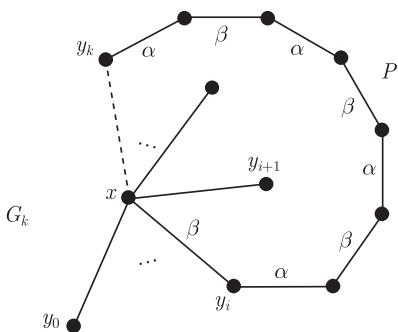

import Guide from '@/components/Guide.astro';
import Knowledge from '@/components/Knowledge.astro';
import Example from '@/components/Example.astro';
import Analysis from '@/components/Analysis.astro';
import Solution from '@/components/Solution.astro';
import Variant from '@/components/Variant.astro';
import Note from '@/components/Note.astro';
import Block from '@/components/Block.astro';
import Method from '@/components/Method.astro';
import Exercise from '@/components/Exercise.astro';

显然, 每个图 $G$ 均有 $\chi^{\prime}(G) \geqslant \Delta(G)$. 对于二部图, 等号成立.

<Knowledge title="命题 5.3.1 (König, 1916)">
每个二部图 $G$ 满足 $\chi^{\prime}(G) = \Delta(G)$.

<Solution title="证明">
我们对 $\|G\|$ 使用归纳法. 当 $\|G\| = 0$ 时, 结论显然成立. 现在假设 $\|G\| \geqslant 1$, 并且对边数少于 $\|G\|$ 的图此结论成立. 令 $\Delta := \Delta(G)$, 取定边 $xy \in G$, 由归纳假设, 图 $G - xy$ 存在一个 $\Delta$-边着色. 我们称着色 $\alpha$ 的边为 $\alpha$-边 ($\alpha$-edge), 等等.

在图 $G - xy$ 中, 顶点 $x$ 和 $y$ 都最多与 $\Delta - 1$ 条边关联, 所以存在 $\alpha, \beta \in \{1, \cdots, \Delta\}$ 使得 $x$ 不与 $\alpha$-边关联而 $y$ 不与 $\beta$-边关联. 如果 $\alpha = \beta$, 我们就可以给边 $xy$ 着这种颜色, 结束, 所以我们可以假设 $\alpha \neq \beta$, 并且 $x$ 与一条 $\beta$-边关联.

我们从 $x$ 出发把这条边延伸成一条极大的途径 $W$, 它的边以 $\beta$ 和 $\alpha$ 交错出现. 因为这种途径中的顶点不会出现两次 (为什么呢?), 所以 $W$ 总是存在的并且是一条路. 此外, $W$ 中不会包含 $y$, 否则, 它将在顶点 $y$ 以 $\alpha$-边结束 (由 $\beta$ 的选择), 并且是条偶数长的路, 所以 $W + xy$ 在 $G$ 中将是一个奇圈 (参考命题 1.6.1). 现在对 $W$ 上的边重新着色, 把 $\alpha$ 换成 $\beta$. 由 $\alpha$ 的选择以及 $W$ 的极大性知, $G - xy$ 中相邻的边仍然着不同的颜色. 因此我们在 $G - xy$ 中找到了一个 $\Delta$-边着色, 并且 $x$ 和 $y$ 都不与 $\beta$-边关联. 通过给 $xy$ 着 $\beta$ 颜色, 我们就把这个着色扩充成 $G$ 的一个 $\Delta$-边着色. ∎
</Solution>
</Knowledge>

<Knowledge title="定理 5.3.2 (Vizing, 1964)">
每个图 $G$ 满足

$$
\Delta (G) \leqslant \chi^{\prime} (G) \leqslant \Delta (G) + 1.
$$

<Solution title="证明">
对第二部分不等式, 我们对 $\|G\|$ 用归纳法. 当 $\|G\| = 0$ 时, 结论显然成立. 对于归纳步骤, 给定具有 $\Delta := \Delta(G) > 0$ 的图 $G = (V, E)$, 假设对于边数少于 $\|G\|$ 的图结论成立. 为了方便, 我们用 “着色” 来简称 “$(\Delta + 1)$-边着色”.

对于每条边 $e \in G$, 由归纳假设知, $G - e$ 存在一个着色. 在这样的着色中, 给定顶点 $v$ 所关联的边至多用了 $d(v) \leqslant \Delta$ 种颜色, 所以某个颜色 $\beta \in \{1, \cdots, \Delta + 1\}$ 在顶点 $v$ 不出现. 对于任意另外一种颜色 $\alpha$, 存在唯一的以 $v$ 为起点的极大途径 (可能是平凡的), 它的边被 $\alpha$ 和 $\beta$ 交替着色. 这个途径是一条路, 我们称它为以 $v$ 为起点的 $\alpha / \beta$-路.

假设 $G$ 没有着色, 那么下面结论成立:

$$
\begin{aligned}
&\text{给定 } xy \in E \text{ 以及 } G - xy \text{ 的任何着色, 使得在顶} \\
&\text{点 } x \text{ 不出现颜色 } \alpha, \text{ 且在顶点 } y \text{ 不出现颜色 } \beta, \\
&\text{那么以 } y \text{ 为起点的 } \alpha / \beta\text{-路终止于 } x.
\end{aligned}\tag{$*$}
$$

否则, 我们沿着这条路互换颜色 $\alpha$ 和 $\beta$, 并给 $xy$ 着色 $\alpha$, 就得到 $G$ 的一个着色, 矛盾.

设边 $xy_0 \in G$, 根据归纳假设, $G_0 := G - xy_0$ 有着色 $c_0$. 假设在这个着色中, 颜色 $\alpha$ 不在顶点 $x$ 出现. 此外, 设 $y_0, y_1, \cdots, y_k$ 是在 $G$ 中 $x$ 的不同邻点的极大序列, 使得在 $c_0$ 中, 对每个 $i < k$, 颜色 $c_0(xy_{i+1})$ 不出现在顶点 $y_i$. 对每个图 $G_i := G - xy_i$ 定义一个颜色 $c_i$ 如下:

$$
c_i(e) := \begin{cases}
c_0(xy_{j+1}), & e = xy_j, \text{ 这里 } j \in \{0, \dots , i - 1\}, \\
c_0(e), & \text{否则}.
\end{cases}
$$

注意到, 在这些着色中, 在顶点 $x$ 不出现的颜色和在 $c_0$ 中是一样的.

现在设在 $c_0$ 中 $\beta$ 颜色不出现在顶点 $y_k$. 根据 ($*$), 在 $G_k$ 中, 从 $y_k$ 出发的 $\alpha/\beta$-路 $P$ (关于 $c_k$ 的) 终止于 $x$, 并且边 $yx$ 着色 $\beta$ (因为 $\alpha$ 不出现在 $x$). 因为 $y$ 不能被当作 $y_{k+1}$, 根据序列 $y_0, \cdots, y_k$ 的极大性, 所以对某个 $i$ ($0 \leqslant i < k$) 有 $y = y_i$ (图 5.3.1). 由 $c_k$ 的定义, 有 $\beta = c_k(xy_i) = c_0(xy_{i+1})$. 根据 $y_{i+1}$ 的选择, 在 $c_0$ 中 $\beta$ 不出现在顶点 $y_i$, 因此在 $c_i$ 中也如此. 因为 $P\overset{\circ}{x}$ 中的边在 $c_i$ 和 $c_k$ 中着相同的颜色, 所以在 $G_i$ 中, 从 $y_i$ 出发的 $\alpha/\beta$-路 $P^{\prime}$ 开始于 $y_i P y_k$. 但是在 $c_0$ 中, 与 $y_k$ 关联的边都不着色 $\beta$, 因此在 $c_i$ 中也是如此. 从而 $P^{\prime}$ 终止于 $y_k$, 与 ($*$) 矛盾. ∎

<figure class="vp-figure">
  
  <figcaption>图 5.3.1 在 $G_k = G - xy_k$ 中的 $\alpha/\beta$-路 $P$</figcaption>
</figure>
</Solution>
</Knowledge>

根据边色数, Vizing 定理把有限图划分成两类: 满足 $\chi^{\prime} = \Delta$ 的图称作第一类 (class 1), 而那些满足 $\chi^{\prime} = \Delta + 1$ 的图称为第二类 (class 2). 因为找不到容易验证的“指标”来确认图是第二类的, 所以不存在一个好刻画来区分这两类图.

最近的一个新结果显示, 具有大的偶数阶数和大的顶点度的正则图属于第一类.

<Knowledge title="定理 5.3.3 (Csaba, Kühn, Lo, Osthus, Treglown, 2016)">
存在 $n_{0} \in \mathbb{N}$ 使得, 对所有的偶数 $n \geqslant n_{0}$ 和 $d \geqslant n/2$, 每一个阶为 $n$ 的 $d$-正则图 $G$ 满足 $\chi^{\prime}(G) = \Delta(G)$.
</Knowledge>
