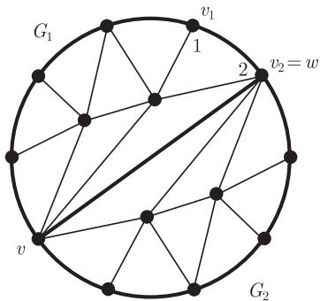
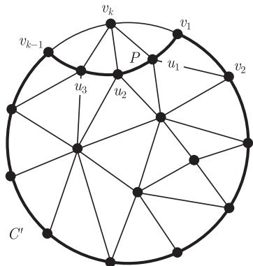
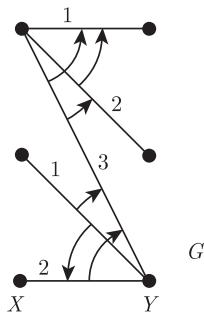

import Guide from '@/components/Guide.astro';
import Knowledge from '@/components/Knowledge.astro';
import Example from '@/components/Example.astro';
import Analysis from '@/components/Analysis.astro';
import Solution from '@/components/Solution.astro';
import Variant from '@/components/Variant.astro';
import Note from '@/components/Note.astro';
import Block from '@/components/Block.astro';
import Method from '@/components/Method.astro';
import Exercise from '@/components/Exercise.astro';

在这一节, 我们来讨论着色概念的一个近期推广, 以及到目前为止的研究成果. 乍看起来, 这个推广可能有点牵强, 但事实上它却提供了图的经典 (顶点和边) 色数同其他一些不变量之间的根本联系.

给定图 $G = (V, E)$, 对 $G$ 的每个顶点给定一列可以选用的颜色, 什么情况下可以给 $G$ 着色 (在通常意义下) 使得每个顶点的着色都选自于给定的列表? 正式地, 设 $(S_v)_{v \in V}$ 是一族集合, 若 $G$ 的顶点着色 $c$ 使得对所有顶点 $v \in G$ 有 $c(v) \in S_v$, 则我们称 $c$ 是使用列表 $S_v$ 的着色 (colouring from the list $S_v$). 对每个顶点 $v$, 设集合族 $(S_v)_{v \in V}$ 满足 $|S_v| = k$, 如果对每个这样的集合族 $(S_v)_{v \in V}$, $G$ 中都存在使用列表 $S_v$ 的顶点着色, 那么称 $G$ 为 $k$-可列表着色的 ($k$-list-colourable) 或 $k$-可选的 ($k$-choosable). 使得图 $G$ 是 $k$-可列表着色的最小整数 $k$ 叫做 $G$ 的列表色数 (list-chromatic number) 或选择数 (choice number) $\operatorname{ch}(G)$.

边的列表着色可以类似地定义. 如果对任何一族大小为 $k$ 的列表, 图 $G$ 都有使用这个列表的边着色, 那么这样最小的整数 $k$ 就叫做 $G$ 的列表着色指数 (list-chromatic index) $\operatorname{ch}^{\prime}(G)$. 正式地, 我们令 $\operatorname{ch}^{\prime}(G) := \operatorname{ch}(L(G))$, 这里 $L(G)$ 是图 $G$ 的线图.

原则上, 要证明一个给定的图是 $k$-可选的要比证明它是 $k$-可着色的要难很多: 后者仅仅是前者的一个特殊情形, 只要取所有的列表均为 $\{1, \cdots, k\}$ 即可. 因此对所有的图, 均有

$$
\operatorname{ch}(G) \geqslant \chi(G) \quad \text{以及} \quad \operatorname{ch}^{\prime}(G) \geqslant \chi^{\prime}(G).
$$

尽管有这些不等式, 但很多已知的色数的上界对选择数也是成立的, Brooks 定理和命题 5.2.2 都是这样的例子. 特别地, 有较大选择数的图也包含具有较大最小度的子图. 另一方面, 可以比较容易地构造这两个不变量相差甚远的图 (练习 28). 综合上述讨论, 这两个事实说明我们离彻底了解色数的一般上界还相差很远.

下面的定理表明, 在与其他一些不变量的关系方面, 选择数与色数是完全不同的. 前面提到, 存在具有任意大最小度的 2-着色图, 比如 $K_{n,n}$, 然而在具有较大 $\delta$, $\varepsilon$ 或 $\kappa$ 的情况下, 选择数被强迫变大.

<Knowledge title="定理 5.4.1 (Alon, 1993)">
存在一个函数 $f : \mathbb{N} \to \mathbb{N}$, 使得对给定的整数 $k$, 所有平均度 $d(G) \geqslant f(k)$ 的图都满足 $\operatorname{ch}(G) \geqslant k$.
</Knowledge>

这个定理的证明用到了第 11 章中介绍的概率方法.

尽管命题 $\operatorname{ch}(G) \leqslant k$ 严格地讲比命题 $\chi(G) \leqslant k$ 要强, 但它们都可以比较容易地证明. 一个漂亮的例子是五色定理的列表形式: 每个可平面图是 5-可选的. 它的证明不依赖五色定理 (甚至没有用到 Euler 公式. 注意到, 五色定理前面的证明是基于这个公式的). 因此, 五色定理可以作为一个推论得到, 而这里的证明非常不同.

<Knowledge title="定理 5.4.2 (Thomassen, 1994)">
每个可平面图是 5-可选的.

<Solution title="证明">
对顶点个数至少为 3 的所有平面图 $G$, 我们将证明下面的结论:

$$
\begin{aligned}
&\text{假设 } G \text{ 的每个内部面的边界是一个三角形, 而外部面的边界是一个圈} \\
&C = v_{1} \cdots v_{k} v_{1}. \text{ 进一步地, 假设顶点 } v_{1} \text{ 已经被着色 } 1, v_{2} \text{ 着色 } 2. \text{ 最后} \\
&\text{假设 } C \text{ 上的其他顶点都包含至少有 } 3 \text{ 种可选颜色的列表, 而 } G - C \text{ 上} \\
&\text{其他顶点都包含至少有 } 5 \text{ 种可选颜色的列表. 那么对这些给定的颜色} \\
&\text{列表, } v_{1} \text{ 和 } v_{2} \text{ 的着色可以扩充为 } G \text{ 的一个着色.}
\end{aligned}\tag{$*$}
$$

首先, 我们证明命题 ($*$) 蕴含着定理的结论. 给定任意一个平面图, 它的每个顶点具有 5 种颜色的列表, 给图加边直到变成一个极大的平面图 $G$. 由命题 4.2.8 知, $G$ 是一个平面三角剖分, 设 $v_{1}v_{2}v_{3}v_{1}$ 是它的外部面的边界. 我们用它们的列表中的颜色给顶点 $v_{1}$ 和 $v_{2}$ 着 (不同的) 颜色, 并从给定的列表中, 根据 ($*$) 把这个着色扩充为 $G$ 的一个着色.

现在, 我们通过对 $|G|$ 使用归纳法来证明 ($*$). 如果 $|G| = 3$, 那么 $G = C$, 这个结论平凡地成立. 现在假设 $|G| \geqslant 4$, 并且对顶点数少的图 ($*$) 都成立. 如果 $C$ 有弦 $vw$, 那么 $vw$ 属于唯一的两个圈 $C_1, C_2 \subseteq C + vw$, 其中 $v_1 v_2 \in C_1$ 和 $v_1 v_2 \notin C_2$. 对于 $i = 1, 2$, 设 $G_i$ 是由 $C_i$ 上的顶点及它内部的顶点 (图 5.4.1) 所生成的 $G$ 的子图. 首先在 $G_1$ 上用归纳法, 这时候 $v$ 和 $w$ 已着色, 然后再对 $G_2$ 用归纳法就得到所需要的 $G$ 的着色.

<figure class="vp-figure">
  
  <figcaption>图 5.4.1 归纳步骤中有弦 $vw$ 的情况, 这里 $w = v_{2}$</figcaption>
</figure>

如果 $C$ 没有弦, 那么令 $v_{1}, u_{1}, \cdots, u_{m}, v_{k-1}$ 是 $v_{k}$ 的邻点, 它们在 $v_{k}$ 的周围按照自然循环顺序排列 [^1]. 由 $C$ 的定义, 所有这些邻点 $u_{i}$ 都在 $C$ 的内部面中 (图 5.4.2). 因为 $C$ 的内部面是以三角形为边界的, 所以 $P := v_{1} u_{1} \cdots u_{m} v_{k-1}$ 是 $G$ 中的一条路, 而 $C^{\prime} := P \cup (C - v_{k})$ 是一个圈.

<figure class="vp-figure">
  
  <figcaption>图 5.4.2 归纳步骤中无弦的情况</figcaption>
</figure>

我们现在从 $v_{k}$ 的列表中选取两种不同的颜色 $j, \ell \neq 1$, 并在所有的 $u_{i}$ 的列表中删去这两种颜色, 那么 $C^{\prime}$ 上每个顶点的列表仍然至少有 3 种颜色, 所以根据归纳假设, 我们可以给 $C^{\prime}$ 和它的内部, 也就是图 $G - v_{k}$ 着色. 由于 $j, \ell$ 中至少有一种颜色没有被 $v_{k-1}$ 使用, 所以可以给 $v_{k}$ 着此色. ∎

[^1]: 就像在五色定理的第一个证明中一样.
</Solution>
</Knowledge>

和很多归纳证明一样, 上述证明的关键是精妙地把要证明的结论适当加强了; 和一般的着色比较, 它通过可以给不同的顶点赋予不同长度的列表, 从而极大地帮助了寻找一个合适的加强结论, 因此可以把着色问题调整得更适合于图的结构. 这表明在处理其他未解决的着色问题中, 或许直接考虑对应的列表着色问题更有利, 例如, 我们用证明 $\operatorname{ch}(G) \leqslant k$ 来代替证明结论 $\chi(G) \leqslant k$. 不幸的是, 这种想法不能用来处理四色定理: 通常来讲, 可平面图不是 4-可选的.

正如前面提到的那样, 一个图的色数和选择数可能会相差很大. 然而奇怪的是, 对于边着色, 却没有一个例子显示类似的现象. 事实上, 猜想是这种现象不存在.

**列表着色猜想** 每个图都有 $\operatorname{ch}^{\prime}(G) = \chi^{\prime}(G)$.

我们将证明列表着色猜想对二部图是成立的. 作为证明工具, 将用到 1.10 节中定义的图定向. 如果 $D$ 是一个有向图而 $v \in V(D)$, 我们用 $N^{+}(v)$ 表示 $D$ 中顶点 $w$ 的集合, 使得 $D$ 中包含一条从 $v$ 到 $w$ 的有向边, 且 $d^{+}(v)$ 表示这个集合的阶数.

为了了解定向是如何应用到着色问题中, 我们来回顾一下 5.2 节中的贪婪算法, 它按照事先固定好的排序 $(v_{1}, \cdots, v_{n})$, 使用最小可用的颜色依次给 $G$ 的顶点着色. 如果给每条边 $v_{i}v_{j}$ “向后”定向, 即当 $i < j$ 时, 由 $v_{j}$ 指向 $v_{i}$, 这样的排序就给出了 $G$ 的一个定向. 所以在决定 $v_{j}$ 的颜色时, 算法只考虑 $v_{j}$ 的那些已着色的邻点, 即在 $v_{j}$ 存在有向边指向的那些顶点. 特别地, 如果对所有的顶点 $v$, 有 $d^{+}(v) < k$, 那么这个算法最多只使用 $k$ 种颜色.

如果把这个事实的证明重新 (相当笨拙地) 叙述成对 $k$ 的归纳论证, 那么着色 1 的顶点集合 $U$ 有如下基本性质: $G - U$ 中的每个顶点都有一条指向 $U$ 的边, 这就保证了每个顶点 $v \in G - U$, 有 $d_{G - U}^{+}(v) < d_{G}^{+}(v)$, 所以由归纳假设, 我们可以用剩下的 $k - 1$ 种颜色给 $G - U$ 着色.

下面的引理把上面的这些观察推广到了列表着色, 也推广到 $G$ 的定向 $D$, 这里 $D$ 不一定从一个顶点排序得到, 但可以包含一些定向圈. 设 $U \subseteq V(D)$ 是一个独立集, 如果对每个顶点 $v \in D - U$, 在 $D$ 中都有一条由 $v$ 指向 $U$ 的边, 那么 $U$ 就叫做 $D$ 的核 (kernel). 注意到, 一个非空有向图的核也是非空的.

<Knowledge title="引理 5.4.3">
设 $H$ 是一个图, 而 $(S_v)_{v \in V(H)}$ 是 $H$ 的一族列表, 如果 $H$ 有个定向 $D$, 使得对于每个 $v$ 有 $d^+(v) < |S_v|$, 并且 $D$ 的每个导出子图都有核, 那么 $H$ 可以使用 $S_v$ 中的列表进行着色.

<Solution title="证明">
我们对 $|H|$ 使用归纳法. 对 $|H| = 0$, 选空着色. 在归纳步骤中, 令 $|H| > 0$. 设 $\alpha$ 是 $S_{v}$ 的某个列表中的颜色, 而 $D$ 是图 $H$ 的一个定向, 那些具有 $\alpha \in S_v$ 的顶点 $v$ 支撑 $D$ 的一个非空子图 $D^{\prime}$. 由假设, $D^{\prime}$ 有个非空核 $U$.

我们给 $U$ 中的顶点着色 $\alpha$, 并将 $\alpha$ 从 $D^{\prime}$ 的其他顶点所对应的列表中删去. 由于这些顶点中的每一个都有条边指向 $U$, 所以对每个顶点 $v \in D - U$ 的修正过的 $S_v^{\prime}$ 仍然在 $D - U$ 中满足 $d^+(v) < |S_v^{\prime}|$. 又因为 $D - U$ 是 $H - U$ 的一个定向, 所以根据归纳假设, 我们可以用这些列表给 $H - U$ 着色. 因为这里的每个列表不包含 $\alpha$, 所以它可以把着色 $U \to \{\alpha\}$ 扩充为所需要的 $H$ 的一个列表着色. ∎
</Solution>
</Knowledge>

在证明列表着色猜想对二部图成立时, 我们将只对那些列表长度均为 $k$ 的着色应用引理 5.4.3. 然而, 注意到, 保持列表的长度的变化对证明引理自身是必要的: 在要求列表长度相同的条件下, 简单的归纳论证不能完成.

<Knowledge title="定理 5.4.4 (Galvin, 1995)">
每个二部图 $G$ 满足 $\operatorname{ch}^{\prime}(G) = \chi^{\prime}(G)$.

<Solution title="证明">
记 $G =: (X \cup Y, E)$, 这里 $\{X, Y\}$ 是图 $G$ 的顶点二部划分. 如果 $G$ 的两条边在 $X$ 中共用一个端点, 就称它们在 $\mathbf{X}$ 相遇 (meet in $X$); 对 $Y$ 也类似地定义. 设 $\chi^{\prime}(G) =: k$, 且 $c$ 是 $G$ 的一个 $k$-边着色.

显然, $\operatorname{ch}^{\prime}(G) \geqslant k$, 所以只需证明 $\operatorname{ch}^{\prime}(G) \leqslant k$. 我们的计划是用引理 5.4.3 来证明 $G$ 的线图 $H$ 是 $k$-可选的. 为了应用这个引理, 需要找到 $H$ 的一个定向 $D$, 使得对 $H$ 中的每个顶点 $e$ 有 $d^{+}(e) < k$, 并且 $D$ 的每个导出子图都有一个核. 为了定义 $D$, 我们考虑两条相邻的边 $e, e^{\prime} \in E$, 不妨设 $c(e) < c(e^{\prime})$. 如果 $e$ 和 $e^{\prime}$ 在 $X$ 中相遇, 那么把边 $ee^{\prime} \in H$ 定向为从 $e^{\prime}$ 指向 $e$; 如果 $e$ 和 $e^{\prime}$ 在 $Y$ 中相遇, 那么其定向为从 $e$ 指向 $e^{\prime}$ (图 5.4.3).

<figure class="vp-figure">
  
  <figcaption>图 5.4.3 给 $G$ 的线图定向</figcaption>
</figure>

对给定的边 $e \in E = V(D)$, 我们计算 $d^{+}(e)$. 如果 $c(e) = i$, 那么与 $e$ 在 $X$ 中相遇的每条边 $e^{\prime} \in N^{+}(e)$ 所用的颜色在 $\{1, \cdots, i-1\}$ 中, 而与 $e$ 在 $Y$ 中相遇的每条边 $e^{\prime} \in N^{+}(e)$ 所用的颜色在 $\{i+1, \cdots, k\}$ 中. 对 $e$ 的任意两个邻点 $e^{\prime}$, 如果它们要么都与 $e$ 在 $X$ 中相遇, 要么都与 $e$ 在 $Y$ 中相遇, 那么它们一定是相邻的 (因此着色不一样), 所以蕴含着 $d^{+}(e) < k$.

我们还需要证明 $D$ 的每一个导出子图 $D^{\prime}$ 是有核的. 然而, 在图 $G$ 中, 如果将 $D$ 中的定向看成一个优先顺序, 那么所要的结论可以由稳定婚姻定理 (2.1.4) 马上得到. 事实上, 给定一个顶点 $v \in X \cup Y$ 和在 $v$ 的边 $e, e^{\prime} \in V(D^{\prime})$, 如果在 $H$ 中边 $ee^{\prime}$ 在 $D$ 中是由 $e$ 指向 $e^{\prime}$ 的, 我们就记成 $e <_v e^{\prime}$, 那么图 $(X \cup Y, V(D^{\prime}))$ 中关于这个优先顺序的任何稳定匹配都是 $D^{\prime}$ 的核. ∎
</Solution>
</Knowledge>

通过命题 5.3.1, 我们得到二部图列表着色指数的准确值.

<Knowledge title="推论 5.4.5">
每个二部图 $G$ 满足 $\operatorname{ch}^{\prime}(G) = \Delta(G)$.
</Knowledge>
