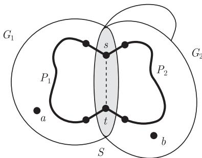
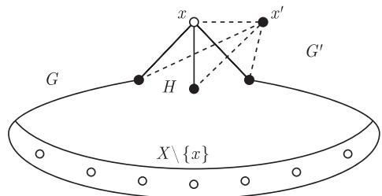

import Guide from '@/components/Guide.astro';
import Knowledge from '@/components/Knowledge.astro';
import Example from '@/components/Example.astro';
import Analysis from '@/components/Analysis.astro';
import Solution from '@/components/Solution.astro';
import Variant from '@/components/Variant.astro';
import Note from '@/components/Note.astro';
import Block from '@/components/Block.astro';
import Method from '@/components/Method.astro';
import Exercise from '@/components/Exercise.astro';

在 5.2 节谈到, 大的色数可以以一个纯粹的整体现象出现: 即使一个图的围长很大, 即从局部看像棵树, 它的色数仍然可以任意大. 因为这种 “整体的依赖性” 很难处理, 所以人们对在什么情况下这种现象不会出现感兴趣, 例如找到导致它的色数比较大的局部因素.

在给出准确的解释之前, 我们先定义图 $G$ 的两个新参数: 使得 $K^r \subseteq G$ 的最大整数 $r$ 叫做 $G$ 的团数 (clique number) $\omega(G)$; 使得 $\overline{K^r} \subseteq G$ (导出地) 的最大整数 $r$ 叫做 $G$ 的独立数 (independence number) $\alpha(G)$. 显然, $\alpha(G) = \omega(\overline{G})$, $\omega(G) = \alpha(\overline{G})$.

如果一个图 $G$ 的任意导出子图 $H \subseteq G$ 都满足 $\chi(H) = \omega(H)$, 那么就称它是一个完美图 (perfect graph), 也就是说, 子图 $H$ 着色所需要的平凡下界 $\omega(H)$ 总是足够来给 $H$ 的顶点着色. 因此, 即使一般而言, 证明 $\chi(G) > k$ 这一结论往往会比较困难, 但是当给定图 $G$ 是完美图时, 只需要找到某个 $K^{k+1}$ 子图作为 $k$ 种颜色是不够的“证据”.

乍看起来, 对完美图结构的要求似乎是有点牵强附会: 虽然它在导出子图关系下是封闭的 (如果仅仅从定义来看), 但是它在一般子图或母图关系下不是封闭的, 更不用说子式关系了 (找出例子?). 然而, 完美性在图论中却是一个重要的概念: 若干重要的图类是完美的 (似乎是偶然的) 这一事实, 也可以作为它的重要性的一个表面的理由 [^1].

[^1]: 完美图拥有对偶性质, 这个性质和最优化及算法复杂性理论有着密切的联系, 但是还远远没有被全面地发现. 定理 5.5.6 只是冰山一角, 更多内容, 读者可以参考注解中 Lovász 的综述文章.

那么哪些图才是完美的呢? 例如, 二部图是完美的. 不太明显的例子是二部图的补图, 这个事实与 König 定理 (2.1.1) 是等价的 (练习 39). 所谓的可比图 (comparability graphs) 是完美的, 区间图 (interval graphs) 也是完美的 (练习 42), 这两类图在一些应用中经常出现.

为了对至少一个这样的例子作详细的研究, 我们这里证明弦图是完美的. 如果图的每个长度至少为 4 的圈都包含弦, 它就叫做弦图 (chordal graphs) 或三角化图 (triangulated graphs), 也就是说, 它不包含除了三角形以外的导出圈.

为了证明弦图是完美的, 我们首先来刻画它的结构. 如果图 $G$ 的导出子图 $G_{1}$, $G_{2}$ 和 $S$ 满足 $G = G_{1} \cup G_{2}$ 和 $S = G_{1} \cap G_{2}$, 那么就说 $G$ 是由 $G_{1}$ 和 $G_{2}$ 沿着 $S$ 粘贴 (pasting) 起来的.

<Knowledge title="命题 5.5.1">
一个图是弦图当且仅当它可以从一个完全图开始, 通过沿着完全子图递归地粘贴弦图而得到.

<Solution title="证明">
如果 $G$ 是沿着一个完全子图把两个弦图 $G_{1}$ 和 $G_{2}$ 粘贴而得到的, 那么 $G$ 显然也是弦图: $G$ 中任何导出圈要么在 $G_{1}$ 中, 要么在 $G_{2}$ 中, 因此由假设, 这些圈是三角形. 由于完全图是弦图, 故定理中构造出来的图都是弦图.

反过来, 设 $G$ 是弦图. 我们对 $|G|$ 使用归纳法证明: 弦图 $G$ 可以像上面描述的那样构造出来. 如果 $G$ 是完全的, 结论显然成立. 因此假设 $G$ 不是完全的, 特别地设 $|G| > 1$, 并且所有顶点数少于 $|G|$ 的图都可以像上面叙述的那样构造出来. 假设 $a, b \in G$ 是两个不相邻的顶点, 且 $X \subseteq V(G) \setminus \{a, b\}$ 是一个极小的 $a - b$ 分隔. 记 $C$ 是 $G - X$ 中包含 $a$ 的一个分支, $G_1 := G[V(C) \cup X]$ 和 $G_2 := G - C$, 那么 $G$ 是由 $G_1$ 和 $G_2$ 沿着 $S := G[X]$ 粘贴起来的.

因为 $G_{1}$ 和 $G_{2}$ 是弦图 (它们是 $G$ 的导出子图), 由归纳假设知, 它们是可以构造出来的, 所以我们只需要证明 $S$ 是完全的即可. 假设 $s, t \in S$ 是不相邻的, 由 $X = V(S)$ 作为 $a - b$ 分隔的极小性知, $s$ 和 $t$ 在 $C$ 中都有邻点. 因此在 $G_{1}$ 中有条从 $s$ 到 $t$ 的 $X$-路, 设 $P_{1}$ 是一条这样的最短路. 类似地, $G_{2}$ 中有一条从 $s$ 到 $t$ 的最短 $X$-路 $P_{2}$. 但是 $P_{1} \cup P_{2}$ 是条不含弦的长度 $\geqslant 4$ 的圈 (图 5.5.1), 与我们的假设 $G$ 是弦图矛盾. ∎

<figure class="vp-figure">
  
  <figcaption>图 5.5.1 如果 $G_{1}$ 和 $G_{2}$ 都是弦图, 那么 $G$ 也是</figcaption>
</figure>
</Solution>
</Knowledge>

<Knowledge title="命题 5.5.2">
每个弦图是完美的.

<Solution title="证明">
因为完全图是完美的, 所以由命题 5.5.1, 我们只需要证明任何由两个完美图 $G_{1}$ 和 $G_{2}$ 沿着一个完全子图 $S$ 粘贴而得到的图 $G$ 仍然是一个完美图. 设 $H \subseteq G$ 是一个导出子图, 我们证明 $\chi(H) \leqslant \omega(H)$.

设 $H_{i} := H \cap G_{i}$ ($i = 1, 2$), 且 $T := H \cap S$, 那么 $T$ 是完全的, 且 $H$ 是由 $H_{1}$ 和 $H_{2}$ 沿着 $T$ 粘贴得到的. 作为 $G_{i}$ 的导出子图, 每个 $H_{i}$ 能够用 $\omega(H_{i})$ 种颜色着色. 因为 $T$ 是完全的, 从而可以一一地着色, 所以 $H_{1}$ 的一个着色和 $H_{2}$ 的一个着色可以结合成 $H$ 的一个着色, 这个着色用了 $\max\{\omega(H_{1}), \omega(H_{2})\} \leqslant \omega(H)$ 种颜色, 如果需要的话, 可以在其中的一个 $H_{i}$ 中置换颜色. ∎
</Solution>
</Knowledge>

由定义, 完美图的每个导出子图仍然是完美的, 因此完美这个性质可以通过一系列禁用导出子图来刻画: 存在一个非完美图的集合 $\mathcal{H}$, 使得任何一个图是完美的当且仅当它不包含一个导出子图与 $\mathcal{H}$ 中的某个元素同构. (例如, 我们可以选择 $\mathcal{H}$ 是所有顶点属于 $\mathbb{N}$ 的非完美图的集合.)

自然地, 我们希望 $\mathcal{H}$ 越小越好. 作为图论中最深刻的结果之一, 可以证明 $\mathcal{H}$ 中只需要包含两类图, 即长度 $\geqslant 5$ 的奇圈和它的补图. (它们都是非完美的, 参考下面的定理 5.5.4.) 这一结果就是 Berge 1963 年提出的著名强完美图猜想 (strong perfect graph conjecture), 这个猜想 40 年后才被解决:

<Knowledge title="定理 5.5.3 (Chudnovsky, Robertson, Seymour and Thomas, 2006)">
一个图 $G$ 是完美的当且仅当 $G$ 和 $\overline{G}$ 中都不包含长度至少为 5 的圈作为它的一个导出子图.
</Knowledge>

在完美图的研究中, 我们通常把 $G$ 中长度至少为 5 的导出圈称作 $G$ 的洞 (hole), 而 $\overline{G}$ 的洞称作 $G$ 的反洞 (antihole), 因此强完美图定理可以叙述成, 图是完美的当且仅当它既没有洞也没有反洞.

强完美图定理的证明比较长且技巧性较强, 要完全搞清楚并不容易. 为了对完美性这个概念有更多的了解, 我们给出上面这个定理的最重要推论 (即完美图定理 (perfect graph theorem), 它原来被称作 Berge 弱完美图猜想 (weak perfect graph conjecture)) 的两个直接的证明.

<Knowledge title="定理 5.5.4 (Lovász, 1972)">
一个图是完美的当且仅当它的补图也是完美的.
</Knowledge>

我们给出的定理 5.5.4 的第一个证明是 Lovász 的原始证明, 这个证明在清晰程度上以及所传达的关于这个问题的 “感觉” 上, 仍然是无人超越的. 第二个证明是 Gasparian (1996) 给出的, 它是 Lovász 的另外一个定理 (定理 5.5.6) 的漂亮线性代数证明, 容易看出定理 5.5.6 蕴含着定理 5.5.4.

作为定理 5.5.4 的第一个证明的准备, 我们给出一个引理. 设 $G$ 是一个图, 顶点 $x \in G$, 且 $G^{\prime}$ 是通过在 $G$ 外添加一个顶点 $x^{\prime}$, 并将它与 $x$ 以及 $x$ 的所有邻点连接而得到的图. 我们称 $G^{\prime}$ 是从 $G$ 通过扩展 (expanding) 顶点 $x$ 到一条边 $xx^{\prime}$ 而得到的图 (图 5.5.2).

<figure class="vp-figure">
  
  <figcaption>图 5.5.2 在引理 5.5.5 的证明中扩展顶点 $x$</figcaption>
</figure>

<Knowledge title="引理 5.5.5">
一个完美图通过扩展一个顶点而得到的图仍然是完美的.

<Solution title="证明">
我们对所考虑的完美图的顶点个数进行归纳. 扩展 $K^1$ 的顶点得到 $K^2$, 它是完美的. 在归纳的过程中, 设 $G$ 是一个非平凡完美图, 并设 $G^{\prime}$ 是从 $G$ 通过扩展顶点 $x \in G$ 成为边 $xx^{\prime}$ 而得到的图. 为了证明 $G^{\prime}$ 是完美的, 我们只需要证明 $\chi(G^{\prime}) \leqslant \omega(G^{\prime})$: $G^{\prime}$ 的每个真导出子图 $H$ 或者与 $G$ 的一个导出子图同构, 或者是从 $G$ 的一个真导出子图通过扩展 $x$ 而得到的. 对于任何一种情况, 根据定理的条件和归纳假设知, $H$ 是完美的, 并且因此可以用 $\omega(H)$ 种颜色着色.

设 $\omega(G) =: \omega$, 那么 $\omega(G^{\prime}) \in \{\omega, \omega + 1\}$. 如果 $\omega(G^{\prime}) = \omega + 1$, 就有

$$
\chi (G ^{\prime}) \leqslant \chi (G) + 1 = \omega + 1 = \omega (G ^{\prime}),
$$

证明结束. 所以我们假设 $\omega(G^{\prime}) = \omega$, 那么 $x$ 不属于任何 $K^{\omega} \subseteq G$ 中, 否则, 加上 $x^{\prime}$, 就在 $G^{\prime}$ 中产生一个 $K^{\omega+1}$. 我们用 $\omega$ 种颜色给 $G$ 着色, 因为每个 $K^{\omega} \subseteq G$ 都和 $x$ 的着色类 $X$ 相交, 但不和 $x$ 本身相交, 所以图 $H := G - (X \setminus \{x\})$ 的团数 $\omega(H) < \omega$ (图 5.5.2). 由于 $G$ 是完美的, 因此我们可以给 $H$ 着 $\omega-1$ 种颜色. 现在 $X$ 是独立的, 所以 $(X \setminus \{x\}) \cup \{x^{\prime}\} = V(G^{\prime} - H)$ 也是独立的. 因此我们可以把 $H$ 上的 $(\omega-1)$-着色扩充成 $G^{\prime}$ 上的一个 $\omega$-着色, 也就证明了所需要的 $\chi(G^{\prime}) \leqslant \omega = \omega(G^{\prime})$. ∎
</Solution>
</Knowledge>

<Solution title="定理 5.5.4 的证明">
对 $|G|$ 使用归纳法, 我们证明任何一个完美图 $G = (V, E)$ 的补图 $\overline{G}$ 也是完美的. 当 $|G| = 1$ 时, 结论显然成立, 故在归纳的过程中, 假设 $|G| \geqslant 2$. 设 $\mathcal{K}$ 是图 $G$ 的所有完全子图的顶点集合. 记 $\alpha(G) =: \alpha$, $\mathcal{A}$ 是 $G$ 中所有满足 $|A| = \alpha$ 的独立集 $A$ 的集合.

$\overline{G}$ 的每个真导出子图是 $G$ 的一个真导出子图的补, 由归纳假设知, 它是完美的. 因此要证 $\overline{G}$ 是完美的, 只需证明 $\chi(\overline{G}) \leqslant \omega(\overline{G}) (= \alpha)$. 对于这个结论, 我们要找到一个集合 $K \in \mathcal{K}$, 使得对任何 $A \in \mathcal{A}$ 有 $K \cap A \neq \varnothing$, 那么

$$
\omega (\overline {{G}} - K) = \alpha (G - K) <   \alpha = \omega (\overline {{G}}),
$$

所以根据归纳假设, 有

$$
\chi (\overline {{{G}}}) \leqslant \chi (\overline {{{G}}} - K) + 1 = \omega (\overline {{{G}}} - K) + 1 \leqslant \omega (\overline {{{G}}}),
$$

这正是我们所需要的.

假设不存在这样的 $K$, 那么对于每个 $K \in \mathcal{K}$, 存在一个满足 $K \cap A_K = \varnothing$ 的集合 $A_K \in \mathcal{A}$. 我们把图 $G$ 中的每个顶点 $x$ 用一个完全图 $G_x$ 代替, 这个完全图的顶点数为

$$
k(x) := |\{K \in \mathcal{K} \mid x \in A_K\}|,
$$

当 $x$ 和 $y$ 在 $G$ 中相邻时, 就把 $G_{x}$ 中所有的顶点和 $G_{y}$ 中所有的顶点相连. 因此我们得到一个顶点集为 $\bigcup_{x\in V}V(G_x)$ 的图 $G^{\prime}$. 在图 $G^{\prime}$ 中, 两个顶点 $v\in G_{x}$ 和 $w\in G_y$ 相邻当且仅当 $x = y$ 或者 $xy\in E$. 更进一步地, $G^{\prime}$ 可以通过对图 $G[\{x\in V\mid k(x) > 0\} ]$ 反复地进行顶点扩展而得到的. 作为图 $G$ 的一个导出子图, 由假设知, $G[\{x\in V\mid k(x) > 0\} ]$ 是完美的, 所以由引理 5.5.5 知 $G^{\prime}$ 是完美的. 特别地,

$$
\chi(G^{\prime}) \leqslant \omega(G^{\prime}). \tag{1}
$$

为了得到和 (1) 的矛盾, 现在我们依次计算 $\omega(G^{\prime})$ 和 $\chi(G^{\prime})$ 的准确值. 由 $G^{\prime}$ 的构造知, $G^{\prime}$ 的每个极大完全子图都具有 $G^{\prime}[\bigcup_{x \in X} G_x]$ 这样的形式, 这里 $X$ 是 $\mathcal{K}$ 中的某个集合, 所以存在一个集合 $X \in \mathcal{K}$ 使得

$$
\begin{aligned}
\omega(G^{\prime}) &= \sum_{x \in X} k(x) \\
&= |\{(x, K) \mid x \in X, K \in \mathcal{K}, x \in A_K\}| \\
&= \sum_{K \in \mathcal{K}} |X \cap A_K| \\
&\leqslant |\mathcal{K}| - 1,
\end{aligned}\tag{2}
$$

由于对所有的 $K$, 有 $|X \cap A_K| \leqslant 1$ (因为 $A_K$ 是独立的, 但 $G[X]$ 是完全的), 且 $|X \cap A_X| = 0$ (由 $A_X$ 的选择), 因此可以推出上面不等式的最后一步. 另一方面,

$$
\begin{aligned}
|G^{\prime}| &= \sum_{x \in V} k(x) \\
&= |\{(x, K) \mid x \in V, K \in \mathcal{K}, x \in A_K\}| \\
&= \sum_{K \in \mathcal{K}} |A_K| \\
&= |\mathcal{K}| \cdot \alpha.
\end{aligned}
$$

由 $G^{\prime}$ 的构造, 有 $\alpha(G^{\prime}) \leqslant \alpha$, 这蕴含着

$$
\chi(G^{\prime}) \geqslant \frac{|G^{\prime}|}{\alpha(G^{\prime})} \geqslant \frac{|G^{\prime}|}{\alpha} = |\mathcal{K}|. \tag{3}
$$

结合 (2) 和 (3), 我们得到

$$
\chi(G^{\prime}) \geqslant |\mathcal{K}| > |\mathcal{K}| - 1 \geqslant \omega(G^{\prime}),
$$

与 (1) 矛盾. ∎
</Solution>

乍一看, 定理 5.5.4 的证明很神奇: 它从一个动机不明的关于扩展顶点的引理开始, 把问题转化到用这种扩展方法构造出来的一个奇怪的图 $G^{\prime}$ 上去, 然后进行一些双重计算就完成了证明. 然而, 读完证明后, 我们对它的理解就会更深刻一点.

一开始这个证明是非常自然的, 直到我们假定对每个 $K \in \mathcal{K}$ 都存在一个 $A_K \in \mathcal{A}$ 使得 $K \cap A_K = \varnothing$. 为了证明这与我们的假设 (即 $G$ 是完美的) 矛盾, 下一步将证明, 由所有的 $A_K$ 导出的子图 $\widetilde{G}$ 具有太大的色数, 以至于大于它的团数. 像通常一样, 当我们想找到色数的下界时, 可以转而寻找 $|\widetilde{G}| / \alpha$ 的下界, 也就是去证明它是大于 $\omega(\widetilde{G})$ 的.

但是, $|\widetilde{G}| / \alpha$ 的界是否能反映 $\chi (\widetilde{G})$ 的真正值呢? 在一个特殊情形, 它是如此的: 如果集合 $A_{K}$ 恰好是互不相交的, 那么有 $|\widetilde{G}| = |\mathcal{K}|\cdot \alpha$ 和 $\chi (\widetilde{G}) = |\mathcal{K}|$, 这里 $A_{K}$ 是着色类. 因为 $\widetilde{G}$ 的每个完全子图都和 $A_{K^{\prime}}$ 相交最多一次, 并且和 $A_{K}$ 不相交, 因此有 $\omega (\widetilde{G}) < |\mathcal{K}| = \chi (\widetilde{G})$, 从而得到想要的矛盾.

当然, 这些集合 $A_{K}$ 通常不是互不相交的, 但我们可以使得它们如此: 把每个顶点 $x$ 用 $k(x)$ 个顶点代替, 这里 $k(x)$ 是包含 $x$ 的 $A_{K}$ 的个数! 这就是为什么构造 $G^{\prime}$ 的原因. 我们剩下需要做的是, 恰当地给出 $G^{\prime}$ 的边集合使得它是完美的 (假设 $G$ 是完美的), 这就直接地指向了顶点扩展的定义和引理 5.5.5.

由于在下面的关于完美性的刻画中, $G$ 和 $\overline{G}$ 是对称的, 所以它显然蕴含着定理 5.5.4. 因为定理 5.5.6 的证明也是来自第一原则 [^2], 因此我们得到了定理 5.5.4 的第二个独立证明.

[^2]: 译者注: 这里指亚里士多德的第一原则 (或第一性原理), 可以解释为只使用最基本的公理事实或假设. 本书多次提到.

<Knowledge title="定理 5.5.6 (Lovász, 1972)">
一个图 $G$ 是完美的当且仅当对所有的导出子图 $H \subseteq G$, 有

$$
|H| \leqslant \alpha(H) \cdot \omega(H).\tag{$*$}
$$

<Solution title="证明">
我们记 $V(G) =: \{v_{1}, \cdots, v_{n}\}$, $\alpha := \alpha(G)$ 和 $\omega := \omega(G)$. ($*$) 式的必要性是显然的: 如果 $G$ 是完美的, 那么 $G$ 的每个导出子图 $H$ 可以划分成至多 $\omega(H)$ 个着色类, 使得每个着色类至多包含 $\alpha(H)$ 个顶点, 从而得到 ($*$) 式.

为了证明充分性, 我们对 $n = |G|$ 用归纳法. 假设 $G$ 的每个导出子图 $H$ 都满足 ($*$) 式, 但是 $G$ 不是完美的. 由归纳假设, $G$ 的每个真导出子图是完美的. 因此, 每个非空独立集 $U \subseteq V(G)$ 都满足

$$
\chi(G - U) = \omega(G - U) = \omega.\tag{1}
$$

实际上, 第一个等式由 $G - U$ 的完美性可直接得到. 第二个也简单: “$\leqslant$” 部分是显然的, 而 $\chi(G - U) < \omega$ 将意味着 $\chi(G) \leqslant \omega$, 所以 $G$ 就是完美的, 与我们的假设矛盾.

让我们把 (1) 式应用到单顶点集 $U = \{u\}$ 上, 并考虑 $G - u$ 的一个 $\omega$-着色. 设 $K$ 是 $G$ 中任意一个 $K^{\omega}$ 的顶点集. 显然

$$
\text{如果 } u \notin K, \text{ 那么 } K \text{ 与 } G - u \text{ 中每个着色类相交}; \tag{2}
$$

$$
\text{如果 } u \in K, \text{ 那么 } K \text{ 与除一个外的所有 } G - u \text{ 的着色类相交.} \tag{3}
$$

设 $A_{0}=\{u_{1},\cdots,u_{\alpha}\}$ 是 $G$ 中基数为 $\alpha$ 的独立集, 而 $A_{1},\cdots,A_{\omega}$ 是 $G-u_{1}$ 的一个 $\omega$-着色的所有着色类, $A_{\omega+1},\cdots,A_{2\omega}$ 是 $G-u_{2}$ 的一个 $\omega$-着色的着色类, 等等; 从而这总共给出了 $G$ 的 $\alpha\omega+1$ 个独立集 $A_{0},A_{1},\cdots,A_{\alpha\omega}$. 对每个 $i=0,\cdots,\alpha\omega$, 由 (1) 式知, 存在一个 $K^{\omega}\subseteq G-A_{i}$, 我们记它的顶点集为 $K_{i}$.

注意到, 如果 $K$ 是 $G$ 的任意一个 $K^{\omega}$ 的顶点集, 那么

$$
\text{存在唯一的 } i \in \{0, \dots , \alpha \omega \} \text{ 使得 } K \cap A _ {i} = \varnothing .\tag{4}
$$

确实, 如果 $K \cap A_0 = \varnothing$, 那么由 $A_i$ 的定义和 (2) 式, 对所有的 $i \neq 0$, 有 $K \cap A_i \neq \varnothing$. 类似地, 如果 $K \cap A_0 \neq \varnothing$, 那么 $|K \cap A_0| = 1$, 所以恰好有一个 $i \neq 0$ 使得 $K \cap A_i = \varnothing$: 把 (3) 式运用到这个唯一的顶点 $u \in K \cap A_0$ 上, 把 (2) 式运用到所有其他顶点 $u \in A_0$ 上.

设 $J$ 是一个主对角线全为零, 其他元素均为 1 的 $(\alpha \omega + 1) \times (\alpha \omega + 1)$ 实矩阵, 而 $A = (a_{ij})$ 是一个 $(\alpha \omega + 1) \times n$ 的实矩阵, 它的行是集合 $A_i$ 与 $V(G)$ 的关联向量, 即如果 $v_j \in A_i$, 则 $a_{ij} = 1$; 否则, $a_{ij} = 0$. 类似地, 设 $B$ 是 $n \times (\alpha \omega + 1)$ 的实矩阵, 它的列是集合 $K_i$ 与 $V(G)$ 的关联向量. 由 $K_i$ 的选择, 对所有的 $i$, 有 $|A_i \cap K_i| = 0$, 同时, 根据 (4) 式, 当 $i \neq j$ 时, 有 $A_i \cap K_j \neq \varnothing$, 从而 $|A_i \cap K_j| = 1$. 因此,

$$
AB = J.
$$

因为 $J$ 是非奇异的, 这就意味着 $A$ 的秩为 $\alpha \omega + 1$. 特别地, $n \geqslant \alpha \omega + 1$, 对于图 $H := G$, 这就与 ($*$) 式矛盾. ∎
</Solution>
</Knowledge>

根据定理 5.2.5, 我们不能通过让图的色数足够大来保证 $K^{r}$ 子图的存在, 即使对 $r = 3$ 也做不到. 然而, 对具有某种特殊性质的图是可以做到的, 因此这些性质就变得重要了, 因为没有它们就不能保证 $K^{r}$ 子图的存在性. 例如, 虽然不包含奇洞或反洞的图看起来像一个奇怪的图类, 但是从强完美图定理知, 这个集合中具有色数 $k$ 的图一定包含 $K^{r}$ 子图, 因此这类图就有意思了: 这个类中的图只要有大的色数就一定有一个局部结构 (例如 $K^{r}$).

更一般地, 如果存在一个函数 $f: \mathbb{N} \to \mathbb{N}$ 使得对 $\mathcal{G}$ 中的每个图 $G \not\supseteq K^r$, 有 $\chi(G) \leqslant f(r)$, 那么我们称图族 $\mathcal{G}$ 是 $\chi$-有界的 ($\chi$-bounded). 对这种图, 只要 $\chi$ 比 $f(r)$ 大, 就可以保证 $K^r$ 子图的存在.

<Knowledge title="定理 5.5.7 ((i) Scott and Seymour, 2014; (ii) Chudnovsky, Scott and Seymour, 2015)">
(i) 不包含奇洞的图是 $\chi$-有界的, 这里 $f(r) = 2^{2^{r+1}}$.

(ii) 对每个整数 $\ell$, 不包含长度 $> \ell$ 洞的图是 $\chi$-有界的.
</Knowledge>

从这个定理, 我们自然会问, 把这两个条件结合起来会得到什么结果: 给定 $\ell$, 不包含长度 $> \ell$ 的奇洞的图是否还是 $\chi$-有界的? 这正是原来 Gyárfás 提出的猜想, 是它启发了定理 5.5.7.
