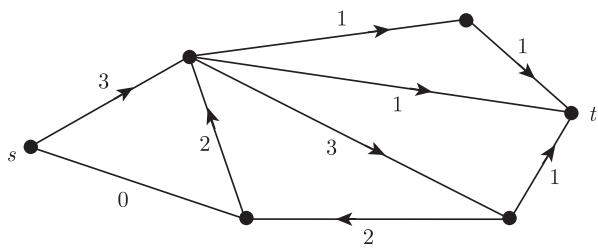
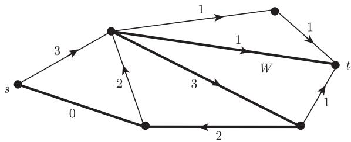

import Guide from '@/components/Guide.astro';
import Knowledge from '@/components/Knowledge.astro';
import Example from '@/components/Example.astro';
import Analysis from '@/components/Analysis.astro';
import Solution from '@/components/Solution.astro';
import Variant from '@/components/Variant.astro';
import Note from '@/components/Note.astro';
import Block from '@/components/Block.astro';
import Method from '@/components/Method.astro';
import Exercise from '@/components/Exercise.astro';

这一节我们将简要地介绍一些网络流理论，它是目前匹配和连通性领域中的标准证明技巧。通过例子，我们来证明这一理论中的经典结果，即由 Ford 和 Fulkerson 得到的**最大流最小割定理** (max-flow min-cut theorem)。只用这一定理便可毫不费劲地得到 Menger 定理 (练习 3)，由此可见该方法的巨大威力。

考虑一个具有初始点 $s$ 和终点 $t$ 的网络模型，这里通过任意两个节点的连线上的流量不大于该连线的固定容量。我们的目的是确定该网络中从 $s$ 流向 $t$ 的最大净流量。由于各种原因，这将同时取决于网络的结构以及它的连接之间的各种容量，而这个最大净流量具体是多少，则正是我们想要找出的。

令 $G = (V, E)$ 为多重图，$s, t \in V$ 为两个固定顶点，且 $c: \vec{E} \to \mathbb{N}$ 为一个映射。我们称 $c$ 为 $G$ 上的一个**容量函数** (capacity)，而称四元组 $N := (G, s, t, c)$ 为一个**网络** (network)。注意到，$c$ 对一条边的两个方向是单独定义的。如果一个函数 $f: \vec{E} \to \mathbb{R}$ 满足以下三个条件 (图 6.2.1)，就称它为 $N$ 上的一个**流** (flow)：

(F1) 对满足 $x \neq y$ 的所有 $(e, x, y) \in \vec{E}$，有 $f(e, x, y) = -f(e, y, x)$；

(F2') 对所有 $v \in V \setminus \{s, t\}$，有 $f(v, V) = 0$；

(F3) 对所有 $\vec{e} \in \vec{E}$，有 $f(\vec{e}) \leqslant c(\vec{e})$。

若 $f$ 的所有取值均为整数，我们称 $f$ 是**整数的** (integral)。

<figure class="vp-figure">
  
  <figcaption>图 6.2.1 网络流的简单记法：所有的赋值均表示在给定方向上的流量 (容量没有显示)</figcaption>
</figure>

设 $f$ 是 $N$ 中的一个流。若 $S \subseteq V$ 满足 $s \in S$ 和 $t \in \overline{S}$，则称集合对 $(S, \overline{S})$ 是 $N$ 中的一个**割** (cut in $N$)，而 $c(S, \overline{S})$ 是这个割的**容量** (capacity)。[^3]

由于现在 $f$ 只需满足 (F2') 而不必满足 (F2)，那么不必要求所有的 $X \subseteq V$ 满足 $f(X, \overline{X}) = 0$ (如命题 6.1.1 中所叙述的那样)。然而，所有割的取值是相同的：

<Knowledge title="命题 6.2.1">
$N$ 中任意割 $(S, \overline{S})$ 满足 $f(S, \overline{S}) = f(s, V)$。

<Solution title="证明">
同命题 6.1.1 的证明一样，我们有

$$
\begin{aligned}
f(S, \overline{S}) &= f(S, V) - f(S, S) \\
&\underset{\text{(F1)}}{=} f(s, V) + \sum_{v \in S \setminus \{s\}} f(v, V) - 0 \\
&\underset{\text{(F2')}}{=} f(s, V).
\end{aligned}
$$
∎
</Solution>
</Knowledge>

命题 6.2.1 中所有 $f(S, \overline{S})$ 的公共值被称为 $f$ 的**总流量** (total value)，并记为 $|f|$。[^4] 图 6.2.1 中所示的流的总流量为 3。

根据 (F3)，对 $N$ 中的每个割 $(S, \overline{S})$，有

$$
|f| = f(S, \overline{S}) \leqslant c(S, \overline{S}).
$$

因此 $N$ 中一个流的总流量绝不会超过一个割的最小容量。下面的**最大流最小割** (max-flow min-cut) 定理表明，这一上界总能在某个流上达到：

<Knowledge title="定理 6.2.2 (Ford and Fulkerson, 1956)">
在每个网络中，流的最大总流量等于割的最小容量。

<Solution title="证明">
令 $N = (G, s, t, c)$ 为一个网络，且 $G =: (V, E)$。我们将定义 $N$ 中的一个整数流序列 $f_{0}, f_{1}, f_{2}, \dots$，使得总流量是严格递增的，即

$$
|f_0| < |f_1| < |f_2| < \dots .
$$

显然，整数流的总流量之和仍然为整数，因此事实上对所有 $n$ 有 $|f_{n+1}| \geqslant |f_n| + 1$。因为所有这些值被 $N$ 中任意割的容量所限制，所以我们的序列总会终止于某个流 $f_n$。与这个流相对应，我们将会找到一个容量为 $c_n = |f_n|$ 的割。由于任何流的总流量不会超过 $c_n$，且任意割的容量不会少于 $|f_n|$，所以这个数值正是定理中提到的最大值和最小值。

对 $f_{0}$ 和所有 $\vec{e} \in \vec{E}$，令 $f_{0}(\vec{e}) := 0$。在 $N$ 中对某个 $n \in \mathbb{N}$ 已经定义了整数流 $f_{n}$ 后，我们用 $S_{n}$ 来表示所有顶点 $v$ 的集合，这里 $v$ 使得 $G$ 包含一条 $s\text{-}v$ 途径 $x_{0} e_{0} \dots e_{\ell-1} x_{\ell}$ 且满足对所有 $i < \ell$ 有

$$
f_n(\vec{e}_i) < c(\vec{e}_i),
$$

其中 $\vec{e}_i := (e_i, x_i, x_{i+1})$ (当然，$x_0 = s$ 且 $x_\ell = v$)。

若 $t \in S_n$，令 $W = x_0 e_0 \dots e_{\ell-1} x_\ell$ 为相应的 $s\text{-}t$ 途径。不失一般性地，假定 $W$ 中不重复任何顶点。令

$$
\epsilon := \min \{c(\vec{e}_i) - f_n(\vec{e}_i) \mid i < \ell\},
$$

则 $\epsilon > 0$。又因为根据假设 $f_n$ (如 $c$) 为整数，所以 $\epsilon$ 是一个整数。令

$$
f_{n+1}: \vec{e} \mapsto \begin{cases}
f_n(\vec{e}) + \epsilon, & \vec{e} = \vec{e}_i, i = 0, \dots, \ell - 1, \\
f_n(\vec{e}) - \epsilon, & \vec{e} = \overleftarrow{e}_i, i = 0, \dots, \ell - 1, \\
f_n(\vec{e}), & \vec{e} \notin W.
\end{cases}
$$

直观上看，$f_{n+1}$ 是 $f_n$ 沿 $W$ 从 $s$ 向 $t$ 多发送了 $\epsilon$ 个单位的流而得到的 (图 6.2.2)。

<figure class="vp-figure">
  
  <figcaption>图 6.2.2 对于常数流 $f_n = 0$ 和 $c = 3$，具有增量 $\epsilon = 2$ 的“增广路” $W$</figcaption>
</figure>

显然，$f_{n+1}$ 也是 $N$ 中的一个整数流。我们计算一下它的总流值 $|f_{n+1}| = f_{n+1}(s, V)$。由于 $W$ 仅包含顶点 $s$ 一次，$\vec{e}_0$ 是唯一满足其 $f$-值改变过并使得 $x = s$ 且 $y \in V$ 的三元组 $(e, x, y)$。这个值 (从而 $f_{n+1}(s, V)$ 的值) 增大了。因此，$|f_{n+1}| > |f_n|$，即所要证的。

若 $t \notin S_n$，则 $(S_n, \overline{S_n})$ 是 $N$ 中的一个割。对 $f_n$ 使用 (F3) 并根据 $S_n$ 的定义，故对所有 $\vec{e} \in \vec{E}(S_n, \overline{S_n})$，有

$$
f_n(\vec{e}) = c(\vec{e}),
$$

因此

$$
|f_n| = f_n(S_n, \overline{S_n}) = c(S_n, \overline{S_n})
$$

即所要证的。
∎
</Solution>
</Knowledge>

因为定理 6.2.2 的证明中所构造的流是整数的，我们同时还证明了以下结论：

<Knowledge title="推论 6.2.3">
每个 (具有整数容量函数的) 网络都包含一个最大总流量为整数的流。
</Knowledge>

[^3]: 数值 $c(S, \overline{S})$ 在 6.1 节的 (1) 中定义。
[^4]: 因此，严格讲，$|f|$ 可以是负值。但在实际应用中，我们可以通过交换 $s, t$ 来改变 $|f|$ 的正负号。
