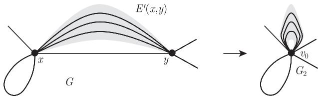

import Guide from '@/components/Guide.astro';
import Knowledge from '@/components/Knowledge.astro';
import Example from '@/components/Example.astro';
import Analysis from '@/components/Analysis.astro';
import Solution from '@/components/Solution.astro';
import Variant from '@/components/Variant.astro';
import Note from '@/components/Note.astro';
import Block from '@/components/Block.astro';
import Method from '@/components/Method.astro';
import Exercise from '@/components/Exercise.astro';

设 $G = (V, E)$ 是一个多重图。若 $f$ 和 $g$ 是 $G$ 的取值于同一个阿贝尔群 $H$ 上的两个环流，那么 $(f + g): \vec{e} \mapsto f(\vec{e}) + g(\vec{e})$ 和 $-f: \vec{e} \mapsto -f(\vec{e})$ 也是环流。于是 $G$ 上取值于 $H$ 的环流很自然地构成了一个群。

在我们所用的术语中，[^5] **$H$-流** ($H$-flow) 是指一个处处非零 (即对所有的 $\vec{e} \in \vec{E}$ 有 $f(\vec{e}) \neq 0$) 的环流 $f: \vec{E} \to H$。注意到，$G$ 上 $H$-流的集合在加法意义下并不封闭：如果在某条边 $\vec{e}$ 上两个 $H$-流相加为零，则它们的和不再是一个 $H$-流。根据推论 6.1.2，包含 $H$-流的图不可能有桥。

对有限群 $H$ 来说，$G$ 上 $H$-流的数目，尤其是它们的存在性，令人非常吃惊地只取决于 $H$ 的阶数，而不取决于 $H$ 本身：

<Knowledge title="定理 6.3.1 (Tutte, 1954)">
对每个多重图 $G$，存在一个多项式 $P$ 使得对任意有限阿贝尔群 $H$，$G$ 上 $H$-流的数目是 $P(|H| - 1)$。

<Solution title="证明">
令 $G =: (V, E)$，对 $m := |E|$ 使用归纳法。我们先假定 $G$ 的所有边均为环边。那么，给定任意有限阿贝尔群 $H$，每个映射 $\vec{E} \to H \setminus \{0\}$ 是 $G$ 上的一个 $H$-流。因为当所有边为环边时有 $|\vec{E}| = |E|$，所以存在 $(|H| - 1)^m$ 个这样的映射，且 $P := x^m$ 即为所需要的多项式。

现在假设存在一条边 $e_0 = xy \in E$ 不是环边，令 $\vec{e}_0 := (e_0, x, y)$ 且 $E' := E \setminus \{e_0\}$。考虑多重图

$$
G_1 := G - e_0 \quad \text{和} \quad G_2 := G / e_0.
$$

根据归纳假设，存在多项式 $P_i (i = 1, 2)$，使得对于任意有限阿贝尔群 $H$ 和 $k := |H| - 1$，$G_i$ 上的 $H$-流的数目为 $P_i(k)$。我们将证明 $G$ 上 $H$-流的数目等于 $P_2(k) - P_1(k)$，则 $P := P_2 - P_1$ 是要找的多项式。

设 $H$ 已给定，并记 $G$ 上全体 $H$-流的集合为 $F$。我们将尝试证明

$$
|F| = P_2(k) - P_1(k). \tag{1}
$$

$G_1$ 上的 $H$-流恰好是那些仅在 $e_0$ 流量为零，而在其他所有边上流量非零的 $G$ 的 $H$-环流限制在 $\vec{E}'$ 上所得到的，我们记 $G$ 上这样的环流所构成的集合为 $F_1$，则

$$
|F_1| = P_1(k).
$$

类似地，我们的目标是证明 $G_2$ 上的 $H$-流一一对应于那些仅可能在 $e_0$ 上流量为零的 $G$ 上的 $H$-环流，那么 $G$ 上这样的环流构成的集合 $F_2$ 满足

$$
|F_2| = P_2(k),
$$

且 $F_2$ 是 $F_1$ 和 $F$ 的不交并。这就验证了 (1)，进而证明了定理。

在 $G_2$ 中，令 $v_0 := v_{e_0}$ 为 $e_0$ 收缩后的顶点 (图 6.3.1，收缩见 1.10 节)。我们要在 $F_2$ 和由 $G_2$ 上的 $H$-流组成的集合之间找一个双射 $f \mapsto g$。给定 $f$，设 $g$ 为 $f$ 在 $\vec{E}' \setminus \vec{E}'(y, x)$ 上的限制，(由于 $x\text{-}y$ 边 $e \in E'$ 在 $G_2$ 中变成了环边，所以它们在 $G_2$ 中只有一个定向 $(e, v_0, v_0)$，我们取 $f(e, x, y)$ 作为它的 $g$-值。) 那么 $g$ 确实是 $G_2$ 上的 $H$-流。注意到，根据命题 6.1.1，取 $X := \{x, y\}$，则 (F2) 对 $G$ 在 $v_0$ 成立。

<figure class="vp-figure">
  
  <figcaption>图 6.3.1 收缩边 $e_0$ 的结果</figcaption>
</figure>

剩下的就是证明映射 $f \mapsto g$ 是双射。如果已给定 $G_2$ 上的 $H$-流 $g$，而且我们想找到一个满足 $f \mapsto g$ 的 $f \in F_2$，则对所有 $\vec{e} \in \vec{E}' \setminus \vec{E}'(y, x)$，由于 $f(\vec{e}) = g(\vec{e})$，故 $f(\vec{e})$ 已确定。根据 (F1)，对所有 $\vec{e} \in \vec{E}'(y, x)$，从而有 $f(\vec{e}) = -f(\overleftarrow{e})$。这样，映射 $f \mapsto g$ 是双射当且仅当对于给定的 $g$，总存在唯一的方法来定义 $f(\vec{e}_0)$ 和 $f(\overleftarrow{e}_0)$ 余下的值，使得 $f$ 对 $e_0$ 满足 (F1)，对 $x$ 和 $y$ 满足 (F2)。

现在，$f(\vec{e}_0)$ 的取值可根据在 $x$ 的 (F2) 以及与 $x$ 关联的边 $e$ 上已知的值 $f(\vec{e})$ 来确定，而 $f(\overleftarrow{e}_0)$ 的取值可根据在 $y$ 的 (F2) 以及与 $y$ 关联的边 $e$ 上已知的值 $f(\vec{e})$ 来确定。的确，假设

$$
h := \sum_{\vec{e} \in \vec{E}'(x, y)} f(\vec{e}) \left(= \sum_{e \in E'(x, y)} g(e, v_0, v_0)\right)
$$

和 $V' := V \setminus \{x, y\}$，那么 (F2) 对 $f$ 成立当且仅当

$$
0 = f(x, V) = f(\vec{e}_0) + h + f(x, V'),
$$

以及

$$
0 = f(y, V) = f(\overleftarrow{e}_0) - h + f(y, V'),
$$

亦即，当且仅当我们取

$$
f(\vec{e}_0) := -f(x, V') - h \quad \text{且} \quad f(\overleftarrow{e}_0) := -f(y, V') + h.
$$

幸运的是，这样定义的 $f(\vec{e}_0)$ 和 $f(\overleftarrow{e}_0)$ 对 $f$ 同样满足 (F1)，这是因为对 $g$ 在 $v_0$ 应用 (F2)，有

$$
f(\vec{e}_0) + f(\overleftarrow{e}_0) = -f(x, V') - f(y, V') = -g(v_0, V') = 0.
$$
∎
</Solution>
</Knowledge>

定理 6.3.1 中的多项式被称为 $G$ 的**流多项式** (flow polynomial)。

<Knowledge title="推论 6.3.2">
如果 $H$ 和 $H'$ 是两个具有相同阶的有限阿贝尔群，那么 $G$ 有 $H$-流当且仅当 $G$ 有 $H'$-流。
</Knowledge>

推论 6.3.2 对代数流理论来说有深刻的影响：它表明在 $H$-流的存在性证明中，关键难点不涉及群理论的本质。另一方面，允许选择一个方便好用的群将会很有用。对此，在命题 6.4.5 中，我们将会看到一个这方面的好例子。

设 $k \geqslant 1$ 为整数，而 $G = (V, E)$ 为多重图，$G$ 上满足对所有 $\vec{e} \in \vec{E}$ 均有 $0 < |f(\vec{e})| < k$ 的 $\mathbb{Z}$-流 $f$ 被称为 **$k$-流** ($k$-flow)。显然，对所有 $\ell > k$，任意 $k$-流也是 $\ell$-流。所以我们会问，使得 $G$ 有一个 $k$-流的最小整数 $k$ 是多少呢 (假设这样的 $k$ 存在)? 我们称这样的最小的 $k$ 为 $G$ 的**流数** (flow number)，并记为 $\varphi(G)$，若对任意 $k$，$G$ 中不存在 $k$-流，我们令 $\varphi(G) := \infty$。

确定流数的问题很快就涉及图论中一些最深刻的未解决的公开问题，我们将在本章晚些时候对这些问题进行讨论。然而，首先还是让我们来看看 $k$-流与 $H$-流的更广义概念之间的联系。

$k$-流与 $\mathbb{Z}_k$-流之间存在着十分紧密的联系。让 $\sigma_k$ 表示从 $\mathbb{Z}$ 到 $\mathbb{Z}_k$ 的自然同态 $i \mapsto \bar{i}$。通过结合 $\sigma_k$，每个 $k$-流定义了一个 $\mathbb{Z}_k$-流。正如下面的定理所示，逆命题也成立：从 $G$ 上每个 $\mathbb{Z}_k$-流，我们可以构造 $G$ 上的一个 $k$-流。考虑到推论 6.3.2，这意味着对任意的群 $H$，$H$-流的存在性问题可归结为相应的 $k$-流问题。

<Knowledge title="定理 6.3.3 (Tutte, 1950)">
一个多重图包含 $k$-流当且仅当它包含 $\mathbb{Z}_k$-流。

<Solution title="证明">
令 $g$ 是多重图 $G = (V, E)$ 上的一个 $\mathbb{Z}_k$-流，我们来构造 $G$ 上一个 $k$-流 $f$。不失一般性，假定 $G$ 不包含环边。设 $F$ 是所有这样的函数 $f: \vec{E} \to \mathbb{Z}$ 的集合：它满足 (F1)，而对所有 $\vec{e} \in \vec{E}$ 有 $|f(\vec{e})| < k$，且 $\sigma_k \circ f = g$。注意到，同 $g$ 一样，任意 $f \in F$ 是处处非零的。

先证明 $F \neq \varnothing$。因为我们能将每个值 $g(\vec{e}) \in \mathbb{Z}_k$ 用 $\bar{i} (|i| < k)$ 表示出来，从而令 $f(\vec{e}) := i$，所以显然存在一个映射 $f: \vec{E} \to \mathbb{Z}$ 使得对所有 $\vec{e} \in \vec{E}$ 有 $|f(\vec{e})| < k$ 且 $\sigma_k \circ f = g$。对每条边 $e \in E$，选取两个定向中的一个，并记为 $\vec{e}$。这样，对每个 $e \in E$，我们可以通过设定 $f'(\vec{e}) := f(\vec{e})$ 和 $f'(\overleftarrow{e}) := -f(\vec{e})$ 来定义 $f': \vec{E} \to \mathbb{Z}$。因此 $f'$ 是满足 (F1) 的函数且取值在所需的范围之内。剩下的就是证明 $\sigma_k \circ f'$ 和 $g$ 不仅在选定的定向 $\vec{e}$ 上，而且在相反方向 $\overleftarrow{e}$ 上也是一致的。因为 $\sigma_k$ 是一个同态，所以这确实成立：

$$
(\sigma_k \circ f')(\overleftarrow{e}) = \sigma_k(-f(\vec{e})) = -(\sigma_k \circ f)(\vec{e}) = -g(\vec{e}) = g(\overleftarrow{e}).
$$

因此 $f' \in F$，故 $F$ 的确是非空的。

我们的目标是找到满足 Kirchhoff 定律 (F2) 的 $f \in F$，因此是一个 $k$-流。作为候选对象，考虑这样的 $f \in F$ 使得和式

$$
K(f) := \sum_{x \in V} |f(x, V)|
$$

与 Kirchhoff 定律的偏差具有最小的可能值。我们将证明 $K(f) = 0$，那么显然，对每个 $x$ 有 $f(x, V) = 0$，即所要证明的。

假设 $K(f) \neq 0$。因为 $f$ 满足 (F1)，且因此有 $\sum_{x \in V} f(x, V) = f(V, V) = 0$，所以存在一个顶点 $x$ 满足

$$
f(x, V) > 0. \tag{1}
$$

设 $X \subseteq V$ 为所有 $x'$ 的集合，这里 $G$ 包含一条从 $x$ 到 $x'$ 的途径 $x_0 e_0 \dots e_{\ell-1} x_\ell$ 使得对所有 $i < \ell$ 有 $f(e_i, x_i, x_{i+1}) > 0$。进一步地，设 $X' := X \setminus \{x\}$。

我们先证明 $X'$ 包含顶点 $x'$ 使得 $f(x', V) < 0$。根据 $X$ 的定义，对所有满足 $x' \in X$ 和 $y \in \overline{X}$ 的边 $e = x'y$，有 $f(e, x', y) \leqslant 0$。特别地，此式对 $x' = x$ 也成立。因此，(1) 蕴含着 $f(x, X') > 0$。这样，根据 (F1)，有 $f(X', x) < 0$，以及 $f(X', X') = 0$。因此

$$
\sum_{x' \in X'} f(x', V) = f(X', V) = f(X', \overline{X}) + f(X', x) + f(X', X') < 0.
$$

故某个 $x' \in X'$ 一定满足

$$
f(x', V) < 0. \tag{2}
$$

由于 $x' \in X$，所以存在一条 $x\text{-}x'$ 途径 $W = x_0 e_0 \dots e_{\ell-1} x_\ell$ 使得对所有 $i < \ell$ 有 $f(e_i, x_i, x_{i+1}) > 0$。现在我们通过沿着 $W$ 向回发送一些流来修改 $f$，设 $f': \vec{E} \to \mathbb{Z}$ 由下式给出

$$
f': \vec{e} \mapsto \begin{cases}
f(\vec{e}) - k, & \vec{e} = (e_i, x_i, x_{i+1}), i = 0, \dots, \ell - 1, \\
f(\vec{e}) + k, & \vec{e} = (e_i, x_{i+1}, x_i), i = 0, \dots, \ell - 1, \\
f(\vec{e}), & \vec{e} \notin W.
\end{cases}
$$

由 $W$ 的定义，对所有的 $\vec{e} \in \vec{E}$，有 $|f'(\vec{e})| < k$。因此，同 $f$ 一样，$f'$ 位于 $F$ 中。

对 $f$ 的修改会对 $K$ 有什么影响呢？同 $W$ 外部的顶点一样，在 $W$ 的所有内部顶点 $v$，它与 Kirchhoff 定律的偏差保持不变：

$$
\text{对所有的 } v \in V \setminus \{x, x'\}, \quad f'(v, V) = f(v, V). \tag{3}
$$

另一方面，对 $x$ 和 $x'$，有

$$
f'(x, V) = f(x, V) - k \quad \text{以及} \quad f'(x', V) = f(x', V) + k. \tag{4}
$$

因为 $g$ 是一个 $\mathbb{Z}_k$-流，所以

$$
\sigma_k(f(x, V)) = g(x, V) = \bar{0} \in \mathbb{Z}_k
$$

且

$$
\sigma_k(f(x', V)) = g(x', V) = \bar{0} \in \mathbb{Z}_k,
$$

因此 $f(x, V)$ 和 $f(x', V)$ 都是 $k$ 的倍数。所以由 (1) 和 (2) 知 $f(x, V) \geqslant k$ 和 $f(x', V) \leqslant -k$，但如此 (4) 就蕴含着

$$
|f'(x, V)| < |f(x, V)| \quad \text{且} \quad |f'(x', V)| < |f(x', V)|.
$$

结合 (3)，可得 $K(f') < K(f)$，这与 $f$ 的选取矛盾。

因此正如所述，$K(f) = 0$，即 $f$ 的确是一个 $k$-流。
∎
</Solution>
</Knowledge>

由于两个取值在 $\mathbb{Z}_k$ 中的环流之和也是一个环流，所以 $\mathbb{Z}_k$-流通常比 $k$-流更容易构造 (通过累加若干合适的部分流而得到)。因此，在确定某个给定图是否包含 $k$-流时，定理 6.3.3 可能会非常有用。在下一节，我们将会看到很多这样的例子。

尽管定理 6.3.3 可以告诉我们一个给定的多重图是否包含一个 $k$-流 (假设我们知道关于 $k - 1$ 的流多项式的取值)，但它并不能告诉我们这种流的个数。根据 Kochol 近期得到的结果，这个数目也是 $k$ 的多项式，它的上界和下界可以被流多项式对应的值所界定。详细内容参见本章后面的注解。

[^5]: 为了避免在每个“$H$-流”前加上“处处非零”的麻烦，我们这里所用的术语和规范的稍有不同，见注解中的脚注。
