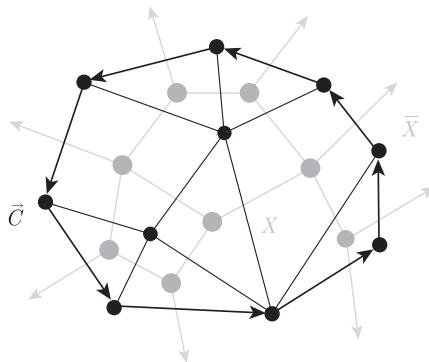

import Guide from '@/components/Guide.astro';
import Knowledge from '@/components/Knowledge.astro';
import Example from '@/components/Example.astro';
import Analysis from '@/components/Analysis.astro';
import Solution from '@/components/Solution.astro';
import Variant from '@/components/Variant.astro';
import Note from '@/components/Note.astro';
import Block from '@/components/Block.astro';
import Method from '@/components/Method.astro';
import Exercise from '@/components/Exercise.astro';

在这一节，我们将会看到流与着色之间有着惊人的联系：平面多重图上的每个 $k$-顶点着色导出该图对偶上的一个 $k$-流，反之亦然。因此，对任意图 (不一定是平面的)，$k$-流的研究成为我们所熟悉的平面上的地图着色问题的自然推广。

设 $G = (V, E)$，而 $G^* = (V^*, E^*)$ 是它的对偶平面多重图 (这意味着 $G$ 和 $G^*$ 都是连通的，见 4.6 节)。为简单起见，假设 $G$ 和 $G^*$ 都不含桥或环边，且都是非平凡的。对边集 $F \subseteq E$，我们记

$$
F^* := \{e^* \in E^* \mid e \in F\}.
$$

反过来，给定一个子集 $E^*$，可以立即将它写成 $F^*$ 的形式，所以我们通过双射 $e \mapsto e^*$ 来隐含地定义 $F \subseteq E$。

假设给定 $G^*$ 上的一个环流 $g$，如何利用 $G$ 和 $G^*$ 之间的对偶关系来从 $g$ 中获得一些有关 $G$ 的信息呢？所有环流所具有的最一般性质就是命题 6.1.1，即对所有 $X \subseteq V^*$，$g(X, \overline{X}) = 0$。由命题 4.6.1，$G^*$ 中的键 $E^*(X, \overline{X})$ 正好对应于 $G$ 中的圈。因此，如果取映射 $e \mapsto e^*$ 和 $g$ 的合成 $f$，并将它们在 $G$ 中一个圈边上的值相加，那么这个和应该也为零。我们的第一个目标是把这个结果正式地叙述并进行证明。

当然，技术上还有一个障碍：因为关于 $g$ 的论证不是在 $E^*$ 中而是在 $\vec{E}^*$ 中，所以我们不能和上面那样简单地定义 $f$：首先得将 $\vec{E}$ 到 $\vec{E}^*$ 的双射 $e \mapsto e^*$ 细化，即对每个 $\vec{e} \in \vec{E}$ 指定 $e^*$ 的两个方向中的一个，这将会是第一个引理的目的之所在。在此之后，我们要证明 $f$ 在 $G$ 中任意一个圈上的和都为零。

如果 $C = v_0 \dots v_{\ell-1} v_0$ 是一个圈，其边为 $e_i = v_i v_{i+1}$ (且 $v_\ell := v_0$)，那么我们称

$$
\vec{C} := \{(e_i, v_i, v_{i+1}) \mid i < \ell\}
$$

为**有定向的圈** (cycle with orientation)。注意到，$\vec{C}$ 的定义依赖于所选取的用来表示 $C$ 的顶点的标号：每个圈都有两个定向。当然，反过来，$C$ 也能从集合 $\vec{C}$ 重新构造。因此，在应用中我们可以自由地使用 $C$，尽管严格地讲，只有当 $\vec{C}$ 已被定义后才可以这样做。

<Knowledge title="引理 6.5.1">
存在一个从 $\vec{E}$ 到 $\vec{E}^*$ 的双射 $*: \vec{e} \mapsto \vec{e}^*$ 具有以下性质：

(i) $\vec{e}^*$ 的底边总是 $e^*$，即 $\vec{e}^*$ 是 $e^*$ 的两个方向 $\vec{e}^*$ 和 $\overleftarrow{e}^*$ 中的一个；

(ii) 若 $C \subseteq G$ 是一个圈，$F := E(C)$，且 $X \subseteq V^*$ 满足 $F^* = E^*(X, \overline{X})$，则存在 $C$ 的一个定向 $\vec{C}$ 使得 $\{\vec{e}^* \mid \vec{e} \in \vec{C}\} = \vec{E}^*(X, \overline{X})$。
</Knowledge>

引理 6.5.1 的证明并不是完全平凡的：它建立在所谓的平面可定向性 (orientability) 的基础上，我们这里不能把它给出，但这个引理的结论从直观上看还是可以理解的。的确，如果按顺时针方向旋转 $e$ 和它的端点到 $e^*$ (图 6.5.1) 来对边 $e = vw$ 和 $e^* = xy$ 定义赋值 $(e, v, w) \mapsto (e, v, w)^* \in \{(e^*, x, y), (e^*, y, x)\}$，则得到的映射 $\vec{e} \mapsto \vec{e}^*$ 就满足引理中的两个结论。

<figure class="vp-figure">
  
  <figcaption>图 6.5.1 定向圈和割的对偶性</figcaption>
</figure>

考虑引理 6.5.1 中给出的一个固定双射 $*$，给定一个阿贝尔群 $H$，设 $f: \vec{E} \to H$ 和 $g: \vec{E}^* \to H$ 是两个映射，使得对所有的 $\vec{e} \in \vec{E}$，有

$$
f(\vec{e}) = g(\vec{e}^*).
$$

对 $\vec{F} \subseteq \vec{E}$，令

$$
f(\vec{F}) := \sum_{\vec{e} \in \vec{F}} f(\vec{e}).
$$

<Knowledge title="引理 6.5.2">
(i) 映射 $g$ 满足 (F1) 当且仅当 $f$ 满足 (F1)；

(ii) 映射 $g$ 是 $G^*$ 的一个环流当且仅当 $f$ 满足 (F1) 且对每个有定向的圈 $\vec{C}$，有 $f(\vec{C}) = 0$。

<Solution title="证明">
结论 (i) 由引理 6.5.1 (i) 和 $\vec{e} \mapsto \vec{e}^*$ 是双射这一事实可得。

对 (ii) 的必要性部分，我们假设 $g$ 是 $G^*$ 上的一个环流，并考虑某个给定定向的圈 $C \subseteq G$。设 $F := E(C)$，由命题 4.6.1 知，$F^*$ 是 $G^*$ 中的极小割，即对某个适当的 $X \subseteq V^*$，有 $F^* = E^*(X, \overline{X})$。根据 $f$ 和 $g$ 的定义，对 $C$ 的两个定向 $\vec{C}$ 中的一个，由引理 6.5.1 (ii) 和命题 6.1.1 得

$$
f(\vec{C}) = \sum_{\vec{e} \in \vec{C}} f(\vec{e}) = \sum_{\vec{d} \in \vec{E}^*(X, \overline{X})} g(\vec{d}) = g(X, \overline{X}) = 0.
$$

从而，根据 $f(\overleftarrow{C}) = -f(\vec{C})$，对于给定的 $C$ 的定向，对应的值也一定为零。

对于充分性部分，根据 (i) 只需证明 $g$ 满足 (F2)。给定 $v \in V^*$，由引理 1.9.3，割集 $E^*(v)$ 是键 $D^* = E^*(X, \overline{X})$ 的不交并，这里我们选取 $X$ 使得 $v \in X$。因为这些键中的每一条边和 $v$ 关联，所以对定向边关系 $\vec{E}^*(X, \overline{X}) \subseteq \vec{E}^*(v)$ 也成立。

由命题 4.6.1，每个集合 $D \subseteq E$ 是 $G$ 中一个圈 $C$ 的边集。根据引理 6.5.1 (ii)，$C$ 有一个定向 $\vec{C}$ 使得

$$
\{\vec{e}^* \mid \vec{e} \in \vec{C}\} = \vec{E}^*(X, \overline{X}).
$$

因此由 $f$ 和 $g$ 的定义，有 $g(X, \overline{X}) = f(\vec{C}) = 0$，从而得到所需的结果

$$
g(v, V^*) = \sum_X g(X, \overline{X}) = 0.
$$
∎
</Solution>
</Knowledge>

在引理 6.5.2 的帮助下，我们现在可以对平面多重图证明着色-流对偶定理。设 $P = v_0 \dots v_\ell$ 是一条路，它的边为 $e_i = v_i v_{i+1} (i < \ell)$，那么我们记 (取决于 $P$ 上顶点的标号)

$$
\vec{P} := \{(e_i, v_i, v_{i+1}) \mid i < \ell\},
$$

并称 $\vec{P}$ 是一条 $v_0 \to v_\ell$ 路 ($v_0 \to v_\ell$ path)。同样地，$P$ 可由 $\vec{P}$ 间接地给出。

<Knowledge title="定理 6.5.3 (Tutte, 1954)">
对每个平面多重图 $G$ 和它的对偶 $G^*$，有

$$
\chi(G) = \varphi(G^*).
$$

<Solution title="证明">
设 $G =: (V, E)$ 且 $G^* =: (V^*, E^*)$。对 $|G| \in \{1, 2\}$，结论容易验证。因此我们假定 $|G| \geqslant 3$，并对 $G$ 中桥的个数用归纳法。若 $e \in G$ 是一个桥，则 $e^*$ 是一个环边，且 $G^* - e^*$ 是 $G / e$ 的平面对偶 (为什么呢?)。因此，根据归纳假设得

$$
\chi(G) = \chi(G / e) = \varphi(G^* - e^*) = \varphi(G^*),
$$

这里，由假设 $|G| \geqslant 3$ 以及 $G$ 不只包含 $e$ 这一条边，我们推出第一个和最后一个等式。

因此，剩下的工作就是检验归纳的初始情形：假定 $G$ 没有桥。如果 $G$ 包含环边，则 $G^*$ 包含桥，根据惯例，$\chi(G) = \infty = \varphi(G^*)$。所以可以假定 $G$ 不包含环边，那么 $\chi(G)$ 是有限的，我们将证明对给定的 $k \geqslant 2$，$G$ 是 $k$-可着色的当且仅当 $G^*$ 有 $k$-流。由于 $G$ (因此 $G^*$ 也一样) 既不包含环边也不包含桥，我们可以对 $G$ 和 $G^*$ 运用引理 6.5.1 和引理 6.5.2。设 $\vec{e} \mapsto \vec{e}^*$ 是由引理 6.5.1 得到的 $\vec{E}$ 和 $\vec{E}^*$ 之间的双射。

首先假定 $G^*$ 有 $k$-流，则 $G^*$ 也包含一个 $\mathbb{Z}_k$-流 $g$。同前面一样，设 $f: \vec{E} \to \mathbb{Z}_k$ 是由 $f(\vec{e}) := g(\vec{e}^*)$ 定义的，我们将利用 $f$ 来定义 $G$ 的一个顶点着色 $c: V \to \mathbb{Z}_k$。设 $T$ 是 $G$ 的一棵根为 $r$ 的正规支撑树。令 $c(r) := \bar{0}$，对其他顶点 $v \in V$，令 $c(v) := f(\vec{P})$，这里 $\vec{P}$ 是 $T$ 中的 $r \to v$ 路。为了验证这是一个正常着色，考虑边 $e = vw \in E$，因为 $T$ 是正规的，我们可以假定在 $T$ 的树序中 $v < w$。如果 $e$ 是 $T$ 中的一条边，则根据 $c$ 的定义，有 $c(w) - c(v) = f(e, v, w)$，由于 $g$ (因此 $f$) 是处处非零的，所以 $c(v) \neq c(w)$。如果 $e \notin T$，让 $\vec{P}$ 表示 $T$ 中的 $v \to w$ 路，根据引理 6.5.2 (ii) 有

$$
c(w) - c(v) = f(\vec{P}) = -f(e, w, v) \neq \bar{0}.
$$

反过来，我们假设 $G$ 有一个 $k$-着色 $c$。用

$$
f(e, v, w) := c(w) - c(v)
$$

来定义 $f: \vec{E} \to \mathbb{Z}$，并用 $g(\vec{e}^*) := f(\vec{e})$ 来定义 $g: \vec{E}^* \to \mathbb{Z}$。显然，$f$ 满足 (F1) 且取值于 $\{\pm 1, \dots, \pm (k-1)\}$，因此，根据引理 6.5.2 (i)，相同的结论对 $g$ 也成立。由 $f$ 的定义，对每个有定向的圈 $\vec{C}$ 进一步地有 $f(\vec{C}) = 0$。所以根据引理 6.5.2 (ii)，$g$ 是一个 $k$-流。
∎
</Solution>
</Knowledge>
