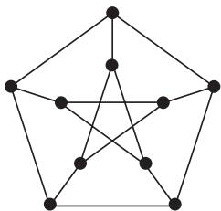
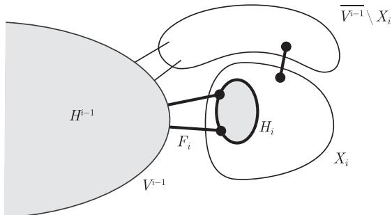

import Guide from '@/components/Guide.astro';
import Knowledge from '@/components/Knowledge.astro';
import Example from '@/components/Example.astro';
import Analysis from '@/components/Analysis.astro';
import Solution from '@/components/Solution.astro';
import Variant from '@/components/Variant.astro';
import Note from '@/components/Note.astro';
import Block from '@/components/Block.astro';
import Method from '@/components/Method.astro';
import Exercise from '@/components/Exercise.astro';

我们如何确定一个图的流数呢？更准确地说，是否每个 (无桥) 图都有一个流数，即对某个 $k$，存在一个 $k$-流呢？流数是否如色数一样可以任意大呢？对给定 $k$，我们能否刻画具有 $k$-流的图呢？

对这四个问题，在这一节将回答第二个和第三个：我们证明每个无桥图都有一个 6-流。特别地，一个图有流数当且仅当它不包含桥。关于刻画有 $k$-流的图这一问题，对 $k = 3, 4, 5$ 仍然没有解决，它的部分答案在下面三个 Tutte 猜想中有所提示，Tutte 是研究图上代数流理论的创始人。

最早且最著名的 Tutte 猜想是他的 **5-流猜想** (5-flow conjecture)：

**五流猜想** (Tutte 1954) 每个无桥的多重图包含 5-流。

哪些图有 4-流呢？根据命题 6.4.4，4-边连通图是其中一个。另一方面，Petersen 图 (图 6.6.1) 就是一个无桥，也不含 4-流的例子：因为它是三正则的但不是 3-边可着色的，根据命题 6.4.5 (ii)，它不可能有 4-流。

<figure class="vp-figure">
  
  <figcaption>图 6.6.1 Petersen 图</figcaption>
</figure>

Tutte 的 **4-流猜想** (4-flow conjecture) 指出：Petersen 图一定会出现在每个不含 4-流的图中。

**四流猜想** (Tutte 1966) 每个不包含 Petersen 图作为子式的无桥多重图包含 4-流。

根据命题 1.7.3，在 4-流猜想中我们可以用“拓扑子式”代替“子式”。

即使 4-流猜想成立，也不是最好的结果：比如 $K^{11}$ 包含 Petersen 图作为子式但却包含 4-流，甚至 2-流。对较稀疏的图，这个猜想会显得更自然；对三正则图的证明由 Robertson, Sanders, Seymour 和 Thomas 在 1998 年公布。

不包含 4-流 (等价地，不包含 3-边着色) 的三正则无桥图或多重图被称为一个**斯纳克** (snark)。三正则图的 4-流猜想表明，每个斯纳克包含 Petersen 图作为子式，在这个意义下，Petersen 图因此被证明是最小的斯纳克。斯纳克组成了四色定理和 5-流猜想最难的核心部分：四色定理等价于每个斯纳克都不是平面的这一命题 (留作练习)，并且不难将 5-流猜想转化为斯纳克的情形。[^6] 然而，尽管斯纳克组成了一个非常特别的图族，但是前面所提到的每个问题却没有因为这一转化而变得更容易。[^7]

**三流猜想** (Tutte, 1972) 每个不包含由恰好一条边或三条边所构成的割的多重图包含 3-流。

同样地，3-流猜想也不是最好可能的：很容易构造一个包含三边割且有 3-流的图 (作为练习)。

由对偶定理 (6.5.3)，对平面图，所有三个流猜想都是正确的，因此它也启发了我们把 3-流猜想转化为 Grötzsch 定理 (5.1.3)，把 4-流猜想转化为四色定理 (因为 Petersen 图不是可平面的，所以它不是一个可平面图的子式)，把 5-流猜想转化为五色定理。

在本节末，我们以这一章的主要结果来结束：

<Knowledge title="定理 6.6.1 (Seymour, 1981)">
每个无桥图都包含 6-流。

<Solution title="证明">
设 $G = (V, E)$ 是一个无桥图。因为 $G$ 的连通分支上的 6-流可累加成 $G$ 上的 6-流，所以我们可假定 $G$ 是连通的，由于 $G$ 不包含桥，故它是 2-边连通的。注意到，在 2-边连通图中，任意两个顶点都位于某个偶连通子图中，例如，由 Menger 定理 (3.3.6 (ii)) 知，连接两个顶点的两条边不交的路的并就是这样一个偶连通子图。我们将反复运用这一事实。

我们将构造 $G$ 的一个互不相交的偶连通子图的序列 $H_0, \dots, H_n$ 以及它们之间的非空边集序列 $F_1, \dots, F_n$。每个集合 $F_i$ 只包含 $H_i$ 和 $H_0 \cup \dots \cup H_{i-1}$ 之间的一条或两条边。我们记 $H_i =: (V_i, E_i)$，

$$
H^i := (H_0 \cup \dots \cup H_i) + (F_1 \cup \dots \cup F_i)
$$

且 $H^i =: (V^i, E^i)$。注意到，每个 $H^i = (H^{i-1} \cup H_i) + F_i$ 是连通的 (对 $i$ 用归纳法)。由命题 6.4.1 (或直接由命题 1.2.1) 知，$H_i$ 是偶的这一假设蕴含着 $H_i$ 不包含桥。

我们在 $G$ 中选取任意一个 $K^1$ 作为 $H_0$。现在假设对某个 $i > 0, H_0, \dots, H_{i-1}$ 和 $F_1, \dots, F_{i-1}$ 都已经定义。如果 $V^{i-1} = V$，就终止构造并令 $i - 1 =: n$，否则，我们令 $X_i \subseteq \overline{V^{i-1}}$ 是满足 $X_i \neq \varnothing$ 和

$$
|E(X_i, \overline{V^{i-1}} \setminus X_i)| \leqslant 1 \tag{1}
$$

的极小集 (图 6.6.2)，这样的 $X_i$ 的确存在，这是因为 $\overline{V^{i-1}}$ 就是一个这样的集合。由于 $G$ 是 2-边连通的，(1) 意味着 $E(X_i, V^{i-1}) \neq \varnothing$。由 $X_i$ 的极小性，图 $G[X_i]$ 是连通的且不包含桥，即它是 2-边连通的或是 $K^1$。从 $E(X_i, V^{i-1})$ 中选取一条或两条边作为 $F_i$ 的元素 (若有可能选两条的话，就选两条)。选取包含 $F_i$ 中边在 $X_i$ 中的端点的 $G[X_i]$ 的任意偶连通子图作为 $H_i$。

当构造完成时，我们设 $H^n =: H$ 且 $E' := E \setminus E(H)$。根据 $n$ 的定义，$H$ 是 $G$ 的一个连通支撑子图。

用“逆向”归纳法，我们定义 $G$ 上一个取值于 $\mathbb{Z}_3$ 的环流序列 $f_n, \dots, f_0$。对每条边 $e \in E'$，设 $\vec{C}_e$ 是 $H + e$ 中包含 $e$ 的一个 (有定向的) 圈，而 $f_e$ 是沿着 $\vec{C}_e$ 的一个具有正值的流。准确地说，设 $f_e$ 是 $G$ 上的一个环流 $\vec{E} \to \mathbb{Z}_3$ 使得 $f_e^{-1}(\bar{0}) = \vec{E} \setminus (\vec{C}_e \cup \overleftarrow{C}_e)$。设 $f_n$ 是所有这些 $f_e$ 之和。由于每个 $e' \in E'$ 位于恰好一个圈 $C_e$ 上 (换言之，在 $C_{e'}$ 上)，因此对所有 $\vec{e} \in \vec{E}'$，有 $f_n(\vec{e}) \neq \bar{0}$。

<figure class="vp-figure">
  
  <figcaption>图 6.6.2 构造 $H_i$ 和 $F_i$</figcaption>
</figure>

现在假设对某个 $i \leqslant n$，环流 $f_n, \dots, f_i$ 已定义，且对所有 $\vec{e} \in \vec{E}' \cup \bigcup_{j > i} \vec{F}_j$ 有

$$
f_i(\vec{e}) \neq \bar{0}, \tag{2}
$$

其中 $\vec{F}_j := \{\vec{e} \in \vec{E} \mid e \in F_j\}$。我们的目的是定义 $f_{i-1}$ 使得 (2) 对 $i - 1$ 也成立。

首先考虑 $|F_i| = 1$ 的情形，不妨设 $F_i = \{e\}$，那么我们令 $f_{i-1} := f_i$，因此需要证明 $f_i$ 在 $e$ (的两个定向) 上是非零的。根据 $F_i$ 的选取，$|F_i| = 1$ 的假设意味着，除了 $e$ 之外，$G$ 不包含任何其他 $X_i\text{-}V^{i-1}$ 边。由于 $G$ 是 2-边连通的，因此它至少包含 $X_i$ 与 $\overline{V^{i-1}} \setminus X_i$ 之间的一条边 $e'$。进一步地，由 (1)，恰好只有一条这样的边。我们证明 $f_i$ 在 $e'$ 上是非零的。因为 $\{e, e'\}$ 是 $G$ 中的一个割，由命题 6.1.1，这意味着 $f_i$ 在 $e$ 上也是非零的。

要证明 $f_i$ 在 $e'$ 上是非零的，我们利用 (2) 证明 $e' \in E' \cup \bigcup_{j > i} F_j$，即 $e'$ 不包含在任何 $H_k$ 或 $j \leqslant i$ 的 $F_j$ 中。由于 $e'$ 的两个端点均在 $\overline{V^{i-1}}$ 中，它显然不会位于任何 $j \leqslant i$ 的 $F_j$ 中以及任何 $k < i$ 的 $H_k$ 中。但是每个满足 $k \geqslant i$ 的 $H_k$ 都是 $G[\overline{V^{i-1}}]$ 的子图。由于 $e'$ 是 $G[\overline{V^{i-1}}]$ 的桥而 $H_k$ 不包含桥，这意味着 $e' \notin H_k$。因此，$f_{i-1}$ 在所考虑的情形中对 $i - 1$ 的确满足 (2)。

剩下的就是考虑 $|F_i| = 2$ 的情形，不妨设 $F_i = \{e_1, e_2\}$。由于 $H_i$ 和 $H^{i-1}$ 均是连通的，我们可以找到 $H^i = (H_i \cup H^{i-1}) + F_i$ 中包含 $e_1, e_2$ 的一个圈 $C$。如果 $f_i$ 在这两条边上均非零，我们再次令 $f_{i-1} := f_i$。否则，不失一般性，存在 $e_1$ 和 $e_2$ 的定向 $\vec{e}_1$ 和 $\vec{e}_2$ 使得 $f_i(\vec{e}_1) = \bar{0}$ 且 $f_i(\vec{e}_2) \in \{\bar{0}, \bar{1}\}$。设 $\vec{C}$ 是 $C$ 的定向使得 $\vec{e}_2 \in \vec{C}$，令 $g$ 是沿着 $\vec{C}$ 取值 $\bar{1}$ 的流 (准确地说，令 $g: \vec{E} \to \mathbb{Z}_3$ 是 $G$ 上的一个环流使得 $g(\vec{e}_2) = \bar{1}$ 且 $g^{-1}(\bar{0}) = \vec{E} \setminus (\vec{C} \cup \overleftarrow{C})$)。然后令 $f_{i-1} := f_i + g$。根据 $\vec{e}_1$ 和 $\vec{e}_2$ 定向的选取，$f_{i-1}$ 在两条边上都是非零的。由于在所有 $\vec{E}' \cup \bigcup_{j > i} \vec{F}_j$ 的边上 $f_{i-1}$ 与 $f_i$ 取值相同且 (2) 对 $i$ 成立，因此 (2) 对 $i - 1$ 也成立。

最后，$f_0$ 成为 $G$ 上取值于 $\mathbb{Z}_3$ 的环流，且除了可能在 $H_0 \cup \dots \cup H_n$ 上为零外，在其他边上处处非零。然而根据命题 6.4.1，$H_0 \cup \dots \cup H_n$ 有 $\mathbb{Z}_2$-流，所以一起形成了 $G$ 的一个 $(\mathbb{Z}_3 \times \mathbb{Z}_2)$-流。由推论 6.3.2 和定理 6.3.3 知，$G$ 包含 6-流。
∎
</Solution>
</Knowledge>

[^6]: 同样的情形也适用于著名的双圈覆盖猜想 (cycle double cover conjecture)，见练习 17。
[^7]: 斯纳克的难以琢磨很早以前就被数学家们所熟悉，见 Lewis Carroll, *The Hunting of the Snark*, Macmillan, 1876。
