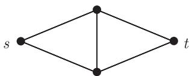

import Guide from '@/components/Guide.astro';
import Knowledge from '@/components/Knowledge.astro';
import Example from '@/components/Example.astro';
import Analysis from '@/components/Analysis.astro';
import Solution from '@/components/Solution.astro';
import Variant from '@/components/Variant.astro';
import Note from '@/components/Note.astro';
import Block from '@/components/Block.astro';
import Method from '@/components/Method.astro';
import Exercise from '@/components/Exercise.astro';

## 第6章 习题

<Exercise title="练习 1">
$^{-}$ 对 $|S|$ 用归纳证明命题 6.2.1.

<Solution title="提示">
+可能存在一个直接的归纳证明，但是并不容易 一定要保证在绘图中那些看起来不同或不相邻的顶点，在图中确实也是不同或不连接的。一个更简单但并不初等的证明可以从定理 6.5.3 得到
</Solution>
</Exercise>

<Exercise title="练习 2">
(i) $^{-}$ 给定 $n \in N$ ，给下面的网络寻找一个容量函数，使得在最大流最小割定理的证明中得到的算法，如果这些增广路的选取不理想的话，需要多于 n 条增广路 W.

<figure class="vp-figure">
  
</figure>

(ii) $^{+}$ 证明：如果选取所有增广路尽可能短，那么所需增广路的个数被这个网络节点个数的函数所限定.

<Solution title="提示">
(i) 在改进解的过程中，引导算法往返地反复使用中间的边

(ii) 在使用算法的每一步，对顶点 考虑最短的 $s { - } v$ 途径，它符合作为可扩路的 $s { - } v$ 的初始路段的条件证明:对每个顶点 $v ,$ 这个 $s { - } v$ 途径的长度在算法中不会减少其次，考虑一条边，它被可扩路使用并饱和了若干次.证明这些路的每一个都比前面的要长，然后推出想要的界

$3 . ^ { + }$ 对于边的形式，使用推理 6.2.3 把定理所提供的流归纳地转换成充分多个边不交的路对于顶点的形式，把每个顶点分离成两个相邻的顶点 $x ^ { - } , x ^ { + }$ ，并如下定义新图的边和容量:通过边 $x ^ { - } x ^ { + }$ 具有正值的流对应于在 中包含 的路
</Solution>
</Exercise>

<Exercise title="练习 3">
$^{+}$ 由最大流最小割定理推导 Menger 定理 (3.3.5).

(提示：边的形式容易证明．对于顶点的形式，构造一个适当的辅助图，然后应用边的形式.)
</Exercise>

<Exercise title="练习 4">
$^{-}$ 令 $f: \overrightarrow{E} \rightarrow H$ 是 G 上的一个环流, 且 $g: H \rightarrow H'$ 是一个群同态. 证明: $g \circ f$ 是 G 上的环流. 如果 f 是一个 H-流, 那么 $g \circ f$ 是一个 $H'$ -流吗?

<Solution title="提示">
由定义知 H-流是处处非零的
</Solution>
</Exercise>

<Exercise title="练习 5">
把图上取值于 $\mathbb{Z}_2$ 的环流所组成的群看成 $\mathbb{Z}_2$ 上的向量空间, 找到1.9节中的一个空间与这个空间之间的一个同构, 并给出这个显式同构.

<Solution title="提示">
考虑顶点度-
</Solution>
</Exercise>

<Exercise title="练习 6">
设 $H$ 是一个可交换群, $G = (V, E)$ 是一个连通图, 且 $T$ 是一棵支撑树, $f$ 是从 $E \setminus E(T)$ 的边定向到 $H$ 的一个映射并满足 (F1), 证明 $f$ 可以唯一地推广到 $G$ 的在 $H$ 中取值的环流上.

<Solution title="提示">
为了证明唯一性，考虑基本割.
</Solution>
</Exercise>

<Exercise title="练习 7">
(继续)

设 $\mathcal{V}_{H} = \mathcal{V}_{H}(G)$ 是所有 $V \to H$ 映射所组成的群，而 $\mathcal{E}_{H} = \mathcal{E}_{H}(G)$ 是所有满足 (F1) 的 $\overrightarrow{E} \to H$ 映射所组成的群，两个群都使用逐点加法。每个 $\varphi \in V_{H}$ 通过 $\psi(e, x, y) := \varphi(y) - \varphi(x)$ 来定义 $\psi \in E_{H}$ .

(i) 证明：这些 $\psi$ 组成 $\mathcal{E}_H$ 的一个子群 $\mathcal{B}_H = \mathcal{B}(G)$ 并且满足 $\mathcal{B}_H = \{\psi \in \mathcal{E}_H \mid \text{对每个定向圈} C \subseteq G, \text{有} \psi(\overrightarrow{C}) = 0\}$ , 这里 $\psi(\overrightarrow{C}) := \sum_{\vec{e} \in \overrightarrow{C}} \psi(\overrightarrow{e})$ .

(ii) 证明：每个满足 (F1) 的 $\overrightarrow{E} \rightarrow H$ 映射可以唯一地推广成 $\mathcal{B}_H$ 的一个映射.

<Solution title="提示">
(i) 给定 $\psi \in { \mathcal { D } } _ { H }$ 像定理 6.5.3 的证明中的着色 样构造 $\varphi \in { \mathscr { V } } _ { H }$

(ii) 基本圈也生成"具有定向的'圈空间

$8 . ^ { + }$ 明这个问题的一种方法是，证明。)中的两个群都同构于 $m + n - 1$ 的拷贝的直积，而(且)中的两个群都同构于 $n - 1$ 的拷贝的直职(和往常一样，这里 $n = | G |$ 而$m = | | G | | )$ I)我们不是直接定义自然的同构，而是找到一个具有核 $\boldsymbol { B } _ { H }$ 的满射 $\mathcal { E } _ { H } \longrightarrow \mathcal { C } _ { H }$ 以及一个具有核 $\mathcal { C } _ { H }$ 的满射 $\mathcal { E } _ { H } \to \mathcal { B } _ { H }$
</Solution>
</Exercise>

<Exercise title="练习 8">
$^{+}$ (继续)

设 $C_{H}$ 是 G 上取值于 H 的所有环流所组成的群.

(i) 证明: $\mathcal{E}_H / \mathcal{B}_H$ 同构于 $\mathcal{C}_H$ .

(ii) 证明: $\mathcal{E}_H / \mathcal{C}_H$ 同构于 $\mathcal{B}_H$ .
</Exercise>

<Exercise title="练习 9">
$^{-}$ 给定 $k \geqslant 1$ ，证明一个图包含 k-流当且仅当它的每个块包含 k-流.

<Solution title="提示">
使用定义以及命题 6.1.1
</Solution>
</Exercise>

<Exercise title="练习 10">
对任意一个多重图 $G$ 和 $G$ 的一条边 $e$ , 证明 $\varphi(G / e) \leqslant \varphi(G)$ . 这是否意味着, 对每个 $k$ , 所有具有 $k$ -流的多重图类在子式意义下是封闭的呢?

<Solution title="提示">
子图是否也可看作子式?
</Solution>
</Exercise>

<Exercise title="练习 11">
$^{-}$ 不利用书上的结果, 直接计算 $K^{4}$ 的流数.

对下面三个练习, 不使用六流定理 (6.6.1).

<Solution title="提示">
依次尝试 $k = 2 , 3 , \cdots$ .在寻找 流的过程中，暂时固定通过一条边的流值，然后考察这对相邻边的影响
</Solution>
</Exercise>

<Exercise title="练习 12">
证明：对每个无桥多重图 G，有 $\varphi(G) < \infty$ .

<Solution title="提示">
表达成圈的并
</Solution>
</Exercise>

<Exercise title="练习 13">
设 $G$ 是一个有 $n$ 个顶点和 $m$ 条边的无桥连通图. 通过考虑 $G$ 的一棵正规支撑树来证明 $\varphi(G) \leqslant m - n + 2$ .

<Solution title="提示">
一开始，通过树 外部的每条边发送小量的流.
</Solution>
</Exercise>

<Exercise title="练习 14">
假设图 $G$ 有 $m$ 棵支撑树, 使得 $G$ 中没有一条边位于所有这些支撑树中. 证明 $\varphi(G) \leqslant 2^m$ .

<Solution title="提示">
结合若干适当子图上的 $\mathbb { Z } _ { 2 } .$ 流来得到UG 上的流
</Solution>
</Exercise>

<Exercise title="练习 15">
证明：每个4-边连通的图有4-流.

<Solution title="提示">
利用前一个练习，并回忆树填装方面的知识
</Solution>
</Exercise>

<Exercise title="练习 16">
证明每个具有哈密顿圈的图包含4-流. (G的一个哈密顿圈 (Hamilton cycle) 是 $G$ 中一个包含所有顶点的圈.)

<Solution title="提示">
看成恰当选择的圈的并.
</Solution>
</Exercise>

<Exercise title="练习 17">
给定图 $G$ 的一族子图 (不一定两两不同), 如果 $G$ 中每条边恰好位于其中两个子图中, 就称这个子图族是 $G$ 的一个双覆盖 (double cover). 双圈覆盖猜想 (cycle double cover conjecture) 指出: 每个无桥多重图都有一个双圈覆盖. 对包含 4-流的图证明该猜想成立.

<Solution title="提示">
使用推论 6.3.2 和命题 .4.1.
</Solution>
</Exercise>

<Exercise title="练习 18">
$^{-}$ 确定 $C^{5} * K^{1}$ (即包含 5 根辐条的轮子) 的流数.

<Solution title="提示">
利用对偶性
</Solution>
</Exercise>

<Exercise title="练习 19">
找到一个无桥图 G 和 H = G - e 使得 $2 < \varphi(G) < \varphi(H)$ .

<Solution title="提示">
取成具有较大流数的圈，我们是否可以通过加边来减少它的流数呢?
</Solution>
</Exercise>

<Exercise title="练习 20">
不使用定理 6.3.3 证明命题 6.4.1.

<Solution title="提示">
使用 Euler 环游-
</Solution>
</Exercise>

<Exercise title="练习 21">
$^{+}$ 证明：一个平面三角剖分图是 3-可着色的当且仅当它的所有顶点度均是偶数.
</Exercise>

<Exercise title="练习 22">
证明：对平面多重图来说，三流猜想等价于 Grötzsch 定理 (5.1.3).

<Solution title="提示">
使用定理 6.5.3.
</Solution>
</Exercise>

<Exercise title="练习 23">
(i) $^{-}$ 证明四色定理和平面斯纳克的不存在性是等价的, 即每个无桥三正则平面多重图包含4-流.

(ii) 在 (i) 中的“无桥”能否换成“3-连通”呢？

<Solution title="提示">
(i) 使用定理 6.5.3

(均可以通过考虑最小的反例，证明 如果每一个 连通立方可平丽多重图是 ←边可着色的(所以有 流)，那么每一个无桥立方可平丽多重圈也是岳边可着色的.
</Solution>
</Exercise>

<Exercise title="练习 24">
$^{+}$ 证明图 $G = (V, E)$ 有一个 k-流当且仅当它具有一个定向 D，使得对每个 $X \subseteq V$ ，该定向在 $E(X, \overline{X})$ 中至少有 1/k 的边从 X 指向 $\overline{X}$ .

<Solution title="提示">
+ 对于"仅芽'部分，运用命题 6.1.1反过来，考虑 上的循环 $f ,$ 它取值在 $\{ 0 , \pm 1 , \cdots , \pm ( k -$ l)\} 中，并遵循给定的定向(即在 所决定的边定向上取正值或零)，并且在尽可能少的边上取零值.然后，如下证明 是处处非零的 如果 $e = s t \in E$ 上取零值且已在中的定向是从 自U $s ,$ ，定义网络 $N = ( G , s , t , c )$ 使得 中的每个具有正的总和的流的选择矛盾，但是 中的任何具有零容量的割与 所假定的性质矛盾
</Solution>
</Exercise>

<Exercise title="练习 25">
$^{-}$ 将 6-流定理 (6.6.1) 推广到多重图.

<Solution title="提示">
把给定的多重图转换成具有同样流性质的图
</Solution>
</Exercise>
