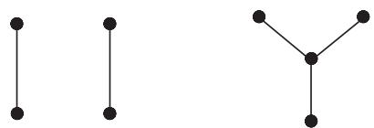
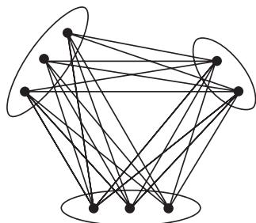
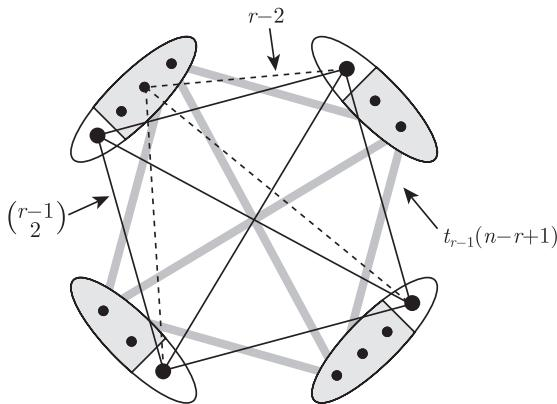

import Guide from '@/components/Guide.astro';
import Knowledge from '@/components/Knowledge.astro';
import Example from '@/components/Example.astro';
import Analysis from '@/components/Analysis.astro';
import Solution from '@/components/Solution.astro';
import Variant from '@/components/Variant.astro';
import Note from '@/components/Note.astro';
import Block from '@/components/Block.astro';
import Method from '@/components/Method.astro';
import Exercise from '@/components/Exercise.astro';

本章我们研究图的整体参数 (如边密度或色数) 对局部结构的影响. 例如, 对给定的整数 $r$, 多少条边可以保证 $n$ 个顶点的图无论边怎么放置都必须包含一个 $K^r$ 子图? 多少条边可以保证至少包含一个 $K^r$ 子式? 是否充分大的平均度或者色数可以保证其中一个子结构出现?

这种类型的问题是图论中非常自然的问题, 已经得到了一些深刻且有趣的结果. 这类问题统称为极值图论 (extremal graph theory).

极图问题从这种意义上说自然地分为下面两类: 如果寻找图的整体条件来确保一个图 $G$ 包含某个图 $H$ 作为它的子式 (或者拓扑子式), 那么我们只需把 $\|G\|$ 提高到 $|G|$ 的某个线性函数值之上, 即使得 $\varepsilon(G)$ 足够大. 到底 $\varepsilon$ 的值需要多大才能够确保想要的子式或者拓扑子式的存在, 这将是 7.2 节讨论的主题. 如果一个图的边数是它的顶点数的线性函数, 那么称这个图是稀疏的 $(\mathrm{sparse})^{1}$, 因此 7.2 节将致力于“稀疏极值图论”.

确保 $H$ 子式存在的一个特别有趣的方式是假设 $\chi(G)$ 是大的. 回忆一下, 如果 $\chi(G) \geqslant k + 1$, 那么 $G$ 包含一个子图 $G'$ 满足 $2\varepsilon(G') \geqslant \delta(G') \geqslant k$ (引理 5.2.3). 现在的问题是大的 $\chi$ 是否只能通过 $\varepsilon$ 间接地影响 $H$ 子式的存在, 或者是否 $\chi \geqslant k + 1$ 这一假设可以迫使图包含比假设 $2\varepsilon \geqslant k$ 更大的子式. 在 7.3 节中我们将看到 Hadwiger 猜想, 它断言 $\chi$ 有这样的特性. 这个猜想可以看作四色定理的推广, 也被很多学者认为是图论中最具挑战性的公开问题.

另一方面, 给定图 $H$, 如果要问什么样的整体条件可以蕴含子图 $H$ 的存在性, 那么提高不变量 $\varepsilon$ 或者 $\chi$ 的值并没有什么帮助, 更不用说第 1 章中所讨论的其他不变量, 这是因为只要 $H$ 包含圈, 就存在具有任意大色数的图不包含 $H$ 作为子图 (定理 5.2.5). 实际上, 除非 $H$ 是二部图, 如果函数 $f$ 使得具有 $f(n)$ 条边和 $n$ 个顶点的图一定包含一个子图 $H$, 那么 $f$ 必须是随着 $n$ 二次增长的 (为什么?).

边数是它的顶点数的二次函数的图叫做稠密图 (dense graph); 图 $G$ 实际包含的边数和潜在边数的比值 $\|G\| \big/ \binom{|G|}{2}$ 叫做 $G$ 的边稠密度 (edge density). 究竟需要多大的边稠密度才可以迫使图包含某个给定子图这一问题是极图问题的原型, 这是本章的第一个主题 (7.1 节). 试图总结“稠密极值图论”这一广泛研究领域, 不如把精力集中在最重要的两个结果: 我们首先证明 Turán 的关于 $H = K^r$ 的经典极值图论定理——这个结果作为一个范例启发了无数关于其他图 $H$ 的类似定理; 然后陈述 Erdős-Stone 的重要定理, 它一次性地给出了关于所有 $H$ 的准确渐近信息.

尽管 Erdős-Stone 定理可以用初等方法证明, 但是我们将利用证明这个定理的机会来展示一个强大的现代证明技巧, 即 Szemerédi 正则性引理, 近年来它已经极大地改变了极值图论的研究, 我们会在 7.4 节叙述和证明这个引理. 在 7.5 节, 我们总结了一下应用正则性引理的一般方法, 并对 Erdős-Stone 定理的证明进行演示. 正则性引理的另外一个应用在 9.2 节中给出.

## 7.1 子图

设 $H$ 是一个图且 $|H| \leqslant n$. 需要多少条边, 使得无论如何放置这些边, 所得到的 $n$ 个顶点的图都包含子图 $H$? 或者问题可以重新表述为: 一个 $n$ 个顶点的图, 如果它不包含 $H$ 作为子图, 那么它最多可能的边数是多少呢? 这样的图的外部特征是怎么样呢? 这样的图会是唯一的吗?

$n$ 个顶点的图 $G \not\supseteq H$, 如果它包含最多可能的边数, 就称它关于 $n$ 和 $H$ 是极值的 (extremal), 它的边数记作 $\mathrm{ex}(n, H)$. 显然, 任何关于某个 $n$ 和 $H$ 是极值的图 $G$, 也是关于 $H \not\subseteq G$ 边极大的. 反过来, 边极大性并不蕴含极值性: $G$ 完全可能是关于 $H \not\subseteq G$ 边极大的, 然而边数却少于 $\mathrm{ex}(n, H)$ (图 7.1.1).

<figure class="vp-figure">
  
  <figcaption>图 7.1.1 两个关于 $P^3 \not\subseteq G$ 边极大的图, 右边的图是极值的吗?</figcaption>
</figure>

作为一种特殊情形, 我们考虑 $H = K^r$ ($r > 1$) 时的问题. 经过短暂的思考, 我们就可以想到作为极值图的明显选择: 所有的 $(r - 1)$-部完全图是不包含 $K^r$ 的边极大图, 但是在这些图中, 边数最多的是哪一个呢? 显然, 是那些划分集的阶尽可能接近的图, 即它们每部分的元素个数相差至多为 1: 如果 $V_1, V_2$ 是两个划分集并满足 $|V_1| - |V_2| \geqslant 2$, 则我们可以通过从 $V_1$ 中移动一个顶点到 $V_2$ 中来增加 $(r - 1)$-部完全图的边数.

唯一的具有 $n \geqslant r - 1$ 个顶点的 $(r - 1)$-部完全图, 使得它的划分集之间大小差别至多为 1 的图, 我们称它为 Turán 图 (Turán graph), 并用 $T^{r-1}(n)$ 来表示它, 用 $t_{r-1}(n)$ 来表示它的边数 (图 7.1.2). 对于 $n < r - 1$, 形式上将继续使用这些定义, 但和以往的术语不同的是, 我们将允许划分集为空. 显然, 对所有的 $n \leqslant r - 1$ 有 $T^{r-1}(n) = K^n$.

<figure class="vp-figure">
  
  <figcaption>图 7.1.2 Turán 图 $T^3(8)$</figcaption>
</figure>

下面的定理表明 $T^{r - 1}(n)$ 关于 $n$ 和 $K^r$ 确实是极值的, 而且是唯一的. 特别地, $\mathrm{ex}(n, K^r) = t_{r - 1}(n)$.

<Knowledge title="定理 7.1.1 (Turán, 1941)">
对所有整数 $r, n$ 且 $r > 1$, 每个顶点数为 $n$ 且边数为 $\mathrm{ex}(n, K^r)$ 的图 $G \not\supseteq K^r$ 是 $T^{r-1}(n)$.

我们给出两个证明, 一个使用归纳法, 而另一个则使用一个简短而直接的局部论证.

<Solution title="第一个证明">
我们对 $n$ 用归纳法. 当 $n \leqslant r - 1$ 时, 有 $G = K^n = T^{r-1}(n)$. 在归纳步骤中, 令 $n \geqslant r$.

因为 $G$ 是一个不包含子图 $K^r$ 的边极大图, 所以 $G$ 有一个子图 $K = K^{r-1}$. 由归纳假设, $G - K$ 至多有 $t_{r-1}(n - r + 1)$ 条边, 且 $G - K$ 的每个顶点在 $K$ 中至多有 $r - 2$ 个邻点. 因此,

$$
\|G\| \leqslant t_{r-1}(n - r + 1) + (n - r + 1)(r - 2) + \binom{r-1}{2} = t_{r-1}(n), \tag{1}
$$

右边的等式可由 Turán 图 $T^{r-1}(n)$ 得到 (图 7.1.3).

<figure class="vp-figure">
  
  <figcaption>图 7.1.3 对于 $r = 5$ 和 $n = 14$, (1) 中的等式</figcaption>
</figure>

因为关于 $K^r$ 图 $G$ 是极值的 (并且 $T^{r-1}(n) \not\supseteq K^r$), 所以我们在 (1) 中取等式. 因此 $G - K$ 中每个顶点在 $K$ 中恰好有 $r - 2$ 个邻点——正如 $K$ 中的顶点 $x_1, \dots, x_{r-1}$ 那样. 对每个 $i = 1, \dots, r - 1$, 令

$$
V_i := \{v \in V(G) \mid v x_i \notin E(G)\}
$$

是 $G$ 在 $K$ 中有 $r - 2$ 个邻点, 但这些邻点不包括 $x_i$ 的所有顶点的集合. 因为 $K^r \not\subseteq G$, 所以每个集合 $V_i$ 是独立的, 并且它们划分 $V(G)$. 因此, $G$ 是 $(r - 1)$-部的. 因为 $T^{r-1}(n)$ 是唯一的有 $n$ 个顶点且边数最多的 $(r - 1)$-部图, 由 $G$ 的极值性假设得到 $G = T^{r-1}(n)$. ∎
</Solution>

在以上 Turán 定理的证明中, 推导的过程写得很紧凑, 技巧性很强, 看起来有点神奇. 然而, 仔细地观察一下, 就可以看出它是怎样从一开始的想法自然地进化而来的: 为了在 $G$ 中确定 $T^{r-1}(n)$ 结构, 我们使用子图 $K \simeq K^{r-1}$ 作为它的种子. 一旦固定了 $K$, 我们思考 $G$ 的余下部分怎样和 $K$ 连接, 然后注意到对每个 $v \in G - K$ 存在一个顶点 $x \in K$ 使得 $v x \notin E(G)$. 下一步, 看看 $G - K$ 的内部结构, 由归纳假设, 我们知道它的最多可能的边数是 $t_{r-1}(n - r + 1)$, 而且只有当 $G - K \simeq T^{r-1}(n - r + 1)$ 时才能达到. 但是, 我们并不知道 $G - K$ 确实有这么多条边: 事实上, 我们只知道 $G$ (不一定是 $G - K$) 在不包含 $K^r$ 子图的条件下具有尽可能多的边, 让 $G - K$ 拥有一个 $T^{r-1}(n - r + 1)$ 结构可能妨碍我们得到 $G - K$ 和 $K$ 之间我们所期待的边数. 事实上, 这个冲突并不会发生. 因为, 如果通过扩充 $K$ 的 $r - 1$ 顶点作为 $T^{r-1}(n)$ 的 $r - 1$ 个顶点族来构造图 $G$, 那么我们可以让 $G - K$ 拥有这个结构的同时拥有 $G - K$ 和 $K$ 之间的理论最大边数 (所有的边, 除了前面提到的必须不连接的顶点对 $\{v, x\}$). 由于这是唯一可以保证两个要求同时成立的方法, 所以 $T^{r-1}(n)$ 是 $n$ 个顶点不包含 $K^r$ 的唯一极图.

在 Turán 定理的第二个证明中, 我们将使用一个称为顶点复制 (vertex duplication) 的运算. 复制 (duplicate) 一个顶点 $v \in G$, 是指在 $G$ 上添加一个新顶点 $v'$, 并且将它只和 $v$ 的邻点相连 (但不和 $v$ 本身相连).

<Solution title="第二个证明">
我们已经看到, 在所有 $n$ 个顶点的 $k$-部完全图中, Turán 图 $T^k(n)$ 的边数最多, 并且它们的度数表明 $T^{r-1}(n)$ 比任何 $T^k(n)$ (这里 $k < r - 1$) 的边数要多, 所以只需证明 $G$ 是完全多部图即可.

如果 $G$ 不是完全多部图, 那么非邻接性不是 $V(G)$ 上的一个等价关系, 于是存在顶点 $y_1, x, y_2$ 使得 $y_1 x, x y_2 \notin E(G)$, 但是 $y_1 y_2 \in E(G)$. 如果 $d(y_1) > d(x)$, 则删去 $x$ 并复制 $y_1$ 会产生另一个比 $G$ 边数多且不包含 $K^r$ 的图, 这与 $G$ 的选取矛盾, 故 $d(y_1) \leqslant d(x)$; 类似地, $d(y_2) \leqslant d(x)$. 但同时删去 $y_1$ 和 $y_2$, 并且将 $x$ 复制两次, 就会产生一个边数比 $G$ 多但不包含 $K^r$ 的图, 再次与 $G$ 的选取矛盾. ∎
</Solution>
</Knowledge>

Turán 图 $T^{r-1}(n)$ 是稠密的, 在数量级上它大约有 $n^2$ 条边. 更确切地说, 对每个 $n$ 和 $r$, 我们有

$$
t_{r-1}(n) \leqslant \frac{1}{2} n^2 \frac{r-2}{r-1},
$$

当 $r - 1$ 整除 $n$ 时, 等式成立 (练习 7). 因此, 值得注意的是, 只需再多 $\epsilon n^2$ 条边 (对于任何固定的 $\epsilon > 0$ 和大的 $n$) 就不仅存在一个 $K^r$ 子图 (正如 Turán 定理那样), 而且对于任意给定的整数 $s$, 也包含一个 $K_s^r$ ——这个图包含大量的 $K^r$ 子图.

<Knowledge title="定理 7.1.2 (Erdős and Stone, 1946)">
对所有的整数 $r \geqslant 2$ 和 $s \geqslant 1$ 及每个 $\epsilon > 0$, 存在一个整数 $n_0$ 使得每个顶点数为 $n \geqslant n_0$, 边数至少为

$$
t_{r-1}(n) + \epsilon n^2
$$

的图包含子图 $K_s^r$.
</Knowledge>

作为如何运用正则性引理的一个实例, Erdős-Stone 定理的证明将在 7.5 节中给出, 但是也可以直接证明这个定理, 见注解中的参考文献.

Erdős-Stone 定理不仅本身有趣, 它还有一个非常有趣的推论. 事实上, 正是这个完全出乎意料的推论确立了这个定理在稠密图极值理论中作为一种元定理 (meta-theorem) 的地位, 并使之闻名于世.

给定一个图 $H$ 和一个整数 $n$, 考虑 $h_n := \mathrm{ex}(n, H) \big/ \binom{n}{2}$: 不包含 $H$ 的拷贝的 $n$ 个顶点图的最大边密度. 那么, 这个重要的密度是否基本上只是 $H$ 的函数, 使得当 $n \longrightarrow \infty$ 时 $h_n$ 收敛呢? 定理 7.1.2 回答了这个问题并给出了更多细节: $h_n$ 的极限是由 $H$ 的一个不变量 (即它的色数) 的非常简单的函数决定的.

<Knowledge title="推论 7.1.3">
对每个至少有一条边的图 $H$, 有

$$
\lim_{n \to \infty} \mathrm{ex}(n, H) \binom{n}{2}^{-1} = \frac{\chi(H) - 2}{\chi(H) - 1}.
$$
</Knowledge>

为了证明推论 7.1.3, 我们需要一个引理来说明 $t_{r-1}(n)$ 不会和它在 $r - 1$ 整除 $n$ 时 (见前面) 取得的值偏差太多, 因此 $t_{r-1}(n) \big/ \binom{n}{2}$ 也收敛. 引理的证明作为一个有提示的简单练习 (练习 8) 留给读者.

<Knowledge title="引理 7.1.4">
$$
\lim_{n \to \infty} t_{r-1}(n) \binom{n}{2}^{-1} = \frac{r-2}{r-1}.
$$
</Knowledge>

<Solution title="推论 7.1.3 的证明">
令 $r := \chi(H)$. 因为 $H$ 不能用 $r - 1$ 种颜色着色, 所以对所有 $n \in \mathbb{N}$, 我们有 $H \not\subseteq T^{r-1}(n)$, 因此

$$
t_{r-1}(n) \leqslant \mathrm{ex}(n, H).
$$

另一方面, 对所有充分大的 $s$ 均有 $H \subseteq K_s^r$, 所以对所有那些 $s$, 有

$$
\mathrm{ex}(n, H) \leqslant \mathrm{ex}(n, K_s^r).
$$

让我们固定一个这样的 $s$, 对每个 $\epsilon > 0$, 定理 7.1.2 蕴含着最终 (即对足够大的 $n$)

$$
\mathrm{ex}(n, K_s^r) < t_{r-1}(n) + \epsilon n^2
$$

成立. 所以对大的 $n$, 有

$$
\begin{aligned}
t_{r-1}(n) \Big/ \binom{n}{2} &\leqslant \mathrm{ex}(n, H) \Big/ \binom{n}{2} \\
&\leqslant \mathrm{ex}(n, K_s^r) \Big/ \binom{n}{2} \\
&< t_{r-1}(n) \Big/ \binom{n}{2} + \epsilon n^2 \Big/ \binom{n}{2} \\
&= t_{r-1}(n) \Big/ \binom{n}{2} + 2\epsilon \Big/ \left(1 - \frac{1}{n}\right) \\
&\leqslant t_{r-1}(n) \Big/ \binom{n}{2} + 4\epsilon \quad (\text{假定 } n \geqslant 2).
\end{aligned}
$$

因此, 由于 $t_{r-1}(n) \big/ \binom{n}{2}$ 收敛于 $\frac{r-2}{r-1}$ (引理 7.1.4), 所以 $\mathrm{ex}(n, H) \big/ \binom{n}{2}$ 也收敛于 $\frac{r-2}{r-1}$. ∎
</Solution>

对二部图 $H$, 推论 7.1.3 表明远比 $\binom{n}{2}$ 少的边数就足够保证子图 $H$ 的存在. 从而, 对依赖于 $r$ 的合适常数 $c_1, c_2$, 有

$$
c_1 n^{2 - \frac{2}{r+1}} \leqslant \mathrm{ex}(n, K_{r, r}) \leqslant c_2 n^{2 - \frac{1}{r}},
$$

下界是由随机图$^2$得到的, 上界的计算方法见练习 12. 如果 $H$ 是一个森林, 只要 $\varepsilon(G)$ 足够大就有 $H \subseteq G$, 所以 $\mathrm{ex}(n, H)$ 关于 $n$ 至多是线性的 (练习 14). 在 1963 年 Erdős 和 Sós 提出了一个猜想: 对任意具有边数 $k \geqslant 2$ 的树 $T$, $\mathrm{ex}(n, T) \leqslant \frac{1}{2}(k-1)n$. 作为对所有 $n$ 的一般界, 对每棵树 $T$, 这是最好的 (练习 15—练习 17).

一个相关的但是相当不同的问题是, 是否较大的 $\varepsilon$ 或者 $\chi$ 能保证一个图 $G$ 包含一棵给定的树作为它的导出子图. 当然, 为了使这个问题有意义, 我们需要增加一些额外的假设——例如, 不让 $G$ 只是一个大的完全图. 最弱的并有意义的假设是要求 $G$ 的团数是有界的 (即对某个固定的整数 $r, G \not\supseteq K^r$). 然而大的平均度仍旧不能保证导出子图 $T$ 的存在 (例如考虑完全二部图), 但是大的色数也许可以: 根据 Gyárfás (1975) 的著名猜想, 对每个 $r \in \mathbb{N}$ 和每棵树 $T$, 存在一个整数 $k = k(T, r)$, 使得每个满足 $\chi(G) \geqslant k$ 和 $\omega(G) < r$ 的图 $G$ 包含 $T$ 作为其一个导出子图.
