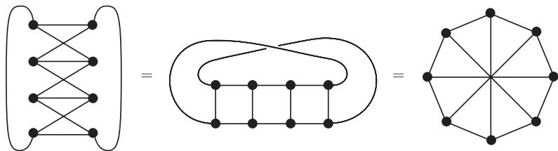

import Guide from '@/components/Guide.astro';
import Knowledge from '@/components/Knowledge.astro';
import Example from '@/components/Example.astro';
import Analysis from '@/components/Analysis.astro';
import Solution from '@/components/Solution.astro';
import Variant from '@/components/Variant.astro';
import Note from '@/components/Note.astro';
import Block from '@/components/Block.astro';
import Method from '@/components/Method.astro';
import Exercise from '@/components/Exercise.astro';

正如我们在 7.2 节中看到的那样, 平均度 $cr\sqrt{\log r}$ 足以保证任意图包含一个 $K^r$ 子式, 并且平均度 $cr^2$ 可保证任意图包含一个拓扑 $K^r$ 子式. 如果我们将上述的“平均度”改为“色数”, 那么在几乎相同的常数 $c$ 下, 这两个结果依然成立: 这是因为每个色数为 $k$ 的图有一个平均度至少为 $k - 1$ 的子图 (引理 5.2.3).

虽然上述两个函数, $cr\sqrt{\log r}$ 和 $cr^2$, 是关于“平均度”最好的 (如果忽略常数 $c$ 的因素), 但是问题是, 将条件改为“色数”后, 它们是否仍然是最好的, 或者是否对某个低增长的函数也会成立. 隐藏在这个问题背后的有关增长率的问题, 是关于不变量 $\chi$ 的一个根本性的问题: 这个不变量是否可以通过确保某个具体的子结构的存在性来对图产生某种直接的结构性影响呢? 或者它的影响不比在某处包含许多边这个“非结构”性质的影响大? 哪个平凡地成立呢?

一般子式或拓扑子式都不是这个问题的答案. 然而, 对一般子式, 下面的 Hadwiger 猜想给出了一个肯定的回答.

<Knowledge title="猜想 (Hadwiger, 1943)">
对每个整数 $r > 0$ 和每个图 $G$, 下面的蕴含关系成立:

$$
\chi(G) \geqslant r \Rightarrow G \succcurlyeq K^r.
$$
</Knowledge>

Hadwiger 猜想对 $r \leqslant 2$ 是平凡的, 对 $r = 3$ 和 $r = 4$ 也很容易证明 (留作练习), 当 $r = 5$ 和 $r = 6$ 时, 它与四色定理等价. 当 $r \geqslant 7$ 时, 这个猜想还没解决, 但是对线图 (练习 34) 和围长较大的图 (练习 32, 也可以参见推论 7.3.9), 它是成立的. 如果将 Hadwiger 猜想改述为 $G \succcurlyeq K^{\chi(G)}$, 那么它对几乎所有图$^3$都成立. 一般情况下, 猜想对 $r + 1$ 成立可以推出猜想对 $r$ 也成立 (留作练习).

对任意固定的 $r$, Hadwiger 猜想等价于下述结论: 每个不包含 $K^r$ 子式的图有一个 $(r - 1)$-着色. 在这个新的表述下, 猜想揭示了不包含 $K^r$ 子式的图的可能特征: 对这种图的非常细致的结构描述, 会帮助我们决定它是否可以被 $(r - 1)$-着色.

以 $r = 3$ 为例, 不包含 $K^r$ 子式的图恰好是森林 (为什么呢?), 它们确实是 2-可着色的. 当 $r = 4$ 时, 不包含 $K^r$ 子式的图也有一个简单的结构刻画.

<Knowledge title="命题 7.3.1">
具有至少 3 个顶点, 且不包含 $K^4$ 子式的图是边极大的当且仅当它可以从三角形开始通过沿 $K^2$ 粘贴$^4$来递归地构造.

<Solution title="证明">
首先回忆一下, 因为 $\Delta(K^4) = 3$, 故每个 $IK^4$ 包含一个 $TK^4$ (命题 1.7.3), 因此不包含 $K^4$ 子式的图就是那些不包含拓扑 $K^4$ 子式的图. 按照上述方法构造出来的图, 它是不包含 $K^4$ 子式的边极大图的证明, 我们留给读者作为一个简单的练习. 为了推导 Hadwiger 猜想对 $r = 4$ 成立, 我们只需要它的必要性, 通过对 $|G|$ 用归纳法来证明.

设 $G$ 是一个给定的不包含 $K^4$ 子式的边极大图. 如果 $|G| = 3$, 则 $G$ 本身是一个三角形. 在归纳步骤令 $|G| \geqslant 4$, 则 $G$ 不是完全的. 设 $S \subseteq V(G)$ 是一个阶为 $\kappa(G)$ 的分隔, $C_1$ 和 $C_2$ 是 $G - S$ 的两个不同分支. 因为 $S$ 是一个极小分隔, 所以 $S$ 中的每个顶点在 $C_1$ 和 $C_2$ 中均有邻点. 如果 $|S| \geqslant 3$, 这蕴含着在顶点 $v_1 \in C_1$ 和顶点 $v_2 \in C_2$ 之间, 图 $G$ 有 3 条独立路 $P_1, P_2, P_3$. 因为 $\kappa(G) = |S| \geqslant 3$, 所以 $G - \{v_1, v_2\}$ 是连通的, 并且包含一条介于两个不同 $P_i$ 之间的 (最短) 路 $P$, 于是 $P \cup P_1 \cup P_2 \cup P_3$ 是一个 $TK^4$, 矛盾.

因此 $\kappa(G) \leqslant 2$, 由引理 $4.4.4^5$ 和归纳假设, 结论成立. ∎
</Solution>
</Knowledge>

命题 7.3.1 的一个有趣推论是, 所有不包含 $K^4$ 子式的边极大图有相同的边数, 因此都是“极值的”.

<Knowledge title="推论 7.3.2">
每个不包含 $K^4$ 子式的边极大图 $G$ 有 $2|G| - 3$ 条边.

<Solution title="证明">
对 $|G|$ 用归纳法. ∎
</Solution>
</Knowledge>

<Knowledge title="推论 7.3.3">
当 $r = 4$ 时, Hadwiger 猜想成立.

<Solution title="证明">
如果 $G$ 可由 $G_1$ 和 $G_2$ 通过沿着一个完全图粘贴而得到, 则 $\chi(G) = \max\{\chi(G_1), \chi(G_2)\}$ (见命题 5.5.2 的证明). 所以, 根据对 $|G|$ 的归纳, 命题 7.3.1 蕴含着不包含 $K^4$ 子式的所有边极大图 (因此所有不包含 $K^4$ 子式的图) 是 3-可着色的. ∎
</Solution>
</Knowledge>

推论 7.3.3 也有一个简单直接的证明 (练习 33).

根据四色定理, $r = 5$ 时的 Hadwiger 猜想可以从下面的不包含 $K^5$ 子式的图的结构定理得到, 正如由命题 7.3.1 得到 Hadwiger 猜想对 $r = 4$ 成立一样. 定理 7.3.4 的证明与命题 7.3.1 的证明类似, 但是要长很多. 因此, 在这里我们只给出定理, 而不予证明.

<Knowledge title="定理 7.3.4 (Wagner, 1937)">
设 $G$ 是一个不包含 $K^5$ 子式的边极大图. 如果 $|G| \geqslant 4$, 则 $G$ 可以由平面三角剖分图和图 $W$ (图 7.3.1) 的拷贝沿三角形和 $K^2$ 递归地粘贴构造而成.
</Knowledge>

<figure class="vp-figure">
  
  <figcaption>图 7.3.1 Wagner 图 $W$ 的三种不同表示</figcaption>
</figure>

应用推论 4.2.10, 经过简单计算可以找到定理 7.3.4 构造的图中哪个具有最多边, 从而发现这些不包含 $K^5$ 子式的极图与不包含 $\{IK^5, IK_{3,3}\}$ 的极图 (即极大平面图) 相比, 前者的边数并不比后者多.

<Knowledge title="推论 7.3.5">
具有 $n$ 个顶点但不包含 $K^5$ 子式的图至多有 $3n - 6$ 条边.
</Knowledge>

由于 $\chi(W) = 3$, 所以定理 7.3.4 和四色定理蕴含着 Hadwiger 猜想对 $r = 5$ 成立.

<Knowledge title="推论 7.3.6">
当 $r = 5$ 时, Hadwiger 猜想成立.
</Knowledge>

Hadwiger 猜想当 $r = 6$ 时比 $r = 5$ 的情形要困难很多, 同样它也依赖于四色定理. 不使用四色定理的证明显示, 任意极小阶的反例都是通过在一个可平面图上增加一个顶点而得到, 但是由四色定理知它根本不是一个反例.

<Knowledge title="定理 7.3.7 (Robertson, Seymour and Thomas, 1993)">
当 $r = 6$ 时, Hadwiger 猜想成立.
</Knowledge>

前面提到过, Hadwiger 猜想带来的挑战是, 需要设计一个可以更好利用 $\chi \geqslant r$ 这一假设的证明技巧, 而不仅仅使用在一个合适子图中 $\delta \geqslant r - 1$ 的推论, 而我们知道这个合适子图不能保证一个 $K^r$ 子式 (定理 7.2.4). 迄今为止, 这样的技巧还没有找到.

如果我们决定仅使用 $\delta \geqslant r - 1$, 那么需要寻找什么样的额外假设才能使它包含一个 $K^r$ 子式呢? 定理 7.2.7 表明, 一个大围长的假设具有这个效果, 也可以参考练习 32. 事实上, 一个更弱的假设就足够了: 对任意固定的 $s \in \mathbb{N}$ 和所有足够大的仅依赖于 $s$ 的 $d$, 可以证明对于比 $d$ 大得多的 $r$, 平均度至少为 $d$ 的图 $G \not\supseteq K_{s,s}$ 包含一个 $K^r$ 子式. 对 Hadwiger 猜想, 这可以推出下面定理:

<Knowledge title="定理 7.3.8 (Kühn and Osthus, 2005)">
对每个整数 $s$, 存在一个整数 $r_s$, 使得对所有图 $G \not\supseteq K_{s,s}$ 以及 $r \geqslant r_s$, Hadwiger 猜想成立.
</Knowledge>

色数至少为 $r$ 的图包含 $K^r$ 作为一个拓扑子式, 这是 Hadwiger 猜想的加强形式, 即著名的 Hajós 猜想 (Hajós conjecture). 在一般情况下它是不成立的, 但是, 定理 7.2.7 蕴含着它对具有较大围长的图成立.

<Knowledge title="推论 7.3.9">
存在一个常数 $g$, 使得所有围长至少为 $g$ 的图满足下面的蕴含关系

$$
\chi(G) \geqslant r \Rightarrow \text{对所有的 } r, \text{ 有 } G \supseteq TK^r.
$$

<Solution title="证明">
设 $g$ 是定理 7.2.7 中的常数, 如果 $\chi(G) \geqslant r$, 则由引理 5.2.3 知, $G$ 有一个最小度 $\delta(H) \geqslant r - 1$ 的子图 $H$. 因为 $g(H) \geqslant g(G) \geqslant g$, 所以定理 7.2.7 蕴含着 $G \supseteq H \supseteq TK^r$. ∎
</Solution>
</Knowledge>
