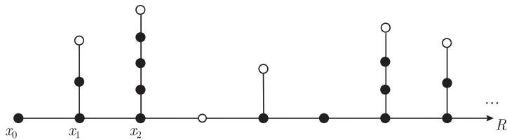
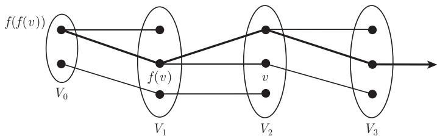
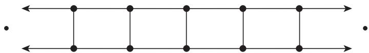
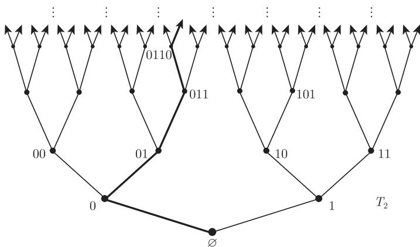

import Guide from '@/components/Guide.astro';
import Knowledge from '@/components/Knowledge.astro';
import Example from '@/components/Example.astro';
import Analysis from '@/components/Analysis.astro';
import Solution from '@/components/Solution.astro';
import Variant from '@/components/Variant.astro';
import Note from '@/components/Note.astro';
import Block from '@/components/Block.astro';
import Method from '@/components/Method.astro';
import Exercise from '@/components/Exercise.astro';

无限图的研究是图论中十分具有魅力的一个分支，但却时常被忽视. 这一章的目的是对它给出一个简介，首先介绍比较初等的，然后逐步地向不同方向展开，来展示它在各个方面的深度和广度. 我们的主题是突出当图是无限图时所出现的典型现象，并且展示它是如何引导出一些深刻而迷人的问题的.

最典型的现象往往在图“刚刚”变成无限图的时候就已经出现了，即当图只有可数多个顶点且每个顶点仅有有限多条边时. 这一现象并不奇怪：毕竟图的一些最基本的结构，例如路，本质上是可数的. 那些只对不可数图成立的有趣性质之所以成立，往往不是与图而是与集合密切相关的，这类问题属于组合集合论 (combinatorial set theory) 的研究范畴，也是一个很迷人的领域，但不是这一章的主题. 我们所考虑的问题都是关于可数图的有趣性质，集合论方面的问题不会涉及.

除了那些描述的性质在有限图中没有对应的术语外，这里所用的术语和有限图的术语是相同的. 一个重要的例子是，图中无限路在无限远处的行为，我们用术语**末端** (end) 来定义. 图的末端可以看作若干无限路在无限远处收敛的极限点. 为了严格地描述这种收敛性，我们需要使用定义在图和末端上的自然拓扑. 因此在 8.6—8.8 节，我们需要熟悉点集拓扑中的基本概念，相关定义的复习会在它们出现时给出.

## 8.1 基本的概念、结论和技巧

在这一节，我们将简单地介绍图论里经常出现的无限性方面的内容.[^1]

在给出少数几个定义后，我们首先看一看无限集上的一些明显性质，并了解它们如何在图中应用；然后举例说明在无限图论中如何运用三个最基本且常见的工具：Zorn 引理、超限归纳法和所谓的“紧致性”. 在这一节的结束，我们将对末端给出一个组合定义，关于它的拓扑含义将在 8.6 节中讨论.

如果一个图的所有顶点的度数都是有限的，就称它是**局部有限的** (locally finite). 一个具有以下形式的无限图 $(V, E)$，

$$
V = \{x_0, x_1, x_2, \dots\}, \quad E = \{x_0 x_1, x_1 x_2, x_2 x_3, \dots\}
$$

被称为**射线** (ray)；一条**双射线** (double ray) 是以下形式的无限图 $(V, E)$，

$$
V = \{\dots, x_{-1}, x_0, x_1, \dots\}, \quad E = \{\dots, x_{-1} x_0, x_0 x_1, x_1 x_2, \dots\}.
$$

在以上两个情况中，总是假设 $x_n$ 是不同的. 因此，在同构意义下，只存在一条射线和一条双射线，后者是唯一的无限 2-正则连通图. 在无限图中，有限路、射线和双射线都被称作**路** (path).

一条射线或双射线的子射线叫做**尾巴** (tail). 严格地讲，每一个射线都有无限多个尾巴，但是任何两个的差别只在于初始的有限长的一段. 把射线 $R$ 和无限多个互不相交的有限路结合起来，使得每条有限路的第一个顶点在 $R$ 上（没有其他顶点属于 $R$），那么这个图叫做**梳** (comb). 这些路上最后一个顶点叫做梳的**梳齿** (teeth)，而 $R$ 是它的**梳背** (spine). （我们也允许路是平凡的，这时，它的唯一顶点在 $R$ 上，而且也被称为梳齿，见图 8.1.1.）

<figure class="vp-figure">
  
  <figcaption>图 8.1.1 梳背为 $R = x_0 x_1 \dots$，梳齿为白色顶点的梳</figcaption>
</figure>

下面我们来看一下无限集的一些基本性质，并看它们在图的某些典型论证中是如何使用的.

$$
\text{无限集去掉一个有限子集后仍然是无限的.} \tag{1}
$$

当无限集在问题中充当着“供给”角色时，为了使得迭代过程能够继续下去，这个简单的性质就变得非常有用. 例如，我们要证明，如果图 $G$ 是无限连通的（也就是说，对每个 $k \in \mathbb{N}$，$G$ 是 $k$-连通的），那么 $G$ 包含一个 $K^{\aleph_0}$（即阶为 $|\mathbb{N}|$ 的完全图）的细分. 在构造无限序列[^2]的过程中，我们把 $K^{\aleph_0}$ 嵌入到 $G$ 中作为一个拓扑子式：首先列举出它的顶点，在每一步我们于 $G$ 中嵌入下一个顶点，并避免前面已经使用过的顶点，把新的顶点和它前面的邻点的象用 $G$ 中的路连接起来. 其中的要点是每条新路只需要避免有限多个前面用过的顶点，而这不成问题，因为去掉任何有限的顶点集合仍能保持 $G$ 是无限连通的.

如果 $G$ 也是可数的，那么我们能否在 $G$ 中找到一个 $T K^{\aleph_0}$ 作为它的支撑子图呢？尽管像上面那样把 $K^{\aleph_0}$ 拓扑地嵌入到 $G$ 中需要无限多步，但这并不能保证构造的 $T K^{\aleph_0}$ 使用了 $G$ 的所有顶点. 但确保这个条件并不难：因为在选择 $K^{\aleph_0}$ 的每个新顶点的象的时候是自由的，所以可以从 $V(G)$ 的某个固定列举中选取下一个没有用过的顶点. 用这种方法，$G$ 的每个顶点最终都被选择了，除非在此之前，它已经作为 $T K^{\aleph_0}$ 中一条路上的细分顶点出现过.

$$
\text{可数多个可数集合的并仍然是可数的.} \tag{2}
$$

这个事实有两种不同的运用方法：一方面它说明可数个集合的并还是个“小”集合；另一方面，也可以有目的地把一个可数集合写成无限个互不相交的无限子集的并. 对后面这类应用的例子，让我们来证明一个无限边连通的可数图包含无限多个边不交的支撑树（注意到，逆命题显然成立）. 窍门是在步骤的无限序列中，同时构造这些树：首先运用 (2) 把 $\mathbb{N}$ 划分成无限多个无限子集 $N_i\ (i \in \mathbb{N})$，然后在第 $n$ 步，我们找出哪个 $N_i$ 包含 $n$，并在第 $i$ 个树 $T_i$ 上加上顶点 $v$. 像前面一样，我们在 $V(G)$ 的某个固定列举中选择没有在 $T_i$ 中出现的极小 $v$，并通过一条避免有限多条已用边的路把 $v$ 连到 $T_i$ 上.

显然，一个可数集合不能有不可数多个互不相交的子集. 然而，

$$
\text{一个可数集合可以有不可数多个子集，它们两两的交都是有限的.} \tag{3}
$$

这是可数集的一个重要性质，是对不成熟的猜想构造反例的一个很好来源. 不参考图 8.1.4，你能证明这一事实吗？

在处理无限集时，另外一个常见的陷阱是，假设无限集（或不可数集）的一个无限嵌套序列 $A_0 \supseteq A_1 \supseteq \cdots$ 的交一定还是无限的（或不可数的）. 但这不一定成立，事实上它可能是空的.（能否找出一个例子？）

在讨论常用的无限证明技巧前，让我们看一看另外一类构造. 我们经常需要构造一个图 $G$，它具有某种局部性质，这种性质更多地与 $G$ 的有限子图有关，而不是和 $G$ 本身有关. 尝试对这个问题进行严格的叙述，不如考虑一个例子：给定两个大的整数 $k$ 和 $g$，构造一个 $k$-连通而且围长至少为 $g$ 的图 $G$.[^3]

我们从长度为 $g$ 的圈（记它为 $G_0$）开始. 这个图有合适的围长但不是 $k$-连通的. 为了纠正这个缺陷，把 $G_0$ 的每对顶点用 $k$ 条新的独立路连接起来，让所有这些路是内部不交的. 如果我们选择的这些路足够长，那么得到的图 $G_1$ 的围长还是 $g$，而且 $G_0$ 的任何两个顶点都不能被少于 $k$ 个其他顶点所分离. 当然，$G_1$ 也不是 $k$-连通的. 然而，我们可以对 $G_1$ 的每对顶点重复这个构造，把 $G_1$ 拓展成 $G_2$，等等. 极限图 $G = \bigcup_{n \in \mathbb{N}} G_n$ 的围长还是 $g$，否则，短圈会出现于这个过程中的某个 $G_n$ 中，矛盾. 和所有的 $G_n$ 不同，极限图是 $k$-连通的：因为任何两个顶点包含于某个共同的 $G_n$ 中，它们不能被少于 $k$ 个 $G_{n+1}$ 中的其他顶点（更不用说 $G$ 中的顶点）所分离.

在无限组合论中，有几个经常用到的基本证明技巧，而最常见的两个就是 Zorn 引理的运用和超限归纳法. 我们通过一个简单的例子来说明它们的应用，这也许胜于对它们进行正式的描述.[^4]

<Knowledge title="命题 8.1.1">
每个连通图都包含一棵支撑树.

<Solution title="第一个证明（通过 Zorn 引理）">
给定连通图 $G$，考虑所有树 $T \subseteq G$ 的集合，集合中按照子图的关系排序. 因为 $G$ 是连通的，所以任何一棵极大树包含 $G$ 的所有顶点，也就是说，是 $G$ 的一棵支撑树.

为了证明极大树的存在，我们需要证明这些树的任何一个链 $\mathcal{C}$ 都有上界，即存在一棵树 $T^* \subseteq G$，它包含 $\mathcal{C}$ 中每棵树作为子图. 我们断言 $T^* := \bigcup \mathcal{C}$ 就是一棵这样的树.

为了证明 $T^*$ 是连通的，设 $u, v \in T^*$ 是任意两个顶点，那么在 $\mathcal{C}$ 中存在包含 $u$ 的树 $T_u$ 和包含 $v$ 的树 $T_v$，其中一个是另一个的子图，不妨设 $T_u \subseteq T_v$，那么 $T_v$ 包含一条从 $u$ 到 $v$ 的路，这条路也包含在 $T^*$ 中.

下一步证明 $T^*$ 是无圈的. 假设它包含一个圈 $C$，那么 $C$ 中的每条边都在 $\mathcal{C}$ 的某个树中，这些树就形成了 $\mathcal{C}$ 的一个有限链，它有一个极大元素 $T$，从而 $C \subseteq T$，矛盾. ∎
</Solution>

超限归纳法和递归方法，分别与有限归纳证明和构造方法非常类似. 基本上是一步接一步地做下去，在每一步可以把前面已经证明或构造了的作为已知. 唯一不同的是，这里进行了任何无限多步后还可以“重新开始”. 严格地讲，就是在计算步骤数时，我们使用序数而不是自然数，见附录 A.

如同在有限图中一样，通常一步一步地去构造想要的对象（例如一棵支撑树）会更直观，这比一开始取定某个未知的“极大”对象，然后再证明它具有需要的性质更好. 更重要的是，一步接一步的构造方法，几乎总是寻找所要的对象的最好方法：只有后来，当你充分理解了它的构造后，才能想出一个归纳顺序（使得它的链有上界），在这个顺序中想要的目标作为它的极大元出现. 因此，尽管 Zorn 引理有时可以提供一个漂亮的方法来总结构造证明，但它一般不能代替通过超限归纳法所得到的深刻理解——正如，在有限情形中，我们偏爱漂亮的直接证明，但这也不能代替更通俗的算法处理.

命题 8.1.1 的第二个证明以典型的方式阐明了超限归纳法的构造和证明的不同：我们递归地定义越来越大的子图 $T_\alpha \subseteq G$，在第 $\alpha$ 步，证明 $T_\alpha$ 是一棵树. 假定对所有的 $\beta < \alpha$，子图 $T_\beta$ 已经定义，同时还需要假设它们是嵌套树，然后运用这些假定来定义 $T_\alpha$. 所以，嵌套树这一事实需要在递归定义进行的同时进行证明，“恰好”在需要使用之前来证明.

<Solution title="第二个证明（通过超限归纳法）">
设 $G$ 是一个连通图. 我们递归地定义树 $T_\alpha \subseteq G$ 使得

$$
\text{对所有的 } \beta < \alpha, \text{ 有 } T_\beta \subseteq T_\alpha. \tag{$*_\alpha$}
$$

设 $T_0$ 只包含一个孤立顶点. 给定极限序数 $\alpha > 0$，令 $T_\alpha := \bigcup_{\beta < \alpha} T_\beta$. 因为 $T_\beta$ 是满足 ($*_\beta$) 的树，新的 $T_\alpha$ 也是一棵树（和第一个证明一样），显然它满足 ($*_\alpha$).

给定后继 $\alpha = \beta + 1$，先看 $G - T_\beta = \emptyset$ 是否成立. 如果成立，则 $T_\beta$ 是一棵支撑树，我们可以终止递归；如果不成立，则 $G - T_\beta$ 包含一个顶点 $v_\alpha$，它通过边 $e_\alpha$ 和 $T_\beta$ 中的一个顶点邻接. 那么，在 $T_\beta$ 上添加 $v_\alpha$ 和 $e_\alpha$ 所得到的 $T_\alpha$ 是满足 ($*_\alpha$) 的树.

剩下需要证明的是，这个递归确实终止. 否则，如果对所有 $\beta < \gamma$，$v_{\beta+1}$ 已经定义，那么 $\beta \mapsto v_{\beta+1}$ 是一个单射，所以 $|\gamma| \leqslant |G|$，然而这不可能对所有的序数 $\gamma$ 都成立，例如，当 $\gamma$ 代表 $V(G)$ 的幂集的良序时，这就不成立. ∎
</Solution>
</Knowledge>

为什么这些证明看起来是如此自然流畅呢？原因就是这里的禁用子结构是圈，它是有限的，所以不能在极限步骤意外地出现. 另一方面，如果我们想构造一个没有射线（即不包含任何射线）的支撑树，那么当 $\alpha$ 取极限值时，部分有限树 $T_\beta$ 的边可能组合成 $T_\alpha = \bigcup_{\beta < \alpha} T_\beta$ 中的一条射线. 事实上，在大多数超限构造中，这都是个挑战：在后继步骤中需要做出一个正确选择，以确保在极限时也存在所需要的结构.

我们的第三个基本证明技巧似乎有点神秘，它被称为**紧致性** (compactness)（原因见下面的解释）. 在某些标准的情形，它为正确的选择提供了一个形式上的方法. 标准的情形是指达到极限时没有意外现象出现，然而和圈的生成不同，有的选择现在看起来不错，但在有限步后，可能走到一条死胡同.

举个例子，设图 $G$ 的所有有限子图都是 $k$-可着色的，那么自然地想去构造一个 $G$ 的 $k$-着色，作为它的有限子图 $k$-着色的极限. 现在每个有限子图可以有若干 $k$-着色，我们选择哪个 $k$-着色有关系吗？显然有关系，当 $G' \subseteq G''$ 是两个有限子图时，$u, v$ 是 $G'$ 中的两个顶点并在 $G''$ 的任意 $k$-着色里着相同的颜色（因此在任何 $G$ 的 $k$-着色中颜色也是一样），在 $G'$ 的每个着色中，我们不能给它们着不同的颜色，即使这样的着色存在. 然而，如果通过某种方法给 $G$ 的所有有限子图着上相容的颜色，那么将自动地得到 $G$ 的所有顶点的一个着色.

所有的紧致性证明的处理方法都和这个十分类似：我们希望解决一个关于无限结构的问题，并且知道如何解决所有有限子结构的情形，“紧致性”使得我们可以结合这些部分解答得到整个问题的答案，如果这些部分解答是互相协调的话.

对于可数结构，所有这些关于有限解的选择、不成功尝试、兼容性的要求，以及如何组合成整体答案，都可以通过一个图看清楚而且相当直观.

<Knowledge title="引理 8.1.2（König 无限引理）">
设 $V_0, V_1, \dots$ 是一个互不相交的非空有限集合的无限序列，而 $G$ 是这些集合并上的一个图. 对 $n \geqslant 1$，假设 $V_n$ 中的每个顶点 $v$ 有个邻点 $f(v)$ 在 $V_{n-1}$ 中，那么 $G$ 包含一条射线 $v_0 v_1 \dots$ 使得对所有的 $n$，都有 $v_n \in V_n$.

<figure class="vp-figure">
  
  <figcaption>图 8.1.2 König 无限引理</figcaption>
</figure>

<Solution title="证明">
设 $\mathcal{P}$ 是结束于 $V_0$ 并且形如 $v f(v) f(f(v)) \dots$ 的所有有限路的集合. 因为 $V_0$ 是有限的，而 $\mathcal{P}$ 是无限的，所以 $\mathcal{P}$ 中有无限多个路结束于同一个顶点 $v_0 \in V_0$；在这些路中，由于 $V_1$ 是有限的，因此其中有无限多条路的倒数第二个顶点是同一个顶点 $v_1 \in V_1$；在这些路中，又有无限多条在 $V_2$ 中使用相同的顶点 $v_2$，等等. 虽然一步步地下去，所考虑的路集合在减少，但在任何有限步后，它仍然是无限的，所以对每个 $n \in \mathbb{N}$，我们可以定义 $v_n$. 由定义，每个顶点 $v_n$ 都和某个路中的顶点 $v_{n-1}$ 相连接，所以 $v_0 v_1 \dots$ 确实是一条射线. ∎
</Solution>
</Knowledge>

下面的“紧致性定理”是图论中第一次出现的此类定理，它回答了前面提到的着色问题：

<Knowledge title="定理 8.1.3（de Bruijn and Erdős, 1951）">
设 $G = (V, E)$ 是一个图，且 $k \in \mathbb{N}$. 如果 $G$ 的每个有限子图的色数最多为 $k$，那么 $G$ 的色数也最多为 $k$.

<Solution title="第一个证明（$G$ 是可数的，通过无限引理证明）">
设 $v_0, v_1, \dots$ 是 $V$ 的一个列举，且 $G_n := G[v_0, \dots, v_n]$. 对颜色集合 $\{1, \dots, k\}$，记 $V_n$ 是 $G_n$ 中使用颜色 $\{1, \dots, k\}$ 所得到的所有 $k$-着色的集合. 在 $\bigcup_{n \in \mathbb{N}} V_n$ 上定义一个新的图，它的边集是所有的 $c c'$，这里 $c \in V_n$ 而 $c' \in V_{n-1}$ 是把 $c$ 限制在 $\{v_0, \dots, v_{n-1}\}$ 上的着色. 设 $c_0 c_1 \dots$ 是这个图的一条射线，使得对所有的 $n$ 有 $c_n \in V_n$，那么 $c := \bigcup_{n \in \mathbb{N}} c_n$ 就是使用颜色 $\{1, \dots, k\}$ 的一个着色. ∎
</Solution>

正如从上个证明中看到的那样，无限引理的运用依赖于“可数图可以被一个有限子图的嵌套序列来穷举”这一事实. 附录 A 给出了无限引理的另一个版本，它适用于任意图，并且不要求这些有限子图被序列化地排列. 这个广义版本依然十分直观，并且可以方便地运用到很多不同情形，包括定理 8.1.3 的证明.

紧致性证明的本质是，我们可以经常把问题更直接地转换成用集合和函数表达的形式，而更少地使用图的术语. 附录 A 中的**紧致性原理** (compactness principle) 就是这样一个版本，它特别好用. 下面我们给出定理 8.1.3 的另外一个证明来展示如何应用它.

<Solution title="第二个证明（对任意图，通过紧致性原理证明）">
设 $X := V$ 和 $S := \{1, \dots, k\}$，而 $\mathcal{F}$ 表示 $V$ 的所有有限子集的集合. 对每个 $Y \in \mathcal{F}$，设 $\mathcal{A}(Y)$ 是 $G[Y]$ 的 $k$-着色的集合. 为了证明定理 8.1.3，我们只需找到一个从 $V$ 到 $\{1, \dots, k\}$ 的函数，它在每个有限子图 $G[Y]$ 上导出一个 $k$-着色，因为显然这样的函数是 $G$ 的一个 $k$-着色.

根据紧致性原理，只需证明对任意给定有限集合 $\mathcal{Y} \subseteq \mathcal{F}$，可以找到一个从 $V$ 到 $\{1, \dots, k\}$ 的函数，它在每一个 $G[Y]$ 上导出一个着色（这里 $Y \in \mathcal{Y}$）. 然而这显然成立：只需取定有限图 $G[\bigcup \mathcal{Y}]$ 的一个 $k$-着色，然后把它任意地拓展到 $V$ 的其他部分即可. ∎
</Solution>

定理 8.1.3 的最后一个证明直接和拓扑中定义的紧致性有关. 前面提到，如果拓扑空间的闭集具有“有限交性质”（即对闭集的集合 $\mathcal{A}$，只要 $\mathcal{A}$ 的任意有限个子集有非空交，则 $\mathcal{A}$ 的所有集合的交 $\bigcap \mathcal{A}$ 也是非空的），那么这个空间是**紧致的** (compact). 由点集拓扑学的 Tychonoff 定理知，在通常的乘积拓扑里，任何紧致空间的乘积仍然是紧致的.

<Solution title="第三个证明（对任意图 $G$，通过 Tychonoff 定理证明）">
考虑 $|V|$ 个有限集 $\{1, \dots, k\}$ 的乘积空间

$$
X := \prod_{V} \{1, \dots, k\} = \{1, \dots, k\}^V
$$

所形成的离散拓扑. 由 Tychonoff 定理知，这是一个紧致空间. 它的基本开集具有形式

$$
O_h := \{f \in X \mid f|_U = h\},
$$

这里 $h$ 是从有限集 $U \subseteq V$ 到 $\{1, \dots, k\}$ 的一个映射.

对每个有限集 $U \subseteq V$，设 $A_U$ 是所有 $f \in X$ 的集合，其中 $f$ 在 $U$ 的限制是图 $G[U]$ 的一个 $k$-着色. 这些集合 $A_U$ 是闭的（也是开的，为什么？），设 $\mathcal{U}$ 是一个有限集合，它的元素是 $V$ 的有限子集，那么 $\bigcap_{U \in \mathcal{U}} A_U \neq \emptyset$，这是因为 $G[\bigcup \mathcal{U}]$ 有一个着色. 由集合 $A_U$ 的有限交性质知，它们的全部交也是非空的，并且这个交中的每个元素都是 $G$ 的一个 $k$-着色. ∎
</Solution>
</Knowledge>

尽管这三个紧致性证明形式上不一样，但是在细节上对它们进行比较是有益的，检验一下每个证明中的要求是如何在另一个证明中反映出来的（见练习 16）.

前面已经提到，紧致性证明的标准用法是把有限图中的定理推广到无限图，或者反过来. 但并不总是像上面那样简单直接，我们经常需要对命题进行稍微的修改才能适用紧致性的论证.

举个例子（更多的见练习 17—练习 28），让我们来证明下面这个著名猜想的局部有限形式. 给定一个图的顶点二部划分，如果每个顶点在另一个部分的邻点数至少和在自身部分的邻点数一样多，那么我们称这个二部划分是**不友好的** (unfriendly). 显然，每个有限图有一个不友好的划分：只要选择使得这两部分之间的边最多的划分即可. 另一个极端的情形是，可以通过集合论的方法来证明不可数的图不一定存在这样的划分，然而令人费解的是，对于可数的情形仍然没有解决.

<Knowledge title="不友好划分猜想">
每个可数图都有一个不友好的顶点集划分.

<Solution title="对可数局部有限图的证明">
设 $G = (V, E)$ 是一个局部有限的无限图，它的顶点可以列举为 $v_0, v_1, \dots$. 对每个 $n \in \mathbb{N}$，把 $V_n := \{v_0, \dots, v_n\}$ 划分为两个集合 $U_n$ 和 $W_n$，使得任何满足 $N_G(v) \subseteq V_n$ 的顶点 $v \in V_n$ 在另一部分的邻点至少与在自身部分的邻点数一样多，记 $\mathcal{V}_n$ 是这样的划分的集合. 因为这个猜想对有限图成立，所以 $\mathcal{V}_n$ 是非空的. 对所有的 $n \geqslant 1$，每个 $(U_n, W_n) \in \mathcal{V}_n$ 导出 $V_{n-1}$ 的一个划分 $(U_{n-1}, W_{n-1})$，它属于 $\mathcal{V}_{n-1}$ 中. 由无限引理，存在一个划分 $(U_n, W_n) \in \mathcal{V}_n$ 的无限序列，对每个 $n \in \mathbb{N}$ 有一个划分，使得每个是由下一个导出的. 那么 $(\bigcup_{n \in \mathbb{N}} U_n, \bigcup_{n \in \mathbb{N}} W_n)$ 就是 $G$ 的一个不友好划分. ∎
</Solution>
</Knowledge>

使得这个证明成为可能的诀窍是，对 $V_n$ 的划分，把那些没有边连到 $V_n$ 外的顶点放在恰当的位置. 为了确保从 $\mathcal{V}_n$ 的划分能导出 $\mathcal{V}_{n-1}$ 的划分，这个弱化是必要的；根据局部有限性，由于每个顶点最终都有这个性质（对足够大的 $n$），所以这个弱化的假设足以保证极限划分是不友好的.

作为这一节的结束，让我们考虑一个在无限图理论中重要，而有限图中没有的概念——**末端**. 图 $G$ 的**末端** (end)[^5] 是指 $G$ 的射线的一个等价类，这里我们称两条射线是等价的，如果对每个有限集合 $S \subseteq V(G)$，两条射线在 $G - S$ 的同一个分支里都有一个尾巴. 注意，这确实是一个等价关系：因为 $S$ 是有限的，所以对每条射线仅有一个这样的分支. 如果两个射线是等价的，它们才能被无限多个互不相交的路连接起来：只需归纳地选择这些路，把 $S$ 取作最初的有限多条路的顶点集合的并，然后去寻找下一个路. $G$ 的末端集合记作 $\Omega(G)$. 我们用 $G = (V, E, \Omega)$ 表示具有顶点集 $V$、边集 $E$ 和末端集合 $\Omega$ 的图 $G$.

举个例子，让我们决定图 8.1.3 中的 2-道路无限梯的末端. 在这个图中，每条射线要么包含左边无限远顶点，要么包含右边无限远顶点，但不同时包含两者. 这两类射线显然均为等价类，所以这个梯恰有两个末端. （在图 8.1.3 中，末端被表示为两个孤立的黑点，一个在左边，另一个在右边.）

<figure class="vp-figure">
  
  <figcaption>图 8.1.3 2-道路无限梯有两个末端</figcaption>
</figure>

树的末端特别简单：树的两条射线是等价的当且仅当它们共享一个尾巴；对每个固定的顶点 $v$，每个末端恰好包含一个以 $v$ 为始点的射线. 即使一个局部有限的树也可能有不可数多个末端. 最早的例子（见练习 37）是**二叉树** (binary tree) $T_2$，它是每个顶点恰好有两个上邻点的有根树. $T_2$ 的顶点集合经常被取成有限 0-1 序列的集合（空序列作为根），正如图 8.1.4 中所显示的那样. 从而 $T_2$ 的末端在一个双射下，对应着以 $\emptyset$ 为始点的射线，因此也对应着无限的 0-1 序列.

<figure class="vp-figure">
  
  <figcaption>图 8.1.4 二叉树 $T_2$ 有连续统多个末端，每个对应于一个无限的 0-1 序列</figcaption>
</figure>

这些例子表明图的末端可以看作射线“在无穷远处收敛的点”，我们将在 8.5 节正式定义它，那里我们定义图上的一个自然拓扑和它的末端，使得射线确实收敛到它们各自的末端.

在末端中不交射线的最多条数是这个末端的（组合）**顶点度数** ((combinatorial) vertex-degree)，末端中边不交射线的最多条数是这个末端的（组合）**边度数** ((combinatorial) edge-degree). 这些最大值确实是可以达到的：对于每个整数 $k$，如果一个末端包含 $k$ 条（边）不交射线的集合，那么它也包含（边）不交射线的无限集合（练习 43）. 因此在 $\mathbb{N} \cup \{\infty\}$ 中，每个末端有一个顶点度数和边度数.

[^1]: 在这一介绍性的章节中，我们有意地使用非正式的叙述方式，以便突出思想而不是概念，而且这些概念本来也不属于图论. 关于无限集和数的基本定义，在本书末的附录 A 中，我们会给出更正式的回顾.
[^2]: 我们专为使用自然数集合作为指标的序列来保留术语“无限序列”.（用良序集的语言说：它是阶为 $\omega$ 的序列.）
[^3]: 存在有限多个这样的图，但构造起来比较困难，在 11.2 节我们将运用随机方法证明它的存在性.
[^4]: 在附录 A 中，对这两个方法给出了简单的介绍，以便读者有足够的信心在实战中运用它们.
[^5]: 译者注：此处原文加注解释“end”在有限图和无限图中的不同用法. 因为中文翻译中，有限图边的“end”译作“端点”，而无限图的“end”译作“末端”，没有混淆的可能，所以删除此注.
