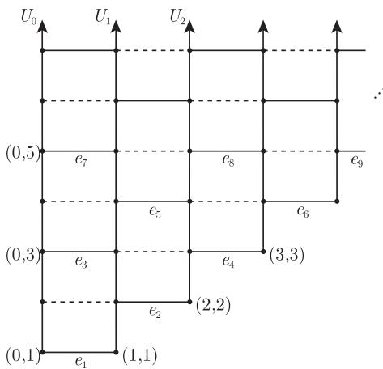
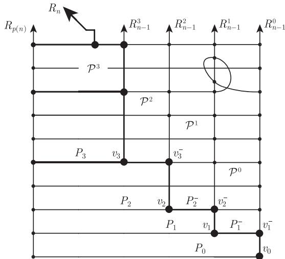

import Guide from '@/components/Guide.astro';
import Knowledge from '@/components/Knowledge.astro';
import Example from '@/components/Example.astro';
import Analysis from '@/components/Analysis.astro';
import Solution from '@/components/Solution.astro';
import Variant from '@/components/Variant.astro';
import Note from '@/components/Note.astro';
import Block from '@/components/Block.astro';
import Method from '@/components/Method.astro';
import Exercise from '@/components/Exercise.astro';

无限连通图的无限性包含两方面根本不同的性质：其一是“长度”，用射线来表示；其二是“宽度”，用无限度数来局部地表示. 无限引理告诉我们这两种性质的一个一定出现：

<Knowledge title="命题 8.2.1">
每个无限连通图包含一个具有无限度数的顶点或一条射线.

<Solution title="证明">
设 $G$ 是一个无限连通图，其所有顶点的度数均为有限. 设 $v_0$ 是一个顶点，对每个 $n \in \mathbb{N}$，令 $V_n$ 为与 $v_0$ 距离为 $n$ 的顶点集. 对 $n$ 进行归纳可证明，集合 $V_n$ 为有限集，所以 $V_{n+1} \neq \varnothing$ (因为 $G$ 是无限且连通的). 进一步地，顶点 $v \in V_{n+1}$ 在任意一条最短 $v\text{-}v_0$ 路上的邻点都包含在 $V_n$ 中. 由引理 8.1.2，$G$ 包含一条射线. ∎
</Solution>
</Knowledge>

如果能获得更多有关这条射线或具有无限度数的顶点在 $G$ 中位置的详细信息，将会对以后的研究有用. 从下面的引理可以看到，它们离任意给定的无限顶点集“很近”.

<Knowledge title="引理 8.2.2 (星-梳引理)">
设 $U$ 为连通图 $G$ 的一个顶点无限集，则 $G$ 要么包含一个梳，它的梳齿均在 $U$ 中，要么包含一个无限星图的细分，其所有叶子点均在 $U$ 中.

<Solution title="证明">
我们首先考虑一族满足下列性质的树 $T$：树 $T$ 的每条边都属于 $T$ 中某条连接 $U$ 中两个顶点的路上. 由于 $G$ 是连通的，所以它包含一条连接 $U$ 中两个顶点的路. 因此这条路是满足性质的一棵树 $T \subseteq G$，故这个族非空. 由 Zorn 引理，存在一棵满足这个性质的极大树 $T^*$. 因为 $U$ 是无限的且 $G$ 是连通的，故 $T^*$ 是无限的. 如果 $T^*$ 包含一个无限度的顶点，则它包含所要的星图的细分.

现在假设 $T^*$ 是局部有限的，则 $T^*$ 包含一条射线 $R$ (命题 8.2.1). 我们构造 $T^*$ 中不交的 $R\text{-}U$ 路序列 $P_1, P_2, \dots$. 对某个 $n$，在选定了所有 $i < n$ 的 $P_i$ 后，选择 $v \in R$ 使得 $vR$ 与这些路 $P_i$ 均不相交. $vR$ 的首条边位于连接 $U$ 的两个顶点且包含在 $T^*$ 中的一条路 $P$ 上. 我们将 $P$ 看作沿着 $R$ 的相同方向通过这条边，选择 $P$ 为极小的，则 $vP$ 具有形式 $vRwP$，这里 $P_n := wP$ 是一条 $R\text{-}U$ 路，同时对所有 $i < n$，有 $P_n \cap P_i = \varnothing$，这是因为 $P_i \cup Rw \cup P_n$ 不包含圈. ∎
</Solution>
</Knowledge>

在局部有限图中，我们将会经常用到引理 8.2.2，因为对这种情形我们总可以得到一个梳图.

回顾一下，一棵有根树 $T \subseteq G$ 在 $G$ 中是正规的 (normal)，如果 $G$ 中每条 $T$-路的端点在 $T$ 的树序下是可比的. 若 $T$ 是一棵支撑树，则唯一的 $T$-路是 $G$ 中那些不属于 $T$ 的边.

正规支撑树或许是无限图理论中最为重要的一个结构性工具. 正如在有限图中一样，它展示了所支撑的母图的分离性质.[^1] 此外，它的正规射线 (normal ray)，即那些从根出发的射线，反映了它的末端结构：

<Knowledge title="引理 8.2.3">
若 $T$ 为 $G$ 中一棵正规支撑树，则 $G$ 中每个末端恰好包含 $T$ 的一条正规射线.

<Solution title="证明">
设 $\omega \in \Omega(G)$ 已给定. 在 $T$ 中运用星-梳引理，这里 $U$ 取为任意射线 $R \in \omega$ 的顶点集. 如果由引理得到的是一个星图的细分，其中所有叶子顶点位于 $U$ 中，而中心为 $z$，则 $z$ 在 $T$ 中的有限下闭包 $\lceil z \rceil$ 在 $G$ 中成对地分离 $U$ 中无限多个顶点 $u > z$ (引理 1.5.5)，这与 $U$ 的选取矛盾.

因此 $T$ 包含一个所有梳齿在 $R$ 中的梳，令 $R' \subseteq T$ 是它的梳背. 由于 $T$ 中每条射线都有递增的尾巴 (练习 4)，因此我们可以假定 $R'$ 是一条正规射线. 因 $R'$ 和 $R$ 等价，故它位于 $\omega$ 中.

反过来，$T$ 中不同的正规射线在 $G$ 中被它们最大的公用顶点的(有限)下闭包所分离 (引理 1.5.5)，故它们不可能属于 $G$ 的同一个末端. ∎
</Solution>
</Knowledge>

并非所有连通图都有一棵正规支撑树，例如，不可数完全图就没有 (为什么?). 研究包含正规支撑树的图的完全刻画的工作还没有完成，并时常会带来一些惊喜.[^2] 其中最为有用的充分条件之一就是该图不含 $TK^{\aleph_0}$，见定理 12.6.9. 对我们来说，以下结果就足够了：

<Knowledge title="定理 8.2.4 (Jung, 1967)">
每个可数的连通图包含一棵正规支撑树.

<Solution title="证明">
定理的证明可从命题 1.5.6 的证明推出，我们只指出它们之间不同的地方. 从单个顶点开始，我们在 $G$ 中构造一个由有限正规树组成的无限序列 $T_0 \subseteq T_1 \subseteq \dots$，所有这些树均有相同根，它们的并 $T$ 也将会是一棵正规支撑树.

为了保证 $T$ 支撑 $G$，我们固定 $V(G)$ 的一个排列 $v_0, v_1, \dots$，并使 $T_n$ 包含 $v_n$. 显然 $T$ 是一棵树 (因为 $T$ 中任意圈都会包含在某个 $T_n$ 中，且 $T$ 中任意两个顶点属于某个共同 $T_n$ 并能在其中被连接起来)，并且 $T$ 的树序导出 $T_n$ 的树序. 最后，$T$ 是正规的，这是因为属于 $G$ 但不属于 $T$ 中的任意边的端点包含在某个 $T_n$ 中；由于 $T_n$ 是正规的，这两个顶点在其中是可比的，放在 $T$ 中也是可比的.

剩下的就是说明如何从 $T_n$ 来构造 $T_{n+1}$. 若 $v_{n+1} \in T_n$，令 $T_{n+1} := T_n$. 否则，设 $C$ 为 $G - T_n$ 中包含 $v_{n+1}$ 的分支，而 $x$ 是链 $N(C)$ 在 $T_n$ 中的最大元，设 $T_{n+1}$ 是 $T_n$ 和满足 $\mathring{P} \subseteq C$ 的 $x\text{-}v_{n+1}$ 路 $P$ 的并，则 $G - T_{n+1}$ 的任意新分支 $C' \subseteq C$ 在 $T_{n+1}$ 中的邻集也是 $T_{n+1}$ 的链，故 $T_{n+1}$ 同样也是正规的. ∎
</Solution>
</Knowledge>

对于那些在无限情形中存在但在有限情况中没有对应形式的性质，最根本的问题之一就是“存在任意多个”是否在某种意义上蕴含着“存在无限多个”. 假设对每个 $k \in \mathbb{N}$，我们都能在某个给定图 $G$ 中找到 $k$ 条不交的射线，那么 $G$ 是否包含一个由不交射线组成的无限集呢?

对 (任意固定长度的) 有限路来说，上面问题的答案显然是肯定的，因为一条有限路 $P$ 绝不可能出现在多于 $|P|$ 条不交的其他路上. 然而，一条选取得不好的射线却可能与无限条其他射线相交，从而使得它们不能被选入同一个不交集中. 因此，我们不能贪心地收集不交的射线，而应该很小心地构造这些射线，并且同时地构造出所有射线.

下面定理的证明是展示构造涉及无限多步的一个极好例子，其最终目标仅在极限步骤出现. 构造过程的每一步都涉及 Menger 定理 (3.3.1) 的非平凡应用.

<Knowledge title="定理 8.2.5 (Halin, 1965)">
(i) 如果，对每个 $k \in \mathbb{N}$，无限图 $G$ 包含 $k$ 条不相交射线，则 $G$ 包含无限多条不相交射线.

(ii) 如果，对每个 $k \in \mathbb{N}$，无限图 $G$ 包含 $k$ 条边不交射线，则 $G$ 包含无限多条边不交射线.

<Solution title="证明">
(i) 用 $\omega$ 步归纳地构造出不相交射线的无限系统. 在 $n$ 步之后，我们会找到 $n$ 条不相交的射线 $R_1^n, \dots, R_n^n$，并且选取这些射线的初始段 $R_i^n x_i^n$；在第 $n+1$ 步，选取射线 $R_1^{n+1}, \dots, R_{n+1}^{n+1}$ 来延伸这些初始段，亦即，使得对 $i = 1, \dots, n$，$R_i^n x_i^n$ 是包含于 $R_i^{n+1} x_i^{n+1}$ 中的子初始段. 那么，显然图 $R_i^* := \bigcup_{n \in \mathbb{N}} R_i^n x_i^n$ 就构成 $G$ 中不相交射线的无限族 $(R_i^*)_{i \in \mathbb{N}}$.

对 $n = 0$，空射线集就是所需要的. 所以我们假设 $R_1^n, \dots, R_n^n$ 已选定，下面说明第 $n+1$ 步. 为简洁起见，记 $R_i^n =: R_i$ 且 $x_i^n =: x_i$. 令 $\mathcal{R}$ 为任意 $|R_1 x_1 \cup \dots \cup R_n x_n| + n^2 + 1$ 条射线的集合 (根据假设，它是存在的). 如果 $\mathcal{R}$ 中的射线和路 $R_1 x_1, \dots, R_n x_n$ 中任意一条相交，就把它立即删掉，那么 $\mathcal{R}$ 仍包含至少 $n^2 + 1$ 条射线.

一开始，我们尽可能多地重复以下步骤：如果存在一个 $i \in \{1, \dots, n\}$ 使得 $R_i^{n+1}$ 尚未定义且 $\mathring{x}_i R_i$ 与目前的 $\mathcal{R}$ 中至多 $n$ 条射线相交，那么就从 $\mathcal{R}$ 中删掉这些射线，令 $R_i^{n+1} := R_i$ 并在 $R_i$ 上选取 $x_i$ 的后继顶点作为 $x_i^{n+1}$. 在尽可能多地重复这一步骤后，我们用 $I$ 来表示使得 $R_i^{n+1}$ 尚未定义的 $i \in \{1, \dots, n\}$ 的集合，并令 $|I| =: m$，则 $\mathcal{R}$ 仍包含至少 $n^2 + 1 - (n - m)n \geqslant m^2 + 1$ 条射线，而每个 $R_i$ ($i \in I$) 与 $\mathcal{R}$ 中多于 $n \geqslant m$ 条射线相交. 令 $z_i$ 是与之相交的第 $m$ 条射线上的第一个顶点，则 $Z := \bigcup_{i \in I} x_i R_i z_i$ 至多与 $\mathcal{R}$ 中 $m^2$ 条射线相交. 我们将所有的其他射线从 $\mathcal{R}$ 中删除，并选其中之一作为 $R_{n+1}^{n+1}$ ($x_{n+1}^{n+1}$ 可任意选).

在剩下的每条射线 $R \in \mathcal{R}$ 上，我们把 $R$ 在 $Z$ 中最后一个顶点后面的顶点记为 $y = y(R)$，并令 $Y := \{y(R) \mid R \in \mathcal{R}\}$. 设 $H$ 是 $Z$ 和所有路 $Ry$ ($R \in \mathcal{R}$) 的并，则在 $H$ 中不可能用少于 $m$ 个顶点将 $X := \{x_i \mid i \in I\}$ 与 $Y$ 分离，这是因为它会漏掉两条射线，一条是 $m$ 条射线 $R_i$ ($i \in I$) 中的一个，另一条是 $\mathcal{R}$ 中与这个 $x_i R_i z_i$ 相交的 $m$ 条射线中的一个. 故由 Menger 定理 (3.3.1) 知，$H$ 中存在 $m$ 条不相交的 $X\text{-}Y$ 路 $P_i = x_i \dots y_i$ ($i \in I$). 对每个 $i \in I$，令 $R_i'$ 表示 $\mathcal{R}$ 中包含顶点 $y_i$ 的射线，选取射线 $R_i x_i P_i y_i R_i'$ 作为 $R_i^{n+1}$，并令 $x_i^{n+1} := y_i$.

(ii) 可类似地证明，见练习 42 以及提示. ∎
</Solution>
</Knowledge>

除了射线外，定理 8.2.5 能否推广到其他图上呢? 给定图之间的关系 $\leqslant$ (例如子图关系 $\subseteq$，或子式关系 $\preccurlyeq$)，我们称一个图 $H$ 是普遍存在的 (ubiquitous)，如果 $nH \leqslant G$ 对所有 $n \in \mathbb{N}$ 成立就蕴含着 $\aleph_0 H \leqslant G$，这里 $nH$ 表示 $H$ 的 $n$ 个拷贝的不交并. 普遍存在性看起来与第 12 章中讨论的良拟序问题密切相关. 对所有标准的图顺序，总可以找到非普遍存在图，见练习 46，它是一个在子图关系下，局部有限图不是普遍存在图的例子.

**普遍存在猜想 (Andreae, 2002)** 每个局部有限连通图关于子式关系是普遍存在的.

同定理 8.2.5 一样，可以证明一个末端包含无限多条不相交射线，只要其中不相交射线的个数不被限定为有限，类似的结论对边不交射线也成立 (练习 43). 因此，正如已阐述的那样，在末端的顶点度数和边度数的定义中提到的最大值是存在的. 具有无限度数的末端被称为厚的 (thick)；具有有限度数的末端称为薄的 (thin).

举个例子，$\mathbb{N} \times \mathbb{N}$ 网格 (grid)，即定义在 $\mathbb{N}^2$ 上的图，它的两个顶点 $(n, m)$ 和 $(n', m')$ 是相邻的当且仅当 $|n - n'| + |m - m'| = 1$，它只有一个末端，并且是厚的. 事实上，$\mathbb{N} \times \mathbb{N}$ 网格从某种意义上是厚末端的基本原型：每个有厚末端的图都包含它作为子式. 这是 Halin 得到的另一经典结果，我们将在本节剩下篇幅证明这个结论.

由于一些技术原因，我们将对六边形网格而不是正方形网格来证明 Halin 定理. 一开始可能感觉不好处理，但它的优势在于我们可以找到它作为拓扑子式而不是通常子式 (命题 1.7.3)，这会对处理问题有所帮助. 我们将定义六边形网格 $H^\infty$ 使得它是 $\mathbb{N} \times \mathbb{N}$ 网格的子图；反过来，容易地看到，$\mathbb{N} \times \mathbb{N}$ 网格是 $H^\infty$ 的子式 (参考第 12 章练习 57).

为了定义六边形四分网格 (hexagonal quarter grid) $H^\infty$，我们从 $\mathbb{N} \times \mathbb{N}$ 网格 $H$ 中删去顶点 $(0, 0)$，以及具有 $n > m$ 的顶点 $(n, m)$ 和所有 $n$ 与 $m$ 具有相同奇偶性的边 $(n, m)(n+1, m)$ (图 8.2.1). 因此，$H^\infty$ 由垂直射线 (vertical ray)

<figure class="vp-figure">
  
  <figcaption>图 8.2.1 六角四分网格 $H^\infty$</figcaption>
</figure>

$$
\begin{aligned}
U_0 &:= H[\{(0, m) \mid 1 \leqslant m\}], \\
U_n &:= H[\{(n, m) \mid n \leqslant m\}] \quad (n \geqslant 1),
\end{aligned}
$$

以及这些射线之间的水平边 (horizontal edge)

$$
E := \{(n, m)(n+1, m) \mid n \not\equiv m \pmod 2\}
$$

组成. 为了把这些边列举成类似于 $e_1, e_2, \dots$ 的形式，我们将它们按双词典序排列：如果 $m < m'$，或者 $m = m'$ 且 $n < n'$，那么边 $(n, m)(n+1, m)$ 在边 $(n', m')(n'+1, m')$ 之前 (图 8.2.1).

<Knowledge title="定理 8.2.6 (Halin, 1965)">
只要图包含一个厚末端，则它一定包含一个 $TH^\infty$ 子图，其射线均属于该末端.

<Solution title="证明">
给定两个由有限或无限路组成的无限集 $\mathcal{P}$ 和 $\mathcal{P}'$，若 $\mathcal{P}'$ 由 $\mathcal{P}$ 中路的末尾段所组成，就记作 $\mathcal{P} \geqslant \mathcal{P}'$. (因此，如果 $\mathcal{P}$ 是一个射线的集合，那么 $\mathcal{P}'$ 也是.)

令 $G$ 为具有厚末端 $\omega$ 的任意图，我们的任务是在 $\omega$ 中寻找不相交的射线使得它们在所需的网格中充当“垂直” (细分的) 射线 $U_n$ 的角色，并将它们用合适的不相交“水平”路连接起来. 我们从构造射线序列 $R_0, R_1, \dots$ (稍后将从中选取一些尾巴 $R_n'$ 作为“垂直射线”) 开始，并结合位于 $R_n$ 和 (满足 $p(n) < n$ 的适当的) $R_{p(n)}$ 之间的路系统 $\mathcal{P}_n$ (稍后将从它们中选取“水平路”). 我们的目标是在未用过的射线“供应集” $\mathcal{R}_0 \geqslant \mathcal{R}_1 \geqslant \dots$ 中寻找 $R_n$. 在完成 $n$ 步构造后，我们将得到子图 $H_n := \bigcup_{i=0}^n (R_i \cup \bigcup \mathcal{P}_i)$.

我们会从 $\omega$ 的不相交射线中的任意无限集 $\mathcal{R}$ 入手，根据 $\omega$ 是厚末端的假设，这样的集合是存在的. 选取 $R_0 \in \mathcal{R}$，令 $\mathcal{P}_0 := \varnothing$ 以及 $\mathcal{R}_0 := \mathcal{R} \setminus \{R_0\}$. 在构造第 $n \geqslant 1$ 步时，我们的选择满足以下所有条件：

(1) 与 $H_{n-1}$ 不相交的射线 $R_n \in \omega$；

(2) 一个整数 $p(n) < n$；

(3) 由不相交的 $R_n\text{-}R_{p(n)}$ 路所组成的无限集合 $\mathcal{P}_n$，这里的 $R_n\text{-}R_{p(n)}$ 路避开所有其他 $R_i$；

(4) 由 $G - H_n$ 中不相交射线组成的无限集合 $\mathcal{R}_n \leqslant \mathcal{R}_{n-1}$.

给定 $n \geqslant 1$，作为 $R_n$ 的第一个选择，考虑 $\mathcal{R}_{n-1}$ 中的任意射线 $R$. 在 (4) 中取 $n$ 为较小的值，我们得到 $R \in \omega$ (由于 $\mathcal{R}_{n-1} \leqslant \dots \leqslant \mathcal{R}_0 \subseteq \mathcal{R}$) 和 $R \cap H_{n-1} = \varnothing$，这满足 (1) 中对 $R_n$ 的要求.

其次，寻找和 $R$ 一起组成 $R_n$ 的集合 $\mathcal{P}_n$ 和 $p(n)$. 因为 $H_{n-1}$ 包含 $R_0 \in \omega$，所以在 $G$ 中存在不交的 $R\text{-}H_{n-1}$ 路的无限集 $\mathcal{P}$. 如果 $\mathcal{P}$ 包含一个全部结束于同一个 $R_i$ ($i < n$) 的路的无限集，那么从 $\mathcal{P}$ 中删除所有其他路；否则 $\mathcal{P}$ 包含一个路的无限集，其中所有的路都结束于 $\mathcal{P}_i$ ($i < n$) 的一条路的内部顶点，我们沿着 $\mathcal{P}_i$ 的这条路延伸直到 $R_i$. 然后从 $\mathcal{P}$ 中删除所有其他路. 在这两种情况，都令 $p(n) := i$，从而满足 (2) 并找到不交 $R\text{-}R_{p(n)}$ 路的无限集 $\mathcal{P}$，这些路都避免所有其他的 $R_i$ ($i < n$). 为了后面的应用，我们记

$$
\begin{aligned}
&\mathcal{P} \text{ 中的每条路是由一条 } R\text{-}H_{n-1} \text{ 路紧跟着} \\
&\text{一条 } H_{n-1} \text{ 中的(可能平凡的)路所组成}.
\end{aligned} \tag{*}
$$

为什么不能把 $R$ 选作 $R_n$ 并把 $\mathcal{P}$ 选作 $\mathcal{P}_n$ 呢? 其原因是条件 (4)：如果 $\mathcal{P}$ 和 $\mathcal{R}_{n-1}$ 中，除了有限多条射线外的所有其他射线相交无限多次，那么就找不到射线的无限集 $\mathcal{R}_n \leqslant \mathcal{R}_{n-1}$ 避开 $\mathcal{P}$.

如果这种情况发生，我们唯一的选择是利用必要性的优势以及 $\mathcal{P}$ 和 $\mathcal{R}_{n-1}$ 之间大量的交集，重新构造完全不同的 $R_n, \mathcal{P}_n$ 和 $\mathcal{R}_n$. 这需要进一步的准备，根据目前得到的结果，我们可以作以下的假定：

$$
\begin{aligned}
&\text{如果 } R' \in \mathcal{R}_{n-1} \text{ 并且 } \mathcal{P}' \leqslant \mathcal{P} \text{ 是 } R'\text{-}R_{p(n)} \text{ 路组成的无限集，} \\
&\text{则存在一条 } \mathcal{R}_{n-1} \text{ 中的射线 } R'' \neq R' \text{ 与 } \mathcal{P}' \text{ 相交无限次.}
\end{aligned} \tag{**}
$$

因为，如果 (**) 不成立，我们可以选取 $R'$ 作为 $R_n$ 并选取 $\mathcal{P}'$ 作为 $\mathcal{P}_n$，并从 $\mathcal{R}_{n-1}$ 的每条射线 $R'' \neq R'$ 中选取一个避开 $\mathcal{P}'$ 的尾巴来组成 $\mathcal{R}_n$，从而使得对 $n$ 条件 (1)—(4) 均满足.

把 $\mathcal{P}$ 中的路根据它在 $\mathcal{R}$ 中起始顶点的自然顺序线性排列，这将会在每个 $\mathcal{P}' \leqslant \mathcal{P}$ 上导出一个序. 如果对某条射线 $R'$，$\mathcal{P}'$ 是 $R'\text{-}R_{p(n)}$ 路的集合，而且这个序在 $\mathcal{P}'$ 的路上前面几个顶点导出的序与 $R'$ 上这些顶点的自然顺序一致，我们就称 $\mathcal{P}'$ 的这样一个序是与 $R'$ 一致的 (compatible).

一开始令 $R =: R_{n-1}^0$ 和 $\mathcal{P} =: \mathcal{P}^0$，我们构造两个序列 $R_{n-1}^0, R_{n-1}^1, \dots$ 和 $\mathcal{P}^0 \geqslant \mathcal{P}^1 \geqslant \dots$，使得每个 $R_{n-1}^k$ 是 $\mathcal{R}_{n-1}$ 中一条射线的尾巴，而每个 $\mathcal{P}^k$ 是一个 $R_{n-1}^k\text{-}R_{p(n)}$ 路的无限集，并且它的序与 $R_{n-1}^k$ 的序一致. 按照这一顺序，记 $\mathcal{P}^k$ 中第一条路为 $P_k$，其在 $R_{n-1}^k$ 上的起始顶点记为 $v_k$；$\mathcal{P}^{k-1}$ 中包含 $P_k$ (若 $k \geqslant 1$) 的路记为 $P_k^-$ (图 8.2.2). 对 $k \geqslant 1$，为了定义 $R_{n-1}^k$ 和 $\mathcal{P}^k$，我们对 $R' \supseteq R_{n-1}^{k-1}$ 和 $\mathcal{P}' = \mathcal{P}^{k-1}$ 运用 (**) 来找到 $\mathcal{R}_{n-1}$ 中的一条射线 $R'' \not\supseteq R_{n-1}^{k-1}$，它与 $\mathcal{P}^{k-1}$ 相交无限次. 令 $R_{n-1}^k$ 是 $R''$ 的一个尾巴，它避开了 $\mathcal{P}$ 中包含 $P_0, \dots, P_{k-1}$ 的有限多条路. 设 $P_k^-$ 是 $\mathcal{P}^{k-1}$ 中的一条与 $R_{n-1}^k$ 相交的路，并设 $v$ 为它在 $R_{n-1}^k$ 上的“最高”顶点，即 $R_{n-1}^k$ 在 $V(P_k^-)$ 中的最后一个顶点. 用 $R_{n-1}^k$ 的尾巴 $v R_{n-1}^k$ 代替 $R_{n-1}^k$，那么我们可以安排 $P_k^-$ 只有顶点 $v$ 属于 $R_{n-1}^k$，从而 $P_k := v P_k^-$ 是起点为 $v_k = v$ 的一条 $R_{n-1}^k\text{-}R_{p(n)}$ 路. 现在我们可以选取一个由 $R_{n-1}^k\text{-}R_{p(n)}$ 路组成的无限集 $\mathcal{P}^k \leqslant \mathcal{P}^{k-1}$，这些路与 $R_{n-1}^k$ 是一致的且包含 $P_k$ 作为它的第一条路.

<figure class="vp-figure">
  
  <figcaption>图 8.2.2 从条件 (**) 构造的 $R_n$</figcaption>
</figure>

注意到，$P_k$ 不可能是任何 $P_i$ ($i < k$) 的子路，这是因为 $P_k$ 包含 $v_k \in R_{n-1}^k$ 而 $R_{n-1}^k \cap P_i = \varnothing$. 由于 $\mathcal{P}^k \leqslant \mathcal{P}^i$，这意味着 $P_k$ 和 $P_i$ 是 $\mathcal{P}$ 中不交路的子路. 类似地，对 $i < k$，射线 $R_{n-1}^k$ 和 $R_{n-1}^i$ 不可能成为 $\mathcal{R}_{n-1}$ 中同一个射线的尾巴，从而成为 $\mathcal{R}_{n-1}$ 中不交射线的尾巴，这是因为 $\bigcup \mathcal{P}^k$ 和 $R_{n-1}^k$ 相交无穷次但避开 $R_{n-1}^i$. (确实，由定义知 $R_{n-1}^k$ 和 $R_{n-1}^{k-1}$ 不相交，所以 $\mathcal{P}^k$ 中的路是 $\mathcal{P}^{k-1} \leqslant \mathcal{P}^i$ 中路的最后路段，$\mathcal{P}^i$ 中的路只与 $R_{n-1}^i$ 相交于它们的第一个顶点.)

对每个 $k$，设 $v_{k+1}^-$ 表示 $P_{k+1}^-$ 在 $R_{n-1}^k$ 上的起始顶点，并令 $R_n^k := \mathring{v}_{k+1}^- R_{n-1}^k$，则可令

$$
\begin{aligned}
R_n &:= v_0 R_{n-1}^0 v_1^- P_1^- v_1 R_{n-1}^1 v_2^- P_2^- v_2 R_{n-1}^2 \dots, \\
\mathcal{P}_n &:= \{P_0, P_1, P_2, \dots\}, \\
\mathcal{R}_n &:= \{R_n^k \mid k \in \mathbb{N}\}.
\end{aligned}
$$

为了验证 $R_n$ 确实是一个射线，需要检验组成它的若干子路段只在它们的连接处相交. 我们已经注意到，对于不同的 $k$，路 $P_k^-$ 是 $\mathcal{P}$ 中不交路的最后路段，而射线 $R_{n-1}^k$ 是 $\mathcal{R}_{n-1}$ 中不交射线的尾巴. 进一步地，由定义知每个 $R_{n-1}^k$ 避开 $\mathcal{P}$ 中包含 $P_0, \dots, P_{k-1}$ 的路. 同时，因为 $P_{k+1}^-$ 处于 $\mathcal{P}^k$ 中，所以每个 $P_{k+1}^-$ 避开了满足 $i < k$ 的射线 $R_{n-1}^i$；它的路是 $\mathcal{P}^i$ 中 $R_{n-1}^i\text{-}R_{p(n)}$ 路的最后路段的真子路段. 因此，余下需要验证的是，对每个 $k$，$R_n$ 的路段 $v_k R_{n-1}^k v_{k+1}^-$ 与前一个路段 $v_k^- P_k^- v_k$ 只相交于 $v_k$，而与下一个路段 $v_{k+1}^- P_{k+1}^- v_{k+1}$ 只相交于 $v_{k+1}^-$. 第一个结论由 $R_{n-1}^k$ 的定义得到，而第二个结论由 $P_{k+1}^-$ 的选取所蕴含.

基于相同的理由，每个 $P_k$ 只与 $R_n$ 相交于 $v_k$ (因此 $\mathcal{P}_n$ 确实是 $R_n\text{-}R_{p(n)}$ 路的集合)，而 $\mathcal{R}_n$ 中的路既不与 $R_n$ 相交也不与 $\mathcal{P}_n$ 中的路相交，所以 $\mathcal{R}_n$ 满足 (4)，而 $\mathcal{P}_n$ 满足 (3). 要记得，对于每个小于 $n$ 而不等于 $p(n)$ 的 $i$，$\mathcal{P} \geqslant \mathcal{P}_n$ 中的路都避开 $R_i$.

剩下需要验证的是 (1). 因为 $\mathcal{P}_n$ 是 $R_n$ 的路的集合并且与 $R_{p(n)}$ 不相交，且由 (1) 有 $R_{p(n)} \in \omega$，所以 $R_n \in \omega$. 要证明 $R_n \cap H_{n-1} = \varnothing$，记得前面提到 $R_n$ 的“垂直”路段处于 $\mathcal{R}_{n-1}$ 的射线中，故由 (4) 知它们和 $H_{n-1}$ 不交；而 $R_n$ 的“水平”路段可以和 $H_{n-1}$ 相交，但只发生在当这路段和它的最后顶点 $v_k$ 相交时 (由 (*) 得). 但是，$v_k$ 也处于一个垂直路段上，所以不在 $H_{n-1}$ 中，因此 $R_n \cap H_{n-1} = \varnothing$，得证.

下面我们利用射线 $R_n$ 和路系统 $\mathcal{P}_n$ 来构造所需要的网格. 通过把每个 $n$ 连接 $p(n)$ 定义了 $\mathbb{N}$ 上的一棵树. 把无限引理 (8.1.2) 运用到从 0 开始不同距离的顶点族，可以找到具有顶点 $n_0 < n_1 < \dots$ 的一条射线 $n_0 n_1 \dots$，或者 (如果这些族中的一个是无限的) 可以找到一个顶点 $n_0$ 具有无限多个比 $n_0$ 大的邻点 $n_1, n_2, \dots$. 我们依次处理这两种情形. 为了简化记号，假定对所有 $i$ 有 $n_i = i$ (换句话说，不考虑任何具有 $n \notin \{n_0, n_1, \dots\}$ 的 $R_n$).

在第一种情形，每个 $\mathcal{P}_n$ 是不交 $R_n\text{-}R_{n-1}$ 路构成的无限集. 我们的目标是选择与垂直射线 $U_n \subseteq H^\infty$ 相对应的射线 $R_n$ 的尾巴 $R_n'$，以及与 $H^\infty$ 的水平边 $e_1, e_2, \dots$ 对应的 $R_n'$ 之间的路 $S_1, S_2, \dots$. 我们将会归纳地寻找路 $S_1, S_2, \dots$，并在寻找的过程中选择需要的 $R_n'$ (但也是按照 $n$ 增加的顺序，从 $R_0' := R_0$ 开始). 在每步构造中，我们将只选取有限多个 $S_k$ 和有限多个 $R_n'$.

令 $k$ 和 $n$ 是使得 $S_k$ 和 $R_n'$ 尚未定义的最小值. 我们将描述如何选取 $S_k$ 以及 $R_n'$ (若 $S_k$ 的定义需要 $R_n'$ 的话). 设 $i$ 是使得在 $H^\infty$ 中 $e_k$ 连接 $U_{i-1}$ 和 $U_i$. 若 $i = n$，令 $R_n'$ 为 $R_n$ 的尾巴并避开有限条路 $S_1, \dots, S_{k-1}$；否则 $R_i'$ 和 $R_{i-1}'$ 已被定义. 现在选择 $R_{i-1}'$ 和 $R_i'$ 之间“足够高的” $S_k \in \mathcal{P}_i$ 以便反映 $e_k$ 在 $H^\infty$ 中所处的位置，同时避开 $S_1 \cup \dots \cup S_{k-1}$，那么 $S_k$ 也会避开所有已定义的其他 $R_j'$：若 $j < i$，由 (3) 知对 $i$ 成立；若 $j > i$，则由 (1) 知对 $j$ 成立. 由于每个 $R_n'$ 都被如此选取以避开所有先前定义的 $S_k$，并且每个 $S_k$ 都避开了所有先前定义的 $R_j'$ ($R_{i-1}'$ 和 $R_i'$ 除外)，所以除了对所要求的关联关系，$R_n'$ 和 $S_k$ 对所有 $n, k \in \mathbb{N}$ 都是两两不交的. 因此我们的构造产生了想要的 $H^\infty$ 的细分.

在第二种情形，每个 $\mathcal{P}_n$ 是不交 $R_n\text{-}R_0$ 路组成的集合. 对于 $H^\infty$ 的垂直射线，我们只使用 $R_n$ ($n \geqslant 1$)，这是因为需要 $R_0$ 来处理水平路. 更准确地说，对于 $n \geqslant 1$ 和前面一样，我们归纳地选择射线 $R_n' \subseteq R_n$，以及它们之间的路 $S_k$，除非 $S_k$ 由三部分组成：$\mathcal{P}_{i-1}$ 中的一个初始路段，紧接着是 $R_0$ 上的中间路段，以及 $\mathcal{P}_i$ 中的一个最后路段. 这样的 $S_k$ 可以重新找到，因为在构造的每一步只有 $R_0$ 的有限部分被用过. ∎
</Solution>
</Knowledge>

[^1]: 引理 1.5.5 对无限图也成立，证明过程也相同.
[^2]: 其中之一就是定理 8.6.2，更多信息见本章后的注解.
