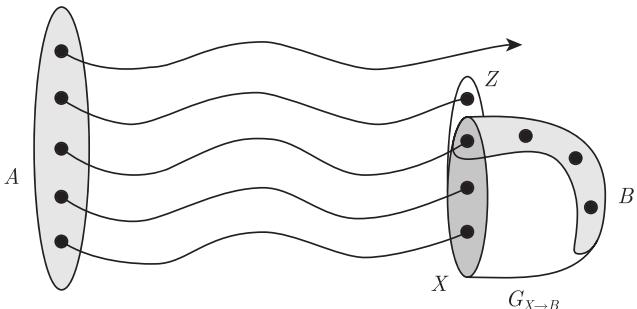
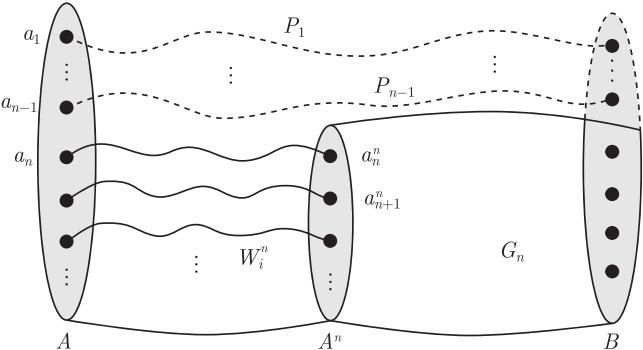
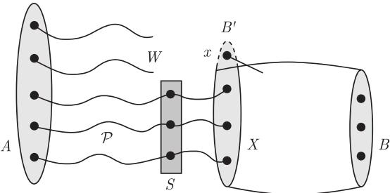
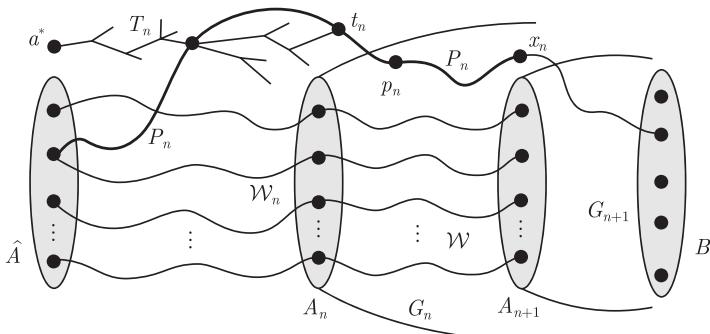

import Guide from '@/components/Guide.astro';
import Knowledge from '@/components/Knowledge.astro';
import Example from '@/components/Example.astro';
import Analysis from '@/components/Analysis.astro';
import Solution from '@/components/Solution.astro';
import Variant from '@/components/Variant.astro';
import Note from '@/components/Note.astro';
import Block from '@/components/Block.astro';
import Method from '@/components/Method.astro';
import Exercise from '@/components/Exercise.astro';

在这一节，我们研究 Menger 定理以及第 2 章中若干匹配定理的无限形式. 这方面的研究是无限图论中最成熟的领域之一，并有若干深刻的结果，其中尤其突出的是 Menger 定理的无限形式，这原来是 Erdős 几十年前的一个猜想，最近才被 Aharoni 和 Berger 证明. 在随后若干年里，人们利用该定理证明中衍生出的技巧得到了这一方向中的大部分结果.

我们将对可数图证明这个定理，这会占用本节的大部分篇幅. 虽然可数图的情形相对简单，但所用的技巧也为一般定理的证明提供了很好的思路. 本节的最后，我们将对无限匹配定理以及由它的证明思路所衍生出的一个猜想作全面的介绍.

我们回忆一下 Menger 定理的最简单形式：设 $A$ 和 $B$ 是一个有限图 $G$ 的两个顶点集合（不一定是不相交的），且 $k = k(G, A, B)$ 表示 $G$ 中分离 $A$ 和 $B$ 所需要的最少顶点个数，那么 $G$ 包含 $k$ 条不相交的 $A\text{-}B$ 路. （显然，$G$ 不可能包含更多条这种路.）当 $G$ 是无限图而 $k$ 是有限时，相同的结果也成立，而且可以从有限情形容易地推出：

<Knowledge title="命题 8.4.1">
设 $G$ 是一个任意图，$k \in \mathbb{N}$，且 $A, B$ 是 $G$ 的两个顶点集合使得 $A, B$ 能被 $k$ 个但不能被少于 $k$ 个顶点分离，那么 $G$ 包含 $k$ 条不相交的 $A\text{-}B$ 路.

<Solution title="证明">
根据假定，每个由不相交 $A\text{-}B$ 路组成的集合的基数至多为 $k$. 选择一个具有最大基数的此类集合，记为 $\mathcal{P}$. 假设 $|\mathcal{P}| < k$，令 $X$ 是在 $\mathcal{P}$ 的每条路上选一个顶点所构成的顶点集，那么不存在这样的集合 $X$ 分离 $A$ 和 $B$. 对每个 $X$，设 $P_X$ 是一条避开 $X$ 的 $A\text{-}B$ 路，而 $H$ 是 $\bigcup \mathcal{P}$ 和所有这种路 $P_X$ 的并，这是一个有限图. 在这个图中，不存在分离 $A$ 和 $B$ 的阶为 $|\mathcal{P}|$ 的顶点集合. 因此由 Menger 定理 (3.3.1)，$H \subseteq G$ 包含多于 $|\mathcal{P}|$ 条从 $A$ 到 $B$ 的路，这与 $\mathcal{P}$ 的选择矛盾. ∎
</Solution>
</Knowledge>

当 $k$ 是无限时，上面的命题马上变成了一个平凡结果. 实际上，令 $\mathcal{P}$ 是 $G$ 中任意不相交 $A\text{-}B$ 路的极大集，那么所有这些路的并将分离 $A$ 和 $B$，所以 $\mathcal{P}$ 一定是无限的. 但是此时这个并集的基数不大于 $|\mathcal{P}|$. 所以，正如我们所期望的那样，$\mathcal{P}$ 包含 $|\mathcal{P}| = |\bigcup \mathcal{P}| \geqslant k$ 条不相交 $A\text{-}B$ 路.

当然，这不过是玩了一个无限基数算术的游戏：从数字上看，虽然 $\mathcal{P}$ 中路的所有内点组成的 $A\text{-}B$ 分离集不大于 $|\mathcal{P}|$，但它使用了远多于必要的顶点个数来分离 $A$ 和 $B$. 换句话说，当路径体系和分离集都是无限的时候，为了从很多的分离集中仔细地分辨出“小的”分离集，分离集的基数就不再是一种行之有效的工具了.

为了克服这个困难，Erdős 对 Menger 定理给出了一种变形，这种变形对于有限图等价于标准的 Menger 定理. 前面提到，如果 $A\text{-}B$ 分离集 $X$ 是由 $\mathcal{P}$ 中每条路上恰好一个顶点组成的，那么 $X$ 称为位于一个不相交 $A\text{-}B$ 路的集合 $\mathcal{P}$ 上. 下面的定理，曾被称为 **Erdős-Menger 猜想** (Erdős-Menger conjecture)，对无限连通度和匹配理论的发展有很大的影响：

<Knowledge title="定理 8.4.2 (Aharoni and Berger, 2009)">
设 $G$ 是任意一个图，而 $A, B \subseteq V(G)$，则 $G$ 包含一个不相交 $A\text{-}B$ 路的集合 $\mathcal{P}$ 和一个位于 $\mathcal{P}$ 上的 $A\text{-}B$ 分离集.
</Knowledge>

下面的几页我们会给出当 $G$ 是可数图时定理 8.4.2 的证明.

在我们对 Menger 定理的有限情形所给出的三个证明中，只有最后一个证明有可能适用于无限的情形，而其他的证明需要对 $|\mathcal{P}|$ 或者 $|G| + \|G\|$ 运用归纳法，可是现在这两个参数均可能是无限的. 但第三个证明看上去更有希望：引理 3.3.2 和引理 3.3.3 提供了一种方法，使得要么能在一个给定的 $A\text{-}B$ 路体系中寻找分离集，要么可以构造另一个 $A\text{-}B$ 路体系，它覆盖更多 $A$ 和 $B$ 中顶点.

引理 3.3.2 和引理 3.3.3（其证明也适用于无限图）为证明定理 8.4.2 奠定了基础. 然而，我们不能只是无限次地运用这些引理. 实际上，虽然使用引理 3.3.2 任意有限次后能产生另一个不相交 $A\text{-}B$ 路体系，但是重复操作无限次后我们也许得不到任何结果：在修改路的过程中，每条边可能被无限次连续地添加到路上或从路上删除，这样的话，我们不能定义 $A\text{-}B$ 路的“极限体系”. 因此，需要采用另外一种方法：从 $A$ 开始，同时生成尽可能多的指向 $B$ 的不交路.

为了更准确地表述，我们引进一些术语. 给定集合 $X \subseteq V(G)$，记 $G_{X \to B}$ 是由 $X$ 以及 $G - X$ 中与 $B$ 相交的所有分支所导出的 $G$ 的子图.

设 $\mathcal{W} = (W_a \mid a \in A)$ 是一族不交的路，其中每个 $W_a$ 从 $a$ 起始. 如果 $\mathcal{W}$ 中路的终点集合 $Z$ 可以分离 $G$ 中的 $A$ 和 $B$，那么我们称 $\mathcal{W}$ 是 $G$ 中的一个 **$A \to B$ 波** ($A \to B$ wave). （注意，$\mathcal{W}$ 可能包含若干没有终点的无限路.）有时，我们希望考虑 $G$ 的那些包含 $A$ 但不包含整个 $B$ 的子图中的 $A \to B$ 波. 基于这个原因，我们并不正式地要求 $B \subseteq V(G)$.

<figure class="vp-figure">
  
  <figcaption>图 8.4.1 边界为 $X$ 的小 $A \to B$ 波 $\mathcal{W}$</figcaption>
</figure>

当 $\mathcal{W}$ 是一个波时，设 $X \subseteq Z$ 是要么属于 $B$ 要么存在一个邻点在 $G_{Z \to B} - Z$ 中的 $Z$ 的顶点集，那么 $X$ 是 $G$ 中的一个极小 $A\text{-}B$ 分离集. 注意到，$z \in Z$ 包含在 $X$ 中当且仅当它能通过一条不包含除 $z$ 外的任何 $\mathcal{W}$ 中的顶点的路连接到 $B$. 我们称 $X$ 为 $\mathcal{W}$ 的**边界** (boundary)，边界为 $X$ 的波 $\mathcal{W}$ 通常简记为 $(\mathcal{W}, X)$. 如果 $\mathcal{W}$ 中的所有路均有限并且 $X = Z$，我们称 $\mathcal{W}$ 为**大波** (large wave)，否则称它为**小波** (small wave). 我们称 $\mathcal{W}$ 是**真波** (proper wave)，如果 $\mathcal{W}$ 中至少一条路是非平凡的，或者如果它的所有路是平凡的但它的边界是 $A$ 的真子集. 例如，每个小波是真波.

注意到，即使某种 $A \to B$ 波总是存在（例如，单点路族 $(\{a\} \mid a \in A)$），但 $G$ 不一定有真 $A \to B$ 波. （例如，如果 $G = K^{10}$，而 $A$ 包含 $G$ 中的两个顶点，而 $B$ 包含另外三个顶点，则不存在真 $A \to B$ 波.）

如果 $(\mathcal{U}, X)$ 是 $G$ 中的一个 $A \to B$ 波，$(\mathcal{V}, Y)$ 是 $G_{X \to B}$ 中的一个 $X \to B$ 波，那么通过把 $\mathcal{V}$ 中的路添加到结束于 $X$ 的 $\mathcal{U}$ 中的路而得到的族 $\mathcal{W} = \mathcal{U} + \mathcal{V}$ 显然是 $G$ 中以 $Y$ 为边界的 $A \to B$ 波. 注意到，$\mathcal{W}$ 是大波当且仅当 $\mathcal{V}$ 和 $\mathcal{U}$ 均是大波. 在下面的意义下，$\mathcal{W}$ 是比 $\mathcal{U}$ 大的波.

给定两个路系统 $\mathcal{U} = (U_a \mid a \in A)$ 和 $\mathcal{W} = (W_a \mid a \in A)$，如果对每个 $a \in A$ 有 $U_a \subseteq W_a$，则我们记 $\mathcal{U} \leqslant \mathcal{W}$. 设 $\mathcal{W}^i = (W_a^i \mid a \in A)$，在这种序下，给定一个波的链 $(\mathcal{W}^i, X^i)_{i \in I}$，令 $W_a^* := \bigcup_{i \in I} W_a^i$，我们定义 $\mathcal{W}^* = (W_a^* \mid a \in A)$，那么 $\mathcal{W}^*$ 是一个波：任意 $A\text{-}B$ 路是有限的但与每个 $X^i$ 均相交，所以对随意大的 $(\mathcal{W}^i, X^i)$ 至少它的一个顶点在 $X^i$ 中，因此是 $\mathcal{W}^*$ 中一条路的最后顶点. 明显地，对所有的 $i \in I, \mathcal{W}^i \leqslant \mathcal{W}^*$，我们称 $\mathcal{W}^*$ 是波 $\mathcal{W}^i$ 的**极限** (limit).

因为 $A \to B$ 波的每个链被它的极限波从上方界定，所以 Zorn 引理蕴含着 $G$ 有一个极大的 $A \to B$ 波 $\mathcal{W}$. 令 $X$ 是它的边界，这个波 $(\mathcal{W}, X)$ 成为我们证明定理 8.4.2 的第一步：如果现在能在 $G_{X \to B}$ 中找到连接 $B$ 与 $X$ 中所有顶点的不交路，那么对于那些结束于 $X$ 的 $\mathcal{W}$ 中的路前面的那些路，$X$ 是这些路的一个 $A\text{-}B$ 分离集.

根据 $\mathcal{W}$ 的极大性，$G_{X \to B}$ 中不存在真 $X \to B$ 波. 就我们的证明而言，只需要证明下面的结论就足够了（下面把 $X$ 重新命名为 $A$）：

<Knowledge title="引理 8.4.3">
如果 $G$ 没有真 $A \to B$ 波，则 $G$ 包含一个连接 $A$ 中所有顶点到 $B$ 的不交 $A\text{-}B$ 路的集合.
</Knowledge>

我们证明引理 8.4.3 的方法是通过列举 $A := \{a_1, a_2, \dots\}$ 中的顶点，并对 $n = 1, 2, \dots$ 分别寻找所需的 $A\text{-}B$ 路 $P_n = a_n \dots b_n$. 因为引理 8.4.3 的前提是 $G$ 没有真 $A \to B$ 波，所以我们希望选择 $P_1$ 使得 $G - P_1$ 没有真 $(A \setminus \{a_1\}) \to B$ 波：这使得 $G - P_1$ 恢复同样的前提，运用同样的方法我们能继续在 $G - P_1$ 中寻找 $P_2$.

然而，我们可能找不到上面提到的 $P_1$，但可以做到几乎一样好：构造 $P_1$ 使得删除它（以及若干 $A$ 以外的顶点）后所余下的图有一个较大的极大 $(A \setminus \{a_1\}) \to B$ 波 $(\mathcal{W}, A')$. 然后，我们把这个波中的路 $W_n = a_n \dots a'_n \ (n \geqslant 2)$ 标记为路 $P_n$ 的初始段. 由 $\mathcal{W}$ 的极大性，在 $G_{A' \to B}$ 中没有真 $A' \to B$ 波. 换句话说，我们已经把 $G_{A' \to B}$ 恢复到 $G$ 原来的前提，并且找到一条 $A'\text{-}B$ 路 $P'_2 = a'_2 \dots b_2$. 因此 $P_2 := a_2 W_2 a'_2 P'_2$ 是引理 8.4.3 中的第二条路，我们可以继续在 $G_{A' \to B}$ 中归纳地进行.

给定 $G$ 中的顶点集 $\hat{A}$，我们称顶点 $a \notin \hat{A}$ 对于 $(G, \hat{A}, B)$ 是**可连接的** (linkable)，如果 $G - \hat{A}$ 包含一条 $a\text{-}B$ 路 $P$ 和一个顶点集 $X \supseteq V(P)$ 使得 $G - X$ 有一个较大的极大 $\hat{A} \to B$ 波（第一个需要考虑的这样的 $a$ 是 $a_1$，而 $\hat{A}$ 是集合 $\{a_2, a_3, \dots\}$）.

<Knowledge title="引理 8.4.4">
设 $a^* \in A$ 且 $\hat{A} := A \setminus \{a^*\}$，假设 $G$ 没有真 $A \to B$ 波，那么 $a^*$ 对于 $(G, \hat{A}, B)$ 是可连接的.
</Knowledge>

<Solution title="引理 8.4.3 的证明（假设引理 8.4.4 成立）">
设 $G$ 满足引理 8.4.3 的条件，即没有真 $A \to B$ 波. 我们构造 $G$ 的子图 $G_1, G_2, \dots$ 满足下面的命题（图 8.4.2）：

$G_n$ 包含一个由不同顶点组成的集合 $A^n = \{a_n^n, a_{n+1}^n, a_{n+2}^n, \dots\}$ 使得 $G_n$ 没有真 $A^n \to B$ 波. $G$ 中存在以 $a_i$ 为起点的不相交路 $P_i \ (i < n)$ 和 $W_i^n \ (i \geqslant n)$. $P_i$ 和 $G_n$ 不相交，并终止于 $B$；$W_i^n$ 以 $a_i^n$ 为终点，并且除 $a_i^n$ 外和 $G_n$ 不相交. $\qquad (*)$

显然，路 $P_1, P_2, \dots$ 将满足引理 8.4.3.

<figure class="vp-figure">
  
  <figcaption>图 8.4.2 $G_n$ 没有真 $A^n \to B$ 波</figcaption>
</figure>

对所有的 $i \geqslant 1$，令 $G_1 := G, a_i^1 := a_i$ 和 $W_i^1 := \{a_i\}$. 我们假设 $G$ 不包含真 $A \to B$ 波，所以当 $n = 1$ 时这些定义满足 $(*)$ 式. 现在假设对 $n$, $(*)$ 式成立. 令 $\hat{A}^n := A^n \setminus \{a_n^n\}$，对 $G_n$ 运用引理 8.4.4，我们能在 $G_n - \hat{A}^n$ 中找到一条 $a_n^n\text{-}B$ 路 $P$ 和一个集合 $X_n \supseteq V(P)$ 使得 $G_n - X_n$ 有一个较大的极大 $\hat{A}^n \to B$ 波 $(\mathcal{W}, A^{n+1})$. 用 $P_n$ 表示路 $W_n^n \cup P$，对 $i \geqslant n + 1$，设 $W_i^{n+1}$ 是由路 $W_i^n$ 从顶点 $a_i^n$ 起连接 $\mathcal{W}$ 中的路而得到的，并称它的最后一个顶点为 $a_i^{n+1}$. 根据 $\mathcal{W}$ 的极大性，在 $G_{n+1} := (G_n - X_n)_{A^{n+1} \to B}$ 中不存在真 $A^{n+1} \to B$ 波，所以对 $n + 1$ $(*)$ 式也成立. ∎
</Solution>

为了证明定理 8.4.2，现在只需要证明引理 8.4.4. 为了这个引理的证明，我们需要另一个引理：

<Knowledge title="引理 8.4.5">
设 $x$ 是 $G - A$ 的一个顶点. 如果 $G$ 没有真 $A \to B$ 波但 $G - x$ 有，那么在 $G - x$ 中每个 $A \to B$ 波是大的.

<Solution title="证明">
假设 $G - x$ 中有一个小波 $(\mathcal{W}, X)$. 令 $B' := X \cup \{x\}$，并且令 $\mathcal{P}$ 表示 $\mathcal{W}$ 中 $A\text{-}X$ 路的集合（图 8.4.3）. 如果 $G$ 包含一个 $\mathcal{P}$ 上的 $A\text{-}B'$ 分离集 $S$，那么在 $\mathcal{W}$ 中把每个 $P \in \mathcal{P}$ 用结束于 $S$ 的初始段来替代，就得到了 $G$ 中的一个小（因此也是真的）$A \to B$ 波，这与假设不存在这种波矛盾. 因此，由引理 3.3.3 和引理 3.3.2，$G$ 包含一个超越 $\mathcal{P}$ 的不交 $A\text{-}B'$ 路集合 $\mathcal{P}'$. 这些路的终点的集合包含 $X$ 作为真子集，所以一定是 $B' = X \cup \{x\}$ 中的所有顶点. 但是 $B'$ 在 $G$ 中分离 $A$ 和 $B$，所以我们可以通过添加那些没有被 $\mathcal{P}'$ 覆盖的 $A$ 的顶点作为孤立路，将 $\mathcal{P}'$ 转变成 $G$ 中的一个 $A \to B$ 波. 因为 $x$ 在 $\mathcal{P}'$ 中但不在 $A$ 中，这是一个真波，但根据假设此波不存在. ∎
</Solution>
</Knowledge>

<figure class="vp-figure">
  
  <figcaption>图 8.4.3 $G - x$ 中的一个小 $A \to B$ 波</figcaption>
</figure>

<Solution title="引理 8.4.4 的证明">
我们在 $G - (\hat{A} \cup B)$ 中归纳地构造树 $T_0 \subseteq T_1 \subseteq \dots$ 以及 $G$ 中的路体系 $\mathcal{W}_0 \leqslant \mathcal{W}_1 \leqslant \dots$，使得每个 $\mathcal{W}_n$ 是 $G - T_n$ 中一个大的极大 $\hat{A} \to B$ 波.

令 $\mathcal{W}_0 := (\{a\} \mid a \in \hat{A})$. 显然，$\mathcal{W}_0$ 是 $G - a^*$ 的一个 $\hat{A} \to B$ 波，同时它也是大波并是极大的：否则，$G - a^*$ 有一个真 $\hat{A} \to B$ 波，将平凡路 $\{a^*\}$ 加到此波上就变成一个真 $A \to B$ 波（但由假设它不存在）. 如果 $a^* \in B$，$\mathcal{W}_0$ 的存在性蕴含 $a^*$ 对于 $(G, \hat{A}, B)$ 是可连接的，所以可以假设 $a^* \notin B$，那么 $T_0 := \{a^*\}$ 和 $\mathcal{W}_0$ 正是我们想要的.

现在假设已经定义了 $T_n$ 与 $\mathcal{W}_n$，令 $A_n$ 表示 $\mathcal{W}_n$ 中路的最后顶点的集合. 因为 $\mathcal{W}_n$ 是大的，所以 $A_n$ 是它的边界，又因为 $\mathcal{W}_n$ 是极大的，所以 $G_n := (G - T_n)_{A_n \to B}$ 没有真 $A_n \to B$ 波（图 8.4.4）.

<figure class="vp-figure">
  
  <figcaption>图 8.4.4 因为 $\mathcal{W}_n$ 是极大的，所以 $G_n$ 没有真 $A_n \to B$ 波</figcaption>
</figure>

注意到 $A_n$ 在 $G$ 中不能分离 $A$ 和 $B$，否则，$\mathcal{W}_n \cup \{a^*\}$ 就是 $G$ 中一个小 $A \to B$ 波，但它不存在. 由于 $(\mathcal{W}_n, A_n)$ 是 $G - T_n$ 的一个波，因此 $G - A_n$ 包含一条和 $T_n$ 相交的 $A\text{-}B$ 路 $P$. 令 $P_n$ 是一条这样的路 $P$，我们选择 $P_n$ 使得它在 $T_n$ 中的最后顶点 $t_n$ 之后的顶点 $p_n$ 在 $V(G)$ 的某个固定枚举中是极小的. 根据 $G_n$ 的定义，$p_n P_n \subseteq G_n - A_n$.

现在，$P'_n = a^* T_n t_n P_n$ 是 $G - \hat{A} - A_n$ 中的一条 $a^*\text{-}B$ 路. 如果 $G_n - p_n P_n$ 没有真 $A_n \to B$ 波，那么 $\mathcal{W}_n$ 不仅在 $G - T_n$ 中，而且在 $G - T_n - p_n P_n$ 中也是一个大的波且是极大的，同时对于 $(G, \hat{A}, B)$，$a^*$ 是可连接的（只需取 $a^*\text{-}B$ 路 $P'_n$ 和 $X = V(T_n \cup p_n P_n)$）. 因此我们可以假设 $G_n - p_n P_n$ 有真 $A_n \to B$ 波.

令 $x_n$ 是 $p_n P_n$ 上的第一个顶点使得 $G_n - p_n P_n x_n$ 有一个真 $A_n \to B$ 波，那么 $G'_n := G_n - p_n P_n \mathring{x}_n$ 没有真 $A_n \to B$ 波，但是 $G'_n - x_n$ 有，根据引理 8.4.5，
$$
G'_n - x_n = G_n - p_n P_n x_n
$$
中的每个 $A_n \to B$ 波是大的. 令 $\mathcal{W}$ 是一个极大的这样的波，记 $\mathcal{W}_{n+1} := \mathcal{W}_n + \mathcal{W}, T_{n+1} := T_n \cup t_n P_n x_n$，那么 $\mathcal{W}_{n+1}$ 是 $G - T_{n+1}$ 中的一个大的极大 $\hat{A} \to B$ 波. 如果 $x_n \in B$，那么 $T_{n+1}$ 包含一条连接 $a^*$ 到 $B$ 的路，并关于 $\mathcal{W}_{n+1}$ 和 $X = V(T_{n+1})$ 满足引理. 给定 $T_{n+1} \subseteq G - (\hat{A} \cup B)$，我们可以假设 $x_n \notin B$.

令 $T^* := \bigcup_{n \in \mathbb{N}} T_n$，那么 $\mathcal{W}_n$ 是 $G - T^*$ 中的 $\hat{A} \to B$ 波，令 $(\mathcal{W}^*, A^*)$ 是这些波的极限. 我们的目标是证明 $A^*$ 不仅在 $G - T^*$ 中，也在 $G$ 中分离 $A$ 和 $B$：那么 $(\mathcal{W}^* \cup \{a^*\}, A^*)$ 是 $G$ 中的一个小 $A \to B$ 波，从而产生矛盾.

假设 $G - A^*$ 中存在一条 $A\text{-}B$ 路 $Q$. 令 $t$ 是它在 $T^*$ 中的最后一个顶点. 因为 $T^*$ 不与 $B$ 相交，所以在 $Q$ 上存在一个紧随 $t$ 的顶点 $p$. 又因为 $T^*$ 包含每个 $p_n$ 但不包含 $p$，所以路 $P = a^* T^* t Q$ 一定不会选作 $P_n$. 现在让 $n$ 充分大使得 $t \in T_n$，并且在固定的 $V(G)$ 的列举中 $p$ 超过 $p_n$（因为 $p_n \in T_{n+1} - T_n$，所以 $p_n$ 是相互不同的.）因此，$P$ 不能被选择作为 $P_n$ 这一事实意味着它在 $T_n$ 外的部分 $p Q$ 与 $A_n$ 相交，不妨设交点为 $q$. 由 $Q$ 的选择知 $q \notin A^*$. 令 $W$ 是 $\mathcal{W}_n$ 中连接 $\hat{A}$ 到 $q$ 的路，这条路同样避免 $A^*$. 但是这样的话 $W q Q$ 在 $G - T^*$ 中包含一条避开 $A^*$ 的 $\hat{A}\text{-}B$ 路，这与 $A^*$ 的定义矛盾. ∎
</Solution>

至此，对于可数的 $G$，我们完成了定理 8.4.2 的证明.

现在转向对匹配的讨论，让我们从一个（本质上无限）简单问题开始：给定两个集合 $A, B$ 以及两个单射 $A \to B$ 和 $B \to A$，是否一定存在 $A$ 与 $B$ 之间的一个双射？这样的双射确实存在，这就是初等集合论中著名的 Cantor-Bernstein 定理. 用匹配的语言重新叙述，它的证明变得十分简单：

<Knowledge title="命题 8.4.6">
设 $G$ 是一个二部图，其二部划分为 $\{A, B\}$. 如果 $G$ 包含一个饱和 $A$ 的匹配和一个饱和 $B$ 的匹配，那么 $G$ 包含 1-因子.

<Solution title="证明">
令 $H$ 是一个 $V(G)$ 上的多重图，它的边集是两个匹配的不交并. （那么，任何同时在两个匹配中的边是 $H$ 中的重边.）$H$ 中每个顶点的度是 1 或 2. 事实上，容易看出 $H$ 的每个分支是一个偶圈或一个无限路. 在每个分支中，每隔一条边取一条边，我们得到了 $G$ 的一个 1-因子. ∎
</Solution>
</Knowledge>

在非二部图中，用不交的 $A\text{-}B$ 路集合代替匹配所对应的路问题就不那么简单了. 对于 $G$ 中的一个路集合 $\mathcal{P}$ 和顶点集 $U$，如果 $U$ 中的每个顶点都是 $\mathcal{P}$ 中一条路的端点，则称 $\mathcal{P}$ **覆盖** (cover) $U$.

<Knowledge title="定理 8.4.7 (Pym, 1969)">
设 $G$ 是一个图，而 $A, B \subseteq V(G)$. 假设 $G$ 包含两个不交 $A\text{-}B$ 路的集合，其中一个覆盖 $A$ 而另一个覆盖 $B$，那么 $G$ 就包含一个不交 $A\text{-}B$ 路的集合，它覆盖 $A \cup B$.
</Knowledge>

练习 64 给出了证明定理 8.4.7 的若干提示.

下面让我们看一看有限图中的典型匹配定理——König 定理、Hall 定理、Tutte 定理、Gallai-Edmonds 定理——怎样推广到无限图中. 对于局部有限图，通过紧致性可以把它们直接推广，参看练习 24—练习 27. 对任意基数的图，也有一些令人满意的推广，它们的证明形成一个连贯的理论体系并且更加深刻，这里只能罗列一些相关结果并指出它们之间的联系. 正如 Menger 定理一样，这些推广后的命题本身也很有趣：对于给定的有限形式的结果，找到一个“正确”的叙述来表达无限形式的定理绝不是一件容易的事，大部分需要相当长的时间才发展成为理论.

让我们从二部图入手，下面的定理是对 König 定理 (2.1.1) 进行 Erdős-Menger 型的推广，它是定理 8.4.2 的一个推论：

<Knowledge title="定理 8.4.8 (Aharoni, 1984)">
每个二部图包含一个匹配 $M$ 以及边集的顶点覆盖，使得这个覆盖是由 $M$ 的每条边中恰好一个端点组成.
</Knowledge>

婚姻定理 (2.1.2) 的无限形式是怎样的呢？有限定理指出，只要第一个划分类中的每个子集 $S$ 在第二个划分类中有足够多的邻点，就存在一个匹配. 但在无限图中我们怎么衡量“足够多”呢？正如 Menger 定理一样，仅仅比较基数是不够的（练习 25）.

然而，有一种简洁的方法来重新叙述有限图的婚姻条件而不需使用基数. 对于分别属于每个二部划分的顶点子集 $X$ 和 $Y$，如果由 $X$ 和 $Y$ 所生成的子图包含饱和 $X$ 的一个匹配，就称 $X$ **可匹配** (matchable) 到子集 $Y$. 如果 $S$ 关于 $|S| > |N(S)|$ 是极小的，根据婚姻定理，$S$ 比 $N(S)$ “大”，这是因为 $S$ 不能匹配到 $N(S)$ 但 $N(S)$ 可以匹配到 $S$. （实际上，根据 $S$ 的极小性和婚姻定理，任何满足 $|S'| = |S| - 1$ 的 $S' \subseteq S$ 都可以匹配到 $N(S)$. 因为 $|S'| = |S| - 1 \geqslant |N(S)|$，所以这个匹配覆盖 $N(S)$.）因此，如果一个 $S$ 阻碍形成完美匹配的原因是 $|S| > |N(S)|$，那么就有一个 $S$ 比 $N(S)$ 大，因为，$S$ 不可匹配到 $N(S)$ 但是 $N(S)$ 可匹配到 $S$.

按这种方式重新叙述婚姻条件就产生了 Hall 定理的一个无限版本，它由定理 8.4.8 得到，正如婚姻定理是从 König 定理得到的一样：

<Knowledge title="推论 8.4.9">
顶点划分为 $\{A, B\}$ 的二部图包含一个饱和 $A$ 的匹配，除非存在一个集合 $S \subseteq A$ 使得 $S$ 不能匹配到 $N(S)$ 但 $N(S)$ 可匹配到 $S$.

<Solution title="证明">
如定理 8.4.8 中一样，考虑一个匹配 $M$ 和一个覆盖 $U$，那么通过 $M$ 的边，$U \cap B \supseteq N(A \setminus U)$ 是可匹配到 $A \setminus U$ 的. 并且，如果 $A \setminus U$ 可匹配到 $N(A \setminus U)$，那么这个匹配和 $M$ 中那些关联 $A \cap U$ 的边一起就组成了一个饱和 $A$ 的匹配. ∎
</Solution>
</Knowledge>

回到有限图，推论 8.4.9 蕴含着婚姻定理：如果 $N(S)$ 可匹配到 $S$ 但反过来不成立，那么很明显 $|S| > |N(S)|$. 类似地，推论 8.4.9 的有限形式蕴含着下面这个充分条件，它是关于饱和 $A$ 的匹配存在的有限情形：

<Knowledge title="定理 8.4.10 (Milner and Shelah, 1974)">
在顶点划分为 $\{A, B\}$ 的二部图中，如果对每个 $a \in A$ 有 $d(a) \geqslant 1$，同时对每个具有 $a \in A$ 的边 $ab$ 有 $d(a) \geqslant d(b)$，则这个二部图包含一个饱和 $A$ 的匹配.
</Knowledge>

现在让我们考虑非二部图. 如果一个有限图包含 1-因子，那么被任何部分匹配（即不覆盖所有顶点的匹配）覆盖的顶点集总可以通过一条增广路得到扩充，这里的增广路指一条起点和终点不被匹配的交错路（见第 2 章练习 1）. 在无限图中，我们不再坚持要求增广路是有限的，只要增广路有起点就可以. 对任意未匹配的顶点 $v$，从 1-因子（假设存在）的一条关联 $v$ 的边开始，我们同样地能找到一条唯一的极大交错路，它要么是一条射线，要么结束于另一个未匹配的顶点. 像有限图一样，沿着这条路交换边，我们可以改进现有的匹配，从而增加已匹配的顶点集合.

所以，一个不可扩部分匹配的存在是 1-因子存在性的一个明显障碍. 下面的定理说明它是唯一可能的障碍：

<Knowledge title="定理 8.4.11 (Steffens, 1977)">
可数图包含 1-因子当且仅当对每个部分匹配都存在一条增广路.
</Knowledge>

和它的有限形式不同，定理 8.4.11 的证明并不简单平凡：“盲目地”扩充一个给定匹配不一定在有限步内产生一个明确定义的匹配，这是因为一条给定边可能无限多次地加入或离开（在哪种情况下，它的极限没有定义？给出一个例子）. 因此，我们不能简单地利用归纳推理找到一个所需要的 1-因子.

事实上，定理 8.4.11 不能推广到不可数图（练习 67）. 然而，从不可扩展的部分匹配的障碍，我们能导出一个可以推广的 Tutte 型条件. 考虑图 $G$ 中的一个顶点集 $S$，我们记 $\mathcal{C}'_{G-S}$ 为 $G - S$ 中因子临界分支的集合，$G'_S$ 为具有顶点集 $S \cup \mathcal{C}'_{G-S}$ 和边集 $\{sC \mid \exists c \in C : sc \in E(G)\}$ 的二部图.

<Knowledge title="定理 8.4.12 (Aharoni, 1988)">
图 $G$ 包含 1-因子当且仅当对每个顶点集 $S \subseteq V(G)$，集合 $\mathcal{C}'_{G-S}$ 在 $G'_S$ 中可匹配到 $S$.
</Knowledge>

应用到有限图，定理 8.4.12 蕴含着 Tutte 的 1-因子定理 (2.2.1)：如果 $\mathcal{C}'_{G-S}$ 在 $G'_S$ 中不可匹配到 $S$，那么根据婚姻定理，存在 $S$ 的一个子集 $S'$ 在 $\mathcal{C}'_{G-S}$ 中连接到多于 $|S'|$ 个分支，这些分支也是 $G - S'$ 的分支，并且由于它们是因子临界的，所以这些分支是奇的.

定理 8.4.8 和定理 8.4.12 也蕴含着 Gallai-Edmonds 定理 (2.2.3) 的一个无限版本：

<Knowledge title="推论 8.4.13">
每个图 $G = (V, E)$ 均包含一个可匹配到 $\mathcal{C}'_{G-S}$ 的顶点集 $S$，并且使得每个不在 $\mathcal{C}'_{G-S}$ 中的 $G - S$ 的分支有 1-因子. 给定任意这样的集合 $S$，图 $G$ 包含 1-因子当且仅当在 $G'_S$ 中 $\mathcal{C}'_{G-S}$ 可匹配到 $S$.

<Solution title="证明">
令 $S \subseteq V$，且 $M$ 是 $G'_S$ 中饱和 $S$ 的一个匹配. 对于集合对 $(S, M)$ 和另外一个这样的集合对 $(S', M')$，如果
$$
S \subseteq S' \subseteq V \setminus \bigcup \{V(C) \mid C \in \mathcal{C}'_{G-S}\},
$$
以及 $M \subseteq M'$，则记 $(S, M) \leqslant (S', M')$. 因为对任意这样的 $S'$ 有 $\mathcal{C}'_{G-S} \subseteq \mathcal{C}'_{G-S'}$，所以 Zorn 引理蕴含着存在一个极大的这样的集合对 $(S, M)$.

对命题的第一部分，我们需要证明每个不在 $\mathcal{C}'_{G-S}$ 中的 $G - S$ 的分支 $C$ 有 1-因子；否则，根据定理 8.4.12，存在一个集合 $T \subseteq V(C)$ 使得在 $C'_T$ 中 $\mathcal{C}'_{C-T}$ 不能匹配到 $T$. 由推论 8.4.9，这意味着 $\mathcal{C}'_{C-T}$ 在 $C'_T$ 中有一个子集 $\mathcal{C}$ 不能匹配到它邻点的集合 $T' \subseteq T$，尽管 $T'$ 可匹配到 $\mathcal{C}$. 如果 $M'$ 是这样的一个匹配，则 $(S, M) < (S \cup T', M \cup M')$ 与 $(S, M)$ 的极大性矛盾.

对于命题的第二部分，只有充分性是非平凡的. 现在我们假设在 $G'_S$ 中 $\mathcal{C}'_{G-S}$ 可匹配到 $S$，反之亦然（根据 $S$ 的选择），所以命题 8.4.6 蕴含着 $G'_S$ 有 1-因子. 从每个分支 $C \in \mathcal{C}'_{G-S}$ 中选取一个顶点 $x_C$ 并保持 $G - S$ 的其他分支不变，就定义了 $S$ 的一个匹配. 对每个 $C \in \mathcal{C}'_{G-S}$ 向这个匹配中添加 $C - x_C$ 的一个 1-因子以及 $G - S$ 的每个其他分支的一个 1-因子，我们得到了 $G$ 中的一个 1-因子. ∎
</Solution>
</Knowledge>

无限匹配理论也许看起来相当成熟和完整，但是对类似于 Erdős-Menger 类型的离散结构，还有很多令人着迷的未解决问题，例如关于偏序集或者超图. 我们以这个方向的一个图的公开问题作为结束本节：

如果无限图 $G$ 的每个导出子图 $H \subseteq G$ 有一个阶为 $\chi(H)$ 的完全子图 $K$，则称 $G$ 是**完美的** (perfect)；如果对于 $G$ 的某个 $\chi(H)$-着色，总可以选择 $K$ 使得它与每个着色类相交，则称 $G$ 是**强完美的** (strongly perfect)；（练习 69 给出了一个完美图但非强完美的例子.）如果每个导出子图 $H \subseteq G$ 的色数至多是它完全子图阶的上确界，则称 $G$ 是**弱完美的** (weakly perfect).

<Knowledge title="猜想 (Aharoni and Korman, 1993)">
每个没有无限独立顶点集的弱完美图是强完美的.
</Knowledge>
