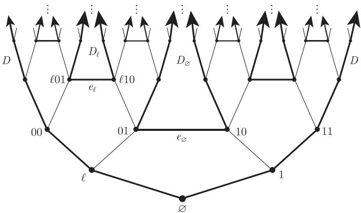
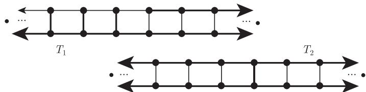

import Guide from '@/components/Guide.astro';
import Knowledge from '@/components/Knowledge.astro';
import Example from '@/components/Example.astro';
import Analysis from '@/components/Analysis.astro';
import Solution from '@/components/Solution.astro';
import Variant from '@/components/Variant.astro';
import Note from '@/components/Note.astro';
import Block from '@/components/Block.astro';
import Method from '@/components/Method.astro';
import Exercise from '@/components/Exercise.astro';

在这节中，我们将对无限图的整体结构进行更深入的了解，尤其是对局部有限图，它可以通过研究其末端来实现. 这个结构本质上是拓扑的，因为拓扑最适合于直观地表达收敛的特点.

我们的第一个目标就是对“图的末端是它的射线在无穷远处收敛的点”这一直观想法进行准确的描述. 为了做到这一点，我们将根据图 $G = (V, E, \Omega)$ 和它的末端来定义一个拓扑空间 $|G|$. 通过考虑这个空间中路、圈以及支撑树的拓扑形式，我们可以把有限图论中某些结果推广到无限图，而之前我们得不到这些结果所对应的无限形式（参看注解中更多例子）. 因此，无限图的末端不仅是一个奇妙的新现象，而且它成为整个理论的有机部分，没有它就不能很好地理解无限图.

为了正式地构造空间 $|G|$，由集合 $V \cup \Omega$ 开始. 对每条边 $e = uv$，添加连续统多个点的集合 $\mathring{e} = (u, v)$，使得这些 $\mathring{e}$ 彼此不相交并且与 $V \cup \Omega$ 也不相交. 对每个 $e$，我们在 $\mathring{e}$ 与实区间 $(0, 1)$ 之间选择某个固定的双射，并且将这个双射拓展成 $[u, v] := \{u\} \cup \mathring{e} \cup \{v\}$ 与 $[0, 1]$ 之间的双射. 这个双射在 $[u, v]$ 上定义了一个度量，我们称 $[u, v]$ 为具有内部点 (inner points) $x \in \mathring{e}$ 的拓扑边 (topological edge). 给定任意 $F \subseteq E$，记 $\mathring{F} := \bigcup \{\mathring{e} \mid e \in F\}$. 当我们谈到“图” $H \subseteq G$ 时，通常指它所对应的点集 $V(H) \cup \mathring{E}(H)$.

因此，我们已经定义了 $|G|$ 的点集，让我们选择开集的一个基来定义它的拓扑. 对每条边 $uv$，根据 $(u, v)$ 和 $(0, 1)$ 之间的固定双射，$(0, 1)$ 的开集所对应的 $(u, v)$ 的子集定义为开集；对每个顶点 $u$ 和 $\epsilon > 0$，我们把“围绕 $u$ 半径为 $\epsilon$ 的开星”当作开集，也就是说，根据从 $[0, 1]$ 继承来的度量对每条边独立衡量，在边 $[u, v]$ 上与 $u$ 距离小于 $\epsilon$ 的所有点的集合定义为开集. 最后，对每个末端 $\omega$ 和每个有限集 $S \subseteq V$，存在 $G - S$ 的唯一分支 $C(S, \omega)$，它包含结束于 $\omega$ 的所有射线. 令 $\Omega(S, \omega) := \{\omega' \in \Omega \mid C(S, \omega') = C(S, \omega)\}$. 对每个 $\epsilon > 0$，记 $\mathring{E}_\epsilon(S, \omega)$ 为终点在 $C(S, \omega)$ 中距离小于 $\epsilon$ 的 $S\text{-}C(S, \omega)$ 边的所有内点的集合. 那么具有下面形式的所有集合定义为开集：

$$
\hat{C}_\epsilon(S, \omega) := C(S, \omega) \cup \Omega(S, \omega) \cup \mathring{E}_\epsilon(S, \omega).
$$

这就完成了 $|G|$ 的定义，它的开集为上面我们明确地定义为开的那些集合的并.

集合 $X \subseteq |G|$ 的闭包 (closure) 记作 $\overline{X}$. 例如，$\overline{V} = V \cup \Omega$（因为任意末端的每个邻点包含一个顶点），而一条射线的闭包是加入它的末端后而得到的. 更一般地，梳齿的集合的闭包包含唯一的末端，即梳背的末端；反过来，如果 $U \subseteq V$ 且 $R \in \omega \in \Omega \cap \overline{U}$，那么存在一个以 $R$ 为梳背，梳齿在 $U$ 中的梳（练习 77）. 特别地，上面所考虑的子图 $C(S, \omega)$ 的闭包是集合 $C(S, \omega) \cup \Omega(S, \omega)$.

我们感兴趣的 $|G|$ 的子空间 $X$ 通常是 $G$ 的子图 $H$ 的闭包，即若 $H = (U, D)$，子空间 $X$ 具有形式 $X = \overline{U} \cup \mathring{D}$. 我们把 $U$ 记作 $V(X)$ 而 $D$ 记作 $E(X)$，并把这样的子空间叫做标准子空间 (standard subspace). 这样的 $X$ 也记作 $\overline{H}$；如果 $H$ 没有孤立顶点，$X$ 还可以记作 $\overline{D}$，并且我们称 $X$ 被 $H$ 所支撑 (spanned by). 注意，$X$ 中的末端总是 $G$ 的末端，但不是 $H$ 的末端. 特别地，这些末端不需要有 $H$ 中的射线.

根据定义，$|G|$ 总是 Hausdorff 的，确实，我们可以证明它是正则的. 当 $G$ 是连通的且局部有限时，$|G|$ 也是紧致的.[^11]

[^11]: 拓扑学家称 $|G|$ 是 $G$ 的 Freudenthal 紧致化.

<Knowledge title="命题 8.6.1">
如果 $G$ 是连通的且是局部有限的，那么 $|G|$ 是紧致的 Hausdorff 空间.

<Solution title="证明">
令 $\mathcal{O}$ 是 $|G|$ 的一个开覆盖，我们证明 $\mathcal{O}$ 有一个有限子覆盖. 取定顶点 $v_0 \in G$，记 $D_n$ 为距离 $v_0$ 为 $n$ 的顶点（有限）集合，并令 $S_n := D_0 \cup \dots \cup D_{n-1}$. 对每个 $v \in D_n$，用 $C(v)$ 表示 $G - S_n$ 中包含 $v$ 的分支，并令 $\hat{C}(v)$ 是它的闭包加上 $C(v)\text{-}S_n$ 边的所有内点，那么 $G[S_n]$ 和这些 $\hat{C}(v)$ 一起形成 $|G|$ 的一个划分.

我们希望证明对某个 $n$，每个具有 $v \in D_n$ 的集合 $\hat{C}(v)$ 包含在某个 $O(v) \in \mathcal{O}$ 中. 因为如此的话，我们就能得到 $\mathcal{O}$ 的关于 $G[S_n]$（注意 $G[S_n]$ 是紧致的，它是边和顶点的有限并）的一个有限子覆盖，然后加上这些有限多个集合 $O(v)$ 就得到我们所需要的 $|G|$ 的有限子覆盖.

假设不存在这样的 $n$，那么对每个 $n$，如果顶点 $v \in D_n$ 使得 $\mathcal{O}$ 中没有集合包含 $\hat{C}(v)$，那么所有这样的顶点 $v$ 所组成的集合 $V_n$ 是非空的. 此外，对 $v \in V_n$ 的每个邻点 $u \in D_{n-1}$，因为 $S_{n-1} \subseteq S_n$，我们有 $C(v) \subseteq C(u)$，因此 $u \in V_{n-1}$. 用 $f(v)$ 表示这样的顶点 $u$. 由无限性引理 (8.1.2)，存在一条射线 $R = v_0 v_1 \cdots$ 使得对所有的 $n$ 满足 $v_n \in V_n$. 设 $\omega$ 是它的末端且 $O \in \mathcal{O}$ 包含 $\omega$，因为 $O$ 是开的，所以它包含 $\omega$ 的一个基本开邻集：存在一个有限集合 $S \subseteq V$ 和 $\epsilon > 0$ 使得 $\hat{C}_\epsilon(S, \omega) \subseteq O$. 现在选择足够大的 $n$ 使得 $S_n$ 包含 $S$ 以及它的所有邻点，那么 $C(v_n)$ 包含在 $G - S$ 的一个分支内. 由于 $C(v_n)$ 包含射线 $v_n R \in \omega$，这个分支一定是 $C(S, \omega)$. 因此

$$
\hat{C}(v_n) \subseteq \hat{C}_\epsilon(S, \omega) \subseteq O \in \mathcal{O},
$$

与 $v_n \in V_n$ 这一事实矛盾. ∎
</Solution>
</Knowledge>

如果 $G$ 包含一个无限度的顶点，那么 $|G|$ 不是紧致的（为什么呢？），但是 $\Omega \subseteq |G|$ 可以是紧致的，对它是紧致的情形，参见练习 85.

还有哪些关于空间 $|G|$ 的一般性结论呢？例如，它是可度量化的吗？实际上，利用 $G$ 的正规支撑树 $T$，在 $|G|$ 上定义一个导出它拓扑的度量并不困难. 然而，不是每一个连通图都有正规支撑树的，并且利用图论方法决定哪些图有这样的树也并不容易. 但令人吃惊的是，可以根据 $|G|$ 上定义的度量来推导出正规支撑树的存在性. 所以，只要 $|G|$ 是可度量化的，就可以用一个自然的方法把度量构造出来：

<Knowledge title="定理 8.6.2">
对于连通图 $G$，下面的结论是等价的：

(i) 空间 $|G|$ 是可度量化的；

(ii) $G$ 包含正规支撑树；

(iii) $G$ 的所有子式有可数的着色数.
</Knowledge>

定理 8.6.2 中 (i) 和 (ii) 的等价性证明见练习 41 和练习 86. 关于 (iii) 的更多讨论见注解.

我们的下一个目标是回顾并重新定义在拓扑意义下的路、连通性、圈和支撑树. 通过把 $G$ 在图论中的概念替换成对应 $|G|$ 中的拓扑概念，我们可以把有限图中关于路、圈以及支撑树的若干定理推广到局部有限图上，但这些结论在一般无限图中是不成立的. 作为一个例子，我们把 Nash-Williams 和 Tutte 的树填装定理 (2.4.1) 进行推广，更多的讨论见注解.

设 $X$ 是一个任意 Hausdorff 空间（稍后，这将是 $|G|$ 的一个子空间），如果 $X$ 不是两个不交的非空开子集的并，[^12] 我们就称 $X$ 是（拓扑）连通的 ((topologically) connected). 注意到，连通空间的连续映象是连通的. 例如，因为实数区间 $[0, 1]$ 是连通的，[^13] 所以它在 $X$ 中的连续映象也是连通的.

[^12]: 这些子集是相互补集，所以也是闭的. 注意到，“开集”和“闭集”均指在 $X$ 中是开的或闭的，即在拓扑子空间意义下，当 $X$ 是 $|G|$ 的子空间时，这两个集合在 $|G|$ 中不一定是开的或闭的.
[^13]: 这个结论只需几行就可以证明，你能给出证明吗？

实区间 $[0, 1]$ 在 $X$ 中的一个同胚象是 $X$ 中的一个弧 (arc)，它连接 (link) $0$ 和 $1$ 的象，这两个象叫做它的端点 (endpoint). $G$ 的每条有限路定义了 $|G|$ 的一条弧. 类似地，每条射线定义了一条连接它的起点和终点的弧，而 $G$ 的双射线连同它尾巴的两个末端组成了 $|G|$ 的一条弧（如果这两个末端不同的话）.

考虑 $|G|$ 的一个标准子空间 $X$，如果整数 $k$ 使得 $X$ 包含 $k$ 条弧，并且这些弧除了把 $\omega$ 作为公共端点外在其他点不相交，那么 $k$ 的上确界（事实上最大值）被称作 $G$ 的末端 $\omega$ 的（拓扑）度 ((topological) degree).

除非另外定义，在本节的余下部分，我们总是假定 $G = (V, E, \Omega)$ 是一个固定的连通局部有限图.

和通常的路不同，$|G|$ 中的弧可能跳跃地越过一个割集，而不包含这个割集的任何边（只有当割集是无限时可能发生）.

<Knowledge title="引理 8.6.3（跳跃弧引理）">
设 $F \subseteq E$ 是 $G$ 一个割，它把顶点集划分成 $V_1$ 和 $V_2$.

(i) 如果 $F$ 是有限的，则 $\overline{V_1} \cap \overline{V_2} = \emptyset$，且 $|G| \setminus \mathring{F}$ 中没有一个弧使得一个端点在 $V_1$ 中，而另一个在 $V_2$ 中.

(ii) 如果 $F$ 是无限的，则 $\overline{V_1} \cap \overline{V_2} \neq \emptyset$，并且如果 $V_1$ 和 $V_2$ 在 $G$ 中是连通的，则存在一条从 $V_1$ 到 $V_2$ 的弧.

<Solution title="证明">
(i) 假设 $F$ 是有限的，设 $S$ 是那些关联 $F$ 中边的顶点的集合，那么 $S$ 是有限的并且分离 $V_1$ 和 $V_2$，所以对每个 $\omega \in \Omega$，连通图 $C(S, \omega)$ 避开 $V_1$ 或 $V_2$，那么形式为 $\hat{C}_\epsilon(S, \omega)$ 的每个基本开集也避开 $V_1$ 或 $V_2$，所以不存在末端 $\omega$ 同时属于 $V_1$ 和 $V_2$ 的闭包.

因为 $|G| \setminus \mathring{F} = \overline{G[V_1]} \cup \overline{G[V_2]}$，并且这个并集是不交的，所以 $|G| \setminus \mathring{F}$ 的连通子集不能与 $V_1$ 和 $V_2$ 同时相交. 因为弧是 $[0, 1]$ 的连续象，故连通，所以 $|G| \setminus \mathring{F}$ 中没有 $V_1\text{-}V_2$ 弧.

(ii) 现在假设 $F$ 是无限的. 因为 $G$ 是局部有限的，在 $V_1$ 中 $F$ 的端点所组成的集合 $U$ 也是无限的. 根据星-梳引理 (8.2.2)，$G$ 中存在一个所有齿都在 $U$ 中的梳. 设 $\omega$ 是它的梳背的末端，如果 $\omega \in \overline{V_1} \cap \overline{V_2}$，那么 $\omega$ 的每个基本开邻域 $\hat{C}_\epsilon(S, \omega)$ 与 $U \subseteq V_1$ 相交无限次，因此也与 $V_2$ 相交.

为了得到 $|G| \setminus \mathring{F}$ 的 $V_1\text{-}V_2$ 弧，我们只需要在 $\overline{G[V_1]}$ 中找到一个弧，在 $\overline{G[V_2]}$ 中找到另外一个弧，它们均终结于 $\omega$. 如果图 $G[V_i]$ 是连通的，这样的弧是存在的：我们可以选取 $V_i$ 中收敛于 $\omega$ 的一个顶点序列，然后在 $G[V_i]$ 中使用星-梳引理得到一个梳，使得它的梳背在 $G[V_i]$ 中是一个射线并收敛于 $\omega$. 连接这两个射线就得到了想要的跳跃弧. ∎
</Solution>
</Knowledge>

从某种意义上讲，弧在 $|G|$ 中扮演着有限图中路的角色，因此对弧的研究至关重要，但如何找到这些弧呢？像引理 8.6.3 (ii) 的证明一样，明确地构造这些弧并不总是可能的. 例如，在图 8.6.1 中，一个弧可能穿过连续统多个末端，这样的弧不能通过使用贪心方法来构造，例如沿着一条射线进入一个末端，再从这个末端的另外一条射线出来，以此类推.

有两种基本的方法，来找到两个给定点（不妨设它们是 $x$ 和 $y$）之间的弧. 第一个是使用紧致性，把有限 $x\text{-}y$ 路的极限作为拓扑 $x\text{-}y$ 路，这是一个连续映射 $\pi : [0, 1] \to |G|$，它把 $0$ 映射到 $x$ 并把 $1$ 映射到 $y$. 点集拓扑的一个引理指出，这个路可以成为单射：

<Knowledge title="引理 8.6.4">
Hausdorff 空间中拓扑 $x\text{-}y$ 路的象包含一条 $x\text{-}y$ 弧.
</Knowledge>

为了展示这个方法，我们会在定理 8.7.3 的证明中使用这个引理.

第二个方法是证明，我们想在其中找到 $x\text{-}y$ 弧的空间是拓扑连通的，并使用这个结论来导出这个空间包含我们想要的弧. 下面三个引理提供了在实用中实现这个方法所需要的工具，我们会在定理 8.6.9 的证明中展示如何使用这个方法.

对于 Hausdorff 空间 $X$，两个点通过一条弧连接是 $X$ 中点的一个等价关系：每一个 $x\text{-}y$ 弧 $A$ 在任意 $y\text{-}z$ 弧 $A'$ 上有第一个点 $p$（由于 $A'$ 是闭的），两个路段 $Ap$ 和 $pA'$ 一起组成 $X$ 的一条 $x\text{-}z$ 弧. 对应的等价类是 $X$ 的弧分支 (arc-component). 如果 $X$ 仅有一个弧分支，那么称 $X$ 是弧连通的 (arc-connected).

因为 $[0, 1]$ 是连通的，所以弧连通性蕴含着连通性. 一般而言，逆命题不成立，即使 $G$ 是局部有限的，对空间 $X \subseteq |G|$ 也不一定成立. 但是对我们所关心的情形它是成立的：

<Knowledge title="引理 8.6.5">
$|G|$ 的每个连通标准子空间是弧连通的.
</Knowledge>

定理 8.7.3 的证明显示引理 8.6.5 可以得到改进. 引理 8.6.5 的另外两个证明见练习 88 和练习 129.

<Knowledge title="引理 8.6.6">
$|G|$ 的标准子空间的弧分支是闭的.

<Solution title="证明">
设 $A$ 是 $|G|$ 的标准子空间的一个弧分支，因为 $A$ 是连通的，故它的闭包 $\overline{A}$ 也是连通的. 如果 $\overline{A} \setminus A \neq \emptyset$，则它的点是 $A$ 中顶点的极限（为什么？），因此 $\overline{A}$ 也是标准的. 要么因为 $A = \overline{A}$，要么由引理 8.6.5 知 $\overline{A}$ 是弧连通的. 由 $\overline{A}$ 的定义，我们有 $A = \overline{A}$，所以 $A$ 是闭的. ∎
</Solution>
</Knowledge>

和构造两个点之间的弧相比，构造 $|G|$ 的包含两个给定点的连通标准子空间要容易很多，这是因为这种连通标准子空间可以用纯粹图论的术语来描述，只涉及 $G$ 的有限子图，而与 $|G|$ 本身无关. 这个描述可以看成“$G$ 的子图 $H$ 是连通的当且仅当对 $G$ 的任意分离两个顶点的割，$H$ 都包含割的一条边”这一事实的拓扑等价命题.

<Knowledge title="引理 8.6.7">
$|G|$ 的标准子空间 $X$ 是连通的当且仅当，对 $G$ 的每个有限割，如果割的二部划分均和 $X$ 相交，那么 $X$ 就包含割的一条边.

<Solution title="证明">
设 $X \subseteq |G|$ 是一个标准子空间. 对于必要性，假设 $G$ 包含一个有限割 $F = E(V_1, V_2)$ 使得 $X$ 与 $V_1$ 和 $V_2$ 都相交，但 $X$ 不包含 $F$ 的边，则

$$
X \subseteq |G| \setminus \mathring{F} = \overline{G[V_1]} \cup \overline{G[V_2]},
$$

由引理 8.6.3 (i) 知，这个并是不交的. $X$ 导出的划分给出了 $X$ 的非空闭子集，因此 $X$ 不是连通的.

如果 $X$ 和 $G$ 的一个以上的分支相交，那么充分性平凡地成立. 因此，我们不妨假设 $G$ 是连通的. 如果 $X$ 不是连通的，那么可以把它划分成不交的非空开子集 $O_1$ 和 $O_2$. 由于 $X$ 是标准的，因此对每个 $i$ 有 $U_i := O_i \cap V(X) \neq \emptyset$. 设 $\mathcal{P}$ 是 $G$ 中边不交的 $U_1\text{-}U_2$ 路的极大集，令

$$
F := \bigcup \{E(P) \mid P \in \mathcal{P}\},
$$

则 $E(X) \cap F = \emptyset$，且 $G - F$ 没有分支与 $U_1$ 和 $U_2$ 都相交. 把 $\{U_1, U_2\}$ 拓展成 $V$ 的一个划分，使得 $G - F$ 的每个分支的所有顶点都在一个划分类中，因此我们得到 $G$ 的一个割 $F' \subseteq F$，它的顶点二划分的每部分均和 $X$ 相交. 由于 $E(X) \cap F = \emptyset$，故只需要证明 $F$ 是有限的.

如果 $F$ 是无限的，则 $\mathcal{P}$ 也是无限的. 因为 $G$ 是局部有限的，所以每个 $P \in \mathcal{P}$ 的顶点都只与 $G$ 的有限多条边关联，因此我们可以归纳地找到 $\mathcal{P}$ 的无限路子集，这些路不仅是边不交的，也是顶点不交的. 因为 $G$ 是连通的，所以这些路在 $U_1$ 中的端点在 $|G|$ 中有一个极限点 $\omega$（命题 8.6.1），它也是这些路的端点在 $U_2$ 中的极限点. 因为 $O_1$ 和 $O_2$ 在 $|G|$ 中均为闭的，所以我们有 $\omega \in O_1 \cap O_2$，与 $O_i$ 的选择矛盾，从而完成了充分性的证明. ∎
</Solution>
</Knowledge>

拓扑空间中的圈 (circle) 是单位圆 $S^1 \subseteq \mathbb{R}^2$ 的同胚象. 例如，如果 $G$ 是如图 8.1.3 中所示的 2-道路无限梯，我们删除它的所有隔板（垂直边），余下的是两条双射线的不交并，通过添加 $G$ 的两个末端所得到的 $|G|$ 的闭包是一个圈. 类似地，“围绕在” 1-道路梯外部的双射线连同此梯的唯一末端形成了一个圈.

不难证明，$|G|$ 中没有弧可以全部由末端组成，这意味着 $|G|$ 的每一个圈是一个标准子空间，支撑它的边集合被称作回路 (circuit).

图 8.6.1 所示的圈是一个更加具有挑战性的例子. 令 $G$ 是从二叉树 $T_2$ 开始，对每个有限 0-1 序列 $\ell$，通过用新边 $e_\ell$ 连接顶点 $\ell 01$ 和 $\ell 10$ 所得到的图. 图中所示的双射线 $D_\ell \ni e_\ell$ 连同 $G$ 的所有（不可数个）末端形成了 $|G|$ 的一条弧 $A$，它与底部双射线 $D$ 的并是 $|G|$ 的一个圈（练习 94）. 注意到，$A$ 中的双射线没有两个是连贯的：在任意两个之间总有第三条（练习 95）.

<figure class="vp-figure">
  
  <figcaption>图 8.6.1 疯狂圈</figcaption>
</figure>

$G$ 的拓扑支撑树 (topological spanning tree) 是 $|G|$ 的连通标准子空间 $T$，它包含每个顶点但不包含任何圈. 因为标准子空间是闭的，所以 $T$ 也包含每一个末端，由引理 8.6.5 知它也是弧连通的. 关于边的添加或删除运算，它是极小连通的也是极大“无圈的”（练习 99）.

人们也许预期 $G$ 在通常意义下的支撑树 $T$ 的闭包 $\overline{T}$ 应该是 $|G|$ 的拓扑支撑树. 然而这个期望不一定成立：$\overline{T}$ 可能包含一个圈（图 8.6.2）. 反过来，闭包是拓扑支撑树的子图很可能是不连通的：例如，在 $\mathbb{N} \times \mathbb{N}$ 网格中的垂直射线连同它的唯一末端形成网格的一个拓扑支撑树.

<figure class="vp-figure">
  
  <figcaption>图 8.6.2 $T_1$ 是一个拓扑支撑树，但 $T_2$ 包含三个圈</figcaption>
</figure>

我们可以像构造有限图的支撑树那样来构造拓扑支撑树：在引理 8.6.11 中，通过递归地删除 $|G|$ 的边可以找到拓扑支撑树. 然而，它也可以“从下面开始”来构造（练习 102）. 拓扑支撑树的存在也可以作为定理 8.2.4 的推论得到：

<Knowledge title="引理 8.6.8">
$G$ 的任意正规支撑树在 $|G|$ 中的闭包是 $G$ 的一棵拓扑支撑树.

<Solution title="证明">
设 $T$ 是 $G$ 的正规支撑树，由引理 8.2.3 知，$G$ 的每个末端 $\omega$ 包含 $T$ 的一条正规射线 $R$，那么 $R \cup \{\omega\}$ 是一条连接 $\omega$ 到 $T$ 的根的弧，所以 $\overline{T}$ 是弧连通的.

剩下只需要检查 $\overline{T}$ 不包含圈. 否则，令 $A$ 是通过删除此圈上的一条边 $f = uv$ 的内点所得到的 $u\text{-}v$ 弧. 显然，$f \in T$. 假设在 $T$ 的树序下 $u < v$，令 $T_u$ 和 $T_v$ 分别表示包含 $u$ 和 $v$ 的 $T - f$ 的分支，注意到 $V(T_v)$ 是 $T$ 中 $v$ 的上闭包 $\lceil v \rceil$.

令 $S := \lceil u \rceil$. 由引理 1.5.5 (ii) 知，$\lceil v \rceil$ 是 $G - S$ 的一个分支 $C$ 的顶点集合. 所以，$V(C) = V(T_v)$ 并且 $V(G - C) = V(T_u)$，因此这两个集合之间的边集合 $E(C, S)$ 与 $E(T)$ 恰好相交于 $f$，从而 $\overline{C}$ 和 $\overline{G - C}$ 把 $|G| \setminus \mathring{E}(C, S) \supseteq A$ 划分成两个开集，这两个开集都和 $A$ 相交，这与 $A$ 是拓扑连通的矛盾. ∎
</Solution>
</Knowledge>

注意到，引理 8.6.8 的证明并没有使用“$G$ 是局部有限的”这一假设：只要图 $G$ 包含正规支撑树 $T$，$T$ 在 $|G|$ 中的闭包就是弧连通的子空间，并且不包含圈.

作为这些新概念的应用，我们把 Nash-Williams 和 Tutte 的树-填装定理 (2.4.1) 推广到局部有限图. 对通常的支撑树进行直接推广并不成立：确实，对每个 $k \in \mathbb{N}$，我们可以构造 $2k$-边连通的局部有限图，删除任意一个有限回路上的边后，它不再连通（练习 19）. 这样的图在任何具有 $\ell$ 个部分的划分中，所有不同部分之间的边数至少是 $k(\ell - 1)$，但它没有两个以上的边不交支撑树：把一棵树的边添加到另一棵上会产生一个（有限）基本回路，删去这个回路会使第三棵支撑树非连通.

然而，只要把通常的支撑树换成拓扑支撑树，定理 2.4.1 就可以得到推广.

<Knowledge title="定理 8.6.9">
对所有 $k \in \mathbb{N}$ 和连通局部有限多重图 $G = (V, E)$，下面的命题是等价的：

(i) $G$ 包含 $k$ 棵边不交的拓扑支撑树；

(ii) 对 $V(G)$ 的任意一个具有（有限）$\ell$ 个部分的划分，$G$ 有至少 $k(\ell - 1)$ 条交叉边.
</Knowledge>

我们首先对定理 8.6.9 的特殊情况（即有限形式的紧致推广）来进行证明，这个形式在极限点是一个稍微弱化的命题（参考引理 8.6.7）：

<Knowledge title="引理 8.6.10">
如果对 $V(G)$ 的任意一个具有 $\ell$ 个部分的有限划分，$G$ 都至少有 $k(\ell - 1)$ 条交叉边，那么 $G$ 包含 $k$ 个边不交的支撑多重子图，它们在 $|G|$ 中的闭包是拓扑连通的.

<Solution title="证明">
取定 $V$ 的一个列举 $v_0, v_1, \dots$，对每个 $n \in \mathbb{N}$，令 $G_n$ 是有限多重图，它是从 $G$ 通过把 $G - \{v_0, \dots, v_n\}$ 的每个分支收缩成一个顶点，并删去所有的环边但保留平行边而得到的多重图，那么 $G[v_0, \dots, v_n]$ 是 $G_n$ 的一个导出多重子图. 让 $\mathcal{V}_n$ 表示 $G_n$ 的所有边不交连通支撑多重子图所组成的 $k$-元组 $(H_n^1, \dots, H_n^k)$ 的集合.

因为 $V(G_n)$ 的每个划分 $P$ 导出 $V(G)$ 的一个划分，而对这个划分 $G$ 有足够多的交叉边，且所有这些交叉边也是 $P$ 的交叉边，所以定理 2.4.1 蕴含着 $\mathcal{V}_n \neq \emptyset$. 由于每个 $(H_n^1, \dots, H_n^k) \in \mathcal{V}_n$ 导出了 $\mathcal{V}_{n-1}$ 的一个元素 $(H_{n-1}^1, \dots, H_{n-1}^k)$，故无限引理 (8.1.2) 产生了 $k$-元组的一个序列 $(H_n^1, \dots, H_n^k)_{n \in \mathbb{N}}$，每个 $\mathcal{V}_n$ 包含其中一项，而序列的极限 $(H^1, \dots, H^k)$ 由下面的嵌套并定义：

$$
H^i := \bigcup_{n \in \mathbb{N}} H_n^i[v_0, \dots, v_n].
$$

对不同的 $i$，这些 $H^i$ 是边不交的（这是因为 $H_n^i$ 是边不交的），但它们可能是不连通的. 为了证明它们有连通的闭包，由引理 8.6.7 知，我们只需证明它们中的每个在 $G$ 的每个有限割 $F$ 中有一条边. 给定 $F$，选择 $n$ 充分大使得 $F$ 的所有边都在 $G[v_0, \dots, v_n]$ 中，那么 $F$ 也是 $G_n$ 的一个割. 现在考虑 $k$-元组 $(H_n^1, \dots, H_n^k)$，它是被无限引理从 $\mathcal{V}_n$ 中选取的，这些 $H_n^i$ 的每一个是 $G_n$ 的连通支撑多重子图，故它包含 $F$ 的一条边，但是 $H_n^i$ 在 $\{v_0, \dots, v_n\}$ 上和 $H^i$ 相同，所以 $H^i$ 也包含这条边. ∎
</Solution>
</Knowledge>

<Knowledge title="引理 8.6.11">
$|G|$ 的每个连通标准子空间，如果它包含 $V$，那么它也包含 $G$ 的一棵拓扑支撑树.

<Solution title="证明">
设 $X$ 是 $|G|$ 的连通标准子空间，它包含 $V$，那么 $G$ 也一定是连通的，所以它是可数的. 设 $e_0, e_1, \dots$ 是 $E(X)$ 的一个列举，我们按顺序考虑这些边，首先令 $X_0 := X$. 如果 $X_n \setminus \mathring{e}_n$ 是连通的，定义 $X_{n+1} := X_n \setminus \mathring{e}_n$；否则，定义 $X_{n+1} := X_n$. 最后，令 $T := \bigcap_{n \in \mathbb{N}} X_n$.

因为 $T$ 是闭的，且包含 $V$，所以它还是一个标准子空间. 由于 $X$ 在 $G$ 的每个有限割中有一条边并且它在这个割中的最后一条边永远不会被删除，因此 $T$ 在每个有限割中也有一条边. 由引理 8.6.7 知，$T$ 是连通的. 同时，$T$ 不包含圈；否则，包含一条边，从圈中删去它后还是连通的. 因此，我们得到了一棵拓扑支撑树. ∎
</Solution>
</Knowledge>

<Solution title="定理 8.6.9 的证明">
从上面两个引理，我们可以得到蕴含关系 (ii) $\to$ (i). 对于 (i) $\to$ (ii)，设 $G$ 包含边不交拓扑支撑树 $T_1, \dots, T_k$，并考虑 $V$ 的具有 $\ell$ 个部分的划分 $P$，如果存在无穷多条交叉边，证明结束，因此，我们假设只存在有限多条交叉边. 对每个 $i \in \{1, \dots, k\}$，令 $T_i'$ 是阶为 $\ell$ 的多重图，它是 $T_i$ 的边在 $P$ 上导出的.

为了证明 $G$ 有至少 $k(\ell - 1)$ 条交叉边，我们论证多重图 $T_i'$ 是连通的. 否则，某个 $T_i'$ 有一个顶点划分使得没有交叉边属于 $T_i$. 这个划分导出了 $G$ 的一个割，这个割不包括 $T_i$ 的边. 根据我们的假设，$G$ 只有有限条交叉边，因此这个割是有限的.

由引理 8.6.7，这与 $T_i$ 的连通性矛盾. ∎
</Solution>
