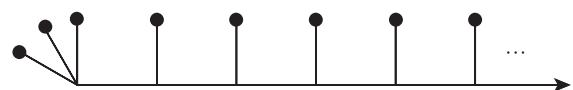

import Guide from '@/components/Guide.astro';
import Knowledge from '@/components/Knowledge.astro';
import Example from '@/components/Example.astro';
import Analysis from '@/components/Analysis.astro';
import Solution from '@/components/Solution.astro';
import Variant from '@/components/Variant.astro';
import Note from '@/components/Note.astro';
import Block from '@/components/Block.astro';
import Method from '@/components/Method.astro';
import Exercise from '@/components/Exercise.astro';

## 第8章 习题

<Exercise title="练习 1">
证明: 如果一个连通图所有顶点的度数是可数的, 那么图本身也是可数的.

<Solution title="提示">
尝试和 $\mathcal { P } _ { n }$ 一起构造 G.
</Solution>
</Exercise>

<Exercise title="练习 2">
给定可数多个自然数的序列 $\sigma ^ { i } = s _ { 1 } ^ { i } , s _ { 2 } ^ { i } , \cdot \cdot \cdot ( i \in \mathbb { N } )$ ，找到一个序列 $\sigma = s _ { 1 } , s _ { 2 } , \cdots$ …使得它将最终优于每个 $\sigma ^ { i }$ ，即对每个运，存在一个 $n ( i )$ 使得对于所有的 $n \geqslant n ( i )$ 有 $s _ { n } > s _ { n } ^ { i }$

<Solution title="提示">
$\sigma$ 从 $s _ { i }$ 优于，， $\sigma ^ { i }$ .
</Solution>
</Exercise>

<Exercise title="练习 3">
可数集合是否可以有不可数多个子集合，使得这些子集舍的交的大小有一个有限\}二界?

<Solution title="提示">
是可数集 的子集的集合，使得对于不同的 $A ^{\prime} , A ^{\prime\prime} \in { \mathcal { A } }$ 和某个固定的 $k \in \mathbb N$ 有$| A ^{\prime} \cap A ^{\prime\prime} | \leqslant k .$ 考虑一个固定 集合 中有多少个集合包含 $S ?$
</Solution>
</Exercise>

<Exercise title="练习 4">
是一棵无限有根数证明 的每条射线都有一个渐增的尾巴，即在由 和它的根定义的树序下，尾巴上的顶点序列是增长的.

<Solution title="提示">
考虑一条射线 $v _ { 0 } v _ { 1 } \cdots$ ，它可以是递减的吗，即 $v _ { 0 } > v _ { 1 } > \cdot \cdot \cdot ?$ 如果不可以，它是否可以递增后再递减昵，即它包含三个顶点使 $x _ { i - 1 } < x _ { i } > x _ { i + 1 } ?$

了归纳地构造这些路另外，也可以运用 Zorn 引理来找到一个不交 A-B 赂的极大集个集合可以是有限的吗?
</Solution>
</Exercise>

<Exercise title="练习 5⁻">
是无限图且 $A , B \subseteq V ( G )$ 证明如果 中不存在有限多个顶点分离包含无限多条不相交的 A-B 路.
</Exercise>

<Exercise title="练习 6">
在命题 ，1.1中，为了证明支撑树的存在性，我们运用 Zorn 引理"从下方"来找到一个极大的无圈子图对于有限圈，我们也可以运用归纳法"从上方"找到一个极小的连通支撑子图如果我们使用 Zorn 引理"从上方"找这样一个子图，会如何呢?

对于下面两个练习，考虑给定图的圈空间(和在1. 节中对有限固的定义一样)会对解决问题有所帮助

<Solution title="提示">
如果你不能使这种方法成立，解释为什么它过不去呢?
</Solution>
</Exercise>

<Exercise title="练习 7">
证明 如果圈包含一棵具有无限多个弦的支撑树，那么它的所有支撑树都包含无限多条弦

<Solution title="提示">
这个圈中有多少个圈?多少个基本圈?

在圈空间中 如何才能生成无限多个圈呢?
</Solution>
</Exercise>

<Exercise title="练习 8">
证明 如果图包含无限多个不同的圈 那么它也包含无限多个边不交的圈.
</Exercise>

<Exercise title="练习 9">
是每个连通的可数无限图，对于每个 $k \in \mathbb N ,$ 1，证明 包含‘个围长至少为 的无限连通支撑子图

<Solution title="提示">
对每一个可数集 存在点对 $\{ u , v \} \in [ V ] ^ { 2 }$ 的序列使得每一个这样的对出现无限多次，
</Solution>
</Exercise>

<Exercise title="练习 10">
对于任意给定 $k \in \mathbb { N } ,$ ，构造一个可平面 连通图是否可以构造一个围长也至少为图'1是否可以构造一个无限连通的可平面图?

<Solution title="提示">
从一个顶点或一个团开始归纳地构造这个图为了保许最后的图有高连通度，把每个新的顶点和将要走义的无限顶点集之间连接很多条边.
</Solution>
</Exercise>

<Exercise title="练习 11">
定理 8.1. 蕴含着存在一个函数 $f _ { \chi } : \mathbb { N } \to \mathbb { N }$ 使得对每个 $k \in \mathbb N$ '1，任意具有色数至少为$f _ { \chi } ( k )$ 的无限图包含一个色数至少为 的有限子图. (例如，令 $f _ { \chi }$ 上的恒等函数对于最小度和连通度，找到类似的商数 $f _ { \delta }$ 和 $f _ { \kappa } ,$ ，或者证明这样的商数不存在

<Solution title="提示">
考虑树，并利用前一个练习.
</Solution>
</Exercise>

<Exercise title="练习 12">
$k \in \mathbb { N } ,$ 而 是图 $G$ 的两个顶点.

(i) 证明·只存在有限多个阶为 的极小 $a { - } b$ 分离，以及有限多个阶为 的极小 $a { - } b$ 割.(如果一个割把 分离，我们称它为曲

(ii) 推导， 的每个边只属于有限多个 条边的键.

<Solution title="提示">
模仿定理 8.7.3 的证明练习 98 提供了一也有用的筒单框架
</Solution>
</Exercise>

<Exercise title="练习 13">
使用无限引理来证明，最小度 的无射线连遥图包含最小度 的有限予图

<Solution title="提示">
逐步地生成这个有限子图在每一步，看看在己生成的子图里是否每个顶点的度数至少为 $d ;$ ，如果没有，给它增加几个新的邻点
</Solution>
</Exercise>

<Exercise title="练习 14">
Halin 证明了一个定理 每个着色数 $\alpha \geqslant \aleph _ { 0 }$ 的图包含一个 $T K ^ { \beta }$ (对每个基数 $\beta < \alpha )$ 对 $\alpha = \aleph _ { 0 }$ ，证明这个定理

<Solution title="提示">
用反证法证明对某个整数饵，一个不包含 $T K ^ { n }$ 的图的色数是多少呢?
</Solution>
</Exercise>

<Exercise title="练习 15">
使用附录 的广义无限引理 对任意图证明定理 8.1.

<Solution title="提示">
建立一个广义无限引理使得当 $P = N$ 时，它与定理 8.1. 的第一个证明中的无限引理是相同的
</Solution>
</Exercise>

<Exercise title="练习 16">
证明定理 8.1. 对可数图成立.注意到，在这个情形，证明基于事实 在第三个证明中所定义的拓扑空间 是序列紧致的(所以， 中每个无限点序列有一介收敛子序列在 $x \in X$ 使得 的每个邻集包含这个子序列的尾巴)

<Solution title="提示">
一开始从 上的拓扑的定义出发，描述 中点序列收敛的涵义，序列到底需要具有什么性质才能保证它的收敛子序列都可以决定 的恰当着色呢?我们是告可以从假设来推导这样一个序列的存在性呢?也许可以从无限引理中找到一些想法
</Solution>
</Exercise>

<Exercise title="练习 17">
h-W 阻盟的树覆盖定理 (2.4.3) 推广\~J无限圈上.

<Solution title="提示">
这是一个典型的紧致性证明 对可数图用无限引理，然后对任意图运用附录 中的紧致性原理或 'ychonov 定理.
</Solution>
</Exercise>

<Exercise title="练习 18">
把填装覆盖定理 (2.4.4)推广到无限图上.

<Solution title="提示">
首先使用 Zorn 引理来找到 $V ( G )$ 的一个划分 使得 的划分类 满足每个 $G [ U ]$ 具有一个 棵支撑树的填装，我们选取 有尽可能多的划分族 U. 然后，使用附录 中的广义无限引理，这里选取 $G / P$ 的有限子圈，来证明 $G / P$ 的边可以划分成 个森林(注还有另外一种方法把填装覆盖定理推广\~J无限圈，它是基于"拓扑支撑树"的，参见练习 12晴)
</Solution>
</Exercise>

<Exercise title="练习 19">
卢对每个 $k \in \mathbb { N } ,$ ，构造一个 连通局部有限图使得删除任何圆的边集后圈变成非遥遥.说h-Williama 和四旧的树填装定理 (2.4.1) 对无限图不成立(提示从一个 连通有限图 $G _ { 0 }$ 开始，如果 $G _ { 0 }$ 包含圈 使得删除 $E ( C )$ 后得到的图还是连通的，那么把更多的 $G _ { 0 }$ 嫁接到 $E ( C )$ 使得 $C$ 具有想要的性质，归纳地进行下去.)

<Solution title="提示">
细分 中的每条边一次，然后把 $G _ { 0 }$ 的新拷贝移植到这些细分顶点上，这需要 $C$ 的长度至少为 $k ,$ 做到这点只需要要求给定的 $G _ { 0 }$ 。有足够大的围长，但是围长到底多大需要在构造的过程中重新考虑.对于树填装的推论，考虑其中一个支撑尉的基本圈.
</Solution>
</Exercise>

<Exercise title="练习 20">
附录 中的广义无限引理和紧致性原理可以互相推出.

<Solution title="提示">
对于必要性，取 $S = \{ 0 , 1 \}$ ，然后把到 的函数看成子集.对于充分性，考虑 $\mathcal { F }$ 中集合的子集
</Solution>
</Exercise>

<Exercise title="练习 21">
在正主;中，使用无限引理我们证明了不友好划分猜想对局部有限图成立

(i) 使用附录 中的紧致性原理，给自另外一个证明.

(ii) 在正文的证明中 为了使用无限引理 我们对命题作了修改，现在还有必要要这样做吗?在证明的哪一步，我们需要使用紧致性原理，因为无限引理要求每个可接受的部分解一定导出某个较小的子结构上的可接受解?哪里用到了局部有限性?

<Solution title="提示">
尝试证明没作修改的命题，
</Solution>
</Exercise>

<Exercise title="练习 22">
(i) 证明·对于所有顶点度是无限的可数图，不友好划分猜想成立

(ii) 是杏能够修改 (i) 中的证明，使得对那些具有有限多个有限顶点度的可数圈也成立?

<Solution title="提示">
(i)，考虑一个无限序列中的顶点，其中这个无限序列使用每个顶点无限次.在每次考虑一个顶点时，让它更开心一点对于 (ii)，首先使得一类顶点开心，然后再考虑别的顶点.
</Solution>
</Exercise>

<Exercise title="练习 23">
使用顶点度来重新叙述第 章练习 46 Gallal :ttl分定理，并把它的等价形式推广到局部有限图.

<Solution title="提示">
运用无限引理或者附录 中的紧致性原理对无限引理，找到一个有关 $G _ { n } = G [ v _ { 1 } , \cdot \cdot \cdot$ $v _ { n } ]$ 的顶点划分的命题，使得它蕴含着关于 $G _ { n - 1 }$ 的导出划分的对应命题，同时，当它对的一个给定划分导出的 $G _ { n }$ 的划分成立时，它对 的这个划分也成立
</Solution>
</Exercise>

<Exercise title="练习 24">
对局部有限图证明定理 8.4.8 你的证明是否可以推广到任意可数图

<Solution title="提示">
对有限子图的一个恰当的减弱命题运用无限引理或者附录 中的紧致性原理.
</Solution>
</Exercise>

<Exercise title="练习 25">
把婚姻定理推广到局部有限圈，并说明它对拥有无限顶点度的可数图不成立

<Solution title="提示">
对于反例部分，注意到如果在有限的情形 $S \subseteq S ^{\prime} \subseteq A$ 满足 $\vert { S } \vert = \vert { N } ( { S } ) \vert$ ，那么婚姻条件保证了 $N ( S ) \subseteq N ( S ^{\prime} )$ 增加 可产生更多的邻点但是，当 是无穷时，这可能不成立我们可以利用这一事实
</Solution>
</Exercise>

<Exercise title="练习 26">
证明:每个局部有限因子-临界图是有限的.

<Solution title="提示">
使用紧致性.
</Solution>
</Exercise>

<Exercise title="练习 27⁺">
证明:局部有限图 因子当且仅当对每个有限集合 $S \subseteq V ( G )$ ，图 $G - S$ 包含最181 个奇(有限)分支.对不是局部有限的图找出反例.

<Solution title="提示">
注意到，为了运用无限引理，只需在 的每一个有限导曲子圈 $G _ { n }$ 中找到一个独立边的集合，使得这个边集合覆盖那些在 $G - G _ { n }$ 中没有邻点的顶点为了找到这样的边集合，对圈 $H _ { n }$ 运用有限 1-因子定理(这里 $H _ { n }$ 是在 $G _ { n }$ 上添加一个大的完全图 $K ,$ 并完全连接K到 $G _ { n }$ 中所有在 $G - G _ { n }$ 中具有邻点的那些顶点).如果你遇到困难，改变 $| K |$ 的奇偶性.

28卢应用 4.3 节的内容，使得画法可以容易地运用无限引理。在无限引理图中，为了从一条射线构造最后的画法，要保证通过归纳构造的部分画法确实是平面上的明确画法，而不只是某类抽象等价的画法
</Solution>
</Exercise>

<Exercise title="练习 28">
Kur目。wski 定理推广到可数图
</Exercise>

<Exercise title="练习 29">
我们称一个顶点 $v \in G$ 支配 (dom ate) 的末端 $\omega ,$ ，如果下面三个条件中的任意一个成立:

(i) 对某个射线 $R \in \omega , G$ 中有一个无限 $v - ( R - v )$ 扇;

(ii) 对每个射线 $R \in \omega , G$ 中有一个无限也 $v - ( R - v )$ 扇，(iii) 不存在 $V ( G - v )$ 的有限子集在 中把 和一条射线分离开来证明上面三个条件是等价的.

<Solution title="提示">
借用练习 的提示，证明 Menger 定理的某种变化的扇子版本
</Solution>
</Exercise>

<Exercise title="练习 30">
证明:图 包含 $T K ^ { \aleph _ { 0 } }$ 。当且仅当 的某个末端被无限多个顶点所控制，

<Solution title="提示">
归纳地构造 $T K ^ { \aleph _ { 0 } }$

$3 1 . ^ { + }$ 对于 (i)，首先考虑证明存在一个顶点，它不支配一个末端 但是可以被有限多条边和

分离关于俏，分析一下(斗的证明中哪里用到了有限可分离性

曲二分树 $T _ { 2 }$ 开始，在保持图的可数性的同时，使得末端变厚
</Solution>
</Exercise>

<Exercise title="练习 31⁺">
设 是一个有限可分离(即任何两个顶点可以被有限多条边分离)图，

(i) 证明 中任何两个不可以被有限多条边分离的末端一定被某个公共点支配.

(ii) 如果没有有限可分离性的假设， (i) 还成立吗?
</Exercise>

<Exercise title="练习 32">
构造一个具有不可数个厚末端的可数圈是否可以找到局部有限的这样的图
</Exercise>

<Exercise title="练习 33">
证明:局部有限、连通且顶点可传递的图恰好有 或无限多个末端

<Solution title="提示">
假设局部有限连通图 有三个不同的末端 是一个有限顶点集，它两两分别分离这些末端。取一个自同构把 映射到"远处的 ${ } ^ { \ ' } G - S$ 的分支，是否可以证明 的映象分离这个分支使得 一定有多于三个末端?
</Solution>
</Exercise>

<Exercise title="练习 34">
证明 $G = ( V , E )$ 的自同构自然地作用于它的末端 二，即每个自同构 $\sigma : V  V$ 可以被拓展成映射 $\sigma : \Omega ( G )  \Omega ( G )$ 使得，只要 是末端 $\omega$ 中的射线就有 $\sigma ( R ) \in \sigma ( \omega )$ 证明 如果 是连通的，那么 的每个自同构 固定一个有限顶点集或一个末端如不固定有限顶点集，它是否可以固定多于一个末端?至少三个末端?

<Solution title="提示">
取定一个顶点叫它的轨道 $U = \{ v , \sigma ( v ) , \sigma ( \sigma ( v ) ) , \cdot \cdot \cdot \}$ 是有限的还是无限的呢?为了决中的位置，令 是从。到jσ间的路，考虑无限并 $P \cup \sigma ( P ) \cup \sigma ( \sigma ( P ) ) \cup \cdot \cdot \cdot$ 这个并是否以某种形式定义一个末端呢?另外，由序列 $v , \sigma ^ { - 1 } ( v ) , \sigma ^ { - 2 } ( v ) , \cdot \cdot \cdot$ 可以得到什么结论呢?
</Solution>
</Exercise>

<Exercise title="练习 35">
证明:图 的局部有限支撑树包含 的每个末端上的一条射线.

<Solution title="提示">
使用引理 8.2.2.
</Solution>
</Exercise>

<Exercise title="练习 36">
如果图的两条射线有无限多个公共顶点，则称一条射线跟随 (fol1ow)另一射线。证明的一棵正规支撑树，那么 的每条射线跟随 的唯一正规射线

<Solution title="提示">
运用引理 8.2.3.
</Solution>
</Exercise>

<Exercise title="练习 37">
使用正规支撑树来证明，可数连通图要么有可树多个末端，要么有连续统多个末端.

<Solution title="提示">
为了证明命题对树成立，假定树有不可数个末端，然后在树中构造一个细分的 $T _ { 2 }$

38‘ 找到一个与正则支撑树相关的等价命题。
</Solution>
</Exercise>

<Exercise title="练习 38">
证明:对连温可数图 下面的命题是等价的(i) 有局部有限支撑树;(ii) 不存在有限分离集 $X \subseteq V ( G )$ 使得 $G - X$ 有无限多个分支-
</Exercise>

<Exercise title="练习 39">
证明:每个(可数)可平面\$连遁图都有一棵局部有限支撑树

<Solution title="提示">
使用上一个练习.
</Solution>
</Exercise>

<Exercise title="练习 40">
证明 Erd 定理的无限版本=无限图 要么包含无限多个不交的圈，要么有一个有限顶点集 使得 $G - Z$ 是一个森林

<Solution title="提示">
考虑正则支撑树中的基本圈
</Solution>
</Exercise>

<Exercise title="练习 41">
是连通图.集合 $U \subseteq V ( G )$ 被称作可分散的 (dispersed)，如果 的每个射线可以被有限多个顶点从 分离开来(在 8.6 节的拓扑中，这些集合恰好是 $V ( G )$ 的闭子集)(i) 证明 有正规支撑树当且仅当 $V ( G )$ 是可数多个可分散集的并(ii) 推导如果 有正规支撑树，则 的每个连通子式亦然

<Solution title="提示">
为了构造。)中的正规支撑树，模仿关于可数图 的证明把每个分散的集合排成良序集，然后连接这些良序成为 V(G) 上的良序 再递归地构造想要的树
</Solution>
</Exercise>

<Exercise title="练习 42">
证明定理 8.2.5 (盐).

<Solution title="提示">
采用顶点的情形，来构造无限多个边不交的途径，这些途径不重复使用边但只重复使用顶点有限多次，分段地构造这些途径使得，除了最后一段外，每段与前面的段落是顶点不交的(也不与其他途径相交)
</Solution>
</Exercise>

<Exercise title="练习 43">
(i) 证明 如果对每个 $k \in \mathbb { N } ,$ 图的给定未端包含 条不交射线，那么它包含无限多条不交射线(ii)+ 证明:如果对每个 $k \in \mathbb N ,$ ，图的给定末端包含 条边不交射线，那么它包含无限多条边不交射线

<Solution title="提示">
模仿定理 8.2.5 的证明，选择与给定的来端所使用的所有射线，那么构造的射线是否也属于这个末端?如果不属于，怎么才能实现呢
</Solution>
</Exercise>

<Exercise title="练习 44">
证明:如果对每个 $k \in \mathbb N .$ ，图包含 条不交的双射线，那么它包含无限多条不交的双射线.

<Solution title="提示">
模仿定理且2.5 的证明 只要可能，尽量选择射线而不是双射线，
</Solution>
</Exercise>

<Exercise title="练习 45">
证明 在普遍存在猜想 (ubiq ty conject e) 中，所考虑的主图也可以假定是局部有限的.

<Solution title="提示">
我们需要证明的是，在任何一个包含任意多个 的不交模型的图 中，找到一个具有同样性质的局部有限子图第一步是找到一个这样的可数图 $G ^{\prime}$ ，并排列它的顶点，然后运用这个排列来找到一个局部有限子图 $G ^{\prime\prime} \subseteq G ^{\prime}$ 使得 $G ^{\prime}$ 的每个顶点只被有限多个的模型使用.
</Solution>
</Exercise>

<Exercise title="练习 46">
证明:下图所示的改进型梳在子图关系下不是普遍存在的 (ubiquitous) 如果删去左边←星，它是否变成普遍存在的呢?

<figure class="vp-figure">
  
</figure>

<Solution title="提示">
为了构造一个包含任意多个改进型梳子 同时不是无穷多个 的拷贝的图，从无限多个不交的 的拷贝开始，然后把它们分成不交的集合 $S _ { 1 } , S _ { 2 } , \cdots$ 使得 $S _ { n }$ 是 n 个 T 的拷贝的不交并，再把不同的集合 $S _ { n }$ 中的顶点重合起来使得它们破坏 的不交拷贝的无限"对角线"集合

47‘ 与定理 8.2.6 的证明不同，我们可以使用(很大但是有限的)集合 $\textstyle { \mathcal { R } } _ { 0 }$ 。中所有射线的合适的尾巴作为射线 $R _ { n }$ .所以，证明中由假定(树)开始的部分可以替换为更筒单的算法来找到 $R _ { n }$ 和不交 $R _ { n } \ – R _ { p ( n ) }$ 赂的无限集为了决定需要多少条射线，考虑无限引理的恰当有限形式的命题 任何足够大的根树要么包含一个至少有 个后继的顶点，要么包含一条长度为 的路
</Solution>
</Exercise>

<Exercise title="练习 47">
模仿定理 8.2.6 的证明，找到一个商数 !:N 使得，只要图 的末端 $\omega$ 包含 !(k)条不交的射线，那么 包含----1' $k \times \mathbb { N }$ '!六角形网格的细分使得它的射线都属于 $\omega .$
</Exercise>

<Exercise title="练习 48">
证明 对于子图关系，不存在通用的周部有限连通图

<Solution title="提示">
假定存在一个广义罔 ，构造一个局部有限连通图 使得它的顶点度对于的任何嵌入都"增长太快"
</Solution>
</Exercise>

<Exercise title="练习 49">
对于子式关系，构造一个通用的局部有限连通圈 对于拓扑子式关系，是否存在这样的图?

<Solution title="提示">
修改 $K ^ { \aleph _ { 0 } }$ 或者Rad 圈，也可以尝试直接构造-
</Solution>
</Exercise>

<Exercise title="练习 50">
证明:对Rad 圈 R 进行下面的每一个运算都产生一个同构于 的图

(i) 取补，即把所有现存的边换成无边，反之亦然

(ii) 删去有限多个顶点，

(iii) 把有限多个边换成无边，反之亦然

(iv) 把有限顶点集 $X \subseteq V ( R )$ 和它的补 $V ( R ) \setminus X$ 之间的所有边换成无边，反之亦然-

<Solution title="提示">
运用性质的.
</Solution>
</Exercise>

<Exercise title="练习 51">
证明， Rad。因是齐次的

<Solution title="提示">
运用往复技巧
</Solution>
</Exercise>

<Exercise title="练习 52">
证明:在同构意义下，齐次可数图被一族它的(阿构类型的)有限子图所唯一决定

<Solution title="提示">
运用往复技巧
</Solution>
</Exercise>

<Exercise title="练习 53">
如前所述，如果图 的子圈 $H _ { 1 } , H _ { 2 } , \cdots$ 边集合组成 E(G) 的一个划分，则称 $H _ { 1 } , H _ { 2 }$ 划分 (partition) G. 证明， Rad 图可以划分成可数局部有限图的任意给定可数集，只要每个子图包含至少一个边.

<Solution title="提示">
归纳地找到划分，每次删除一个图的边集并证明剩下的图仍然同构于 如何才能保证一旦删除了所有必需的边集，就没有边剩下了呢?

饵， 把密度像性质的一样使用。
</Solution>
</Exercise>

<Exercise title="练习 54">
我们称一个线性序是稠密的 (de丑陋)，如果任意两个元素之间存在第三个元素

(i) 找到或构造一个可数的稠密线性序，它既没有极大元也没有极小元

(ii) 证明这个序是唯一的，即任意两个这样的序是序同构的(如何定义昵

(iii) 证明 在所有可数线性序中，这个序是通用的.它是否是齐次的呢? (提供适当的定义.)
</Exercise>

<Exercise title="练习 55">
给定 明白之间的双射! $f ,$ 设 $G _ { f }$ 是定义在 上的图使得如果 $u \in f ( v )$ ，则$u , v \in \mathbb { N }$ 是邻接的;反之亦然.证明所有这样的图 $G _ { f }$ 是同构的

<Solution title="提示">
R
</Solution>
</Exercise>

<Exercise title="练习 56">
(为集合论学者设计)给定集合论中的任意可数模型，定义图的顶点是集合，而两个集合是邻接的当且仅当一个包含另一个作为予集.证明 这样定义的图是Rad

<Solution title="提示">
对于性质的中的顶点。，先令 $v : = U$ 这样的设定为什么不行呢?如果不行，如何修改呢?你可以运用基础公理 (axiom of foundation)，由它知道不存在集合的序列$x _ { 1 } \in \cdot \cdot \cdot \in x _ { n } \ ( n \geqslant 2 )$ 且 $x _ { 1 } = x _ { n }$
</Solution>
</Exercise>

<Exercise title="练习 57">
给定图 的顶点集 AJBJ 证明， 或者包含无限多个边不交 A-B 路，或者存在有限边集在 中分离

<Solution title="提示">
贪婪地收集这些路
</Solution>
</Exercise>

<Exercise title="练习 58">
是一个局部有限圈，对于有限顶点集 和两个末端 $\omega , \omega ^{\prime} ,$ ，如果 $C ( S , \omega ) \neq C ( S , \omega ^{\prime} )$ 则称 分离 (sep旧时e) 末端 $\omega$ 和 $\omega ^{\prime}$ 运用命题 8.4.1 证明，如果 $\omega$ 和 $\omega ^{\prime}$ 可以被 $k \in \mathbb N$ 个但不能被少于 $k$ 个顶点分离，那么 包含 条不交的双射线，使得它们的尾巳一个在 $\omega$ 中，另一个在 $\omega ^{\prime}$ 中这个结论对非局部有限的图也成立吗?

<Solution title="提示">
参考练习 59 对于局部有限图 ，找到集合 $S _ { i }$ 很容易.
</Solution>
</Exercise>

<Exercise title="练习 59">
证明练习 43 (i) 的具有更多结构悖质的版本设 $\omega$ 是可数图 的末端证明:G 要么包含一个 $T K ^ { \aleph _ { 0 } }$ 。使得所有射线都在 $\omega$ 中，耍么存在不交有限集合 $S _ { 0 } , S _ { 1 } , S _ { 2 } , \cdots$ 使得，如果 $C _ { i }$ 是 $G - ( S _ { 0 } \cup S _ { i } )$ )的分支，它使得所有射线的尾巴都在 $\omega$ 中，那么对所有 $i < j$ 有 $C _ { i } \supset C _ { j }$ ，并且对所有 $i \geqslant 1 , G [ S _ { i } \cup C _ { i } ]$ 包含 $| S _ { i } |$ 个不交 $S _ { i ^ { - } } S _ { i + 1 }$ 路.

<Solution title="提示">
首先处理支配剧的那些顶点如果你认为有帮助，可以假定 有一棵正则支撑树

60+ 使用练习 59 中的思路
</Solution>
</Exercise>

<Exercise title="练习 60⁺">
是否存在可平面 $\aleph _ { 0 ^ { - } } .$ :iE则图 它的所有末端具有无限顶点度?
</Exercise>

<Exercise title="练习 61">
是局部有限连通图 的两个顶点集是否存在不交 A-B 赂的无限序列 $\mathcal { P } _ { 1 }$ $\mathcal { P } _ { 2 } , \cdot \cdot \cdot$ 使得每个 $\mathcal { P } _ { n + 1 }$ 是从 $\mathcal { P } _ { n }$ 使用交错途径得到的，并且存在某个边 $e \in G$ 使得对无限多个饨 $n , e$ 属于 $E [ \mathcal { P } _ { n } ]$ ，对另外无限多个 不属于 $E [ \mathcal { P } _ { n } ]$
</Exercise>

<Exercise title="练习 62">
构造一个大波的小极限例子.是否可以找到一个局部有限的例子?

<Solution title="提示">
选取 $a \in A ,$ 并构造一序列被 $\mathcal { W } _ { 1 } , \mathcal { W } _ { 2 } , \cdot \cdot \cdot$ 使得每个波包含平凡路 \{α\} 定义在 $a$ 的边使得 在每个 $\mathcal { W } _ { n }$ 的边界上，但不在限制波的边界上
</Solution>
</Exercise>

<Exercise title="练习 63⁺">
对于树，证明定理 .4，

<Solution title="提示">
正如可数的情形一样，一般性的问题可以简化\~J引理 8.4.3. 对森林证明这个引理

$6 4 . ^ { + }$ 由?开始，递归地定义路系统 $\mathcal { P } _ { \alpha }$ 使得它从 逐步地连接更多的 B. 在递归步骤中，选取非覆盖顶点 $b \in B$ 并沿着包含它的路 $Q \in \mathcal { Q }$ 后退直到它碰上 $\mathcal { P } _ { \alpha }$ ，这里记 $P = a \cdots b ^{\prime}$ 我们可以重新调整 使得它沿着 $Q$ 到达 $b ,$ 但这会让 $b ^{\prime}$ 成为非覆盖的那么，在有限步骤后，这些变化是否可以使得 的覆盖部分增加?为了证明这是会发生的，我们可否定义一个"指标"参数 它随着步数的增加而增加(或减少)但不能无限地增加(或减少)1作为选择，也可以证明并运用稳定婚姻定理 (2.1玛的某种无限形式，
</Solution>
</Exercise>

<Exercise title="练习 64⁺">
证明 $\mathrm { P y m }$ 定理 (8 .4， 7)
</Exercise>

<Exercise title="练习 65">
(i)-证明 Dilworth 定理在任意无限偏序集 上的简单推广=如果 不包含阶为 $k \in$ 的反链，那么 可以划分成少于 条链(只需对可数的 证明即可)

(证)-找到一个偏序集，它没有无限多条反链，同时不能划分成有限多条链.

(iii) 对于不包含无限链的偏序集，从定理 .4， 推导下面Dilworth 定理的 Erdðs-Menger类型的推广每个这样的偏序集包含一个分解成链的划分 使得某个反链与的所有链相交

<Solution title="提示">
(i) 恰好是紧致性，这是一个运用定理 8.1. 且只需一行的漂亮证明，对于间，由若干任意大的有限反链构造一个偏序集.对于 (iii)，定义一个二部罔如下=对每一个点 $x \in P .$ 选取两个顶点 $x ^{\prime}$ 和 $x ^{\prime\prime}$ ，并添加满足 $x < y$ 的所有边 $x ^{\prime} y ^{\prime\prime}$ 在定理 .4.8 所提供的圈中，考虑匹配 和顶点覆盖 是如何定义了一个 的链划分呢?对于这样一个链的多少个点 $x ,$ 对应的 $x ^{\prime}$ 或 $x ^{\prime\prime}$ 属于 呢?
</Solution>
</Exercise>

<Exercise title="练习 66">
是可数圈，且满足每个部分匹配都有一个增广赂。

(i) 举例 找到 和部分匹配序列 $M _ { 0 } , M _ { 1 } , \cdots$ ， 这里每个部分匹配是从前一个部分匹配对增广赂的边集做对称差得到的，并且使得对 的每个边 $e , e$ 属于无限多个 $n$ 的 $M _ { n + 1 } \setminus M _ { n }$

(ii) 证明.对每个部分匹配 存在 (i) 中的序列使得 $\textstyle \bigcup _ { m } \bigcap _ { n > m } M _ { n }$ 是一个 1-因子的边集舍-

<Solution title="提示">
由定理 8.4.11 包含一个 因子你是否可以使用这一事实对 (ii) 给出一个肯定的答案.
</Solution>
</Exercise>

<Exercise title="练习 67">
找到 一个不可数图，它的每个部分匹配都有一个增广路(有限的或无限的)，但它没有1-因子-

<Solution title="提示">
为了保证每一个部分匹配是可扩展的，这样的图需要有很多边，然而如何避免 因子的出现呢?
</Solution>
</Exercise>

<Exercise title="练习 68⁻">
设 是一个可数图 它的有限子图都是完美的.证明， 是弱完美的但不一定是完美的

<Solution title="提示">
先考虑 的完全子图是有限界阶的情形，我们可以使用 8.1 节的结果.

$6 9 . ^ { + }$ 对于 (ii) 的完美性 证明 $T _ { 2 }$ 的每个具有任意大的有限反链的子集也有一个无限反链.

$7 0 . ^ { + }$ 为了简单起见，把图替换成它的一棵支撑树 哪些顶点比其他顶点需要在排列中出现

的更早?对(吟，考虑正则支撑树
</Solution>
</Exercise>

<Exercise title="练习 69⁺">
设 是一个二分树的不可比较圈，即 $V ( G ) = V ( T _ { 2 } )$ )，且两个顶点是邻接的当且仅当它们在 $T _ { 2 }$ 的树序下是不可比较的，证明， 是完美的但不是强完美的
</Exercise>

<Exercise title="练习 70⁺">
(i) 证明 无限连通局部有限图的顶点可以被列举，使得每个顶点都邻接到某个后面的顶点

(垣)利用分离性质刻画所有可数但不一定局部有限的阁.
</Exercise>

<Exercise title="练习 71">
考虑命题 证明后面第二个段落中定义的秩，证明=一棵树有秩当且仅当它是递归可修剪的，并日它有秩 $\alpha$ 当且仅当 是它的修剪标号的最大值

<Solution title="提示">
提醒 $T _ { \alpha }$ 是由递归剪枝算法定义的，所以它在 中是下集合
</Solution>
</Exercise>

<Exercise title="练习 72">
是无射线的图，并具有秩 ，而 是实现秩的有限顶点集并具有最小阶.证明是唯一的

<Solution title="提示">
如果 $U ^{\prime}$ 是另外一个这样的集合，那么考虑顶点 $u \in U \setminus U ^{\prime}$ 以及 $G - U ^{\prime}$ 中包含甸的分支的秩。
</Solution>
</Exercise>

<Exercise title="练习 73">
(i) 构造年个可数树，它在无射线图的排序中具有秩 ω. 是否可以找到这样的树，它包含所有其他树?

(ii)+ 是否存在一个秩为 $\omega$ 的树，它是每一个这些树的子树?

<Solution title="提示">
对图的边进行细分会对它的秩产生什么影响呢?
</Solution>
</Exercise>

<Exercise title="练习 74">
一个图 $G = ( V , E )$ 被称作有界的 (bounded)，如果对每个顶点标号 $\ell : V \to \mathbb { N } ,$ ，存在一个函数 f:N 中活着任意射线最终都会超越标号 ι(正式的定义是每个射线 $v _ { 1 } v _ { 2 } \cdots$ ，存在 $n _ { 0 }$ 使得对所有 $n > n _ { 0 }$ 。有 $f ( n ) > \ell ( v _ { n } ) . )$ 证明下面的结论(i) 射线是有界的，

(ii) 每个局部有限连通图是有界的;

(iii) 可数树是有界的当且仅当它不包含 $\aleph _ { 0 } -$ 正则树 $T _ { \aleph _ { 0 } }$ 的细分

<Solution title="提示">
对(斗，注意一条射线有可数多条子射线对(盐i) 中的充分性?递归地修剪给定树，把已经界定的子树剪掉

75+ $T _ { \aleph _ { 1 } }$ 有这样的标号吗?如果 $T T _ { \aleph _ { 1 } }$ 递归地构造 的一个标号假定标号已存在，在中标号为零的顶点的位置在哪里呢?标号为 的顶点在哪里呢?
</Solution>
</Exercise>

<Exercise title="练习 75⁺">
是很为 的树，而 $\leqslant$ 表示 $V ( T )$ 上与 和?关联的树序，证明 不包含 ，-正则树 $T _ { \aleph _ { 1 } }$ 的细分当且仅当 有一个序标号 $t \mapsto o ( t )$ 使得只要 $t < t ^{\prime} ,$ 就有 $o ( t ) \geqslant o ( t ^{\prime} )$ 并且 没有多于可数个顶点具有相同的标号
</Exercise>

<Exercise title="练习 76">
是具有顶点 $v _ { 0 } , v _ { 1 } , \cdot \cdot \cdot$ 的可数连通图，对每个 $n \in \mathbb { N } ,$ ，记 $S _ { n } : = \{ v _ { 0 } , \cdot \cdot \cdot , v _ { n - 1 } \}$ \}证 明下面的命题·

(i) 的每个末端 ，存在由 $G - S _ { n }$ 的分支 $C _ { n }$ 组成的唯一序列 ${ \cal C } _ { 0 } \supseteq { \cal C } _ { 1 } \supseteq \cdots$ .使得对所有的 $C _ { n } = C ( S _ { n } , \omega )$

(ii) $G - S _ { n }$ 的分支 $C _ { n }$ 组成的每一介无限序列 ${ \cal C } _ { 0 } \supseteq { \cal C } _ { 1 } \supseteq \cdots$ 在唯一的末端 $\omega$ 使得对所有的 $C _ { n } = C ( S _ { n } , \omega )$

<Solution title="提示">
是局部有限图时， (垣)中所需要的射线的存在性可以立即从星-梳子引现得到.当 $G$ 不是局部有限图时，要么直接构造这条射线，要么对构造过程中所产生的局部有限树使用屋-梳子引理.

77‘ 对于必要性，注意到不存在顶点的有限集合把 分离开来.运用这一事实归纳地构造 R-U 路，或者使用 Menger 定理的平凡形式。
</Solution>
</Exercise>

<Exercise title="练习 77">
是一个圈，且 $U \subseteq V ( G ) , R \in \omega \in \Omega ( G )$ . 证明， 包含一个具有梳背 和梳齿中的梳当且仅当 $\omega \in { \overline { { U } } }$
</Exercise>

<Exercise title="练习 78">
给定图 $H \subseteq G .$ 设 $\eta : \Omega ( H ) \to \Omega ( G )$ 的每个末端映射到 的包含它作为(射线的)子集的唯一末端对下面的问题，我们假定 是连逝的并且 $V ( H ) = V ( G )$

(í) 证明·η 不一定是单射它一定是满射吗?

(ii) 可是如何把|町的子空间。(H) 和它在 $|G|$ 中的映象联系起来的?可总是连续的吗?它是开的吗?如果知道句是个单射?这些问题的答案会改变吗?

(iii) 支撑树是末端一一的 (end.拟出缸1)，如果 是个双射;它是拓扑末揣一一的(如pc←10gically end-[，田 凶吟，如果 是一个阿胚证明 每个连通可数图包含一棵拓扑末端一一的支撑树

的末端空间 (end space) $|G|$ 的子空间 $\Omega ( G )$

<Solution title="提示">
答案也许依赖于 是否是局部有限的提醒，从紧致空间到 Hausdorlf 空间的连续双射是一个同胚，对于 (iii)，可以使用引理1.5.5 (坦).
</Solution>
</Exercise>

<Exercise title="练习 79">
考虑图 8.1. 中的二分树 $T _ { 2 }$ 的末端壁间。，它的顶点是有限。 序列.

(i) 证明，\{1同胚于 $2 ^ { \mathbb { N } }$ 这里 $2 = \{ 0 , 1 \}$ 拥有离散拓扑且 $2 ^ { \mathbb { N } }$ 拥有乘积拓扑

(ii) 中确定两个末端，使得由它们所生成的无限二元序列表示了同样的有理数证明所得到的。的商空间同胚于实数区间 10 1]

<Solution title="提示">
(ti) 中，我们可以假定实数已表达成二进位形式.实区间 [0 11 保持了从 继承来的子空间拓扑，它就是 上通常度量所生成的拓扑.
</Solution>
</Exercise>

<Exercise title="练习 80">
对阁 8.6.1 所示的平丽阁，在每条水平边的上而添加无限多条水平边，使得与定义在同一个有理数 工的G- 序列所关联的每对射线变成一个梯子.证明或反证 所得到的阁的末端空间同胚于 [0 1]

<Solution title="提示">
注意对未端空间所傲的并非故意的变化
</Solution>
</Exercise>

<Exercise title="练习 81">
紧致度量些问被称为一个康托尔集 (C 自由吟，如果只有单点集是连边的子集，且每个点是一个聚点(邮 皿u1ation point).

(i) 刻画末端壁间是康托尔集的所有树，

(ii) 证明 连通的局部有限图的末端空间是一个康托尔集的子集。

<Solution title="提示">
可以对树使用定理自 6.2 运周引理1.5.5 (ti) 或者练习 78 的答案，从 (i) 的解答推出。i).
</Solution>
</Exercise>

<Exercise title="练习 82">
(i) 证明 如果 的收缩子式且具有有限分支集，那么 的末端空间是同胚的

(ii) 用 $T _ { n }$ 表示恃叉树，即每一个顶点恰好有 个后继的根树证明=所有这样的树都具有同胚的末端空间.

<Solution title="提示">
对于 (i)，定义一个问胚，它把 的射线映射到 的射线，但反之不然对于间，证明$T _ { n }$ 可以从 $T _ { 2 }$ 通过收缩有限集合来得到，
</Solution>
</Exercise>

<Exercise title="练习 83">
使用序列紧致性和无限引理，给出命题 一个独立的证明.

<Solution title="提示">
如果序列紧致壁阳(即每一个点的无限序列都有一个收敛的子序列)有可数萎，那么它是紧致的假如无限引理看起来没有什么帮助 可以参考引理 8.2.2
</Solution>
</Exercise>

<Exercise title="练习 84⁺">
(为拓扑学者设计)在局部紧致的、连逝的，且周部连逝的 Hausdorff 空间 X 中，考虑序列 $U _ { 1 } \supseteq U _ { 2 } \supseteq \cdots$ ，这里 $U _ { i }$ 是开的、非空的、连通的子集且具有紧致前沿(量。ntier)，同时满足 $\bigcap _ { i \in \mathbb { N } } { \overline { { U _ { i } } } } = \emptyset$ 我们称这样的序列等价于另外一个这样的序列，如果一介序列的每个集合包含另一个序列的某个集合;反之亦然‘注意到，这确实是一个等价关系，它的等价类叫做 的Freude hal 末端.现在，把这些末端添加到空间 中，然后在拓展后的空间 上定义一个自然拓扑，使得当 是一个图时 同胚于 IXI (通过固定的每个点且把 的哺的"末端跚跚 IXI 的末端).

<Solution title="提示">
为了定义 上的拓扑，模仿标准的单点紧致化的定义

$8 5 . ^ { + }$ 对于紧致性的证明，使用正则支撑树并模仿命题 8.6.1 的证明.

$8 6 . ^ { + }$ 对于第一部分，减少树的边长度使得由根开始的一个射线的总长度变成有限，然后调整中另外边的长度，并拓展所得到的度量到 的未端1:.对于第二部分，注意到对 $V \cup \Omega$ 上给定拓扑所生成的度量，距离每个末端至少 $1 / n$ 的顶点的集合 $V _ { n }$ 是封闭的，并证明取正整数时，这些集合覆盖
</Solution>
</Exercise>

<Exercise title="练习 85⁺">
是一个连通可数图但不是局部有限的证明， $|G|$ 不是紧致的，然而 O(的是紧致的当且仅当对任意有限集 $S \subseteq V ( G )$ 只有有限多个 G-8 的分支包含射线
</Exercise>

<Exercise title="练习 86⁺">
是一个连通图假定 有正规支撑树，在 $|G|$ 上定义一个导出它通常拓扑的度量反过来，运用练习 41 证明，如果 $V \cup \Omega \subseteq | G |$ 是可度量化的，!il 包含正规支撑树
</Exercise>

<Exercise title="练习 87">
找到一个圈 使得 $|G|$ 是不可度量化的.(提示 不要直接考虑度量，而是回忆-1'.度量空阔的性质，构造一个不具有这个性质的G.)拓扑空间 称为局部连通的 (locally connected) ，如果对每个 $x \in X$ 的每个邻都存在 的一个连遭开邻集 $U ^{\prime} \subseteq U .$ 连续统 (continuum) 是一个紧致的连通Hausdorff 空间由点集拓扑学的一个定理知，每个局部连通的度量连续统一定是弧连通的

<Solution title="提示">
在度量空间中，每个点是可数多个开集的交集这里的开集是围绕点的半径为 $1 / n$ 的开球 $( n \in \mathbb { N } )$
</Solution>
</Exercise>

<Exercise title="练习 88">
证明 对连通局部有限图 $|G|$ 的每个连通标准子空间是局部连通的.根据 f:面提到的定理，导出引理 8.6.5.

<Solution title="提示">
给定连通的标准予空间 ，以及一个来端 $\omega \in X$ ，考虑足够小的开邻域 $\hat { C } _ { \epsilon } ( S , \omega )$ 使得$| E ( S , \omega ) \cap E ( X ) |$ 是最小的然后使用引理 8.6.7
</Solution>
</Exercise>

<Exercise title="练习 89">
不使用引理 8.6.5 直接证明引理 8.6.6

<Solution title="提示">
给定 的一个弧分支 和一个末端 $\omega \in { \overline { { A } } } .$ ，选取 中收敛于 $\omega$ 的点序列 $x _ { 1 } , x _ { 2 } , \cdots$ 尝试通过把 $x _ { n } { - } x _ { n + 1 }$ 弧的段藩拼凑在一起，来构造一个从这些点到j $\omega$ 的弧
</Solution>
</Exercise>

<Exercise title="练习 90">
是局部有限圈 $|G|$ 的由包含至少两条边的集合支撑的标准子空间证明是一个圈当且仅当对任意两条不同的边 $e , e ^{\prime} \in E ( G )$ ，子些问 $\boldsymbol { X } \setminus \boldsymbol { \mathscr { e } }$ ;是连通的，但 X\$( \stackrel \{ \circ \} \{ e \} \cup \stackrel \{ \circ \} \{ e \} ^ \{ \prime \} )$ 是不连适的

<Solution title="提示">
可以运用事实 从单位圆上删除一个开区间，剩下的部分还是连通的，但删除两个不交的开区间则不连通记住 ]G] 的闭连通子集是路连逝的
</Solution>
</Exercise>

<Exercise title="练习 91">
每个局部有限 连通的无限图是否一定包含一个无限回路?是否包含一个无限键?

<Solution title="提示">
构造两个属于同一个末端的射线，它们起始于同一个顶点但在其他顶点不交这种构造可以通过考虑正规射线并运用射线的顶点都不是割点这一事实实现.
</Solution>
</Exercise>

<Exercise title="练习 92">
和某:1'无限键只相交于一条边。

<Solution title="提示">
由回路所生成的子图的分支是什么呢?两个结果都需要使用跳跃弧引理.
</Solution>
</Exercise>

<Exercise title="练习 93">
朋， $|G|$ 中包含在某个弧或圈 中的所有边的并是 中的稠密集-

<Solution title="提示">
前面提到，在 $S ^ { 1 }$ 中每一个点有一个由 $\mathbb { R } ^ { 2 }$ 中的弧组成的邻域基.可否证明 中连接两个末端的每一个弧一定在一个边相交?如果不能证明，可否证明它交于一个顶点?如果还不行，记得使用引理 8.6.3
</Solution>
</Exercise>

<Exercise title="练习 94">
通过展示与 $S ^ { 1 }$ 的同胚，说明伊 8.6.1 中的困确实是一个圃

<Solution title="提示">
在一个无穷序列中，排列双射线 和 $D _ { l }$ ，并归纳地定义这些 $D _ { l }$ 和 $S ^ { 1 }$ 的适当线段之间的局部同胚.当完成这个后，把所有双射线的井的局部同胚拓展到tlG 的末端上，使得最后的映射连续.定义想要的双射的一个好办法是，一方面使用。 序列集合的线性序的结构 另一二 面，把 $S ^ { 1 }$ 的区间看成 [0 1] 的一个拷贝，并考虑它的线性序的结构
</Solution>
</Exercise>

<Exercise title="练习 95">
每个弧在其点集上导出一个源自 [0 11 的线性序我们称 $|G|$ 的一个弧是模狂的 (wild)如果在它自身顶点的某个子集上导出有理数的序 在任何两个之间还有另外‘个.证明:每个包舍不时数多个末端的弧是疯狂的，

<Solution title="提示">
证明 每个包含不可数多个来端的弧的区问都包含一个顶点，使得这个顶点把它分离成两个区间参考练习 54.

96‘ 需要多少个不交的国才能使得它们的交可以具有一个连通闭包?你是否见过一个连通标准予空间，它是不交孤的并的闭包?
</Solution>
</Exercise>

<Exercise title="练习 96">
找到一个局部有限图 ，它具有 $|G|$ 的连通标准子壁间使得这个子空间是不交圈的并的闭包
</Exercise>

<Exercise title="练习 97">
证明:对局部有限图 $|G|$ 的一个闭标准子空间 是|叫中的圈当且仅当 是连通的，且 中的每个顶点恰好关联 中的两条边，并且 中每个末端的拓扑度为 2.

<Solution title="提示">
需要证明的主要命题是满足条件的每一个子空间 是一个圈设 $A \subseteq C$ 是连接两个顶点 $x _ { 0 }$ 和脚的弧如果 $y _ { 0 }$ $C \setminus A$ 的任意顶点，那么 的连通性导出了 的一个$v { - } A$ 弧，它是 上的第一个点，由皮条件知它一定是 $x _ { 0 }$ 或 $y _ { 0 }$ 。从 中顶点的一个排序 $v _ { 0 } , v _ { 1 } , \cdot \cdot \cdot$ "开始，构造一个顶点的耳道路无限序列 $\cdot \cdot \cdot , x _ { - 2 } , x _ { - 1 } , x _ { 0 } , y _ { 0 } , y _ { 1 } , y _ { 2 } , \cdot \cdot \cdot$ 使包含连接 $x _ { - i - 1 }$ 到 $x _ { - i }$ ‘的弧 $A _ { i }$ 以及连接 $y _ { i }$ 到如 $y _ { i + 1 }$ 的弧 $B _ { i }$ (对所有 $i \in \mathbb { N } )$ 1)，使的并 和所有的这些弧是 $( 0 , 1 )$ 的同胚拷贝运用它的尾巴的连通性证明它们收敛于 的唯一末端从度假设导出这两个末端重舍，且 $\overline { { U } } = C$ 是一个圈
</Solution>
</Exercise>

<Exercise title="练习 98">
是一棵局部有限的树，构造一个连续映射 $\sigma : [ 0 , 1 ] \to | T | .$ ，它把 映射到树的根，并经过每条边恰好两次，在每个方向上一次(严格地，定义 $\sigma$ 使得边的每个内部点恰好是 [0 1] 中两个点的象)

(提示:把 $\sigma$ 定义为有限子树 $T _ { n }$ 上类似的映射 $\sigma _ { n }$ 的极限)

<Solution title="提示">
设 $T _ { n }$ 是由树 中前面 层组成的子树那么容易地定义一个映射 $\sigma _ { n }$ :把 $T _ { n }$ 嵌入平面中，然后"沿着"它行走，使得你的右手放 $T _ { n }$ 旦上，而你的脚紧挨 $T _ { n }$ .为了保证 $\sigma _ { n }$ 的兼容性，有必要要求 $\sigma _ { n }$ 在 $T _ { n }$ 每个叶子"停顿"一会，即把[口 1] 的一个非平凡子区间映射到每个叶子上在这些区间，我们可以把内 $\sigma _ { n }$ 展从而得到内+ $\sigma _ { n + 1 }$ 剩下的工作是，当 $n \to \infty$ 时，对于在 $\sigma _ { n }$ 中不断改变取值的那些点 $x \in [ 0 , 1 ]$ ，怎样正确地定义极限 $\sigma$ 并且证明在这些点上的连续性.
</Solution>
</Exercise>

<Exercise title="练习 99">
是连通的局部有限图证明 对于 $G$ 的支撑子图 $T ,$ "f面的命题是等价的

(i) $\overline { T }$ 是 $| G |$ 的拓扑支撑树;

(ii) 是使得 不包含圈的边极大圈，

(iii) 是使得 $\overline { T }$ 是 $| G |$ 的连通子空间的边极小图

<Solution title="提示">
应用引理 8.6.5 和引理 8.6.7. 也可以使用每个圈包含一条边这一事实.

100- (i) 如果一个拓扑支撑树同)fF..于一个空间 $| T |$ (这里 是一棵树)，但它本身没有这种形式，那么它包含一个末端，这个同胚把末端酣才到一个点(即不是一个末端)你能找到一个拓扑支撑树使得这些不成立吗?(ii) 对任意这样的树 $T$ 去存在 的个末端，它不能被 个射线代表.从这个末端 $T$ 如何支撑 的一个射线呢?
</Solution>
</Exercise>

<Exercise title="练习 100">
(i) 注意到 拓扑支撑树不必同胚于一棵树对于一棵适当的树 它是否可以同胚于空间 $| T |$ 呢?(ii) 找到一个图 它的支撑树是 它在 $|G|$ 中的闭包不是弧连通的
</Exercise>

<Exercise title="练习 101">
是局部有限圈 的末端一一的支撑树(这种树的定义见练习 78). $\overline { T }$ 是否是 $|G|$的拓扑支撑树呢。

<Solution title="提示">
使用基本割
</Solution>
</Exercise>

<Exercise title="练习 102">
是局部有限连通图 它的顶点是 $v _ { 0 } , v _ { 1 } , \cdot \cdot \cdot$ .设 $G _ { n }$ 的子式，它由收缩$\{ v _ { 0 } , \cdots , v _ { n } \}$ 的每个分支成一个点而得到.构 $G _ { n }$ 岛的支撑 $T _ { n }$ 使得 $\textstyle \bigcup _ { n } E ( T _ { n } )$ 是 G的拓扑支撑树的边集

<Solution title="提示">
不要使用紧致性
</Solution>
</Exercise>

<Exercise title="练习 103">
是局部有限连通图 $G = ( V , E )$ 的边集

(i) 证明:F 是一个网路当且仅当 不包含在 的任意拓扑支撑树的边集中，而且是关于这个性质极小的.

<Solution title="提示">
罔顾引理 8.6.11 以及它的证明对 (i)，可以使用一个简单的事实， $S ^ { 1 }$ 并不真包含 $S ^ { 1 }$ 的另外一个拷贝对 (ii)，证明 每个不包含有限键的边集都避开一个拓扑支撑树.
</Solution>
</Exercise>

<Exercise title="练习 104">
在局部有限连通圈中，推广第 章练习钮，来找到键和有限键的刻画(ii) 证明 是有限键当且仅当 的每个拓扑支撑树的边集相交，而且 是关于这个件质极小的.

<Solution title="提示">
我们需要通常的立捧树，也需要拓扑立捺树可以考虑使用练习 117 的结果 每个普

含一个键
</Solution>
</Exercise>

<Exercise title="练习 105⁺">
对局部有限图的标准子空间 ，证明拓扑树填装定理 这里， 的拓扑主撑树是 X 的连通闭子空间，它包含所有的顶点但不包含圈.

<Solution title="提示">
为了找到正确的条件，考虑一个容易的蕴含关系，然后模仿定理 8.6.9 的证明，即收缩X $\backslash S _ { n }$ 的弧分支 这里 $S _ { n }$ 的最前面 个顶点的集合首先证明 $X \setminus S _ { n }$ 只有有限多个弧分支.你能把 V(X) 所对应的划分拓广成 $V ( G )$ 的一个划分，同时只有有限多个交叉边?
</Solution>
</Exercise>

<Exercise title="练习 106">
为了说明定理 3.2.6 不能推广到具有"有限性"圈空间的无限图，构造一个 连通的局部有限可平面图 它本身包含分离圃，但分离圈不是非分离导出国的有限和是否可以找到一个例子，其中即使有限非分离导出圆的无限薄和也不能生成所有的分离圈?

<Solution title="提示">
记得，有限平面图的非分离导出圈都是边界.
</Solution>
</Exercise>

<Exercise title="练习 107">
作为定理 8.7.1 (叫的逆命题，证明 除非 $\overline { T }$ 是一棵拓扑支撑树，否则局部有限图普通支撑树 的基本回路不能生成 C(G)

<Solution title="提示">
为什么 不能成为拓扑支撑树?
</Solution>
</Exercise>

<Exercise title="练习 108">
如果可数图 没有奇割集，那么 的边集可以划分成有限回路如果 是不可数的，证明的哪个部分过不去?

<Solution title="提示">
用贪婪方法找到 回路，使得所有的边都包括在内
</Solution>
</Exercise>

<Exercise title="练习 109⁻">
解释在证明推论 8.7.4 时为什么需耍使用定理 8.7.3，我们是否可以只是结合 $D _ { i }$ 根据假设 $D _ { i } \in { \mathcal { C } } ( G ) )$ 的回路组分和(∞illstituent sum) 来形成个大的族呢?

<Solution title="提示">
考虑薄度
</Solution>
</Exercise>

<Exercise title="练习 110">
使用定理 8.7.1 (而不是定理 8.7动来推出推论 8.7.4.

<Solution title="提示">
从同一个拓扑支撑树的基本回路来律成每个被加数.
</Solution>
</Exercise>

<Exercise title="练习 111">
如果有限边集 的每个有限割相交偶数次，它是否也和每个无限割相交偶数次呢?

<Solution title="提示">
回顾所有关于圈空间的结果.
</Solution>
</Exercise>

<Exercise title="练习 112">
使用证明定理 8.6.9 的方法来证明定理 8.7.3

<Solution title="提示">
跟随定理 8.7.3 的证明直到需要一个弧来连接一个给定地的端点 $x , y$ 这个地方这个弧可以通过找到一个包含 的恰当选通标准予空间来得到，然后应用引理 8.6.5.
</Solution>
</Exercise>

<Exercise title="练习 113">
使用证明定理 8.7.3 的方法来证明引理 8.6.5.在下面十个练习中，设 是连逝的局部有限图令 ${ \mathcal { C } } = { \mathcal { C } } ( G )$ 并和1. 节一样定义的割空间 (cut sp e) 8 = 8(G) 注意到，这里的割可能是无限的.对于割，可以和回路一样定义"生成"运算，并允许取无限薄和给定集合 ${ \mathcal { F } } \subseteq { \mathcal { E } } ( G )$ ，记 $\mathcal { F } _ { \mathrm { f i n } } \mathrel { \mathop : } = \{ F \in \qquad$ ${ \mathcal { F } } \mid | F | < \infty \} , { \mathcal { F } } ^ { \perp } : = \{ D \in { \mathcal { E } } ( G ) \mid \forall F \in { \mathcal { F } }$ F有 $| D \cap F | \in 2 \mathbb { N } \}$ 以及 $( \mathcal { F } _ { \mathrm { f i n } } ) ^ { \perp } = : \mathcal { F } _ { \mathrm { f i n } } ^ { \perp }$

<Solution title="提示">
定理 8.7.3 的证明中，对任意边 $e = x y \in G _ { n }$ l 园为 一定属于 $G _ { n }$ 的一个圃，所以可以找到一条在 $G _ { n } - e$ 中的 $x { - } y$ 路还有哪个其他假设你可以用来找到这条路呢?
</Solution>
</Exercise>

<Exercise title="练习 114">
证明， 的边空间 $\mathcal { E } = \{ 0 , 1 \} ^ { E }$ 中是闭的，如果 \{O I\} 具有离散拓扑而衍 1\}E具有乘积拓扑.

<Solution title="提示">
使用 的"有限性"描述
</Solution>
</Exercise>

<Exercise title="练习 115">
证明上面给出的 $\mathcal { C } _ { \mathrm { f i n } }$ 的定义和书中给出的定义是相同的， 的有限元素就是有限回赂的有限和.

<Solution title="提示">
这不能从定义直接得到tl，一个 的给定有限元素可以表达为(可能无限个)罔路的无限薄和.书中的哪个定理可能有用呢?你是否可以不用整个定理，而是只使用证明中半路二建立的一个结论呢?
</Solution>
</Exercise>

<Exercise title="练习 116">
(i) 证明， 的任意普通支撑树的基本圈通过有限和生成 ${ \mathcal { C } } _ { \mathrm { f i n } } .$ )但它们不一定生成

(证)证明， 的任意拓扑支撑树的基本割通过有限和生成 $B _ { \mathrm { f i n } }$ ，但它们不一定生成 B.

<Solution title="提示">
(i) 中的第一个命题，先解决练习 115 或者使用书中的一个定理对(垣)中的第一个命题可以直接证明 由可能产生给定的有限割 的基本回路的唯一和开始，要证明它确实加起来等于 同时使用它与 的和是另外一个有限割这一事实
</Solution>
</Exercise>

<Exercise title="练习 117">
(i) 证明， 是由有限割牛成的 e(G) 的子空间.(iì) 证明每一个割是键的不交并(iìì)+ 证明 的任意普通支撑树的基本割生成$( \mathrm { i v } ) ^ { + }$ 证明， 在无限薄和 是封闭的‘

<Solution title="提示">
(i) 容易证明. (ii) 可以类似于第 章的练习 39 来证明.对于 (ili)，参考定理1.9.5 的证晚在那里基本割的和可能形成一个给定的割，这里直接证明这是可以实现的(不要使用(时，除非你可以不使用 (i植)而直接证明 (iv).) 证明命题 (iv) 并不能像关于 ${ \mathcal { C } } ( G )$ 的证明那样可以简单地从 (ii) 推出(为什么不可以呢?)然而， (iv) 可以从(温)推出·把给定和的每项重新表达成基本割的和，证明所有的被加项是恰当定义的，并找到一个顶点划分来证明这个和确实是一个割.另一个更漂亮的证明可以从练习 118 (i) 得到
</Solution>
</Exercise>

<Exercise title="练习 118">
(i) 对于命题 $\begin{array} { r l } { \mathcal { C } } & { { } = \ \mathcal { B } _ { \mathrm { f i n } } ^ { \perp } } \end{array}$ 和 $B \ = \ C _ { \mathrm { f i n } } ^ { \perp }$ 的每一个，在本书中找到一个证明或者证明梗概(ii)+ 证明， $B ^ { \perp } = \mathcal { C } _ { \mathrm { f i n } } ;$ ；如果G 是 2-边连通的，则有 ${ \mathcal { C } } ^ { \perp } = B _ { \mathrm { f i n } }$

<Solution title="提示">
对于(斗的第二-个命题，参考1. 节仰的第一个命题容易证明，但需要书中的某冲定理对于第二个命题，因为 是耳边远远的，所以每条边属于一个有限回路.我们需要证明的基本事实是:对每个无限割 我们可以找到一个集合 $D \in { \mathcal { C } }$ 使得 $D$ 与 $F$ 在无限多条边上相交令 是不交的有限回路的无限并‘如果这些回路互相相交得太多，记得使用事实 正则支撑树的基本回路组成一个薄族。

$1 1 9 . ^ { + }$ (i) 这个命题可以容易地证明但并不平凡

(ii) 对第一个命题，首先证明每个集合 $F \in \hat { \mathcal { C } } ^ { \perp }$ l.是一个割，然后从 $F$ 中删除不交有限键的一个极大集合，从而得到一个警tl $F ^{\prime}$ ! 需要证明 $F ^{\prime} = \varnothing$ (ii) 的第二部分是这个的对偶.

(iii) 任意集舍 $F \in \hat { \mathcal { C } } ^ { \bot } \setminus \mathcal { C } ^ { \bot }$ 是一个无限割，它与每个回路相交偶数次.不难构造$F$ 使得 不与任何回路相交无限次构造的一个难点是，构造对鸟连通图成立，但对卢连通图不成立(因为我们不知道 $\hat { \mathcal { C } } ^ { \perp } = \mathcal { C } ^ { \perp }$ L是否成立)，使得我们不能和回路相交奇数次构造满足 $B ^ { \bot } \subsetneq \hat { B } ^ { \bot }$ 2-连通图时可以使用对偶技巧.
</Solution>
</Exercise>

<Exercise title="练习 119⁺">
中回路的集合记为 ，而键的集合记为

(i) 证明 $\hat { \mathcal { C } } _ { \mathrm { f i n } } ^ { \perp } = \mathcal { C } _ { \mathrm { f i n } } ^ { \perp }$ 和 $\hat { B } _ { \mathrm { f i n } } ^ { \perp } = B _ { \mathrm { f i n } } ^ { \perp }$

(ii) 证明， $\hat { \mathcal { C } } ^ { \perp }$ 的每个元素是有限键的不交井，而 $\hat { B } ^ { \perp }$ 的每个元素是有限回路的不交并(iii) 构造一个 2-连通圈，具有性质 ${ \mathcal { C } } ^ { \perp } \subsetneq { \hat { \mathcal { C } } } ^ { \perp }$ 或 $B ^ { \bot } \subsetneq \hat { B } ^ { \bot }$
</Exercise>

<Exercise title="练习 120">
把第 章练习 46 间的 Gallai 划分定理进行推广，证明 E(G) 可以划分成一个集合$C \in { \mathcal { C } }$ 和一个集合 $D \in B .$ (这加强了练习 23.)

<Solution title="提示">
一开始，把有限定理运用到引理 8.6.10 或定理 8.7.1 (iii) 的证明中所定义的子式 $G _ { n }$ ，我们可以得到两个明显的紧致证明:第一个构造一个顶点划分，它导出想要的边划分二‘个将直接构造想要的边划分.考虑使用练习 118 (i).
</Solution>
</Exercise>

<Exercise title="练习 121">
$F \subseteq E ( G )$ 是一个边集(i) 证明 如果 不包含奇回路，那么它可以扩展成一个割$( \mathrm { i i } ) ^ { + }$ 证明·如果 不包含奇键，那么它可以扩展成某个 $D \in { \mathcal { C } }$

<Solution title="提示">
(i) 有一个非常简单的证明，但是它不能对 (ii) 提供一个对偶解.为了证明 (ii)，尝试把表达成一个拓扑支撑树的基本回路的和你如何选择这棵树使得所有 $e \in F$ 都属于和式中呢?
</Solution>
</Exercise>

<Exercise title="练习 122">
是一个阿贝尔群 $|G|$ H-循环 (H circulation) 的群 $\mathcal { C } _ { H }$ 是由映射 $\psi : { \overrightarrow { E } }  H$ 组成的，其中对 的任意有限割 $E ( X , Y ) , \psi$ 满足 (F1) 和 $\psi ( X , X ) = 0$ . (符号可参见6.1 节.)把第 章的练习 推广到 $\mathcal { C } _ { H }$ J二，这里 $\mathcal { E } _ { H }$ 和 $\mathcal { D } _ { H }$ 的定义见第 章.

<Solution title="提示">
关键是找到恰当的支撑树.
</Solution>
</Exercise>

<Exercise title="练习 123">
$|G|$ 的连通标准子空间我们称一个连续映射 $\sigma : S ^ { 1 } \to X$ 的拓扑欧拉环游 (topologìcal Euler tour) ，如果它穿过 $E ( X )$ 的每条边恰好一次(正式地 $E ( X )$ 中边的任意内点是 $S ^ { 1 }$ 中恰好一个点的象)证明， 包含一个拓扑 Euler 环游当且仅当 $E ( X ) \in { \mathcal { C } } ( G )$
</Exercise>

<Exercise title="练习 124">
无限遥遥图 中的开欧拉环游 (op Euler tour) 是一个 道路无限途径. $\dots e _ { - 1 } v _ { 0 } e _ { 0 }$ 川，它包含 的每条边恰好一次证明， 包含开 Eu!er 环游当且仅当 是可数的，每个顶点有偶数度或无限度，且如 $V _ { 1 }$ 和 $V _ { 2 }$ 均为无限集，则有限的割 $F = E ( V _ { 1 } , V _ { 2 } )$ 是奇的

<Solution title="提示">
容易看出给定条件是必要的为了证明充分性，归纳地构造一个 Euler 环游，在构造过程中对余下图中出现的任何有限分支立即结合进来为了保证所有的地包含在内，把地排列，总是把 一个边作为包含的对象.需要考虑两种情形 如果 有奇割，首先覆盖割中的边，并把它们尽量远的端点成对地连接起来，然后分剔地处理剩下的两个无限分支，如果 没有奇寄tl，归纳地用一个有限闭途径的序列来覆盖它的边 使得其中的每一个有限闭回路和下一个相交于一个顶点，然后在这些圈的并中找到一个 Euler 环游
</Solution>
</Exercise>

<Exercise title="练习 125">
由第 章练习 23 知，每个有限岳连通且不包含 $K ^ { 4 }$ 或 $K _ { 2 , 3 }$ 子式的阁有一个 Hamilton圃，它包括所有顶点证明 每个局部有限的这样图包含 il阳在圃，即 $|G|$ 中包含

的所有顶点(和末端)的圈

<Solution title="提示">
使用第 章的练习 23 来证明在 8.8 节中定义的 的子式 $G _ { n }$ 包含 Hamilton 圈然后使用练习 97 或者引理 8.8.4证明，它们的边集合收敛于 $|G|$ 中一个 Hamilton 圆的边集舍，选择 $S _ { n }$ 连遁对证明会有所帮助，

12晴+首先解答更容易的练习 18 对拓扑支撑树，从覆盖开始，然后考虑填装使用 Zorn 引理来寻找"极大的 森林填装.为了简单，开始时对某些 $G / P$ 可以允许森林包含拓扑回路，这里"大的"填装指使用更多边和更细致的顶点划分 然后，对 的划分类在由子图 $G [ U ]$ 定义的标准子空问中寻找拓扑支撑树填装，
</Solution>
</Exercise>

<Exercise title="练习 126">
对具有拓扑支撑树的局部有限圈 ，把定理 .4.4推广到从 $|G|$ 得到的适当空间中的填装和覆盖
</Exercise>

<Exercise title="练习 127">
在定理 8.8.2 的证明中，哪里使用 是远远的这一条件?

<Solution title="提示">
对所有非流通图 ，证明不成立吗?或者只对部分不成立?或者都成立?
</Solution>
</Exercise>

<Exercise title="练习 128⁻">
使用 8.8 节的技巧证明 疯狂圈确实是个圈。在处理疯狂圈图 时，可以使用非正式的定义和直观描述

<Solution title="提示">
这个练习的目标是，对在坷的的某个合适的共尾子集 中的所有 $p ,$ 找到一族和引理8.8.4中一样的映射 $g _ { p } \colon S ^ { 1 } \to X _ { p }$
</Solution>
</Exercise>

<Exercise title="练习 129">
使用 8.8 节的方法证明 对局部有限图 $|G|$ 的连通标准子空间包含拓扑支撑树，即包含所 可顶点的闭连通子空间

<Solution title="提示">
首先证明，如果我们从一个连通标准子空间 中删除 个顶点的集合 $S _ { n }$ 那么 $X \backslash S _ { n }$ 只有有限多个弧分支.然后对某个合适的共尾集 $P \subseteq P ( G )$ 中的所有 找到树 $p ,$ $X _ { p } ^{\prime} \subseteq$ $X _ { p } = | G / p |$ 它们在通常的键合映射! $f _ { q p } \colon X _ { q } \to X _ { p }$ 的限制 $f _ { \boldsymbol { q p } } ^{\prime}$ 下组成了一个逆系统下一步证明，它们的逆极限 $X ^{\prime} \subseteq \varprojlim X _ { p }$ 中是一个拓扑支撑树 证明的诀窍是选择 时也需要考虑 但是如果你不想重新证明这个特别的逆系统，而是使用定理8.8.2，那么你要考虑 V(G) :划分巾不仅仅是 $V ( X )$

$1 3 0 . ^ { + }$ 使用超滤子 (ultrafilter). 这个练习适合以前学习过紧致化知识的学生.
</Solution>
</Exercise>

<Exercise title="练习 130">
对无边可数无限图 ，考虑空间 I$|G|$I. 我们见过以另外一种面目出现的这个空间吗?
</Exercise>
