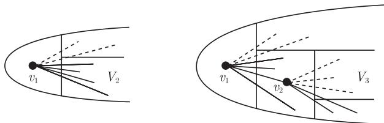

import Guide from '@/components/Guide.astro';
import Knowledge from '@/components/Knowledge.astro';
import Example from '@/components/Example.astro';
import Analysis from '@/components/Analysis.astro';
import Solution from '@/components/Solution.astro';
import Variant from '@/components/Variant.astro';
import Note from '@/components/Note.astro';
import Block from '@/components/Block.astro';
import Method from '@/components/Method.astro';
import Exercise from '@/components/Exercise.astro';

在这一章，我们从一个表面上似乎属于第 7 章中的问题出发：当一个图足够大的时候，什么样的子结构必然出现呢？

7.4 节的正则性引理对这个问题给出了一个可能的答案：每个大的图 $G$ 都包含一个大的“类似于随机图”的子图 (即大部分边均匀地分布)。另一方面，如果我们想找一个给定的具体子图 $H$，那么这个问题就更类似于 Turán 定理 (7.1.1)、Wagner 定理 (7.3.4)，或者 Hadwiger 猜想：也许我们不能期望每个图 $G$ 都包含 $H$ 的拷贝，但若它不包含 $H$，那么它可能具有一些有趣的子图结构。

这一章我们要考虑的典型问题是，当一个图包含某个导出子图时，它具有什么样的结构。比如，给定整数 $r$，是否每一个足够大的图都包含完全子图 $K^r$ 或者一个导出的 $\overline{K^r}$？是否每个足够大的连通图都包含子图 $K^r$ 或者大的导出路或星？

尽管从表面上看，上述问题类似于一个极值问题，但这类问题开创了一个很独特的数学分支。确实，这一章中的定理和证明与代数以及几何中的某些结论有很多共同之处，而远远多于与图论其他方向的共同点。因此，这类问题的研究通常被认为是一个组合分支，称为 Ramsey 理论 (Ramsey theory)。

和本书的主题相符，我们只关注那些可以用很自然的图论语言来表达的结果。然而，即使从广义 Ramsey 理论的角度来看，这样做也并不像想象中的那么局限：图的概念很适合用来描述 Ramsey 问题，并且这一章的内容使用了各种各样的思想和方法来表达这个理论的独特魅力所在。

## 9.1 Ramsey 的原始定理

Ramsey 定理的最简单形式为：给定一个整数 $r \geqslant 0$，每个充分大的图 $G$ 都包含 $K^r$ 或 $\overline{K^r}$ 作为导出子图。乍一看，这让人感到意外：毕竟在 $G$ 中，在所有可能的边中我们需要大约 $(r - 2) / (r - 1)$ 比例的边来保证子图 $K^r$ 的存在性 (推论 7.1.3)，但是 $G$ 或者 $\overline{G}$ 不可能拥有超过一半的所有可能边。然而，正如 Turán 图所显示的那样，在不生成 $K^r$ 的同时尽量添加边到图 $G$ 中会产生新的结构，这也许会帮助我们找到导出子图 $\overline{K^r}$。

那么，如何证明 Ramsey 定理呢？从任意一个顶点 $v_1 \in V_1 := V(G)$ 开始，我们试着递归地在 $G$ 中构造 $K^r$ 或者 $\overline{K^r}$。如果 $|G|$ 很大，那么就存在一个大的顶点集 $V_2 \subseteq V_1 \setminus \{v_1\}$，这个集合中的顶点要么都与 $v_1$ 连接，要么都不与 $v_1$ 连接。相应地，我们可以把 $v_1$ 看成 $K^r$ 或者 $\overline{K^r}$ 的第一个顶点，其他的顶点都在 $V_2$ 中；然后再选取一个顶点 $v_2 \in V_2$ 来构造 $K^r$ 或者 $\overline{K^r}$。因为 $V_2$ 较大，类似地，关于 $v_2$ 也一定存在一个大的顶点子集 $V_3$，使得 $V_3$ 中的所有顶点要么都与 $v_2$ 连接，要么都不与 $v_2$ 连接。接下来继续在 $V_3$ 中进行类似的搜索，照此一直进行下去 (图 9.1.1)。

<figure class="vp-figure">
  
  <figcaption>图 9.1.1 选择序列 $v_1, v_2, \dots$</figcaption>
</figure>

按照这种方法下去，我们可以进行多少步呢？这依赖于初始顶点集 $V_1$ 的大小：每个集合 $V_i$ 的大小至少是前一个集合 $V_{i - 1}$ 的一半，这样的话，如果 $G$ 的阶大约是 $2^s$ 的话，我们就可以完成 $s$ 步构造。正如下列证明中所显示的那样，选取 $s = 2r - 3$ 时，就有足够多的顶点 $v_i$ 使得可以从中找到 $K^r$ 或者 $\overline{K^r}$ 的顶点。

<Knowledge title="定理 9.1.1 (Ramsey, 1930)">
对每个 $r \in \mathbb{N}$，都存在 $n \in \mathbb{N}$，使得每一个阶数至少为 $n$ 的图包含 $K^r$ 或 $\overline{K^r}$ 作为导出子图。

<Solution title="证明">
对于 $r \leqslant 1$，定理显然成立。我们假设 $r \geqslant 2$，并令 $n := 2^{2r - 3}$，同时设 $G$ 是一个阶至少为 $n$ 的图。我们定义一个集合序列 $V_1, V_2, \dots, V_{2r - 2}$ 并选取顶点 $v_i \in V_i$ 满足下列性质：

(i) $|V_i| = 2^{2r - 2 - i} \ (i = 1, \dots, 2r - 2)$；

(ii) $V_i \subseteq V_{i - 1} \setminus \{v_{i - 1}\} \ (i = 2, \dots, 2r - 2)$；

(iii) 顶点 $v_{i - 1}$ 要么与 $V_i$ 中所有顶点连接，要么与 $V_i$ 中的所有顶点都不连接 $(i = 2, \dots, 2r - 2)$。

令 $V_1 \subseteq V(G)$ 是任意一个有 $2^{2r - 3}$ 个顶点的集合，任取 $v_1 \in V_1$。对于 $i = 1$，(i) 成立，而 (ii) 和 (iii) 平凡成立。现在我们假设已经选取了 $V_{i - 1}$ 和 $v_{i - 1} \in V_{i - 1}$ 使得对 $i - 1$ 满足条件 (i)—(iii) ($1 < i \leqslant 2r - 2$)。因为
$$
|V_{i - 1} \setminus \{v_{i - 1}\}| = 2^{2r - 1 - i} - 1
$$
是奇数，所以 $V_{i - 1}$ 有一个子集 $V_i$ 满足 (i)—(iii)，我们任取 $v_i \in V_i$。

在 $2r - 3$ 个顶点 $v_1, \dots, v_{2r - 3}$ 中，有 $r - 1$ 个顶点具有类似于 (iii) 中 $v_{i - 1}$ 的性质，即都满足要么与 $V_i$ 中所有顶点连接，要么与 $V_i$ 中的所有顶点都不连接。相应地，因为对所有的 $i$ 都有 $v_i, \dots, v_{2r - 2} \in V_i$，所以这 $r - 1$ 个顶点和 $v_{2r - 2}$ 在 $G$ 中要么导出 $K^r$，要么导出 $\overline{K^r}$。∎
</Solution>
</Knowledge>

定理 9.1.1 中对应于 $r$ 的最小整数 $n$ 称为 $r$ 的 Ramsey 数 (Ramsey number)，记为 $R(r)$。我们的证明说明了 $R(r) \leqslant 2^{2r - 3}$。在第 11 章，我们会使用简单的概率方法证明 $R(r)$ 的下界为 $2^{r/2}$ (定理 11.1.3)。

换句话说，阶为 $n$ 的图所必须包含的最大团或者最大顶点独立集是 (渐近地) $n$ 的对数大小。然而，只要我们不允许某个导出子图的出现，那么图的阶就会很大：Erdős-Hajnal 猜想指出，对每个图 $H$，存在一个常数 $\delta_H > 0$ 使得每个不包含 $H$ 的导出拷贝的图 $G$ 都包含一个至少 $|G|^{\delta_H}$ 个顶点的集合，这个集合要么是独立集，要么支撑 $G$ 的一个完全子图。

在 Ramsey 理论中，习惯地把划分看成着色：用 $c$ 种颜色 (colours) 给集合 $X$ (中的元素) 着色，简称为 $c$-着色 ($c$-colouring)，即把 $X$ 划分成 $c$ 个类 (每个类对应一个颜色)。特别地，这种着色不需要满足第 5 章中所提到的“不相邻”的要求。给定 $[X]^k$ 的一个 $c$-着色，其中 $[X]^k$ 表示 $X$ 的所有 $k$-子集的集合，我们称一个集合 $Y \subseteq X$ 是单色的 (monochromatic)，如果 $[Y]^k$ 的每个元素都着相同的颜色，$^1$ 即属于 $[X]^k$ 的 $c$ 个划分类中的同一个。类似地，如果 $G = (V, E)$ 是一个图，并且在 $G$ 的一个边着色中，$H \subseteq G$ 的所有边都着同一种颜色，我们称 $H$ 是 $G$ 的一个单色子图 (monochromatic subgraph)，称其为 $G$ 中的红色 $H$ (绿色 $H$ 等)，诸如此类。

用上面的术语，Ramsey 定理可以表述为：对于每一个 $r$，都存在 $n$ 使得对于任意给定 $n$ 个元素的集合 $X$，每一个 $[X]^2$ 的 2-着色都有一个单色的 $r$-集合 $Y \subseteq X$。有趣的是，对任意的 $c$ 和 $k$，这个结论对在 $[X]^k$ 上的 $c$-着色都成立，并且证明几乎完全相同！

我们首先证明比较简单的无限集的情形，然后推出有限集的情形。

<Knowledge title="定理 9.1.2">
令 $k$ 和 $c$ 是正整数，而 $X$ 是一个无限集。如果用 $c$ 种颜色来给 $[X]^k$ 着色，则 $X$ 有一个无限的单色子集。

<Solution title="证明">
对于固定的 $c$，我们对 $k$ 使用归纳法来证明定理。当 $k = 1$ 时，结论显然成立。故设 $k > 1$ 并且假设结论对较小的 $k$ 成立。

用 $c$ 种颜色对 $[X]^k$ 进行着色。我们将构造一个 $X$ 的无限子集的无穷序列 $X_0, X_1, \dots$，并且对所有的 $i$，选取元素 $x_i \in X_i$ 满足下面的条件：

(i) $X_{i + 1} \subseteq X_i \setminus \{x_i\}$；

(ii) 对于 $Z \in [X_{i + 1}]^{k - 1}$，所有 $k$-子集 $\{x_i\} \cup Z$ 都着相同的颜色，我们称这种颜色与 $x_i$ 关联 (associate)。

我们从 $X_0 := X$ 开始并任取 $x_0 \in X_0$。根据假设，$X_0$ 是无限的。对于某个 $i$，取定一个无限集 $X_i$ 和 $x_i \in X_i$，我们对 $[X_i \setminus \{x_i\}]^{k - 1}$ 进行 $c$-着色：把每个集合 $Z$ 用 $[X]^k$ 的 $c$-着色中 $\{x_i\} \cup Z$ 的颜色来着色。由归纳假设，$X_i \setminus \{x_i\}$ 有一个无限的单色子集，把它取作 $X_{i + 1}$。显然，这个选择满足条件 (i) 和 (ii)。最后，我们任取 $x_{i + 1} \in X_{i + 1}$。

由于 $c$ 是有限的，在 $c$ 种颜色中必有一种颜色关联无限多个 $x_i$，这些 $x_i$ 构成了 $X$ 的一个无限单色子集。∎
</Solution>
</Knowledge>

有限情形的定理 9.1.2 可以用无限情形的相同方法证明。但是为了确保在归纳法的每一步，相关的集合都足够大，我们必须留意集合的大小，这就涉及大量繁琐的计算。只要我们不关心界的大小，更好的办法是通过使用“紧致性”的方法，即使用 König 的无限引理 (8.1.2)，从无限的情形推导出有限情形。

<Knowledge title="定理 9.1.3">
对所有的 $k, c, r \geqslant 1$，存在一个 $n \geqslant k$，使得关于 $[X]^k$ 的任意一个 $c$-着色，每个 $n$-集合 $X$ 都有一个单色的 $r$-子集。

<Solution title="证明">
按照集合论中的习惯，我们用 $n \in \mathbb{N}$ 表示集合 $\{0, 1, \dots, n - 1\}$。假设对某个 $k, c, r$，命题不成立。那么对每个 $n \geqslant k$，都存在一个 $n$-集合 (不妨设为集合 $n$) 以及一个 $c$-着色 $[n]^k \to c$，使得 $n$ 不包含单色的 $r$-集合。我们称这种着色为坏的 (bad)，所以假设对每个 $n \geqslant k$，都存在一个 $[n]^k$ 的坏着色。我们的目标是把这些坏着色结合起来成为 $[\mathbb{N}]^k$ 的一个坏着色，从而与定理 9.1.2 矛盾。

对每个 $n \geqslant k$，令 $V_n \neq \varnothing$ 是 $[n]^k$ 的坏着色集合。当 $n > k$ 时，任意 $g \in V_n$ 到 $[n - 1]^k$ 的限制 $f(g)$ 仍然是坏的，因此仍然在 $V_{n - 1}$ 中。由无限引理 (8.1.2) 知，存在一个坏着色 $g_n \in V_n$ 的无限序列 $g_k, g_{k + 1}, \dots$，使得对所有 $n > k$，有 $f(g_n) = g_{n - 1}$。对每个 $m \geqslant k$，所有满足 $n \geqslant m$ 的着色 $g_n$ 在 $[m]^k$ 上是一致的，故对每个 $Y \in [\mathbb{N}]^k$ 和所有 $n > \max Y$，$g_n(Y)$ 的值相同。我们把 $g_n(Y)$ 的这个公共值定义为 $g(Y)$ 的值，那么 $g$ 是 $[\mathbb{N}]^k$ 的一个坏着色：每个 $r$-集合 $S \subseteq \mathbb{N}$ 包含在某个足够大的 $n$ 中，所以 $S$ 不可能是单色的，这是因为 $g$ 和坏着色 $g_n$ 在 $[n]^k$ 上是一致的。∎
</Solution>
</Knowledge>

定理 9.1.3 中，对应于 $k, c, r$ 的最小整数 $n$ 叫做关于这些参数的 Ramsey 数 (Ramsey number)，记为 $R(k, c, r)$。
